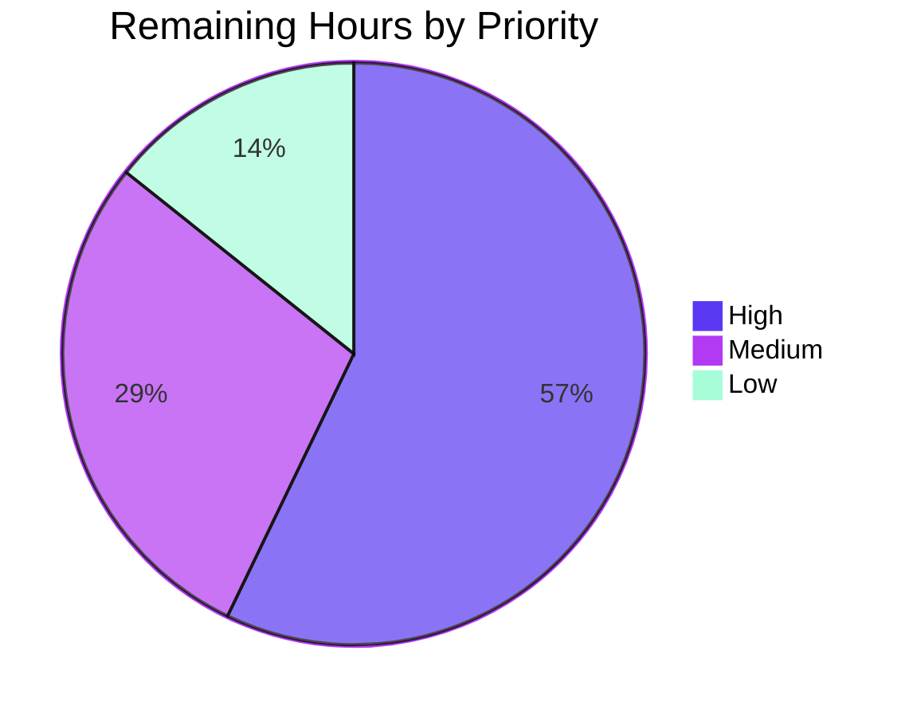

# 1. Executive Summary

## 1.1 Project Overview

`hello_world` is a single-module Node.js HTTP service that answers two fixed plain-text strings on `127.0.0.1:3000`. This release makes Express the routing layer and its first runtime dependency, and adds `GET /good-evening` beside the existing `GET /`. Both are byte-level contracts: `Hello, World!\n` (14 bytes) unchanged and `Good evening\n` (13 bytes) new, each at `200` with `Content-Type: text/plain` and no charset parameter. Scope was two files, one dependency, one route — no configuration surface, persistence, UI or documentation.

## 1.2 Completion Status

**72% complete — 9.0 hours delivered of 12.5 total, 3.5 hours remaining.** Every stated requirement is delivered and verified; what remains is production readiness.


| Metric | Hours |
|---|---|
| Total Hours | 12.5 |
| Completed Hours (Baseline: Human with agentic-assist) | 9.0 |
| Remaining Hours | 3.5 |

Calculation: (9.0 completed / 12.5 total) × 100 = **72.0%**.

## 1.3 Key Accomplishments

- `GET /good-evening` answers `200`, `text/plain` with no charset parameter, and exactly `Good evening\n` (13 bytes) — `server.js:9`.
- `GET /` still answers `200` with the same media type and exactly `Hello, World!\n` (14 bytes) — `server.js:8`.
- Express is the routing layer and the only runtime dependency: one require, one manifest entry — `server.js:2`, `package.json:11-13`.
- The Express app is now the listener of the existing `http.Server`; bind, port and startup line are unchanged — `server.js:7`, `server.js:11`, `server.js:13-15`.
- Every other path and method answers Express's default `404`, and neither route reads a request value, so no credential or cookie changes a response.
- Two files changed (10 insertions, 6 deletions); lockfile, README and every other path untouched.

## 1.4 Critical Unresolved Issues

None of the four requirements the request stated is open — **0 of 4** — and no agreed requirement is unresolved: **0 of 30 open**. Four production-readiness items remain, all outside that scope:

| Issue | Impact | Owner | ETA |
|---|---|---|---|
| `package.json` declares `express ^5` while `package-lock.json` records no express entry (`package-lock.json:1-13`). | `npm ci` fails with `EUSAGE`; resolved versions can drift between hosts. | Platform / DevOps | 1 day |
| No automated check pins the byte-exact status, media type or body of either route; the contract rests on the raw response API (`server.js:8-9`). | A later switch to `res.send`/`res.type` would silently append `; charset=utf-8` and break both endpoints. | Application developer | 1–2 days |
| Slow-client request expiry was never driven to completion; an incomplete request holds its socket until Node's default headers timeout. | Behaviour at expiry is unverified, and the socket is held for the default timeout. | QA | Folded into the check above |
| No deployment configuration or runbook: port 3000 is a source literal with no override, `NODE_ENV` is unset, and there is no health check or request log. | A second instance on one host dies with `EADDRINUSE`, and a wedged instance is invisible beyond a missing startup line. | Operations | 1 day |

## 1.5 Access Issues

No access issues identified — no credential, endpoint or secret is needed to build, run or verify.

## 1.6 Recommended Next Steps

1. **[High]** Pin both routes' status, charset-free media type and exact bytes in an automated check, with a slow-client timeout case.
2. **[Medium]** Regenerate and commit `package-lock.json`, then move the pipeline from `npm install` to `npm ci`.
3. **[Medium]** Write the deployment runbook: `NODE_ENV=production`, one instance per host for the fixed port, and an external probe of both routes.
4. **[Low]** Put a reverse proxy in front for the hardening headers and rate limiting, and to hide `X-Powered-By`.

# 2. Project Hours Breakdown

## 2.1 Completed Work Detail

| Component | Hours | Description |
|---|---|---|
| Express dependency declaration | 1.0 | `dependencies` appended to `package.json` holding only `"express": "^5"`, every pre-existing field kept in value, order and indentation, the license line gaining its trailing comma, and the range proven to resolve in its major (`package.json:11-13`). |
| Express routing layer and route migration | 1.5 | Express required in the existing CommonJS form, the application constructed at module scope, both routes registered one per line carrying the original three response statements verbatim, and the still-`require`d `http` module reduced to the listener (`server.js:1-11`). |
| Route contract verification | 2.5 | Status, media type and exact byte bodies checked for both endpoints across six process starts, clean restarts, an empty environment and repeated sequential and concurrent traffic; 13- and 14-byte bodies compared byte-for-byte against their literals. |
| Process identity | 1.0 | One `http.createServer(app)` and one `LISTEN` socket on `127.0.0.1:3000`, no wildcard bind, no child processes, the 41-byte startup line emitted once per start on empty stderr, and the port released on `SIGTERM` and `SIGINT`. |
| Unspecified-input defaults and security evaluation | 2.5 | Express's own `404`, `HEAD`, `OPTIONS` and `X-Powered-By` behaviour confirmed for every path and method outside the two routes, plus the two-route attack surface probed for header and identity blindness, traversal, reflected payloads, CRLF injection, oversized bodies and smuggling. |
| Delivery-scope integrity | 0.5 | Two-path change set with no file added, deleted or renamed; lockfile, README and marker files byte-identical to the base commit; no stray marker, comment or unused construct in either delivered file. |
| **Total** | **9.0** | |

## 2.2 Remaining Work Detail

| Category | Hours | Priority |
|---|---|---|
| Reproducible dependency installation — regenerate and commit `package-lock.json` for `express ^5`, switch the pipeline to `npm ci`, re-run the two-route byte-exact check | 1.0 | Medium |
| Contract regression check — automate status, charset-free media type and exact body bytes for both routes, plus one slow-client request driven to the headers timeout | 2.0 | High |
| Deployment runbook and runtime settings — install command, `NODE_ENV=production`, fixed-port serialisation, external probe of both routes | 0.5 | Low |
| **Total** | **3.5** | |

## 2.3 Calculation and Confidence

Completed hours come from the six delivered components above; remaining hours come from the three production-readiness categories. 9.0 + 3.5 = 12.5 total, and (9.0 / 12.5) × 100 = 72.0%.

Confidence is **high** on the completed side: every hour traces to a component whose behaviour was exercised and whose result is reproducible from the repository. It is **medium** on the remaining side: the contract regression check is well understood at 2.0 hours, while the lockfile work depends on a decision that the delivered scope excludes and the runbook depends on where the service will be deployed. No remaining hour is allocated to an agreed requirement, because none is outstanding.

# 3. Test Results

All checks below were executed against this working tree on Node v22.23.5 with npm 11.21.3 and `express` 5.3.0 resolved from the declared range. The project ships no test framework, so each check is a `curl` or raw-socket exchange asserted by a shell comparison — the framework column says so rather than implying a suite that does not exist. Every count is an observed result, not an estimate.

| Area / Category | Framework | Tests | Passed | Failed | Coverage | What This Proves |
|---|---|---|---|---|---|---|
| Route response contract (both endpoints) | curl + shell assertions | 15 | 15 | 0 | Not instrumented | Both endpoints answer `200` with `Content-Type: text/plain` and no charset parameter, and bodies of exactly 14 and 13 bytes matching their literals. |
| Unspecified input and framework defaults | curl + shell assertions | 23 | 23 | 0 | Not instrumented | Thirteen named unmatched paths and five non-GET methods fall through to Express's default `404`, while `HEAD` answers `200` bodyless and `OPTIONS` returns `Allow: GET, HEAD`. |
| Dependency declaration and resolution | node probes + npm | 8 | 8 | 0 | Not instrumented | `express ^5` is the only declared dependency, the manifest key set and order are intact, no forbidden field exists, the package resolves to major 5 in this checkout and is not installed globally. |
| Startup, bind and log surface | ss/lsof + shell assertions | 11 | 11 | 0 | Not instrumented | One listener on `127.0.0.1:3000`, no wildcard bind, a single 41-byte startup line, empty stderr, and no request-derived value in the log after traffic. |
| Lifecycle and configuration surface | shell assertions | 7 | 7 | 0 | Not instrumented | A restart reproduces byte-identical bodies and an identical startup line; `PORT`/`HOST` cannot override the bind; an empty environment still serves both routes exactly. |
| Security posture of the two-route surface | curl + raw-socket probes | 14 | 14 | 0 | Not instrumented | Credential-bearing, traversal, CRLF-in-path, 1 MB body and `TE`+`CL` requests change no response, leak no file content and inject no header; no cookie is set. |
| Concurrency and idempotence | 25 parallel requests per route | 2 | 2 | 0 | Not instrumented | Fifty concurrent requests returned exactly one distinct body per route with no off-size response. |
| **Total** | | **80** | **80** | **0** | | |

### Not Covered

- **No automated suite exists, so nothing guards the contract between releases.** `npm test` runs the placeholder `echo "Error: no test specified" && exit 1` (`package.json:6-8`) and exits non-zero by design. The byte-exact media-type requirement survives only because the handlers use `res.statusCode`, `res.setHeader` and `res.end` (`server.js:8-9`); `res.send` or `res.type` would append `; charset=utf-8` and break both endpoints with nothing to catch it.
- **Slow-client request expiry was never reached.** A truncated request line, headers without a terminating blank line, and a declared `Content-Length` larger than the body each produced no reply inside a 1.5–3 s window while the service stayed healthy; Node's 60 s headers timeout was not driven to expiry. A human should decide whether that hold needs bounding.
- **No rendered surface could be tested.** No `200` response carries HTML, and no template, stylesheet or client-side code exists, so browser-driven verification has no subject.
- **No authenticated flow could be exercised.** Neither route authenticates, issues a token or opens a session; the absence was verified (credential-bearing requests return identical bytes, no `Set-Cookie`, no `WWW-Authenticate`) rather than assumed.
- **No operational surface exists to test.** There is no health, metrics or tracing endpoint to probe (`404` like any unmatched path) and no container, CI pipeline, reverse proxy or process supervisor in the repository, so nothing beyond a foreground `node server.js` was exercised.
- **No load or soak testing beyond 25 concurrent requests per route**, and no performance profiling: the responses are constants and the response path is O(1), so throughput was not characterised.

# 4. Runtime Validation & UI Verification

Each line records a flow that was actually driven against a running process, with what was observed. Two entries are partial and one is not applicable; those are the areas nothing exercised.

- ✅ **Startup** — `node server.js` prints `Server running at http://127.0.0.1:3000/` exactly once, binds a single loopback socket, and writes nothing to stderr.
- ✅ **`GET /`** — `HTTP/1.1 200 OK`, `X-Powered-By: Express`, `Content-Type: text/plain`, `Content-Length: 14`, body `Hello, World!\n`; identical on every one of six starts and after a restart.
- ✅ **`GET /good-evening`** — `HTTP/1.1 200 OK`, `Content-Type: text/plain`, `Content-Length: 13`, body `Good evening\n`; no `charset` parameter in the raw header bytes.
- ✅ **Unmatched paths and methods** — thirteen named paths and `POST`/`PUT`/`PATCH`/`DELETE`/`TRACE` all answer Express's default `Cannot GET …` `404`; `HEAD` answers `200` with a zero-byte body; `OPTIONS` answers `200` with `Allow: GET, HEAD`; no `5xx` appeared anywhere.
- ✅ **Restart and shutdown** — `SIGTERM` and `SIGINT` release the port without error output, and the fresh process returns byte-identical bodies with an identical startup line.
- ✅ **Configuration surface** — `PORT=9999 HOST=0.0.0.0` changes nothing (the bind stays `127.0.0.1:3000` and `9999` refuses connections), and a boot under an empty environment still serves both bodies exactly.
- ✅ **Hostile input** — forged `Authorization`/`Cookie`/`X-Forwarded-User`, traversal and direct file paths, `%0d%0a` in the path, a 1 MB `POST` body and a `Transfer-Encoding`+`Content-Length` request all behaved inertly: identical bodies, `404`, or `400`.
- ⚠ **Slow-client requests** — an incomplete request held its socket with no reply inside the probe window while the service stayed healthy; the timeout was never driven to expiry.
- ⚠ **Deployment runtime** — only a foreground `node server.js` was exercised; no container, supervisor, reverse proxy or CI stage exists to run the service under.
- ❌ **User interface** — not applicable: no screen, template, stylesheet or asset exists, and every `200` response is plain text.

**Never exercised at runtime:** slow-client timeout expiry, any rendered or browser-driven surface (none exists), an authenticated flow (no authentication, token or session exists), health and metrics endpoints (absent by design), and any deployment platform or process supervisor.

# 5. Compliance & Quality Review

## 5.1 Compliance Matrix

| Deliverable | Benchmark | Status | Evidence |
|---|---|---|---|
| `GET /good-evening` contract | Functional correctness against the stated contract | ✅ Pass | `server.js:9`; observed `200`, `text/plain`, 13-byte `Good evening\n` |
| `GET /` backward compatibility | Existing behaviour preserved | ✅ Pass | `server.js:8` carries the original three statements verbatim; observed 14-byte `Hello, World!\n` |
| Express routing integration | Declared dependency closes against the import | ✅ Pass | `server.js:2` ↔ `package.json:11-13`; resolves to 5.3.0 |
| Process identity | Bind, port and startup output unchanged | ✅ Pass | `server.js:4-5`, `server.js:13-15` byte-identical to the base commit |
| Change-set discipline | Minimal diff, nothing unrelated touched | ✅ Pass | Two modified paths, 10 insertions, 6 deletions; lockfile and README byte-identical |
| Secrets and credentials | No secret, key or token in source | ✅ Pass | No credential-shaped literal in either file; log carries none after credential-bearing traffic |
| Input handling and injection | No unvalidated input path and no sink | ✅ Pass | `req` is never dereferenced; both bodies are module literals; traversal, CRLF and oversized probes inert |
| Dependency hygiene | Published package, reproducible resolution | ⚠ Partial | `express ^5` is published and patched, but no lockfile entry pins the resolved tree |
| Code hygiene | No placeholders, dead code or stray markers | ✅ Pass | Zero TODO/FIXME markers and zero comments; six live response statements |
| Observability | Startup signal without sensitive output | ⚠ Partial | One 41-byte startup line and no request log, health check or metrics endpoint |
| Automated tests | Regression protection for delivered behaviour | ❌ Not met — excluded by the agreed scope | No suite exists; `npm test` is the placeholder that exits 1 |
| Deployment readiness | Installable and operable by another team | ⚠ Partial | Installs and runs with `npm install` + `node server.js`; no `npm ci` path, runbook or supervisor |

## 5.2 AAP & Rule Divergences and Gaps

Five divergences were established. Each is a fact about this repository, and each is reported whether or not it needs action.

| What the AAP/Rule Required | What Was Delivered Instead | Why It Diverged | Impact | Remediation |
|---|---|---|---|---|
| Validation limited to reading the two files back: no dependency install, no server started, no request issued (plan §0.2.3, §0.7.1). | The declared dependency was installed and both routes were exercised with real requests, including adversarial probes. | Sanctioned — the environment's setup instructions mandate install, syntax check and a byte-exact two-route smoke test, and they outrank the plan's validation preference. | None on the deliverable; the contract is proven by observed responses rather than by reading literals. | None. |
| No lockfile created or committed; `package-lock.json` left exactly as it stands (plan §0.1.2, §0.3.2). | `package.json` declares `express ^5` while `package-lock.json` records no express entry (`package-lock.json:1-13`). | Sanctioned — the request forbids a lockfile change, so the manifest/lockfile mismatch is the required state. | `npm ci` fails with `EUSAGE`; the resolved minor and 64 transitive packages are unpinned and can drift between installs. | Regenerate and commit the lockfile in a separate change, then switch the pipeline to `npm ci` (1.0 h). |
| Both files read exactly as the agreed listings, which end with a newline (plan §0.6.2). | Content matches, but `package.json` ends without a trailing newline. | Sanctioned — §0.6.1 requires both files keep their existing line endings and §0.1.2 forbids reformatting; the original file had no trailing newline. | One character short of the listing; a tool that later appends to the manifest sees a spurious last-line diff. | None required; add the newline only as part of a legitimate future edit. |
| Standing style expects one statement per line and no duplicated logic. | Each route carries three statements on one line (`server.js:8` is 127 characters, `server.js:9` is 138) and the six-statement sequence is duplicated rather than shared. | Sanctioned — the request requires the most line-compact form and forbids refactoring or extracting a helper. | Two long lines and a duplicated sequence; readability and lint cleanliness only. | None under the current constraint; extract a helper only if the no-refactor constraint is lifted. |
| Standing quality benchmark expects delivered behaviour to carry automated tests. | No test suite ships; `npm test` remains the placeholder `echo "Error: no test specified" && exit 1` (`package.json:6-8`). | Sanctioned — the request forbids adding tests or changing the test script. | The byte-exact media-type contract has no regression guard: a switch to `res.send`/`res.type` would break both endpoints silently. | Add the contract regression check, including a slow-client timeout case (2.0 h). |

**Validation method.** The plan scoped validation to reading the two delivered files back, with no install, no server start and no request issued. The environment's setup instructions require the opposite — install the declared dependency, syntax-check the file and issue both requests with byte assertions — and they take precedence over the plan's validation preference. The delivered files are unaffected either way; the only consequence is evidential, and in the reader's favour, because the contract is proven by observed responses rather than by reading literals. No action follows.

**Manifest and lockfile.** The request forbids creating or committing a lockfile, so `package-lock.json` was left exactly as it stood while `package.json` gained `express: ^5`. The lockfile therefore records neither express nor its transitive tree. `npm ci` fails immediately with `EUSAGE` and `Missing: express@5.3.0 from lock file`, so any pipeline must install with `npm install`, and the resolved minor plus 64 transitive packages are free to move between installs. A fresh install today resolves 5.3.0 with a patched `body-parser` 2.4.0. The decision needed is whether to authorise a separate change that regenerates and commits the lockfile, then switches CI to `npm ci`.

**Manifest line ending.** The agreed listing shows `package.json` ending with a newline; the delivered file does not, because the original file did not and the plan requires both files keep their existing line endings while forbidding any reformatting. The line-ending rule is the more specific instruction, so the file complies with it and sits one character short of the listing. Nothing reads that last byte today; the only cost is a spurious last-line diff for a tool that later appends to the manifest. Leave it as delivered and add the newline only as part of a legitimate future edit.

**Route line shape and duplication.** The plan requires the most line-compact form — one line per route carrying the original three response statements verbatim — and forbids refactoring, renaming or extracting a helper. `server.js:8` is therefore 127 characters and `server.js:9` is 138, each holding `res.statusCode`, `res.setHeader` and `res.end`, and that sequence appears twice rather than once inside a shared function. Style guides and linters expect one statement per line and no duplicated logic. The trade is deliberate and confined to two lines; extraction becomes worthwhile only if the no-refactor constraint is ever lifted.

**Absent automated tests.** The standing expectation is that delivered behaviour carries automated tests. The request forbids adding a suite, adding a test file or changing the placeholder `test` script, so nothing was added and `npm test` still exits 1. The gap this leaves is specific and material: each endpoint's byte-exact `text/plain`-without-charset response depends entirely on the raw `res.setHeader` call at `server.js:8-9`, so any later simplification to `res.send` or `res.type` would silently append `; charset=utf-8` and break both contracts with no signal. This is the highest-value remaining task, estimated at 2.0 hours.

# 6. Risk Assessment

| Risk | Category | Severity | Probability | Mitigation | Status |
|---|---|---|---|---|---|
| A later edit replaces the raw `res.setHeader` call with `res.send` or `res.type`, which appends `; charset=utf-8` and breaks both byte-exact contracts with no signal. | Technical | High | Medium | Add the automated contract check of status, media type and exact body bytes for both routes. | Open |
| `express ^5` resolves through an empty lockfile entry, so the minor version and 64 transitive packages drift between installs; the declared range minima also admit advisories in `body-parser` and `path-to-regexp` that are unreachable only because no body parser is mounted and both routes are literal text. | Integration / Security | Medium | Medium | Commit a regenerated lockfile, install with `npm ci`, and run an advisory audit in the pipeline. | Open |
| Port 3000 is a source literal that no environment variable can override, so a second instance on the same host collides and the unhandled listen error terminates the process. | Operational | Medium | High on a shared host | Run one instance per host or serialise startup, and supervise the process so a failed bind is restarted and alerted. | Open |
| The two `200` responses carry no `X-Content-Type-Options`, frame-ancestors, HSTS or `Cache-Control`, no rate limiting, and advertise `X-Powered-By: Express`. | Security | Low | Medium if exposed beyond loopback | Terminate at a reverse proxy that supplies the headers and throttling, and strip `X-Powered-By` there. | Open, accepted by the agreed scope |
| `NODE_ENV` is unset because no environment configuration exists, so any handler that later throws would return a stack trace through Express's default error handler. | Security | Low | Low today (both handlers are non-throwing) | Run the process with `NODE_ENV=production`. | Open |
| The only runtime output is one startup line: no request log, health check, metrics or tracing, so a wedged or half-deployed instance is invisible except by the absence of that line. | Operational | Medium | Medium | Supervise the process and probe both routes externally as the health signal. | Open |
| No `engines` field may be added, so a Node runtime older than 18 fails at run time rather than at install time. | Operational | Low | Low | Document the Node 22 requirement in the runbook and pin it in the deployment image. | Partially mitigated |
| Incomplete requests hold their socket until Node's default headers timeout, and expiry was never driven to completion, so the bound is unverified. | Operational | Low | Low | Cover the timeout in the contract check and bound it at a front proxy. | Open |

# 7. Visual Project Status

**Completion by hours** — Completed Work in Dark Blue (`#5B39F3`), Remaining Work in White (`#FFFFFF`).


**Remaining hours by category** — the same three categories as Section 2.2.

| Category | Hours | Priority | Share of remaining |
|---|---|---|---|
| Contract regression check, including a slow-client timeout case | 2.0 | High | 57% |
| Reproducible dependency installation (lockfile, `npm ci`) | 1.0 | Medium | 29% |
| Deployment runbook and runtime settings | 0.5 | Low | 14% |
| **Total** | **3.5** | | **100%** |



**State by capability**

| Capability | State | Open items it carries |
|---|---|---|
| Route contract — `GET /` unchanged, `GET /good-evening` added | Delivered and verified | No automated guard for the byte-exact media type |
| Dependency declaration and resolution | Delivered and verified | No lockfile entry, so resolution is unpinned |
| Process identity — single listener, loopback bind, startup output | Delivered and verified | No runbook, supervisor or health signal |
| Unspecified-input defaults — `404`, `HEAD`, `OPTIONS`, `X-Powered-By` | Delivered and verified | None |
| Security posture of the two-route surface | Delivered and verified | None beyond the accepted hardening gaps |
| Log surface — one startup line, no request data | Delivered and verified | None |
| Delivery-scope integrity — two files, nothing else touched | Delivered and verified | None |

# 8. Summary & Recommendations

The release delivers the request in full. Express is now the routing layer and the project's only runtime dependency, `GET /good-evening` answers `200` with exactly `Good evening\n` (13 bytes) and `Content-Type: text/plain` carrying no charset parameter, and `GET /` still answers `200` with exactly `Hello, World!\n` (14 bytes) and the identical media type. The Express application replaced the old inline handler as the listener of the existing `http.Server`, so the bind address, the port and the 41-byte startup line are byte-identical to what was there before, and every path or method outside the two routes now falls to Express's own `404`. The change set is two files — 10 insertions, 6 deletions — with the lockfile, README and every other path untouched.

AAP-scoped completion is **72%**: 9.0 hours of delivered, verified work against 12.5 total hours, leaving 3.5. That figure is not a statement about the request: **0 of 30 agreed requirements are open**, and all 30 are met, one of them (the exact byte-for-byte listing of `package.json`) under the line-ending rule that governs it. The 3.5 remaining hours are entirely production readiness — reproducibility, a regression guard, and a runbook — and each traces to a named risk rather than to missing functionality.

The critical path to production is short and ordered. First, add the automated check that pins both routes' status, charset-free media type and exact bodies, including one slow-client request driven to timeout; it is the only thing standing between a future one-line simplification and a silent break of both contracts. Second, decide whether to authorise a commit that regenerates `package-lock.json` so the pipeline can move from `npm install` to `npm ci` and the resolved dependency tree stops drifting. Third, write the runbook: install command, `NODE_ENV=production`, one instance per host or serialised startup for the source-literal port 3000, and an external probe of both routes as the health signal. A reverse proxy in front of the service closes the remaining hardening gap without touching the two files this release was scoped to.

Success is measurable on the terms this service is judged by: both endpoints byte-exact on every start, restart and environment change; one listener, loopback-only, with the same startup line; zero `5xx` and zero file disclosure across every probe; and no credential, cookie or request value able to reach a response or the log. All of that holds today. **Production readiness: ready for its stated purpose as a loopback-bound, unauthenticated, constant-response service; not ready for exposure to an untrusted network**, which needs the proxy-supplied headers and throttling above. Confidence is high on the delivered work and medium on the remaining estimates.

| Measure | Result |
|---|---|
| Agreed requirements met | 30 of 30 |
| Endpoints verified byte-exact | 2 of 2 |
| Checks executed | 80 passed, 0 failed |
| Listener sockets | 1, bound to `127.0.0.1:3000` |
| Files changed | 2 (10 insertions, 6 deletions) |
| Remaining effort | 3.5 hours, three production-readiness items |

# 9. Development Guide

Run every command from the repository root. The commands and their quoted output were all executed against this code on Node `v22.23.5`; results are recorded as observed.

## 9.1 System Prerequisites

- **Node.js 22.x** — verified on `v22.23.5`; any Node 18+ runtime executes this file, but nothing in the manifest pins a version, so a runtime older than 18 fails at start rather than at install.
- **npm 11.x** — verified on `11.21.3`.
- A POSIX shell with `curl`, and `ss` or `lsof` to inspect the listening socket.
- No database, message broker, service endpoint, credential or environment variable is required.

```bash
node -v    # v22.23.5
npm -v     # 11.21.3
```

## 9.2 Install Dependencies

```bash
npm install --no-audit --no-fund
```

Installs the single declared dependency and its transitive tree — 65 packages — resolving `"express": "^5"` to `5.3.0`.

```bash
node -e "console.log(require('express/package.json').version)"   # 5.3.0
```

Two constraints matter here. First, `npm install` rewrites `package-lock.json`, which the delivered change set deliberately does not include; discard the rewrite to keep the tree at the two delivered files:

```bash
git checkout -- package-lock.json
```

Second, do not install with `npm ci`: the committed lockfile records no express entry, so `npm ci` fails by design (see 9.7). Installing with `--no-package-lock` is the alternative that leaves the lockfile untouched — verified to add the same 65 packages with the lockfile's checksum unchanged:

```bash
npm install --no-package-lock --no-audit --no-fund
```

## 9.3 Syntax Gate

```bash
node --check server.js
```

Exit status `0` with no output. There is no build, transpile, bundle or generate step.

## 9.4 Start the Service

```bash
node server.js
```

Expected output, printed once:

```
Server running at http://127.0.0.1:3000/
```

The process binds `127.0.0.1:3000` from source literals in `server.js:4-5` and prints nothing else. `PORT` and `HOST` have no effect — verified: with `PORT=9999 HOST=0.0.0.0` the bind is still `127.0.0.1:3000` and `9999` refuses connections. Stop it with `Ctrl+C`; `SIGTERM` and `SIGINT` both release the port without error output.

## 9.5 Verify Both Routes

Start the service and check both endpoints in one command, so the port is held for a fraction of a second:

```bash
node server.js & sleep 0.5; curl -sD - http://127.0.0.1:3000/; curl -sD - http://127.0.0.1:3000/good-evening; kill %1
```

Observed output:

```
Server running at http://127.0.0.1:3000/
HTTP/1.1 200 OK
X-Powered-By: Express
Content-Type: text/plain
Date: Wed, 25 Nov 2026 13:59:16 GMT
Connection: keep-alive
Keep-Alive: timeout=5
Content-Length: 14

Hello, World!
HTTP/1.1 200 OK
X-Powered-By: Express
Content-Type: text/plain
Date: Wed, 25 Nov 2026 13:59:16 GMT
Connection: keep-alive
Keep-Alive: timeout=5
Content-Length: 13

Good evening
```

Assert the bytes and the header value rather than eyeballing them:

```bash
node server.js & sleep 0.5
printf 'Hello, World!\n' | cmp - <(curl -s http://127.0.0.1:3000/)            && echo 'GET / exact'
printf 'Good evening\n'   | cmp - <(curl -s http://127.0.0.1:3000/good-evening) && echo 'GET /good-evening exact'
curl -sI http://127.0.0.1:3000/good-evening | grep -i '^content-type' | cat -A  # Content-Type: text/plain^M$
curl -s -o /dev/null -w '%{http_code}\n' http://127.0.0.1:3000/missing          # 404
kill %1
```

`cat -A` prints `Content-Type: text/plain^M$` — the absence of `; charset=utf-8` is the point of the check. If `kill %1` does not reach the server because `node server.js` was chained behind other commands, stop the process you started by its port:

```bash
ss -ltn | grep -w 3000
kill $(lsof -ti tcp:3000 -sTCP:LISTEN)
```

## 9.6 Example Usage

```bash
node server.js & sleep 0.5
curl -s http://127.0.0.1:3000/good-evening
curl -s -o /dev/null -w 'status=%{http_code} type=%{content_type}\n' http://127.0.0.1:3000/good-evening
kill %1
```

```
Good evening
status=200 type=text/plain
```

The `type` value carries no charset parameter, which is the whole contract. Any other path or method answers Express's default `404`, and `HEAD` answers `200` with no body while `OPTIONS` reports `Allow: GET, HEAD`.

## 9.7 Troubleshooting

| Symptom | Cause | Resolution |
|---|---|---|
| `Error: Cannot find module 'express'` with exit status 1 at `server.js:2` | The declared dependency is not installed in this checkout. | `npm install --no-audit --no-fund` |
| `npm error code EUSAGE` / `Missing: express@5.3.0 from lock file` | `npm ci` was run against a lockfile that records no express entry — the intended state of this change. | Install with `npm install` (or `--no-package-lock`), or commit a regenerated lockfile before using `npm ci`. |
| `Error: listen EADDRINUSE: address already in use 127.0.0.1:3000`, process exits | Another instance holds the fixed port; the listen error is unhandled, so the process terminates. | `ss -ltn \| grep -w 3000`, then stop the process you started with `kill $(lsof -ti tcp:3000 -sTCP:LISTEN)`; run one instance per host. |
| `Content-Type: text/plain; charset=utf-8` in a response | A handler was changed to `res.send`, `res.type` or `res.status`, which append the charset parameter. | Restore the raw `res.statusCode` / `res.setHeader` / `res.end` sequence at `server.js:8-9`. |
| `PORT` or `HOST` set but the bind never changes | Host and port are source literals; there is no environment configuration. | Expected. Edit `server.js:4-5` if the address must change. |
| `git status` shows `package-lock.json` modified after an install | npm rewrites the lockfile on install. | `git checkout -- package-lock.json` |
| `npm test` exits with status 1 | The project ships no test suite; `test` is the placeholder `echo "Error: no test specified" && exit 1`. | Expected — do not use it as a gate. Use the checks in 9.5. |

# 10. Appendices

## A. Command Reference

| Purpose | Command |
|---|---|
| Check the runtime and package manager | `node -v && npm -v` |
| Install the declared dependency | `npm install --no-audit --no-fund` |
| Discard the lockfile rewrite an install produces | `git checkout -- package-lock.json` |
| Syntax gate | `node --check server.js` |
| Start the service | `node server.js` |
| Fetch both contracts with headers | `curl -sD - http://127.0.0.1:3000/; curl -sD - http://127.0.0.1:3000/good-evening` |
| Assert the exact bodies | `printf 'Hello, World!\n' \| cmp - <(curl -s http://127.0.0.1:3000/)` and `printf 'Good evening\n' \| cmp - <(curl -s http://127.0.0.1:3000/good-evening)` |
| Assert the media type has no charset | `curl -sI http://127.0.0.1:3000/good-evening \| grep -i '^content-type' \| cat -A` |
| Probe unmatched-path behaviour | `curl -s -o /dev/null -w '%{http_code}\n' http://127.0.0.1:3000/missing` |
| Inspect the listening socket | `ss -ltn \| grep -w 3000` |
| Stop the process holding the port | `kill $(lsof -ti tcp:3000 -sTCP:LISTEN)` |
| Review the delivered change | `git diff --stat 6c2a446..HEAD` |

## B. Port Reference

| Port | Bind address | Owner | Configurable |
|---|---|---|---|
| 3000 | `127.0.0.1` (loopback only) | `server.js`, from the source literals at `server.js:4-5` | No — `PORT` and `HOST` are ignored; the address changes only by editing the source |

One listening socket exists per process; a second instance on the same host fails with `EADDRINUSE` and exits. Nothing is reachable on a non-loopback address: the host's routable address refuses the connection.

## C. Key File Locations

| Path | Role |
|---|---|
| `server.js` | The only application file: requires, host/port constants, Express app, the two routes, the listener and the startup log (15 lines) |
| `package.json` | The manifest: `dependencies` holding only `express ^5`, with the pre-existing fields unchanged |
| `package-lock.json` | Committed lockfile that records no express entry — the intended state of this change |
| `README.md` | Pre-existing repository note, unmodified |
| `.blitzyignore.txt`, `test.blitzyignore.txt`, `test.py.txt` | Pre-existing empty marker files, unmodified |

## D. Technology Versions

| Component | Version | Notes |
|---|---|---|
| Node.js | `v22.23.5` | Verified runtime; Node 18+ executes the file, no version is pinned in the manifest |
| npm | `11.21.3` | Verified package manager |
| express | `5.3.0` (declared `^5`) | Sole runtime dependency; current `latest` of the declared major |
| Lockfile format | `lockfileVersion: 3` | Records `hello_world` only; no express entry |
| Build tooling | none | No transpile, bundle, lint, type-check or test tooling in the repository |

## E. Environment Variable Reference

| Variable | Read by the service | Purpose |
|---|---|---|
| — | — | The service reads no environment variable at all; host and port are source literals |
| `PORT`, `HOST` | No | Ignored if set — verified with `PORT=9999 HOST=0.0.0.0` |
| `NODE_ENV` | No | Not read by the code, but set it to `production` when deploying so a future throwing handler cannot return a stack trace |
| `PATH`, `HOME` | Node runtime only | The service boots under an empty environment apart from these and serves both routes exactly |

## F. Developer Tools Guide

- **Gates available:** `node --check server.js` for syntax, the `curl` + `cmp` assertions in 9.5 for behaviour, and `git diff --stat 6c2a446..HEAD` to confirm the change set is still two files.
- **No repository tooling:** there is no linter, formatter, type checker, bundler, coverage tool or test runner to invoke, and none is expected to be added by this change. Adding one is a separate decision that must also decide how the byte-exact media type stays pinned.
- **Live inspection:** `ss -ltn | grep -w 3000` for the socket and `lsof -ti tcp:3000 -sTCP:LISTEN` for its owner.
- **Change-set discipline:** after any local install, run `git checkout -- package-lock.json` so the delivered diff stays at `server.js` and `package.json`.

## G. Glossary

- **Byte-exact contract** — a response whose status, header value and body bytes must match a specification exactly, including the trailing newline.
- **Charset parameter** — the `; charset=utf-8` suffix Express appends to a text media type when a response is sent through `res.send` or `res.type`; it must not appear here.
- **Media type** — the value of `Content-Type`; `text/plain` here, with no parameters.
- **Route** — a method-and-path pair registered on the application object; this service has exactly two, both `GET`.
- **Listener** — the bound socket the process accepts connections on; created by `http.createServer(app)` and started by `server.listen`.
- **Catch-all handler** — the single request handler that answered every path and method before this change; it is retired, and unmatched paths now reach Express's default `404`.
- **Framework default** — behaviour Express supplies for input the contract does not specify, such as a `404` page and the `X-Powered-By` header.
- **Lockfile** — the file recording the exact resolved dependency tree; here it records none, so an install resolves from the manifest's range instead.
- **Unpinned resolution** — a declared range such as `^5` that admits any compatible version, so the resolved version depends on the registry state at install time.
