# Technical Specification

# 1. Introduction

## 1.1 Executive Summary

`hao-backprop-test` is a deliberately minimal Node.js project. It holds seven files, 913 bytes of non-git content, zero external dependencies, and exactly one implementation file: `server.js`, 14 lines that start an HTTP server on the loopback interface and answer every request with the fixed body `Hello, World!`. There is no application framework, no configuration layer, no persistence, and no business domain model. This section describes the system the code actually constitutes, and states plainly where a conventional Introduction field has no evidence behind it.

### Repository Facts

| Attribute | Value | Evidence |
| --- | --- | --- |
| Project name | `hao-backprop-test` (npm package `hello_world`) | `README.md` line 1; `package.json` `name` |
| Version / license | `1.0.0` / MIT | `package.json`, `package-lock.json` |
| Author | `hxu` | `package.json` `author` |
| Implementation | `server.js`, 14 lines, CommonJS, Node `http` module only | `server.js` lines 1-14 |
| Runtime dependencies | None (lockfile contains only the root package entry) | `package-lock.json` `packages[""]` |
| Observed response | `200 OK`, `Content-Type: text/plain`, 14-byte body `Hello, World!\n` | Verified by running `node server.js` and issuing an HTTP request to `127.0.0.1:3000` |
| Runtime verified against | Node.js v22.23.5, npm 11.21.3 | `node --version`, `npm --version` |
| Version control state | One commit (`6c2a446`), branches `main` and `QA-25-nov-branch` with identical content | `git log`, `git diff main QA-25-nov-branch` (empty) |

### Core Business Problem

The repository does not solve a commercial or user-facing problem. It records its own purpose in `README.md` line 2: *"test project for backprop integration. Do not touch!"* The problem it addresses is environmental rather than functional — it supplies a stable, dependency-free, loopback-only HTTP endpoint that an external tooling pipeline referred to as the "backprop integration" can exercise, plus an explicit instruction that the checkout must not be modified so that pipeline's results stay comparable between runs. Nothing inside the repository implements, configures, or documents that integration; there is no client code, no endpoint reference beyond the fixed response, and no CI hook.

### Key Stakeholders and Users

| Stakeholder | Interest or responsibility | Evidence |
| --- | --- | --- |
| Maintainers of the backprop integration | Own the external pipeline this fixture exists to test; rely on the checkout staying unchanged | `README.md` line 2 |
| Repository owner (declared author `hxu`; remote `Sandeep01Kumar/002-existing-projects-qa-test`) | Hosts this project as an entry in a collection of pre-existing projects | `package.json` `author`; `git remote -v` |
| QA / verification engineers | Start the process, issue requests, compare the response against the fixed contract | `server.js` lines 6-14; the `QA-25-nov-branch` branch |
| Local HTTP client or harness | The only consumer of the served content; runs on the same host over loopback | `server.js` lines 3-4 (`127.0.0.1:3000`) |
| Node.js operator | Supplies the runtime and a free TCP port 3000 | `server.js` lines 12-14 |

The repository names no customers, user personas, roles, or organisational units, and its code contains no identity, tenancy, or access-control constructs.

### Expected Business Impact and Value Proposition

- **Deterministic output.** The single handler at `server.js` lines 6-10 ignores the request entirely, so every request — any method, path, or headers — yields byte-identical output. Comparisons across runs reduce to a single string.
- **Zero-install footprint.** `package.json` declares no `dependencies` or `devDependencies`, and `package-lock.json` (`lockfileVersion` 3) contains only the root `""` entry, so an install fetches nothing and the fixture cannot drift through transitive upgrades.
- **No external exposure or credentials.** The listener binds `127.0.0.1` on port 3000 only (`server.js` lines 3-4), and the project contains no secrets, tokens, or outbound calls, so it can run offline inside an isolated environment.
- **Full auditability.** The complete functional surface is 14 lines, making the fixture trivially reviewable when a pipeline result needs explaining.
- **Immutability as a stated property.** *"Do not touch!"* in `README.md` turns stability itself into the deliverable.

Beyond this fixture role the repository carries no product requirements, market metrics, revenue model, or customer commitments, and no KPI, SLA, or telemetry exists anywhere in the tree.


## 1.2 System Overview

### 1.2.1 Project Context

**Business context and market positioning.** `hao-backprop-test` is not a product. `README.md` defines it as a *"test project for backprop integration"* and instructs *"Do not touch!"*, which positions it as an immutable verification fixture rather than a deliverable. Its remote, `https://github.com/Sandeep01Kumar/002-existing-projects-qa-test.git`, places it as the second numbered entry in a collection of pre-existing projects used for quality assurance. The manifest is unpublished in intent as well as in fact: `package.json` carries no `private`, `repository`, `files`, `keywords`, or `engines` field and version `1.0.0`, so nothing marks it as a releasable artifact. The current branch, `QA-25-nov-branch`, holds content identical to `main` (`git diff` between them is empty), consistent with branch-level QA activity on a fixture whose payload never changes.

**Current system limitations.** No earlier system exists in the repository to be replaced or upgraded — history is a single commit, `6c2a446`, "Add files via upload", which introduced all seven files at once (40 insertions). The limitations below therefore describe this system itself.

| Limitation | Evidence | Consequence |
| --- | --- | --- |
| Declared entry point does not exist | `package.json` `main: "index.js"`; no such file; `node .` fails with `Cannot find module '.../index.js'` | The process must be started explicitly as `node server.js`; npm's default entry contract is unusable, and no `start` script is declared (the `scripts` block holds only `test`) |
| No automated verification | `scripts.test` = `echo "Error: no test specified" && exit 1`; `npm test` prints the message and exits 1; no test framework, no CI configuration | Regressions cannot be detected by the repository itself |
| Network binding is hard-coded | `server.js` lines 3-4 (`hostname = '127.0.0.1'`, `port = 3000`); no environment variables or config files are read | Port 3000 must be free and the fixture cannot be relocated without editing source |
| One fixed response, no routing | Handler at lines 6-10 ignores `req`; no path, method, header, or body inspection | No endpoint variety, no API contract beyond the literal payload |
| No lifecycle or error handling | No `server.on('error')`, no `SIGTERM`/`SIGINT` handling, no graceful shutdown, no TLS (`http` only) | Port conflicts surface as an unhandled error; the server runs until the process is killed; traffic is plaintext |
| Minimal observability | A single `console.log` on startup (line 13); no request logging, metrics, or health endpoint | Behaviour can only be inspected from outside the process |
| Inert placeholder files | `test.py.txt`, `.blitzyignore.txt`, `test.blitzyignore.txt` are byte-zero | Filenames suggest test, ignore-list, and Python roles that no content fulfils |

**Integration with the existing enterprise landscape.** The full integration surface is small and fully enumerable from `server.js` and `package.json`:

- **Inbound:** one HTTP listener on the loopback interface, TCP port 3000 (`server.js` lines 3-4, 12-14). No other port, interface, socket, or protocol is opened.
- **Toolchain:** the Node.js standard library `http` module (the only `require` in the tree), and an npm manifest plus `lockfileVersion` 3 lockfile describing an empty dependency graph.
- **Module system:** CommonJS. `package.json` has no `"type"` field, so `.js` files load as CommonJS; `server.js` exports nothing and performs its socket bind as a load-time side effect.
- **External systems:** none. There is no outbound HTTP client, database driver, message broker, identity provider, log shipper, or telemetry agent anywhere in the seven-file tree.
- **The "backprop integration":** referenced only by `README.md` line 2. No artifact in the repository calls it, configures it, or describes its interface.

### 1.2.2 High-Level Description

**Primary system capabilities.** The system has exactly three capabilities, all in `server.js`.

| Capability | Implementation | Observed behaviour |
| --- | --- | --- |
| Bind an HTTP listener | `http.createServer(...)` with `server.listen(port, hostname, callback)` (lines 6-14) | Process listens on `127.0.0.1:3000` |
| Answer every request identically | Handler sets `res.statusCode = 200`, `Content-Type: text/plain`, then `res.end('Hello, World!\n')` (lines 7-9) | `200 OK`, `Content-Length: 14`, body `Hello, World!` |
| Confirm startup on stdout | Listen callback `console.log` (line 13) | Prints `Server running at http://127.0.0.1:3000/` |

**Major system components.** The repository is flat: seven first-order files, no sub-directories.

| Component | Path | Responsibility |
| --- | --- | --- |
| HTTP server module | `server.js` | The only executable code: creates the server, defines the response, binds `127.0.0.1:3000`, logs startup |
| Package manifest | `package.json` | Identity (`hello_world`, `1.0.0`, MIT, author `hxu`), a stale `main` of `index.js`, and a placeholder `test` script |
| Dependency lockfile | `package-lock.json` | Records `lockfileVersion` 3 with a single root `""` entry — a deterministic empty dependency graph |
| Documentation | `README.md` | Two lines: the project name and its purpose/immutability instruction |
| Inert placeholders | `test.py.txt`, `.blitzyignore.txt`, `test.blitzyignore.txt` | Zero bytes each; contribute no behaviour and exclude nothing from tooling |

**Core technical approach.** The design is intentionally the smallest thing that serves bytes over HTTP:

1. **Standard library only.** `const http = require('http')` (line 1) is the project's sole dependency, so the runtime needs no package installation.
2. **Inline closure handler.** A single arrow function passed to `http.createServer` captures `res`, writes status and content type, and ends the response with a fixed string literal. No middleware, router, or template engine participates.
3. **Hard-coded constants.** Host and port are module-scope `const` literals rather than configuration, which removes every configuration failure mode at the cost of portability.
4. **Load-time side effect.** The module neither exports a factory nor guards its `listen` call, so requiring `server.js` binds the socket; the file has no importable API and can only be exercised as a black box over TCP.
5. **No persistence.** The only datum in the system is the string literal `Hello, World!\n`; there is no store, schema, cache, or file written at runtime.

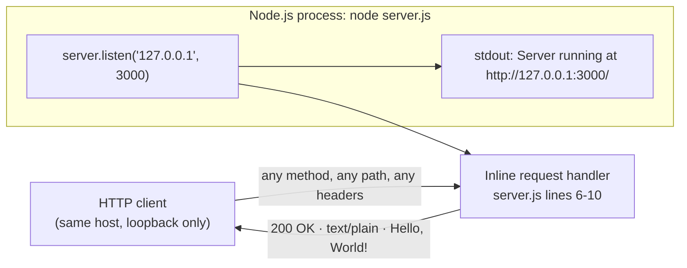

The verified exchange, captured by running the process and requesting the root path:

```text
HTTP/1.1 200 OK
Content-Type: text/plain
Content-Length: 14

Hello, World!
```

Note that the same response is returned for any request, because the handler never reads `req`.

### 1.2.3 Success Criteria

**Measurable objectives.** Each item below was executed against this checkout; there are no aspirational targets, since the repository defines none.

| Objective | Measure | Observed result | Status |
| --- | --- | --- | --- |
| Process starts and reports readiness | Startup line on stdout, exit code retained | `Server running at http://127.0.0.1:3000/` | Met |
| Listener accepts connections on the intended address | TCP connect to `127.0.0.1:3000` | Connection accepted; HTTP exchange completed | Met |
| Response status is success | First status line of the reply | `HTTP/1.1 200 OK` | Met |
| Response media type is as coded | `Content-Type` header | `text/plain` | Met |
| Payload is byte-identical to the coded literal | `Content-Length` and body | `Content-Length: 14`; `Hello, World!` | Met |
| Install footprint is empty | Lockfile package count | One entry: the root `""` package | Met |
| Automated regression detection | `npm test` exercises the server | Prints `Error: no test specified`, exits 1 | Not met |

**Critical success factors.**

- A Node.js runtime is available; the fixture was validated on v22.23.5 with npm 11.21.3, and uses no API newer than the `http` surface that all supported releases provide.
- TCP port 3000 on `127.0.0.1` is free at start, because it is a source literal rather than a parameter.
- The server is launched explicitly as `node server.js`; `node .` fails with `Cannot find module '.../index.js'` because the manifest's `main` points at a file that is not in the tree.
- The checkout remains content-identical to `main` (the branch diff is empty), preserving the comparability the `README.md` instruction demands.
- No network egress is needed: serving succeeds on a host with no registry, proxy, or DNS access.

**Key performance indicators.** The repository defines no KPI, SLO, alert, or metric of any kind — there is no instrumentation beyond one startup log line. The indicators below are the only ones a verifier can compute from outside the process, and none is recorded by the code.

| Indicator | How a verifier derives it | Baseline for this checkout |
| --- | --- | --- |
| Time to readiness | Interval from process start to the startup line on stdout | One log line emitted immediately after bind |
| Response conformance | Share of replies matching status 200, `text/plain`, 14-byte body | All replies, since the handler branches on nothing |
| Dependency count | Packages in `package-lock.json` excluding the root entry | 0 |
| Test coverage | Tests executed by `npm test` | 0 (script exits 1 by design) |
| Availability window | Uptime of the process between start and termination | Unbounded; no shutdown path exists in the code |


## 1.3 Scope

### 1.3.1 In-Scope

**Core features and functionalities.** The scope of this system is fully determined by `server.js`; every capability below is exercised by the single verified exchange described in 1.2.

| Must-have capability | Scope statement | Evidence |
| --- | --- | --- |
| Loopback HTTP listener | Bind TCP port 3000 on `127.0.0.1` at process start | `server.js` lines 3-4, 12-14 |
| Uniform fixed response | Answer every request with status 200, `Content-Type: text/plain`, and the exact body `Hello, World!\n` | `server.js` lines 7-9 |
| Startup confirmation | Write `Server running at http://127.0.0.1:3000/` to stdout once the listener is bound | `server.js` line 13 |
| Dependency-free manifest | Declare project identity with an empty dependency graph, resolvable by npm without fetching packages | `package.json`; `package-lock.json` |
| Direct execution | Run on a stock Node.js install with the single command `node server.js` | Verified on Node.js v22.23.5 |

**Primary user workflows.**

1. **Start the fixture.** An operator or automation step runs `node server.js`; the process binds `127.0.0.1:3000` and prints the readiness line to stdout.
2. **Exercise the fixture.** Any local HTTP client sends a request to `http://127.0.0.1:3000/` — the method, path, and headers are irrelevant — and receives `200 OK` with the fixed 14-byte plain-text body.
3. **Audit the dependency posture.** A maintainer reads `package.json` and `package-lock.json` to confirm that an install fetches nothing and that the fixture cannot drift through transitive upgrades.
4. **Inspect the declared test hook.** A verifier runs `npm test` and confirms that no automated test exists (the script prints `Error: no test specified` and exits 1).

No other workflows exist in the repository: there is no build, no lint, no release, no migration, and no configuration step.

**Essential integrations.**

| Integration | Direction | Mechanism |
| --- | --- | --- |
| Loopback TCP socket | Inbound | `server.listen('127.0.0.1', 3000)`; the only network surface in the project |
| Node.js standard library | Inbound (dependency) | `require('http')` at `server.js` line 1 — the only `require` in the tree |
| npm toolchain | Inbound (tooling) | `package.json` manifest and `package-lock.json` (`lockfileVersion` 3) describing an empty dependency graph |
| Backprop integration | Outbound (external) | Referenced only by `README.md` line 2; no client module, configuration, or endpoint reference exists in the checkout |

**Key technical requirements.**

- A Node.js runtime with the standard `http` module; validated on v22.23.5.
- CommonJS module semantics: `package.json` declares no `"type"`, and `server.js` has no exports.
- TCP port 3000 free on `127.0.0.1`, since the address is a source literal rather than a parameter.
- No environment variables, configuration files, secrets, DNS, or registry access are read or required.
- No files are written at runtime, and no external process is contacted while serving.
- MIT licensing as declared in `package.json` and `package-lock.json`.

**Implementation boundaries.**

| Boundary dimension | Boundary as implemented | Evidence |
| --- | --- | --- |
| System boundary | One process, one source file, one module scope; no sub-modules, packages, or services | `server.js` (14 lines); flat repository root |
| Network boundary | `127.0.0.1:3000` only; plaintext HTTP; no other port, interface, or protocol | `server.js` lines 3-4, 12-14 |
| User groups covered | No end-user groups or roles; only a local operator and a local test client | No identity, tenancy, or access-control code anywhere in the tree |
| Geographic / market coverage | None — loopback-only, English-only literal payload, no localization or i18n assets | `server.js` line 9; absence of any locale handling |
| Data domains included | A single static string literal; no persistence, schema, record, or PII processing | `server.js` line 9; no database driver or data file |
| Tooling boundary | Manifest, lockfile, and three byte-zero placeholders that implement nothing | `package.json`, `package-lock.json`, `test.py.txt`, `.blitzyignore.txt`, `test.blitzyignore.txt` |

### 1.3.2 Out-of-Scope

**Explicitly excluded features and capabilities.** None of the following is present in the checkpoint; each was ruled out by reading every file in the tree and by searching all seven files for the relevant constructs.

| Excluded area | Status | Evidence |
| --- | --- | --- |
| Routing, multiple endpoints, path or method handling | Absent | Handler ignores `req` entirely (`server.js` lines 6-10) |
| Request body, query, header, or form parsing | Absent | No parsing code; no framework or middleware dependency |
| Persistence, database, cache, or file I/O | Absent | No driver, no schema, no write call in `server.js` |
| Authentication, authorization, session, or rate limiting | Absent | No identity or control constructs anywhere |
| TLS/HTTPS, certificates, reverse proxy | Absent | `require('http')` only; no TLS module or proxy config |
| Configuration management, environment variables, secrets | Absent | Host and port are hard-coded literals; no `.env`, no config loader |
| Observability: request logs, metrics, health endpoint, tracing | Absent | Only one startup `console.log` (line 13) |
| Error handling, graceful shutdown, TLS fallback, restart policy | Absent | No `server.on('error')`, no signal handlers, no supervisor config |
| Automated tests and quality gates | Absent | `scripts.test` is the npm placeholder that exits 1; no test framework, no CI workflow, no lint config |
| Build, container, or deployment artifacts | Absent | No CI/Docker/Make config; no `start` script; `main` points at a non-existent `index.js` |
| Python source | Absent | `test.py.txt` is zero bytes and is not executable by any script |
| Ignore-list rules | Absent | `.blitzyignore.txt` and `test.blitzyignore.txt` are both zero bytes, so they exclude nothing |
| Static file serving, templating, or asset pipeline | Absent | Response is a hard-coded literal |
| Multi-tenant, geographic, or localization features | Absent | Loopback-only listener; single English literal |

**Future phase considerations.** The repository documents no roadmap, backlog, TODO, or issue reference: a full search of the tree for `TODO` and `FIXME` returns no matches, history holds a single commit, and `README.md` line 2 explicitly instructs *"Do not touch!"*. No future phase is therefore recorded or implied. The gaps catalogued above — a valid `main` entry point, a working `test` script, externalised host and port, and basic lifecycle handling — are observable absences, not committed work, and this specification does not treat them as planned scope.

**Integration points not covered.**

- The "backprop integration" itself: no client, adapter, contract, schema, or configuration for it exists in the checkout.
- Any external API, package registry publication, database, identity provider, message broker, or log/metric backend.
- Network exposure beyond the loopback interface, including container networking, host port mapping, and ingress.
- Any npm lifecycle hook beyond `test`; no `start`, `build`, `prepublish`, or `postinstall` behaviour is defined.

**Unsupported use cases.**

- Internet-facing or production deployment: the listener is loopback-only, plaintext, unauthenticated, and has no lifecycle management.
- Request-dependent behaviour: because the handler discards `req`, the system cannot serve different content per path, method, version, or caller.
- Stateful or data-driven workflows: there is no store, no input processing, and no output variation.
- Load or capacity commitments: no connection limits, pooling, instrumentation, or performance target exists in code or documentation.
- Name-based entry points: `node .` fails (`Cannot find module '.../index.js'`), and no `start` script is declared, so only `node server.js` works.
- Test or verification automation inside the repository: `npm test` always exits 1 by design.
- Executing the placeholder files: `test.py.txt`, `.blitzyignore.txt`, and `test.blitzyignore.txt` contain no content and perform no function.


## 1.4 References

- `server.js` - the only implementation code in the repository (14 lines): `require('http')` (line 1), hard-coded `hostname = '127.0.0.1'` and `port = 3000` (lines 3-4), the request handler setting `res.statusCode = 200`, `Content-Type: text/plain` and `res.end('Hello, World!\n')` (lines 6-10), and `server.listen` with the startup `console.log` (lines 12-14); also the evidence that the handler ignores `req` and that no error handling, shutdown path, or export exists.
- `README.md` - establishes the project name `hao-backprop-test` (line 1) and the purpose statement *"test project for backprop integration. Do not touch!"* (line 2), which grounds the business problem, stakeholder analysis, immutability property, and future-phase determination.
- `package.json` - establishes project identity (`hello_world`, `1.0.0`, description "Hello world in Node.js", author `hxu`, MIT), the non-existent `main` of `index.js`, the sole `test` script that exits 1, the absence of dependency and `engines` blocks, and the absence of a `"type"` field (CommonJS resolution).
- `package-lock.json` - establishes `lockfileVersion` 3 with the root `""` entry as the only package, confirming a zero-dependency and zero-transitive-dependency install footprint.
- `test.py.txt` - zero-byte placeholder; establishes that no Python source exists despite the filename.
- `.blitzyignore.txt` - zero-byte placeholder; establishes that no path exclusions are configured.
- `test.blitzyignore.txt` - zero-byte placeholder; establishes that no ignore rules are configured.
- Repository root (`""`) - flat structure of exactly seven files and no sub-directories, establishing the system and tooling boundaries.
- `.git` metadata (commit `6c2a446`, branches `main` and `QA-25-nov-branch`, remote `Sandeep01Kumar/002-existing-projects-qa-test`) - establishes the single-commit history, the content-identical QA branch, and the fixture's placement in a collection of pre-existing QA projects.
- Runtime verification of `node server.js` on Node.js v22.23.5 with npm 11.21.3 - established the observed `200 OK`, `Content-Type: text/plain`, `Content-Length: 14`, body `Hello, World!` exchange, the stdout readiness line, the `npm test` exit status of 1, and the `node .` failure caused by the missing `index.js` entry point.


# 2. Product Requirements

## 2.1 Feature Catalog

The checkout delivers exactly four features. Each is evidenced in source and was exercised against Node.js v22.23.5 with npm 11.21.3. No other capability exists in the seven-file tree: a content search of every tracked file for `process.env`, `https`, `on('error'`, `SIGTERM`, and `module.exports` returns no matches, and the three byte-zero placeholders (`test.py.txt`, `.blitzyignore.txt`, `test.blitzyignore.txt`) deliver no behaviour, so they are catalogued as constraint **C-007** in 2.4.5 rather than as features.

| Feature ID | Feature name | Category | Priority · Status |
| --- | --- | --- | --- |
| F-001 | Loopback HTTP Listener | Runtime and Networking | Critical · Completed |
| F-002 | Uniform Fixed Response | Request Handling | Critical · Completed |
| F-003 | Startup Readiness Reporting | Operations and Observability | Medium · Completed |
| F-004 | Dependency-Free Package Metadata | Packaging and Toolchain | High · Completed |

Identifier conventions used throughout section 2: `F-XXX` for features, `F-XXX-RQ-YYY` for functional requirements, `C-XXX` for constraints, `A-XXX` for assumptions. Every feature carries status **Completed** because it is implemented in the checkout as committed at `6c2a446`, not proposed.

### 2.1.1 F-001 — Loopback HTTP Listener

| Metadata field | Value |
| --- | --- |
| Unique ID | F-001 |
| Feature name | Loopback HTTP Listener |
| Feature category | Runtime and Networking |
| Priority level | Critical |
| Status | Completed |
| Implementation | `server.js` lines 3-4 (address constants) and lines 12-14 (`server.listen`) |

**Overview.** The process creates one `http.Server` and binds it to TCP port 3000 on `127.0.0.1` as a load-time side effect of requiring the module. `server.js` line 3 fixes `hostname = '127.0.0.1'` and line 4 fixes `port = 3000`; line 12 calls `server.listen(port, hostname, ...)` with those constants. The module exports nothing and guards the call with no condition, so importing `server.js` binds the socket and there is no importable API — the listener can only be exercised as a black box over TCP. A process launched with `node server.js` was observed accepting a connection on `127.0.0.1:3000` and completing an HTTP exchange; `npm start` reaches the same result because npm falls back to its implicit `node server.js` default when no `start` script is declared, whereas `node .` fails because the manifest's `main` (`index.js`) is absent from the tree.

**Business value.** The listener is the entire delivery mechanism of the fixture: it turns the checkout into a reachable, offline-capable HTTP endpoint for the external pipeline that `README.md` line 2 calls the "backprop integration". Binding the loopback interface rather than a public one keeps that endpoint off every network but the host's own, which is what lets the fixture run inside isolated QA environments with no egress, no DNS, and no credentials.

**User benefits.** An operator gets one fixed, predictable address (`http://127.0.0.1:3000/`) with no configuration to supply and no install or build step to perform first. A verification harness can poll the port and know it is talking to this system, since nothing else in the tree opens a socket.

**Technical context.** The only dependency is the Node.js standard library `http` module (`server.js` line 1); the runtime is CommonJS because `package.json` declares no `"type"` field. There is no TLS, no router, no middleware, no clustering, and no lifecycle management: no `server.on('error')` handler, no signal handlers, and no graceful-shutdown path exists in the file, so a bind failure surfaces as an unhandled error and the process runs until it is killed externally.

| Dependency type | Item | Evidence |
| --- | --- | --- |
| Prerequisite features | F-004 — the manifest must keep resolving `server.js` as CommonJS (no `"type": "module"`) for the bind-on-load behaviour to hold | `package.json` lines 1-11; `server.js` line 1 |
| System dependencies | A Node.js runtime (validated on v22.23.5) and a free TCP port 3000 on `127.0.0.1`, because both values are source literals | `server.js` lines 3-4; observed bind |
| External dependencies | None — no package registry, network egress, database, or credential is contacted | `package-lock.json` single root `""` entry; `server.js` line 1 |
| Integration requirements | Inbound loopback TCP only; optionally invoked through the npm CLI, which resolves the implicit `node server.js` start default | Observed `node server.js` and `npm start` serving on `127.0.0.1:3000` |

### 2.1.2 F-002 — Uniform Fixed Response

| Metadata field | Value |
| --- | --- |
| Unique ID | F-002 |
| Feature name | Uniform Fixed Response |
| Feature category | Request Handling |
| Priority level | Critical |
| Status | Completed |
| Implementation | `server.js` lines 6-10 (inline request handler) |

**Overview.** Every request, whatever its method, path, query, headers, or body, receives the same three-part answer produced by the arrow handler passed to `http.createServer`: `res.statusCode = 200` (line 7), `res.setHeader('Content-Type', 'text/plain')` (line 8), and `res.end('Hello, World!\n')` (line 9). The handler never reads its `req` parameter, so no input influences the output. Observed replies: `GET /`, `POST /arbitrary?x=1` with a form body, and `HEAD /` all returned `200 OK`, `Content-Type: text/plain`, and a 14-byte payload whose bytes are `Hello, World!` followed by a single line feed.

**Business value.** The fixture's value is comparability. Because the handler branches on nothing, two runs of any pipeline against this endpoint reduce to a comparison of one literal string, so a difference points at the pipeline rather than at the endpoint. That determinism is the product.

**User benefits.** A verifier writes assertions against a known status, media type, and exact payload with no fixtures, mocks, or seed data, and gets the same result on every call and every run.

**Technical context.** Node.js contributes the transport details the code does not set: `Content-Length: 14`, `Date`, `Connection: keep-alive`, and `Keep-Alive: timeout=5` were observed on the wire. `Date` therefore changes per request, so byte-exact comparison must cover status line, `Content-Type`, `Content-Length`, and body rather than the whole header block. The handler holds no state and performs no parsing, templating, or serialization; the response type is a hard-coded English literal with no charset parameter and no i18n resource.

| Dependency type | Item | Evidence |
| --- | --- | --- |
| Prerequisite features | F-001 — a request cannot be answered before the listener binds | `server.js` lines 12-14 precede any handling |
| System dependencies | Node.js `http` server response semantics (automatic `Content-Length` and `Date` headers) | Observed response headers on `127.0.0.1:3000` |
| External dependencies | None — no template engine, serializer, static file, or data store participates | `server.js` lines 6-10 |
| Integration requirements | Inbound HTTP/1.1 over loopback; the reply is the complete external contract, so any consumer assertion is written against it | Observed identical replies across three request shapes |

### 2.1.3 F-003 — Startup Readiness Reporting

| Metadata field | Value |
| --- | --- |
| Unique ID | F-003 |
| Feature name | Startup Readiness Reporting |
| Feature category | Operations and Observability |
| Priority level | Medium |
| Status | Completed |
| Implementation | `server.js` line 13, inside the `listen` callback opened at line 12 |

**Overview.** Once the socket is bound, the listen callback writes a single line to stdout: `Server running at http://127.0.0.1:3000/`. The line is a template literal interpolating the same `hostname` and `port` constants the listener used (lines 3-4), so it cannot drift from the actual bind address unless those constants are edited. It is the only `console` call in the repository.

**Business value.** It gives whatever supervises or drives the fixture a readiness marker to wait on, replacing a retry-until-connect loop with a single line to read. For a QA fixture that is started and stopped repeatedly, that reduces flakiness at the boundary between process start and the first request.

**User benefits.** An operator sees immediately that the bind succeeded and which URL to call, without probing the port. A harness can treat the line as the signal to begin exercising the endpoint.

**Technical context.** Suppression, redirection, or capture of stdout is the only control over this output; the code has no log level, formatter, or destination option. No request-level logging, metric, trace, or health endpoint exists, so after startup the process is silent — serving any number of requests produced no further stdout in observation.

| Dependency type | Item | Evidence |
| --- | --- | --- |
| Prerequisite features | F-001 — the callback fires only after a successful bind | `server.js` lines 12-13 |
| System dependencies | A writable stdout on the launching process or supervisor | Observed readiness line in captured process output |
| External dependencies | None — no log shipper, agent, or collector is configured | Absence of any logging dependency in `package.json` |
| Integration requirements | Process supervision must capture or tolerate stdout; the readiness line is the documented start signal | `server.js` line 13 |

### 2.1.4 F-004 — Dependency-Free Package Metadata

| Metadata field | Value |
| --- | --- |
| Unique ID | F-004 |
| Feature name | Dependency-Free Package Metadata |
| Feature category | Packaging and Toolchain |
| Priority level | High |
| Status | Completed |
| Implementation | `package.json` (11 lines) and `package-lock.json` (13 lines) |

**Overview.** The manifest declares the project's identity — `hello_world`, version `1.0.0`, description "Hello world in Node.js", author `hxu`, license `MIT` — and declares no `dependencies`, `devDependencies`, `engines`, `repository`, `files`, `private`, or `"type"` field. Its only script is the npm placeholder `echo "Error: no test specified" && exit 1`. The lockfile records `lockfileVersion` 3 with a single `packages` key, the root `""` package, which means the dependency graph is empty: no direct, transitive, or `node_modules` entries, no version ranges, no tarball URLs, no integrity hashes. Observed: `npm install` reported `up to date, audited 1 package` with `found 0 vulnerabilities` and created no `node_modules` directory; `npm run` listed only `test`; `npm test` printed its message and exited 1.

**Business value.** An empty dependency graph removes the two failure modes that make fixtures unreliable over time — registry availability and transitive upgrade drift. The project installs and runs offline, and its audit surface is one package that contains no third-party code. The MIT declaration gives the checkout an unambiguous licence for use in the collection of QA projects it belongs to.

**User benefits.** A verifier can clone and run without registry access, proxy configuration, or a lockfile refresh. A reviewer can confirm the absence of third-party code by reading a 13-line lockfile instead of an install tree.

**Technical context.** The absence of a `"type"` field is what makes `server.js` load as CommonJS, and the absence of any dependency block is what lets the listener start on a bare Node.js install. Two deviations from npm convention are present and are constraints, not delivered requirements: `main` points at `index.js`, which does not exist in the tree, so `node .` fails; and no `start` script is declared, so `npm start` succeeds only through npm's implicit `node server.js` default. Since `scripts.test` always exits 1, no automated verification lives in the repository and all verification of F-001 to F-003 is external.

| Dependency type | Item | Evidence |
| --- | --- | --- |
| Prerequisite features | None — metadata stands alone and precedes every other feature | `package.json`, `package-lock.json` |
| System dependencies | npm 11.21.3 (observed) for lifecycle scripts; `node` alone suffices to run the server | `npm --version`; `package.json` `scripts` |
| External dependencies | None — no registry entry, tarball, or integrity hash is referenced | `package-lock.json` lines 6-12 |
| Integration requirements | npm may consume the manifest for `install`, `run`, and `start`; nothing in the code reads it at runtime | Observed `npm install`, `npm run`, `npm start`, `npm test` |


## 2.2 Functional Requirements Table

Requirements are stated only for behaviour the checkout actually implements. Each carries a stable `F-XXX-RQ-YYY` identifier, an acceptance criterion a verifier can execute from outside the process, a priority on the Must-Have / Should-Have / Could-Have scale, and a complexity rating on the High / Medium / Low scale. Every requirement below rates Low complexity: the whole implementation is 14 lines of standard-library JavaScript.

| Requirement set version | Contents | Basis | Revision history |
| --- | --- | --- | --- |
| v1.0.0 | 16 requirements: F-001-RQ-001 to F-004-RQ-004 | Commit `6c2a446`; package version `1.0.0`; behaviour observed on Node.js v22.23.5 / npm 11.21.3 | None — initial baseline. No requirement has been revised, superseded, or withdrawn, because the repository has a single commit and `README.md` line 2 instructs that the checkout must not be modified |

### 2.2.1 F-001 Functional Requirements — Loopback HTTP Listener

| Requirement ID | Description | Acceptance criteria | Priority · Complexity |
| --- | --- | --- | --- |
| F-001-RQ-001 | Bind TCP port 3000 on `127.0.0.1` when the process starts, using the module constants at `server.js` lines 3-4 | After `node server.js`, a TCP connect to `127.0.0.1:3000` succeeds and an HTTP exchange completes (observed `200 OK`); a connect to port 3000 on a non-loopback interface of the same host is refused | Must-Have · Low |
| F-001-RQ-002 | Start from the checkout with a single command and no install, build, transpile, or configuration step | On a host with no registry access, `node server.js` prints the readiness line and serves a request; `npm start` reaches the same listener through npm's implicit `node server.js` default; neither command creates an artefact in the tree | Must-Have · Low |
| F-001-RQ-003 | Keep serving after the bind until the process is terminated externally; no self-shutdown, idle timeout, or request-count limit | The process answers requests after arbitrary elapsed time and arbitrary request counts, and stops only on an external signal; the source contains no signal handler, timer, or `close` call | Should-Have · Low |
| F-001-RQ-004 | Open exactly one listener, over plaintext HTTP, on one address; no second port, interface, or protocol | The tracked tree contains exactly one `createServer` and one `listen` call; no `https`, `tls`, or `net` import; no port literal other than 3000 | Must-Have · Low |

| Requirement ID | Input parameters | Output / response | Performance · Data requirements |
| --- | --- | --- | --- |
| F-001-RQ-001 | None — `hostname = '127.0.0.1'` (`server.js` line 3) and `port = 3000` (line 4) are literals | A bound listening socket plus the readiness line from F-003 | Bind executes once during module evaluation, before the listen callback fires; the repository defines no latency target · No data is read or written |
| F-001-RQ-002 | The command line (`node server.js`) and the checkout directory | A running server process and the readiness line on stdout | Startup includes no install or build phase; `npm install` was observed to fetch nothing and create no `node_modules` · No generated artefacts |
| F-001-RQ-003 | None | Continuous availability of `http://127.0.0.1:3000/` | No uptime, throughput, or connection-limit target exists in code or documentation · Nothing is persisted across requests |
| F-001-RQ-004 | None | Exactly one listening socket on one address | Not applicable — no capacity behaviour is expressed · Not applicable |

| Requirement ID | Business rules | Data validation | Security · Compliance |
| --- | --- | --- | --- |
| F-001-RQ-001 | The endpoint address is fixed and identical on every run, which is what makes pipeline comparisons valid | The host must remain a loopback literal and the port an integer in 1-65535 (currently 3000); `git grep` finds no `process.env` or config reader, so values cannot be overridden | Loopback binding keeps the endpoint unreachable from other hosts and needs no firewall rule · No PII, credential, or regulated data is processed |
| F-001-RQ-002 | The runnable entry point is `server.js`; the manifest's `main` (`index.js`) does not exist and `node .` fails | A verifier must not treat `npm test` as a gate — it exits 1 by design (`package.json` line 7) | No install step means no third-party code to vet at start-up · MIT licence declared in `package.json` line 10 |
| F-001-RQ-003 | The serving window is controlled by the operator, not by the code | Termination must come from outside (SIGTERM/SIGINT or a supervisor); the source has no handler for either | Unbounded connections are accepted with no authentication or rate limit, which is acceptable only because the listener is loopback-only and serves a public constant · No audit log exists |
| F-001-RQ-004 | One process serves one endpoint; horizontal copies require separate hosts because the port is hard-coded | Any additional `listen` or port literal would violate the fixed-contract property and must be rejected in review | Plaintext HTTP only; confidentiality relies entirely on the loopback boundary · No certificate or TLS configuration exists |

### 2.2.2 F-002 Functional Requirements — Uniform Fixed Response

| Requirement ID | Description | Acceptance criteria | Priority · Complexity |
| --- | --- | --- | --- |
| F-002-RQ-001 | Return HTTP status 200 for every request, with no conditional branches | `GET /`, `POST /arbitrary?x=1` with a form body, and `HEAD /` each return `200 OK`; the status is assigned unconditionally at `server.js` line 7 | Must-Have · Low |
| F-002-RQ-002 | Send `Content-Type: text/plain` on every response | The reply header is exactly `text/plain`, with no charset parameter or other media-type suffix (`server.js` line 8) | Must-Have · Low |
| F-002-RQ-003 | Return the exact 14-byte body `Hello, World!` followed by one line feed | `Content-Length: 14` and `od -c` of the body shows `H e l l o ,   W o r l d ! \n` with no other bytes (`server.js` line 9) | Must-Have · Low |
| F-002-RQ-004 | Produce an identical reply regardless of method, path, query string, headers, or body; no routing or content negotiation | Requests differing in every one of those dimensions return byte-identical status, media type, and payload; the handler never reads `req` (`server.js` line 6) | Must-Have · Low |
| F-002-RQ-005 | Hold no per-request state, so repeated and concurrent requests receive the same reply | Successive and parallel requests return identical payloads; the only module-scope bindings are `const` declarations, with no mutable request state | Should-Have · Low |

| Requirement ID | Input parameters | Output / response | Performance · Data requirements |
| --- | --- | --- | --- |
| F-002-RQ-001 | A request of any shape; the handler ignores it | `HTTP/1.1 200 OK` | Constant work per request — no branching, lookup, or I/O before `res.end` · No data store consulted |
| F-002-RQ-002 | None | Header `Content-Type: text/plain`; Node.js adds `Date`, `Connection: keep-alive`, `Keep-Alive: timeout=5` | Set once per response; no negotiation or compression · Payload is ASCII, so no charset is needed |
| F-002-RQ-003 | None | Body `Hello, World!\n` (14 bytes) with `Content-Length: 14` | One `res.end` write of a string literal; the runtime computes the length · Literal defined at `server.js` line 9 |
| F-002-RQ-004 | Method, target, query, headers, body — all ignored; an unconsumed request body does not affect the reply | The same 200 / `text/plain` / 14-byte reply for every request shape | Reply cost is independent of request size, since no body is read or parsed · No input is deserialised |
| F-002-RQ-005 | Repeated or concurrent requests | Identical replies in every case | No shared mutable state, so no lock, queue, or session store is needed · Nothing is cached or written |

| Requirement ID | Business rules | Data validation | Security · Compliance |
| --- | --- | --- | --- |
| F-002-RQ-001 | Success is the only outcome the endpoint can produce; a non-200 reply indicates a runtime failure rather than a business outcome | No input is validated because no input is read — the validation surface is intentionally empty | No request data is reflected or interpreted, so there is no reflected-XSS or injection path inside the handler · No authentication or session construct exists |
| F-002-RQ-002 | The media type is part of the contract and must not gain parameters | The header literal must remain `text/plain`; adding a charset would change the compared bytes | Declaring no charset means clients assume US-ASCII for the ASCII payload · No content-disposition or cache header is set |
| F-002-RQ-003 | The payload, including the trailing line feed, is the whole observable contract and must not change | Compare bytes: `Content-Length` must be 14, the final byte must be `0a`; the `Date` header must be excluded from any byte-exact comparison because it varies per request | The payload is a public constant containing no secrets or personal data · No encoding, escaping, or serialisation applies |
| F-002-RQ-004 | No routing, versioning, or content negotiation is offered; consumers must not expect per-path behaviour | Every method and path must return the same reply; adding a branch would break F-002-RQ-004 | Uniform replies mean no method- or path-based privilege difference · No CORS, cookie, or auth header is emitted |
| F-002-RQ-005 | The endpoint is stateless by design and cannot correlate two requests | Identical replies across a repeated series; no module-scope `let`, `var`, or mutable object exists in `server.js` | No identifiers, cookies, or tracking are returned · No request logging (see F-003-RQ-002) means no traffic data is retained |

### 2.2.3 F-003 Functional Requirements — Startup Readiness Reporting

| Requirement ID | Description | Acceptance criteria | Priority · Complexity |
| --- | --- | --- | --- |
| F-003-RQ-001 | Write a single readiness line to stdout once the listener is bound | Captured stdout contains exactly `Server running at http://127.0.0.1:3000/` (`server.js` line 13) | Must-Have · Low |
| F-003-RQ-002 | Emit nothing further: no per-request logging, metrics, traces, or health endpoint | Serving any number of requests adds no stdout; the readiness line is the only `console` call in the tree | Should-Have · Low |
| F-003-RQ-003 | Derive the reported address from the same constants that govern the bind, so the message cannot drift from the actual listener | Editing `server.js` lines 3-4 changes both the bound address and the printed line, because line 13 interpolates `${hostname}` and `${port}` | Should-Have · Low |

| Requirement ID | Input parameters | Output / response | Performance · Data requirements |
| --- | --- | --- | --- |
| F-003-RQ-001 | None | One stdout line terminated by the newline `console.log` appends | Emitted once per process, immediately after the bind completes · No log file is written |
| F-003-RQ-002 | Any volume of traffic | No additional output on stdout or stderr during normal serving | Zero logging I/O per request; log volume is constant regardless of load · No metrics store exists |
| F-003-RQ-003 | The values of `hostname` and `port` (`server.js` lines 3-4) | The interpolated template literal at line 13 | Compile-time interpolation of two constants, no runtime lookup · Single source of truth for address values |

| Requirement ID | Business rules | Data validation | Security · Compliance |
| --- | --- | --- | --- |
| F-003-RQ-001 | The readiness line is the signal that the endpoint may be exercised | The string must match exactly, including scheme, host, port, and trailing slash; a changed message breaks any supervisor that waits for it | Discloses only a loopback URL and port · No audit or retention requirement applies |
| F-003-RQ-002 | The process is silent while serving, so silence must not be read as failure | Capture stdout while sending requests; any new output is a deviation | Because nothing is logged, request data cannot leak through logs — a deliberate consequence of the absent logging layer · No access log to retain |
| F-003-RQ-003 | Address values must exist in exactly one place | Change line 3 or 4 and re-run: bind target and message must both change together | No secret or credential is interpolated · Not applicable |

### 2.2.4 F-004 Functional Requirements — Dependency-Free Package Metadata

| Requirement ID | Description | Acceptance criteria | Priority · Complexity |
| --- | --- | --- | --- |
| F-004-RQ-001 | Declare a complete, stable package identity in the manifest | `package.json` contains `name` `hello_world`, `version` `1.0.0`, `description` "Hello world in Node.js", `author` `hxu`, and `license` `MIT` (lines 2-10) | Must-Have · Low |
| F-004-RQ-002 | Keep the dependency graph empty for both direct and transitive dependencies | No `dependencies`, `devDependencies`, `peerDependencies`, or `optionalDependencies` block exists; the lockfile's `packages` map holds only the root `""` key; `npm install` reports `audited 1 package`, `found 0 vulnerabilities`, and creates no `node_modules` | Must-Have · Low |
| F-004-RQ-003 | Load `server.js` as a CommonJS module so the bind-on-load behaviour holds | No `"type"` field is present; `server.js` uses `require('http')` and no `import`/`export` syntax; `node server.js` starts without a module-resolution error | Must-Have · Low |
| F-004-RQ-004 | Declare the licence once, consistently, in both manifest and lockfile | `package.json` line 10 and `package-lock.json` line 10 both specify `MIT` as an SPDX identifier | Should-Have · Low |

| Requirement ID | Input parameters | Output / response | Performance · Data requirements |
| --- | --- | --- | --- |
| F-004-RQ-001 | The manifest text (251 bytes) | Metadata resolvable by npm without registry access | Negligible size; parsed only by tooling, never at runtime · Fields at `package.json` lines 2-10 |
| F-004-RQ-002 | An `npm install` or `npm ci` invocation | `up to date, audited 1 package`, `found 0 vulnerabilities`, no `node_modules` created | Observed install completed in 142 ms with nothing fetched · Lockfile is 247 bytes, `lockfileVersion` 3, one `packages` key |
| F-004-RQ-003 | `node server.js` | The module evaluates and the listener binds | No transpile or resolution beyond one standard-library import · No import/export syntax in the tree |
| F-004-RQ-004 | Both metadata files | `MIT` present in each | Not applicable · Duplicated declaration must stay in sync across two files |

| Requirement ID | Business rules | Data validation | Security · Compliance |
| --- | --- | --- | --- |
| F-004-RQ-001 | Identity must stay stable so run-to-run comparisons remain valid | `package.json` `name` and `version` must equal the lockfile's `name` and `version` | No credential, token, or registry auth field is present · MIT licence declared |
| F-004-RQ-002 | Zero third-party code is a product property, not an accident | Exactly one key in the lockfile `packages` map (the empty string); any added dependency requires regenerating the lockfile | No dependency tree means no supply-chain surface and nothing to audit beyond the project itself · Observed audit result: 0 vulnerabilities |
| F-004-RQ-003 | Modules are CommonJS; introducing ESM would change how the listener starts | The `"type"` field must remain absent and `server.js` must keep `require`-style imports | No dynamic import or remote module load exists · Not applicable |
| F-004-RQ-004 | One licence for the whole checkout | Both files must name `MIT`; a mismatch is a defect | Not applicable · MIT satisfies the licence expectation of the QA project collection without adding terms |

### 2.2.5 Traceability Matrix

Each requirement traces to the implementation evidence that satisfies it, the external verification that confirms it, and the specification section that describes the same behaviour. Every requirement is currently **Met**; none is partial, and no requirement exists without corresponding code.

| Requirement ID | Implementation evidence | Verification method | Acceptance status |
| --- | --- | --- | --- |
| F-001-RQ-001 | `server.js` lines 3-4, 12 | Start the process, then `curl -D - http://127.0.0.1:3000/` | Met — `200 OK` observed |
| F-001-RQ-002 | `server.js` line 1; `package.json`; `package-lock.json` | `npm install` then `node server.js`; repeat with `npm start` | Met — readiness line both ways, nothing installed |
| F-001-RQ-003 | Absence of signal handlers, timers, and `close` calls in `server.js` | Serve traffic, wait, re-request, then terminate externally | Met — serving continued until external termination |
| F-001-RQ-004 | Single `createServer` and `listen`; no `https`/`tls` import | `git grep -n "listen\|createServer"`; inspect imports | Met — one listener, plaintext HTTP only |
| F-002-RQ-001 | `server.js` line 7 | Request with GET, POST, and HEAD | Met — 200 in all three |
| F-002-RQ-002 | `server.js` line 8 | Inspect response headers with `curl -D -` | Met — `Content-Type: text/plain` |
| F-002-RQ-003 | `server.js` line 9 | Compare `Content-Length` and `od -c` of the body | Met — 14 bytes, trailing `0a` |
| F-002-RQ-004 | `server.js` line 6 (unused `req`) | Request an arbitrary path and query with a body | Met — identical reply |
| F-002-RQ-005 | `const`-only module scope in `server.js` | Issue a repeated series of requests and compare bytes | Met — identical replies |
| F-003-RQ-001 | `server.js` line 13 | Capture stdout of `node server.js` | Met — exact readiness line |
| F-003-RQ-002 | Only `console` call in the tree is line 13 | Capture stdout while serving traffic | Met — no further output |
| F-003-RQ-003 | Templates at line 13 over constants at lines 3-4 | Edit constants, restart, compare bind target and message | Met — both derive from one literal pair |
| F-004-RQ-001 | `package.json` lines 2-10 | Read manifest; compare identity with lockfile | Met — all five fields present |
| F-004-RQ-002 | `package.json` (no dependency blocks); `package-lock.json` lines 6-12 | `npm install`; inspect `packages` keys and directory listing | Met — 1 audited package, no `node_modules` |
| F-004-RQ-003 | `package.json` (no `"type"`); `server.js` line 1 | `node server.js` on a stock runtime | Met — loads and binds as CommonJS |
| F-004-RQ-004 | `package.json` line 10; `package-lock.json` line 10 | Compare licence fields across both files | Met — `MIT` in both |

The runtime composition of these requirements is shown by the request-handling flowchart in 1.2.2; the dependency structure between the four features is shown by the map in 2.3. Section 1.3 lists the same capabilities as in-scope, and 1.2.3 records the corresponding success criteria, with the single exception of automated regression detection, which no requirement here claims because `npm test` exits 1 by design.


## 2.3 Feature Relationships

The four features form a chain of three runtime dependencies and one packaging dependency, with nothing else between them. All relationships below are read directly from `server.js`, `package.json`, and `package-lock.json`; the repository contains no module graph, service registry, or interface definition to compare against, and the flat seven-file layout means there is no shared library folder.

### 2.3.1 Feature Dependency Map

Arrows run from prerequisite to dependent. F-004 is the only feature with no predecessor: it supplies the module semantics the listener is loaded under. F-001 is the sole prerequisite of both F-002 and F-003, which are siblings — the response handler and the readiness line share no source line and do not interact.

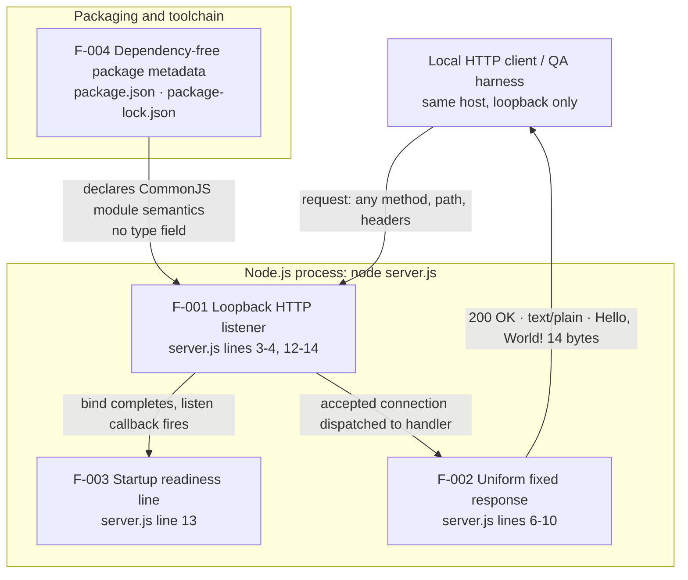

| Dependent feature | Depends on | Mechanism | Evidence |
| --- | --- | --- | --- |
| F-001 | F-004 | The manifest declares no `"type"` field, so `server.js` resolves as a CommonJS module and its `require('http')` call and load-time `listen` execute | `package.json` lines 1-11; `server.js` line 1 |
| F-002 | F-001 | No request reaches the handler until the listener binds; the handler is passed to `http.createServer` and invoked per accepted connection | `server.js` lines 6, 12 |
| F-003 | F-001 | The readiness line is emitted from the callback passed to `server.listen`, so it can only fire after a successful bind | `server.js` lines 12-13 |
| F-004 | None | Metadata stands alone; nothing in the tree reads it at runtime | `package.json`, `package-lock.json` |

No other dependency exists. F-002 and F-003 are independent of each other, no feature depends on the three zero-byte placeholder files, and nothing in the repository depends on the external integration named in `README.md` line 2.

### 2.3.2 Integration Points

| Integration | Direction | Mechanism | Feature |
| --- | --- | --- | --- |
| Loopback TCP socket | Inbound | `server.listen(3000, '127.0.0.1', cb)` — the only socket the project opens | F-001 |
| HTTP/1.1 request and response | Inbound | Node.js `http` server semantics; status, `Content-Type`, and body set per response | F-002 |
| Node.js standard library | Inbound dependency | `require('http')` at `server.js` line 1 — the only `require` in the tree | F-001, F-002 |
| Process stdout | Outbound | One `console.log` at start-up; nothing per request | F-003 |
| npm CLI | Inbound tooling | Manifest and lockfile drive `install`, `run`, and the implicit `node server.js` used by `start` | F-004 |
| "Backprop integration" (external pipeline) | Outbound, referenced only | `README.md` line 2 names it; no client, adapter, contract, schema, or configuration for it exists in the checkout | — |

The last row is a declared relationship rather than an implemented one: the checkout supplies an endpoint the external pipeline may call, but holds no code that calls it, so the coupling is one-directional and unverified from inside the repository.

### 2.3.3 Shared Components

| Shared element | Location | Consumed by | Nature of sharing |
| --- | --- | --- | --- |
| `hostname` and `port` constants | `server.js` lines 3-4 | F-001 (bind target) and F-003 (readiness message) | Single source of truth — the message is interpolated from the same literals the listener binds, so the two cannot disagree |
| `http` module import | `server.js` line 1 | F-001 (server construction) and F-002 (handler signature and response object) | One standard-library import, one binding, no wrapper layer |
| `server` object | `server.js` line 6 | F-001 (owns and binds it) and F-003 (registers its listen callback) | A single module-scope `const`; never exported, so no other code can attach to it |
| Package manifest | `package.json` | F-004 (identity and dependency graph) and F-001 (module resolution semantics) | Two features read the same file for different purposes; neither modifies it |
| Payload literal `Hello, World!\n` | `server.js` line 9 | F-002 only | Not shared — referenced once, with no constant, template, or resource file |

There are no shared functions, classes, utilities, or middleware in the repository: `server.js` defines no named function, class, or `module.exports`, so no component is reusable by another. Any future feature added to this checkout would share only the `http` import and the two address constants.

### 2.3.4 Common Services

The repository implements no common service. There is no application framework, middleware pipeline, dependency-injection container, configuration service, logging service, persistence layer, cache, message broker, identity provider, or HTTP client — a content search of every tracked file for `require(` returns exactly one match (`http`) and for `module.exports` returns none. Nothing resembling a service registry, adapter, or shared repository layer exists to be reused across features.

The only facilities common to more than one feature are supplied by the runtime rather than the project:

| Facility | Provided by | Used by | Project-side configuration |
| --- | --- | --- | --- |
| Event loop and socket handling | Node.js runtime | F-001, F-002 | None — no concurrency, cluster, or timeout settings |
| Character-encoding and header defaults | Node.js `http` module | F-002 | None — `Content-Length` and `Date` are added automatically |
| stdout stream | Node.js process | F-003 | None — no logger, level, or destination option |
| Package metadata resolution | npm CLI | F-004 | Manifest and lockfile only; no `.npmrc` or registry configuration |


## 2.4 Implementation Considerations

The repository defines no performance target, latency budget, throughput figure, availability objective, or capacity plan: there is no instrumentation beyond one start-up log line and no benchmark, load test, or CI configuration in the tree. The assessments below therefore separate what the code demonstrably does from what it demonstrably does not provide, and each cites the evidence for its claim. Consistency with 1.2.3 is intentional — the only measurable objectives in this system are ones a verifier can compute from outside the process.

### 2.4.1 F-001 Implementation Considerations — Loopback HTTP Listener

| Consideration area | Assessment | Evidence |
| --- | --- | --- |
| Technical constraints | Host and port are source literals, so the listener cannot be relocated without editing `server.js`; only the standard-library `http` module is used; the file is CommonJS and binds on load rather than exposing a start function; no TLS, cluster, or supervisor configuration exists | `server.js` lines 1-4, 12-14; absent `process.env` reference across all tracked files |
| Performance requirements | None stated by the repository. The bind runs once during module evaluation, before the listen callback; the process was observed ready immediately after launch. No connection limit, timeout, backlog, or keep-alive tuning is configured, so behaviour rests on Node.js defaults | `server.js` lines 12-14; observed readiness line and successful request immediately after start |
| Scalability considerations | Single process, single thread, single hard-coded port per host. There is no clustering, worker thread, SO_REUSEPORT, or load-balancer configuration, so capacity scales only by running one instance per host and scaling out hosts; the loopback binding also makes any remote client require a local proxy or tunnel | Single `listen` call; no `cluster`, `worker_threads`, or proxy configuration in the tree |
| Security implications | Exposure is confined to the loopback interface, which is the project's principal control. Traffic is plaintext; there is no authentication, authorisation, rate limiting, or TLS. Because no `server.on('error')` handler exists, a bind failure (such as port 3000 already in use) surfaces as an unhandled error event rather than a managed message | `server.js` lines 3-4, 12-14; absence of error handling in the file |
| Maintenance requirements | Fourteen reviewable lines, but any address change is a source edit and a redeploy; there is no automated test to catch regressions, so verification stays external (`npm test` exits 1); `README.md` line 2 states the checkout must not be modified, which makes change itself a review decision | `server.js`; `package.json` line 7; `README.md` line 2 |

### 2.4.2 F-002 Implementation Considerations — Uniform Fixed Response

| Consideration area | Assessment | Evidence |
| --- | --- | --- |
| Technical constraints | The response is three hard-coded statements with no templating, serialisation, content negotiation, compression, or i18n resource; the media type carries no charset parameter; `req` is never read, so no routing, versioning, or per-caller behaviour is possible | `server.js` lines 6-10 |
| Performance requirements | None stated. Per-request work is constant: assign status, set one header, end the response with a 14-byte string. Node.js supplies `Content-Length`, `Date`, and keep-alive headers; the observed `Keep-Alive: timeout=5` is the runtime default, not a project setting | Observed response headers on `127.0.0.1:3000` |
| Scalability considerations | The handler holds no state and allocates no per-connection structure, so request cost does not grow with concurrency and the reply cost is independent of request size because the body is never consumed. There is no cache header, connection pool, or back-pressure mechanism, and the endpoint is loopback-only, so scaling pressure is a property of the host rather than the design | `server.js` lines 6-10; module scope holds only `const` bindings |
| Security implications | No request data is reflected, interpreted, or stored, so the handler offers no reflected-XSS, template-injection, or deserialisation surface. The payload is a public constant with no secrets or personal data. The absence of a charset, of CORS headers, of cookies, and of caching directives means consumers see only what the literal declares. Unread request bodies are never parsed by application code | `server.js` lines 6-10; observed reply headers |
| Maintenance requirements | Any change to the payload or status is a one-line edit, but the payload is the entire external contract, so a change must be coordinated with the external pipeline that compares runs, and no in-repository test would catch the resulting mismatch. The `Date` header varies per request, so byte-exact comparison must exclude it | `server.js` line 9; observed header set; `package.json` line 7 |

### 2.4.3 F-003 Implementation Considerations — Startup Readiness Reporting

| Consideration area | Assessment | Evidence |
| --- | --- | --- |
| Technical constraints | Output is a single `console.log` to stdout with no level, format, or destination control; it cannot be tuned, throttled, or routed beyond redirecting the process's stdout | `server.js` line 13 — the only `console` call in the tree |
| Performance requirements | One write per process, immediately after the bind; zero I/O per request, so serving any volume of traffic adds no logging cost | Observed: one line in captured stdout after launch and none after serving requests |
| Scalability considerations | Log volume is constant and independent of request rate, so the reporting feature imposes no scaling concern; it also provides no request-level signal, so observability does not scale with traffic | `server.js` line 13; absence of per-request logging |
| Security implications | The line discloses only a loopback URL and port — no host identity, path, secret, or build metadata. Because nothing is logged per request, no request data can leak through logs, at the cost of having no access trail at all | `server.js` line 13; absence of any logging library or file write |
| Maintenance requirements | The message interpolates the same `hostname` and `port` constants as the bind, so it stays truthful when the address changes; any supervisor or script that matches the exact string must be updated if the wording changes | `server.js` lines 3-4, 13 |

### 2.4.4 F-004 Implementation Considerations — Dependency-Free Package Metadata

| Consideration area | Assessment | Evidence |
| --- | --- | --- |
| Technical constraints | `main` points at a non-existent `index.js`, so npm's default entry contract is unusable and the process starts as `node server.js` (or `npm start`, which npm resolves to that same implicit default). No `start`, `build`, or `lint` script exists; `scripts.test` prints a message and exits 1; there is no `engines` field to constrain the runtime and no `private` flag to prevent accidental publication | `package.json` lines 5-10; observed `node .` failure, `npm start` success, `npm test` exit 1, `npm run` listing only `test` |
| Performance requirements | None on the request path — no code reads the manifest at runtime. Tooling cost is negligible: an install was observed to audit one package in 142 ms and the lockfile is 247 bytes | Observed `npm install`; `package-lock.json` |
| Scalability considerations | Not applicable to serving capacity. The empty dependency graph does mean the install and audit footprint stays constant regardless of how many environments consume the checkout | `package-lock.json` single root `""` entry |
| Security implications | Zero third-party code removes the supply-chain attack surface entirely; an audit of the single package reported no vulnerabilities, and no registry URL, token, or credential appears in either file. The trade-off is that no dependency scanning, SBOM, or signed-provenance mechanism is configured, because there is nothing to scan | `package-lock.json`; observed audit output; absence of dependency blocks in `package.json` |
| Maintenance requirements | Name, version, and licence are duplicated across manifest and lockfile and must stay consistent; adding any dependency would require regenerating the lockfile and abandoning the zero-install property. The stale `main` field and the always-failing `test` script are long-lived maintenance traps for anyone who assumes npm convention applies | `package.json` lines 2-10; `package-lock.json` lines 2-11 |

### 2.4.5 Assumptions and Constraints

These are recorded because every requirement in 2.2 depends on them, and because several are properties a reviewer might otherwise mistake for defects. Constraints describe what the checkout does not provide; assumptions describe the conditions under which the verified behaviour holds.

| ID | Assumption | Basis | Impact if invalid |
| --- | --- | --- | --- |
| A-001 | A Node.js runtime with the standard `http` module is available; validated on v22.23.5 with npm 11.21.3 | `server.js` line 1; observed versions | Nothing starts; no requirement in 2.2 can be satisfied |
| A-002 | TCP port 3000 on `127.0.0.1` is free when the process starts | `server.js` line 4 literal; no fallback logic | Bind fails as an unhandled error (C-001, C-005); the fixture must be relocated by editing source |
| A-003 | The consumer of the endpoint runs on the same host, or reaches loopback through a local proxy or tunnel | `server.js` line 3 binds `127.0.0.1` only | Remote clients cannot connect; F-001-RQ-001 and F-002-RQ-001 become untestable from the client's position |
| A-004 | The checkout stays content-identical to `main` | `README.md` line 2 ("Do not touch!"); `git diff main QA-25-nov-branch` is empty | Run-to-run comparability, the fixture's whole purpose, is lost |
| A-005 | Verification is performed from outside the process, because the repository contains no test harness | `package.json` line 7; no test framework or CI file in the tree | There is no automated signal; regressions reach the external pipeline undetected |

| ID | Constraint | Evidence | Consequence for requirements |
| --- | --- | --- | --- |
| C-001 | Host and port are hard-coded source literals; no environment variable or configuration file is read | `server.js` lines 3-4; `git grep process.env` returns no matches | F-001-RQ-001 fixes the address; F-001-RQ-004 forbids a second listener |
| C-002 | The declared entry point `main: index.js` does not exist, and no `start` script is declared | `package.json` lines 5-7; `node .` fails; `npm start` works only through npm's implicit default | F-001-RQ-002 names `node server.js` / `npm start` as the launch path and excludes `node .` |
| C-003 | No automated tests exist; `scripts.test` prints `Error: no test specified` and exits 1 | `package.json` line 7; observed exit status 1 | Every acceptance criterion in 2.2 is verified externally; no requirement may claim in-repo regression coverage |
| C-004 | Plaintext HTTP only; no TLS module, certificate, or reverse-proxy configuration | `server.js` line 1 uses `http`; no `https` or `tls` reference in the tree | F-001-RQ-004 constrains the protocol; confidentiality rests on the loopback boundary alone |
| C-005 | No error handling and no graceful shutdown: no `server.on('error')`, no `SIGTERM`/`SIGINT` handler, no `close` call | Absence of those constructs in `server.js` | F-001-RQ-003 records unbounded lifetime as should-have behaviour, not a managed lifecycle |
| C-006 | One fixed payload with no routing, content negotiation, or per-path behaviour | `server.js` lines 6-10; handler ignores `req` | F-002-RQ-004 and F-002-RQ-005 make invariance and statelessness explicit requirements |
| C-007 | Three zero-byte placeholders (`test.py.txt`, `.blitzyignore.txt`, `test.blitzyignore.txt`) implement nothing and exclude nothing | `wc -c` reports 0 for each | None of them may be traced to a requirement; they carry no behaviour to test |
| C-008 | The checkout is declared immutable by its own documentation | `README.md` line 2 | Any change, including closing gaps in C-002 or C-003, requires an explicit review decision rather than routine maintenance |

Related documents: the scope boundaries these constraints imply are enumerated in 1.3.2; the limitation table in 1.2.1 covers the same gaps from an architectural angle; the requirement-to-evidence mapping is in 2.2.5; and the feature dependency structure is in 2.3.1.


## 2.5 References

- `server.js` — the sole implementation file (14 lines). Establishes F-001 (constants at lines 3-4, `server.listen` at lines 12-14), F-002 (handler at lines 6-10: `res.statusCode = 200`, `Content-Type: text/plain`, `res.end('Hello, World!\n')`), F-003 (readiness `console.log` at line 13), the `require('http')` at line 1 that makes the listener dependency-free, and the absence of routing, request parsing, error handling, signal handling, exports, and configuration reads.
- `package.json` — establishes F-004: identity (`hello_world`, `1.0.0`, description, author `hxu`, `MIT` at lines 2-10), the non-existent `main` of `index.js` (line 5, constraint C-002), the placeholder `test` script (line 7, constraint C-003), and the absence of dependency, `engines`, `private`, and `"type"` fields that underpins F-004-RQ-002 and F-004-RQ-003.
- `package-lock.json` — establishes the empty dependency graph: `lockfileVersion` 3 with the root `""` package as the only entry (lines 6-12), and the duplicated `MIT` declaration (line 10) used in F-004-RQ-004.
- `README.md` — establishes the project name (line 1) and the purpose and immutability instruction "test project for backprop integration. Do not touch!" (line 2), which ground the business value of F-001 and F-002, the external integration row in 2.3.2, and assumption A-004 / constraint C-008.
- `test.py.txt`, `.blitzyignore.txt`, `test.blitzyignore.txt` — zero-byte placeholders; establish that no Python source, ignore rule, or executable content exists, recorded as constraint C-007 and excluded from the feature catalog.
- Repository root (`""`) — flat structure of exactly seven files and no sub-directories, which establishes that no shared component folder, module graph, or common service exists (2.3.3, 2.3.4).
- `.git` metadata (single commit `6c2a446`, branches `main`, `QA-25-nov-branch`, and their origin counterparts) — establishes the v1.0.0 requirement baseline in 2.2, the absence of any revised or superseded requirement, and the content-identical QA branch behind assumption A-004.
- Runtime verification executed against this checkout on Node.js v22.23.5 and npm 11.21.3 — established the observed contract behind every acceptance criterion in 2.2.5: readiness line `Server running at http://127.0.0.1:3000/`, `200 OK` with `Content-Type: text/plain`, `Content-Length: 14` and body bytes `Hello, World!\n` for `GET /`, `POST /arbitrary?x=1` with a body, and `HEAD /`; `node .` failing on the missing `index.js`; `npm start` reaching the listener through npm's implicit default; `npm install` reporting one audited package with no `node_modules` created; `npm run` listing only `test`; and `npm test` exiting 1.


# 3. Technology Stack

## 3.1 Programming Languages

The technology surface of this repository is four non-empty tracked files totalling 39 lines — `server.js` (14), `package.json` (10), `package-lock.json` (13), `README.md` (2) — plus three zero-byte placeholders. It implements one loopback HTTP listener using only the Node.js standard library. The table below is the entire stack; each row is expanded in the sub-section named against it.

| Stack layer | Technology as implemented | Version evidence | Detailed in |
| --- | --- | --- | --- |
| Execution runtime | Node.js, 22.x LTS line | v22.23.5 exercised for verification; `package.json` declares no `engines` constraint | 3.1 |
| Programming language | JavaScript (ECMAScript 2015 subset), CommonJS modules | No `type` field in `package.json`; `require('http')` at `server.js` line 1 | 3.1 |
| Framework | None — the Node.js standard-library `http` module only | `server.js` line 1 is the only `require` in the tree | 3.2 |
| Third-party libraries | None | `package-lock.json` `packages` holds a single root key, `""` | 3.3 |
| Package registry | npm format only; nothing is ever fetched | `lockfileVersion` 3; no `.npmrc` anywhere | 3.3 |
| Third-party services | None | The handler makes no outbound call | 3.4 |
| Database, cache, storage | None | No driver, ORM, schema, or `fs` usage | 3.5 |
| Build, container, pipeline | None | No build script, `Dockerfile`, `*.tf`, or workflow file | 3.6 |

The default stack supplied with this assignment (AWS, Docker, Terraform, GitHub Actions, Python/Flask, Auth0, MongoDB, Langchain, React/TypeScript, TailwindCSS, React Native, Swift, Kotlin, Objective-C, ElectronJS) has **no footprint whatsoever** in this repository. Each sub-section below names the default-stack items that would belong to its category and records their absence with evidence, so the divergence is auditable rather than implied.

### 3.1.1 Language Inventory by Component

| Component | Path | Language / format | Module system | Evidence |
| --- | --- | --- | --- | --- |
| HTTP server (all executable code) | `server.js` | JavaScript, ES2015 subset | CommonJS | `require` line 1; `const` lines 1, 3, 4, 6, 12; arrow functions lines 6, 12; template literal line 13 |
| Package manifest | `package.json` | JSON (npm schema) | n/a | Identity, `main`, `scripts`, `author`, `license` — no dependency or `type` field |
| Dependency lockfile | `package-lock.json` | JSON (npm lockfile v3) | n/a | `lockfileVersion` 3, `requires: true`, single root entry |
| Documentation | `README.md` | Markdown | n/a | Two lines: project name and immutability instruction |
| Inert placeholders | `test.py.txt`, `.blitzyignore.txt`, `test.blitzyignore.txt` | None — zero bytes each | n/a | `wc -c` reports 0 for all three |

**JavaScript is the only programming language in the stack.** Its use is confined to one file that binds a socket as a load-time side effect, defines a single request handler, and writes one startup line: `const http = require('http')` (line 1), host and port constants (lines 3-4), `http.createServer(...)` (line 6), `server.listen(port, hostname, ...)` (lines 12-14). No module is exported, so there is no importable API and the code can only be exercised over TCP.

**Language level actually required.** The source uses `const` declarations, arrow functions, and one template literal — constructs standardised in ECMAScript 2015 — and uses nothing later: no `async`/`await`, no classes, no optional chaining, no spread syntax, and no ESM `import`. Any Node.js release line still receiving support satisfies the language requirement; the binding constraint is the runtime, not the syntax.

**Languages absent from the stack.** The filename `test.py.txt` suggests Python, but the file is zero bytes and no npm script or pipeline can execute a `.txt` file, so no Python code exists. TypeScript, Swift, Kotlin, Objective-C, and every JVM, CLR, or other native toolchain named in the default stack are likewise absent: there is no file of any of those types and no build, compiler, or toolchain entry that would consume one.

### 3.1.2 Selection Criteria

The repository records no architecture decision record, design note, or comment explaining a language choice; `README.md` line 2 simply declares the project a test fixture for backprop integration that must not be touched. The criteria below are therefore inferred from the observable shape of the code, and each is stated with the evidence that supports it.

| Criterion | How the code satisfies it | Evidence |
| --- | --- | --- |
| Zero-install determinism | The only language dependency is the runtime's own standard library, so no package is downloaded and the served payload cannot drift through a transitive upgrade | `server.js` line 1; empty dependency graph in `package-lock.json` |
| Smallest sufficient abstraction | One fixed literal response requires no routing, middleware, templating, or serialisation, so a framework would add code without adding capability | Handler at `server.js` lines 6-10 ignores `req` and writes a constant |
| Zero configuration | CommonJS is the default for `.js` when `package.json` has no `type` field, so the file loads with no build step, transform, or loader flag | `package.json` lines 1-11; `server.js` line 1 |
| Runtime portability | No native addon, no version-specific API, and no filesystem or network egress means the file runs unmodified on any supported Node.js line | `server.js` in full |
| Reviewability of an immutable fixture | 14 lines in one file can be diffed and compared byte-for-byte between runs, which is what a fixture used for run-to-run comparison needs | `README.md` line 2; single commit in history |

### 3.1.3 Constraints and Runtime Dependencies

| Constraint | Evidence | Consequence |
| --- | --- | --- |
| A Node.js runtime must be present | `server.js` line 1; no bundler or interpreter vendored in the tree | Nothing starts without Node.js installed on the host |
| No declared or enforced runtime version | `package.json` declares no `engines` field, so npm emits no warning and enforces no floor | The hosting environment must pin Node.js itself; verification used v22.23.5, on the 22.x LTS line (maintenance support to 2027-04-30) |
| Lockfile format implies a modern npm | `package-lock.json` line 4 sets `lockfileVersion: 3`, the default written by npm 9 and later and readable back to npm 7 | The first Node.js LTS bundling npm 9 is 18.14.0, so any supported LTS meets the tooling floor — an inference from the lockfile, not a declared constraint |
| CommonJS is the only module system in use | No `type` field in `package.json`; `require` at `server.js` line 1 | Adopting ESM would require a `type` field or `.mjs` files, plus a corresponding edit |
| No type checking, linting, or compilation | No TypeScript, ESLint, or Prettier configuration in the tree; no `build` or `lint` script | Language errors surface only at execution time; there is no static gate before the process binds |
| No configuration surface | Host and port are module-scope literals (`server.js` lines 3-4); `process.env` is never referenced | The address cannot be changed by environment or config file — only by editing source |
| Single-threaded execution model | One `listen` call, no `cluster` or `worker_threads` usage | Capacity scales by running one instance per host, not within a process |
| No error handling on the language boundary | No `server.on('error')` handler in the file | A bind failure such as a port conflict is emitted as an unhandled `error` event and terminates the process; observed as `listen EADDRINUSE: address already in use 127.0.0.1:3000` when port 3000 was already occupied |


## 3.2 Frameworks & Libraries

**The repository uses no framework.** The only framework-equivalent surface is the Node.js standard-library `http` module, which the runtime supplies rather than the project. Every framework or library category that could plausibly apply was checked against the tree; none has an artifact.

| Category | Candidates evaluated | Status | Evidence |
| --- | --- | --- | --- |
| Backend HTTP framework | Express, Koa, Fastify, NestJS | Absent | `server.js` line 1 imports `http` only; no dependency block in `package.json` |
| Python web framework | Flask | Absent | No `.py` content; `test.py.txt` is zero bytes |
| AI / orchestration framework | Langchain | Absent | No Python source, no npm package, no model client |
| Web UI framework | React, React Native, ElectronJS | Absent | No `.jsx`/`.tsx`/`.ts` file, no bundler, no DOM or renderer code |
| CSS framework | TailwindCSS | Absent | No stylesheet, no stylesheet pipeline, no PostCSS config |
| Test framework | Jest, Mocha, Vitest, AVA | Absent | `scripts.test` is the npm placeholder that exits 1; no test file |
| Build / transpile / bundle | Webpack, esbuild, Babel, `tsc` | Absent | No config file, no `build` script, no output directory |
| Lint / format | ESLint, Prettier | Absent | No `.eslintrc*`, `.prettierrc`, or `lint` script |
| Configuration loader | dotenv or similar | Absent | No `.env`, no config module, no `process.env` reference |
| Logging / metrics client | winston, pino, OpenTelemetry | Absent | The only output is one `console.log` (`server.js` line 13) |
| Validation / serialisation | Joi, zod, ajv | Absent | The response is a string literal; no request data is read |
| HTTP client | axios, node-fetch, `http.request` | Absent | No outbound call anywhere in the tree |

### 3.2.1 Core Runtime Surface — the `http` Standard-Library Module

The project's entire framework surface is four standard-library calls, all in `server.js`: `http.createServer(handler)` (line 6), `res.statusCode` (line 7), `res.setHeader('Content-Type', 'text/plain')` (line 8), and `res.end('Hello, World!\n')` (line 9), bound by `server.listen(port, hostname, callback)` (lines 12-14). Because the module ships inside the runtime, it carries **no independent version number**; its version is the Node.js version, v22.23.5 in the verified environment.

Several behaviours observers see are produced by the runtime, not by project code, and are therefore properties of the chosen runtime version rather than of this repository:

| Observable | Origin | Evidence |
| --- | --- | --- |
| `HTTP/1.1` protocol, `200 OK` status line | Runtime, from `res.statusCode = 200` | Observed live response |
| `Date` header | Runtime | Observed live response; never set in code |
| `Content-Length: 14` | Runtime, computed from the body length | Observed live response |
| `Connection: keep-alive`, `Keep-Alive: timeout=5` | Runtime defaults; no server tuning in code | Observed live response |
| Plaintext transport only | `http` is imported; `https` and `tls` are not | `server.js` line 1 |

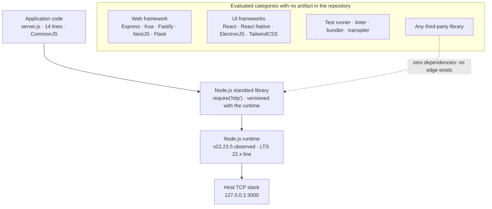

### 3.2.2 Supporting Libraries

There are none. `npm ls --all` in the checkout prints the project name followed by `└── (empty)`, and `package-lock.json` contains one package entry — the root `""` — with no `dependencies` map beside it. The constructs that might be mistaken for library usage are runtime built-ins and globals, not dependencies: `require('http')` (`server.js` line 1) and `console.log` (line 13), which is a Node.js global requiring no import.

### 3.2.3 Compatibility Requirements and Justification

| Compatibility requirement | Basis | Impact |
| --- | --- | --- |
| A Node.js runtime exposing the `http` module | `server.js` line 1 | The only hard framework dependency; npm declares no `engines` floor, so the environment must pin the version |
| `http.createServer`, `res.statusCode`, `res.setHeader`, `res.end`, `listen(port, host, callback)` | `server.js` lines 6-14 | All are long-stable public APIs; no experimental or version-gated flag appears in the file |
| CommonJS `require` resolution | No `type` field in `package.json` | Loading the file as ESM would break line 1 |
| ECMAScript 2015 syntax support | `const`, arrow functions, template literal | Satisfied by any supported Node.js line; no transpiler is needed or configured |
| HTTP/1.1 plaintext transport | `http` imported; `https`/`tls` absent | No certificate, keystore, or proxy configuration is required or supported |

**Justification for the single framework choice.** Using the `http` module instead of Express, Fastify, or Koa is consistent with every constraint the repository actually exhibits: the handler needs no routing, middleware chain, body parsing, or template rendering (`server.js` lines 6-10 ignore `req` entirely), so a framework would contribute no capability; the empty dependency graph gives the fixture an install that fetches nothing and cannot drift; and `README.md` line 2 declares the checkout immutable, which makes a 14-line file with no transitive surface the cheapest thing to keep frozen. The trade-off is explicit: there is no middleware, so no security headers, no rate limiting, no request logging, and no content negotiation — and equally no framework CVE exposure through this repository.

**Integration requirements.** The framework layer has exactly one integration point: the runtime's own module loader. Any library adoption would have to add a `dependencies` block to `package.json`, regenerate `package-lock.json` (currently a single root entry), and abandon the zero-install property that 3.3 documents.


## 3.3 Open Source Dependencies

**The project declares and resolves zero open-source dependencies.** Both the manifest and the lockfile are consistent with that claim, and there is no installed tree to inspect.

### 3.3.1 Declared Dependency Inventory

| Artifact | Production dependencies | Development dependencies | Resolved packages | Evidence |
| --- | --- | --- | --- | --- |
| `package.json` | 0 | 0 | 0 | Lines 1-11 contain `name`, `version`, `description`, `main`, `scripts`, `author`, `license`; no `dependencies`, `devDependencies`, `peerDependencies`, `optionalDependencies`, or `bundledDependencies` block exists |
| `package-lock.json` | 0 | 0 | 0 | `lockfileVersion: 3` and `requires: true` (lines 4-5), with `packages` holding a single key, `""`, carrying only name, version, and license (lines 7-11) |
| `node_modules/` | — | — | absent | Directory does not exist in the checkout |
| Runtime built-ins | — | — | 1 module | `require('http')` (`server.js` line 1) ships inside Node.js and is not a package |

The only `require` call in the entire tree is `server.js` line 1, `const http = require('http');`, which resolves to a runtime built-in rather than to an installed package. `npm ls --all` therefore prints the project name followed by `└── (empty)`.

**Package identity.** `package.json` declares `hello_world` version `1.0.0`, described as *"Hello world in Node.js"*, authored by `hxu`, under the MIT license; `package-lock.json` mirrors the name, version, and license in its root entry. The manifest sets no `private` flag, so nothing in the metadata itself prevents an `npm publish`; the only safeguard is that no publish script or pipeline exists (3.6).

### 3.3.2 Registry and Versioning Model

| Aspect | As implemented | Evidence |
| --- | --- | --- |
| Registry | npm, inferred solely from the npm-format lockfile; nothing is ever fetched, so no registry is contacted at build or run time | `package-lock.json` `lockfileVersion: 3`; no `.npmrc` in the tree to override the default registry |
| Version ranges | None exist — no semver range, tag, or git dependency is declared | `package.json` has no dependency block |
| Lockfile format | `lockfileVersion: 3`, the default written by npm 9 and later and readable back to npm 7 | `package-lock.json` line 4 |
| Lockfile size | 247 bytes, containing only the root entry | Checkout file listing |
| Integrity metadata | No `resolved` URL, `integrity` hash, or `dependencies` map exists for any package, because no package is recorded | `package-lock.json` lines 6-12 |
| Update automation | None — no Dependabot, Renovate, or dependency-review configuration | No `.github` directory or bot configuration file in the tree |
| Reproducibility | An install resolves and fetches nothing, so the dependency graph is deterministic by construction rather than by pinning | Observed `npm install` auditing a single package |

Because `lockfileVersion: 3` is the current default, the checkout is forward-compatible with present-day npm: any supported Node.js LTS line can read and re-write the lockfile without a format migration.

### 3.3.3 Supply-Chain and Security Posture

**Strengths.** With no third-party package there is no transitive dependency tree to exploit: no typosquatting exposure, no malicious `postinstall` script, no abandoned or unmaintained package, no license obligation beyond the project's own MIT terms, and no version-conflict resolution. Dependency-confusion and registry-compromise attacks have no target in this repository. No registry token, credential, or `.npmrc` exists in the tree, so nothing secret can leak through package tooling.

**Trade-offs.**

| Gap | Evidence | Consequence |
| --- | --- | --- |
| No dependency scanning, SBOM, or provenance verification | No CI workflow, no scanner configuration, no lockfile `integrity` entries to verify | There is nothing to scan, but there is also no mechanism that would notice if a dependency were introduced |
| Runtime version is the only unpinned external artifact | No `engines` field in `package.json`, no `.nvmrc` | The Node.js build itself is the one supply-chain input whose provenance rests entirely on the environment, not the repository |
| No automated dependency-update or review gate | Absent bot configuration and absent CI | A dependency addition would be caught only in code review — which `README.md` line 2 ("Do not touch!") makes a deliberate decision rather than routine maintenance |

The practical effect is that the dependency posture is the project's strongest security property and its weakest operational one: nothing can be compromised through a package, and nothing can be patched or verified through package tooling either.


## 3.4 Third-Party Services

**The system integrates with no third-party service.** The complete network surface is one inbound listener on `127.0.0.1:3000` (`server.js` lines 3-4, 12-14); no outbound request, SDK, credential, or endpoint reference exists anywhere in the seven-file tree.

| Service category | Default-stack candidate | Status | Evidence |
| --- | --- | --- | --- |
| Authentication / identity | Auth0 | Absent | No identity module, token, session, cookie, or credential; handler never reads `req` headers |
| External APIs | Any upstream REST or GraphQL service | Absent | No HTTP client, no `http.request`/`fetch` call, no URL literal except the loopback host |
| Monitoring / APM / error tracking | Datadog, New Relic, Sentry | Absent | No agent, no SDK, no instrumentation; single `console.log` on startup (`server.js` line 13) |
| Log aggregation | Any log shipper or collector | Absent | Output is stdout only, unformatted, with no destination configuration |
| Cloud services | AWS or any other provider | Absent | No SDK, no IAM credential, no region or endpoint configuration |
| Managed data services | MongoDB Atlas or similar | Absent | No connection string or driver (see 3.5) |
| Messaging / queues | SQS, Kafka, RabbitMQ | Absent | No producer or consumer code |
| CDN / edge / WAF | Any | Absent | Loopback binding cannot be reached through an edge network without a source change |
| TLS termination / reverse proxy | Any | Absent | Plaintext `http` only; no proxy configuration file in the tree |
| Real-time push | WebSocket, SSE, socket.io | Absent | Handler ends the response immediately; no upgrade handling |

**Integration surface, fully enumerated.** Inbound: a single TCP listener on the loopback interface. Outbound: none at runtime — the process serves traffic without DNS resolution, registry access, or any egress, and was observed answering a request while making no external connection. Tooling: the npm CLI, used only if an operator chooses to run an install, which fetches nothing (3.3).

**Authentication and access control.** There is none. Access is restricted solely by the loopback bind: a client must already be on the same host (or reach loopback through a local proxy or tunnel) to connect at all. Because the transport is plaintext and the response is public constant data, no confidential material crosses the boundary; but if the bind address were changed to a routable interface, the endpoint would become an unauthenticated, unencrypted HTTP service with no rate limiting, no security headers, and no request logging — that rebinding is the single change with the largest security consequence in the stack.

**The "backprop integration".** `README.md` line 2 names backprop integration as the project's purpose, and that is the only reference to it in the repository. There is no client module, endpoint URL, contract, schema, credential, or configuration for such a service in any tracked file, so it is not a component of this technology stack: whatever calls backprop lives outside the checkout, and this repository's role is limited to being consumed as a fixture.


## 3.5 Databases & Storage

**The system has no database, cache, or storage layer.** It reads nothing at runtime and writes nothing at runtime; the only datum it holds is a string literal compiled into `server.js`.

| Storage category | Default-stack or common candidate | Status | Evidence |
| --- | --- | --- | --- |
| Document database | MongoDB | Absent | No driver or ODM dependency, no connection string, no schema file |
| Relational database | PostgreSQL, MySQL | Absent | No driver, no `*.sql` file, no migration tooling |
| Embedded database | SQLite | Absent | No `.db`/`.sqlite` file, no driver |
| Cache | Redis, Memcached | Absent | No cache client, no connection configuration |
| Object storage | S3 or equivalent | Absent | No SDK, no bucket reference, no upload path |
| Search index | Elasticsearch or similar | Absent | No client, no index definition |
| File-system reads/writes | — | Absent | `fs`, `path`, and `stream` are never imported; the only `require` is `http` (`server.js` line 1); no file is created or modified by the running process |
| Configuration store | `.env`, JSON/YAML config, parameter store | Absent | Host and port are source literals (`server.js` lines 3-4); no `.env` or config file exists |
| Session / state store | — | Absent | No session concept; the handler holds no per-connection structure |

**Persistence strategy: none.** All state is module-scope, immutable, and recreated on every start:

| Datum | Kind | Location |
| --- | --- | --- |
| `hostname` = `'127.0.0.1'` | `const` string literal | `server.js` line 3 |
| `port` = `3000` | `const` number literal | `server.js` line 4 |
| `'Hello, World!\n'` | Response body literal, 14 bytes | `server.js` line 9 |

Nothing survives a request beyond the response itself and nothing survives a restart, so the process is fully stateless. Requests are answered identically regardless of history, order, or concurrency — a property the runtime's own defaults supply, since no connection pool, cache, or store is involved.

**Consequences of the absent storage layer.** There is no schema to migrate, no data to back up or restore, no retention or purge policy, no replication or failover to configure, and no datastore connection to pool, time out, or health-check. Restarting the process cannot lose or corrupt anything, which is why the absence of graceful-shutdown handling is inconsequential for data integrity. On the security side, no data is stored at rest, so there is no encryption-at-rest requirement, no stored credential, and no PII or tenant data that could leak through a store; the payload is a public constant.

**Boundary.** Introducing any store would be a stack change across three layers at once: a new third-party dependency and lockfile regeneration (breaking the zero-dependency property in 3.3), a configuration surface for the connection string (replacing the literal-only model in 3.1.3), and lifecycle handling for connect and disconnect (`server.js` currently has neither). Nothing in the repository anticipates or scaffolds such a change.


## 3.6 Development & Deployment

The project has no build step, no container image, no infrastructure definition, and no pipeline. Its development toolchain is the Node.js runtime, the npm CLI, and git; deployment consists of launching one file.

### 3.6.1 Development Tools

| Tool | Version observed | Role | Evidence |
| --- | --- | --- | --- |
| Node.js | v22.23.5 | The only runtime that executes the code | Used to run `server.js` successfully; `package.json` declares no `engines` floor |
| npm | 11.21.3 | Manifest and lockfile tooling; resolves an empty dependency graph | `npm ls --all` prints `└── (empty)`; `npm test` runs the placeholder script |
| git | — | Version control; one commit total | Commit `6c2a446` "Add files via upload" adds all seven files (40 insertions); remote `https://github.com/Sandeep01Kumar/002-existing-projects-qa-test.git`; `main` and `QA-25-nov-branch` are content-identical |

**Development tooling that is absent.** No linter (ESLint), formatter (Prettier), type checker (TypeScript), test runner (Jest, Mocha, Vitest), bundler or transpiler (Webpack, esbuild, Babel), editor configuration (`.editorconfig`), runtime version pin (`.nvmrc`), git hook framework (Husky), or debugger launch configuration exists in the tree. Consequently there is no local quality gate of any kind: syntax and behaviour are validated only by starting the process.

### 3.6.2 Build System and Entry Points

**There is no build system.** No transpilation, bundling, minification, asset pipeline, or artifact directory exists, and `package.json` declares no `build` script. Source is executed directly by the runtime, so the deployed unit is the source file itself.

| Invocation | Result | Mechanism |
| --- | --- | --- |
| `node server.js` | Starts and binds `127.0.0.1:3000` | Verified live: response `200 OK`, `Content-Type: text/plain`, `Content-Length: 14`, body `Hello, World!` |
| `npm start` | Starts the same process | No `start` script is declared, so npm falls back to its implicit default of `node server.js`; observed to invoke exactly that |
| `node .` | Fails | `main` is `index.js` (`package.json` line 5) and no such file exists, so Node raises `Cannot find module .../index.js` |
| `npm test` | Fails by design | `scripts.test` is `echo "Error: no test specified" && exit 1`; observed to print the message and exit with status 1 |
| `npm run` | Lists one script | Only `test` is defined, so no `build`, `lint`, `start`, or lifecycle hook other than `test` can be invoked |

The mismatch between the declared `main` and the actual source is a property of the toolchain configuration, not of the code: the process can only be started by naming `server.js` explicitly, whether directly or through npm's implicit default. `package.json` is the only configuration file in the stack, and it configures nothing beyond identity, an unusable entry point, and a placeholder test.

### 3.6.3 Containerization, Infrastructure as Code, and CI/CD

| Default-stack item | Status | Evidence |
| --- | --- | --- |
| Docker / container image | Absent | No `Dockerfile`, `docker-compose.yml`, or `.dockerignore`; no image build or entrypoint definition anywhere |
| Terraform / infrastructure as code | Absent | No `*.tf`, `.tfvars`, or state configuration |
| AWS or any cloud provisioning | Absent | No SDK, CLI configuration, or template (see 3.4) |
| GitHub Actions or any CI/CD pipeline | Absent | No `.github/` directory; no `.gitlab-ci.yml`, `Jenkinsfile`, `azure-pipelines.yml`, or any other pipeline descriptor |

The GitHub remote exists and branches `main` and `QA-25-nov-branch` are present, but nothing runs on push, pull request, or schedule. Any gate that consumes this repository — including the external backprop comparison named in `README.md` line 2 — must be configured and executed outside it. It is also worth stating plainly that `npm test` exits 1, so a pipeline that adopts the conventional `npm test` step would fail on every run until a real test script exists.

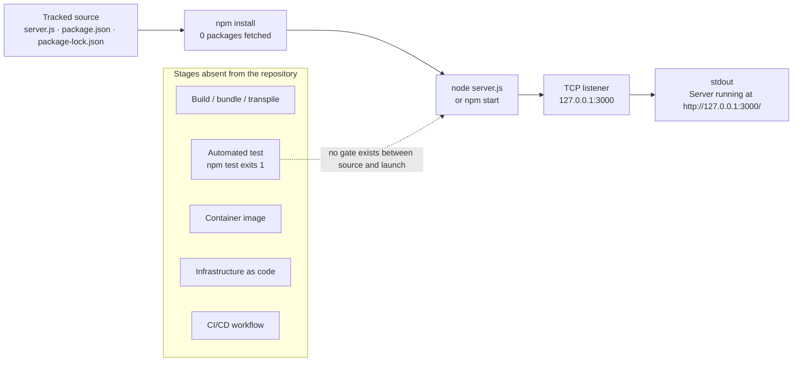

### 3.6.4 Deployment Requirements and Operational Constraints

| Requirement | Value as implemented | Evidence | Failure mode if unmet |
| --- | --- | --- | --- |
| Runtime | A Node.js installation exposing the `http` module; v22.23.5 verified | `server.js` line 1; no `engines` or `.nvmrc` to enforce a version | Process cannot start; nothing is bundled or compiled |
| Address and port | `127.0.0.1`, TCP `3000`, both source literals | `server.js` lines 3-4 | A different port requires editing source; if 3000 is occupied the bind emits an unhandled `error` event (`listen EADDRINUSE`) and the process terminates without a managed message |
| Start command | `node server.js`, or `npm start` | `package.json` line 5 lacks `start`; npm's implicit default resolves to `node server.js` | `node .` fails because `index.js` does not exist |
| Working set | The checkout itself; no build output, no install step required | `npm install` fetches nothing | — |
| Configuration / secrets | None required; no environment variable is read | No `process.env` reference, no `.env`, no secret file | Nothing to inject or misconfigure |
| Process supervision | External to the repository: no signal handling, no graceful shutdown, no restart policy | No `SIGTERM`/`SIGINT` handler, no `server.close()` call | The process runs until killed; restarts are the supervisor's responsibility |
| Health and readiness signal | One stdout line, `Server running at http://127.0.0.1:3000/` | `server.js` line 13 | No HTTP health endpoint exists, so a probe must be a TCP connect or a log match |
| Remote reachability | Not supported: loopback bind, plaintext HTTP, no authentication | `server.js` lines 3-4; `http` module only | Serving remote clients requires a source edit plus a local proxy or tunnel |
| Exposure control | The loopback bind is the only security boundary | Observed listener; no TLS, auth, or WAF | Rebinding to a routable interface would publish an unauthenticated, unencrypted endpoint with no rate limiting and no request logging |

**Deployment implication of the default stack.** Because no container, infrastructure, or pipeline artifact exists, the environment — not the repository — owns provisioning, image construction, process supervision, and release automation. The reproducible part of deployment is the application itself: the source plus an empty dependency graph. The non-reproducible part is the runtime: with no `engines` field and no `.nvmrc`, the Node.js version is whatever the host supplies, which is why recording the verified v22.23.5 matters.


## 3.7 References

**Repository files**

- `server.js` — the entire executable stack: `require('http')` (line 1), loopback and port literals (lines 3-4), the uniform handler (lines 6-10), the bind and startup log (lines 12-14); established the language, module system, framework surface, and the absence of auth, persistence, outbound calls, and error handling.
- `package.json` — identity `hello_world@1.0.0`, MIT license, author `hxu`, `main: "index.js"` (absent on disk), the placeholder `test` script, and the absence of any dependency, `engines`, `type`, or `private` field.
- `package-lock.json` — `lockfileVersion: 3`, `requires: true`, and a `packages` map holding only the root `""` entry, establishing the empty dependency graph and the npm versioning model.
- `README.md` — two lines naming the project a test project for backprop integration with the instruction "Do not touch!", establishing the fixture's purpose and immutability.
- `.blitzyignore.txt` — zero bytes; excludes nothing.
- `test.blitzyignore.txt` — zero bytes; excludes nothing.
- `test.py.txt` — zero bytes; filename suggests Python but no Python code exists.

**Repository folder**

- Repository root (`/`, branch `QA-25-nov-branch`) — flat, seven tracked files, no sub-directories, no `node_modules`, no `.github/`, no `Dockerfile`, no `*.tf`, and no linter, formatter, TypeScript, or pipeline configuration; established the absences recorded in 3.2, 3.3, and 3.6.

**Web sources**

- [npm CLI documentation — `package-lock.json`](https://docs.npmjs.com/cli/v10/configuring-npm/package-lock-json) — definition of `lockfileVersion` values, including that version 3 is written by npm 9 and later and is backwards compatible to npm 7.
- [npm CLI `lockfile-version` configuration](https://docs.npmjs.com/cli/v11/using-npm/config) — confirmation that the current default lockfile version is 3.
- [npm CLI release notes v9.0.0](https://github.com/npm/cli/releases/tag/v9.0.0) — the change that made v3 lockfiles the default.
- [Node.js release index](https://nodejs.org/dist/index.json) — bundled npm version per Node.js release, used to derive the Node.js 18.14.0 tooling floor.
- [Node.js 18.14.0 release notes](https://nodejs.org/en/blog/release/v18.14.0) — first LTS release shipping npm 9.
- [Node.js Release Working Group schedule](https://github.com/nodejs/Release) — Node.js 22 "Jod" lifecycle dates: initial release 2024-04-24, Active LTS 2024-10-29, Maintenance 2025-10-21, end-of-life 2027-04-30.


# 4. Process Flowchart

## 4.1 Workflow Inventory and Scope

The system in this checkout is a single Node.js process that opens one loopback HTTP listener and answers every request with one fixed payload (`server.js` lines 1-14). Its complete workflow set is therefore small enough to enumerate exhaustively: three work-performing flows and three failure or termination paths, all of them exercised against this checkout on Node.js v22.23.5 with npm 11.21.3 at commit `6c2a446`.

### 4.1.1 Actors and System Boundaries

| Actor | Type | Boundary | Interaction surface | Evidence |
| --- | --- | --- | --- | --- |
| Operator | Human, the only user touchpoint | Outside the process | Starts the process from a shell (`node server.js` or `npm start`) and reads the single readiness line; terminates it with a signal | `server.js` lines 12-14; `package.json` lines 6-8 |
| HTTP client | Software, same host only | Outside the process | Opens TCP connections to `127.0.0.1:3000` and exchanges HTTP/1.1 messages | `server.js` lines 3-4 |
| Node.js HTTP parser | Runtime layer inside the process | Inside the process, below application code | Parses request bytes, emits `request`, generates protocol-level errors, manages keep-alive | `server.js` line 1 (only import); observed `400 Bad Request` and `100 Continue` |
| Application handler | The only application code | Inside the process | Writes status, media type, and body; never reads the request object | `server.js` lines 6-10 |
| Operating system | Host | Outside the process | Allocates TCP port 3000 on the loopback interface; delivers termination signals | Observed bind, `EADDRINUSE`, and `SIGTERM` behaviour |

The trust boundary is the loopback bind alone. There is no authentication, authorization, session, or tenant construct anywhere in the tree, and no outbound client, database driver, or message broker, so the application boundary coincides exactly with the process boundary.

### 4.1.2 Enumerated Workflows

| ID | Workflow | Trigger | Terminates when | Where documented | Requirements |
| --- | --- | --- | --- | --- | --- |
| WF-01 | Process startup and listener binding | `node server.js` or `npm start` | Readiness line written to stdout, or process exits 1 on bind failure | 4.2 | F-001-RQ-001, F-001-RQ-002, F-003-RQ-001, F-003-RQ-003 |
| WF-02 | Request–response cycle (the core business process) | Any inbound HTTP request | Response fully written via `res.end` | 4.3 | F-002-RQ-001 to F-002-RQ-005 |
| WF-03 | Connection session: keep-alive, pipelining, idle close | Reuse of an established TCP connection | Client closes, or server closes the idle socket after the keep-alive window | 4.4 | F-001-RQ-003, F-002-RQ-005 |
| WF-04 | Malformed-request rejection | Request bytes that the HTTP parser cannot accept | Runtime-generated `400 Bad Request` | 4.6 | None — no application requirement covers this path |
| WF-05 | Bind failure | TCP port 3000 already in use, or the address is unavailable | Process exits 1 after an unhandled `error` event | 4.7 | F-001-RQ-001 |
| WF-06 | Termination | `SIGTERM`, `SIGINT`, or process kill | Process ends; the socket is released by the OS | 4.7 | F-001-RQ-003 |

Two consequence-bearing absences belong in this inventory because a reader would otherwise look for them: there is no batch or scheduled flow (no timer, cron, queue consumer, or job schedule in the tree) and no event-processing flow (no `EventEmitter` listener is registered — not even for `error` — and nothing publishes or consumes messages). WF-04 and WF-05 are the only flows in which the application code does not execute, and both are decided entirely by the runtime and the OS.

### 4.1.3 High-Level System Workflow

The diagram below is the complete life of the process. Solid edges are the normal sequence; the two branches out of the bind decision and the termination edges are the only ways the flow can deviate.

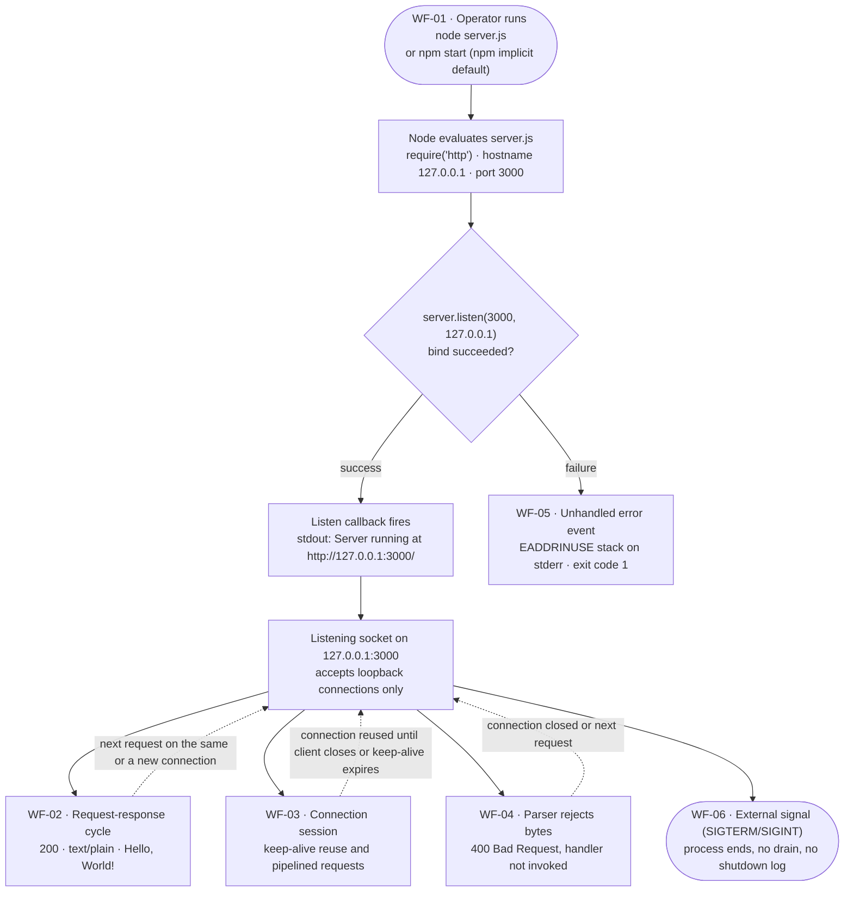

Every boxed step is one or two source lines. The whole implemented surface is the `http` import (line 1), two constants (lines 3-4), the inline handler (lines 6-10), and the `listen` call with its callback (lines 12-14); no other module, function, or class exists in the repository to participate in a flow.


## 4.2 WF-01: Process Startup and Listener Binding

Startup is the only flow in which the operator is a participant. It has five application steps, one decision the application does not make, and one observable output.

### 4.2.1 Process Steps

| # | Step | Actor | Source evidence | Observed result |
| --- | --- | --- | --- | --- |
| 1 | Enter the start command | Operator | `node server.js`; `npm start` reaches the same file because `package.json` declares no `start` script and npm's implicit default is `node server.js` (`package.json` lines 6-8) | Process starts; `node .` instead fails, because `package.json` line 5 sets `main` to `index.js`, which does not exist in the tree |
| 2 | Resolve and load the module | Node.js | No `"type"` field, so `server.js` loads as CommonJS; `const http = require('http')` (line 1) is the only import | No install or build step precedes this; `package-lock.json` describes an empty dependency graph, so nothing is fetched |
| 3 | Declare the endpoint constants | Application | `hostname = '127.0.0.1'`, `port = 3000` (lines 3-4) | Values are literals; no environment variable or configuration file is read |
| 4 | Construct the server and register the handler | Application | `http.createServer((req, res) => {...})` (lines 6-10), no options object | Runtime defaults apply unchanged (`keepAliveTimeout` 5000 ms, `headersTimeout` 60000 ms, `requestTimeout` 300000 ms, `timeout` 0, `maxRequestsPerSocket` 0, `maxHeadersCount` unlimited-by-default) |
| 5 | Bind the listener | Application → OS | `server.listen(port, hostname, callback)` (line 12) | Bind is asynchronous; module evaluation finishes first and the referenced socket keeps the event loop alive |
| 6 | Decide the bind outcome | Operating system | No `server.on('error')` handler exists | Success proceeds to step 7; failure becomes WF-05 (4.7) |
| 7 | Report readiness | Application | `console.log(\`Server running at http://${hostname}:${port}/\`)` (line 13) | Exactly one stdout line: `Server running at http://127.0.0.1:3000/` |

### 4.2.2 Decision Points, Touchpoints, and Timing

- **Decision points:** one, and it belongs to the OS — whether `127.0.0.1:3000` can be bound. The application contains no conditional branch at any point in startup; there is no `if`, `try`, or fallback anywhere in `server.js`.
- **User touchpoints:** exactly two, both textual — the shell command the operator types, and the readiness line printed on success. Nothing else in the system ever addresses a human; the process is silent for the remainder of its life regardless of traffic volume (one log line in `/tmp` capture after 50+ requests).
- **Startup timing:** the readiness line follows the bind completion within the same asynchronous continuation, and no install, transpile, or dependency resolution occurs before it, so readiness arrives effectively immediately on a free port. In the verification run the line was already present on the first check 1.2 s after launch.
- **Post-startup state:** the process is in the listening state of WF-02/WF-03 until an external signal ends it (WF-06). The application never re-binds, retries, or self-terminates.

### 4.2.3 Startup Swim Lanes

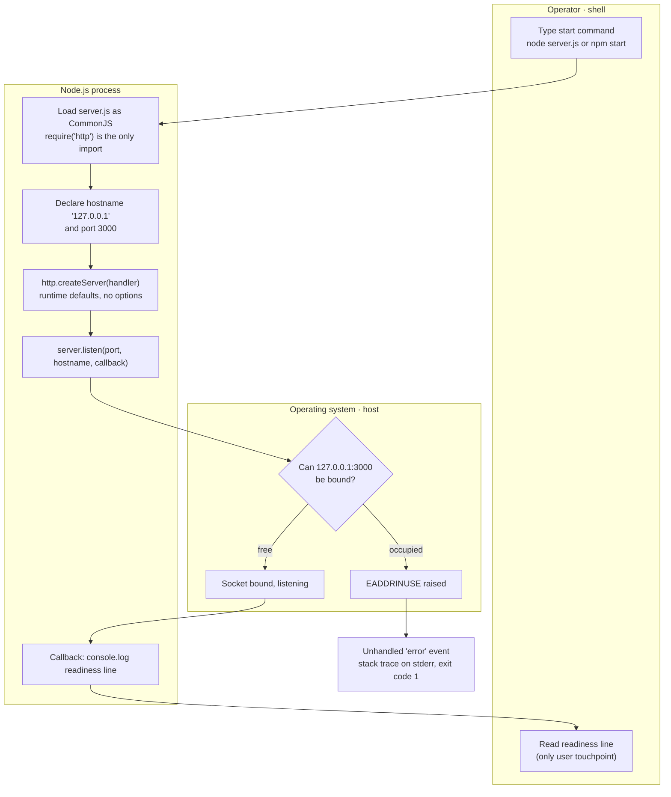

The failure branch is drawn outside the host swim lane because the terminal error handling happens in the process, not the OS: the `error` event is emitted on the server object, no listener is attached, and Node's default behaviour throws it (`node:events:497  throw er; // Unhandled 'error' event`), printing `Error: listen EADDRINUSE: address already in use 127.0.0.1:3000` and exiting with status 1. That branch is specified in 4.7.


## 4.3 WF-02: Request–Response Cycle

The request–response cycle is the system's entire purpose and its entire business logic: one handler that writes three values and returns. It has ten observable steps, of which the application performs three and the runtime performs the rest.

### 4.3.1 Process Steps

| # | Step | Performed by | Evidence | Observed result |
| --- | --- | --- | --- | --- |
| 1 | Open or reuse a TCP connection to `127.0.0.1:3000` | Client | `server.js` lines 3-4, 12 | Connection accepted; a non-loopback interface on the same host is not bound |
| 2 | Write the HTTP request | Client | — | Any method, path, query string, header set, or body is accepted |
| 3 | Buffer and parse the request line and headers | Node.js parser | `server.js` line 1 (`http` module); no parsing code in the repository | Valid requests proceed; unparsable bytes yield `400 Bad Request` (WF-04) |
| 4 | Answer `Expect: 100-continue` | Node.js parser | No `checkContinue` listener registered | Interim `HTTP/1.1 100 Continue` sent, then the normal reply follows |
| 5 | Emit `request` and invoke the handler | Node.js runtime | `server.js` line 6 — the arrow function is the server's sole request listener | Handler runs once per request; `req` is never read |
| 6 | Assign status | Application | `res.statusCode = 200` (line 7) | `HTTP/1.1 200 OK` |
| 7 | Assign media type | Application | `res.setHeader('Content-Type', 'text/plain')` (line 8) | Header exactly `text/plain`, no charset parameter |
| 8 | End the response with the fixed payload | Application | `res.end('Hello, World!\n')` (line 9) | `Content-Length: 14`, body `Hello, World!` plus one line feed |
| 9 | Complete the message and decide the connection's fate | Node.js runtime | Runtime defaults; no application involvement | `Date`, `Connection: keep-alive`, `Keep-Alive: timeout=5` added; body suppressed for `HEAD` |
| 10 | Delight or reuse: connection returns to WF-03, or closes | Node.js runtime / client | — | Observed: keep-alive reuse and pipelining both work; idle sockets close after ~5 s |

There is no persistence, lookup, template render, or outbound call between steps 5 and 9: the response is three constant writes. That is why 50 concurrent requests at parallelism 25 returned 50 × `200`, and why reply latency does not vary with request size — no part of the request body is read or deserialised.

### 4.3.2 Decision Points

| Decision | Owner | Question | Outcome A | Outcome B |
| --- | --- | --- | --- | --- |
| D1 | Node.js parser | Do the request line and headers parse cleanly? | Emit `request` (step 5) | Generate `400 Bad Request`; the handler never runs (WF-04) |
| D2 | Node.js parser | Does the request carry `Expect: 100-continue`? | Write interim `100 Continue`, then continue | Continue directly to step 5 |
| D3 | Node.js runtime | Is the method `HEAD`? | Headers only — the observed reply carried no body and no `Content-Length` | Headers plus the 14-byte body |
| D4 | Node.js runtime | Should the connection be reused? | Connection returned to keep-alive (observed `Keep-Alive: timeout=5`) | Connection closed after the response |

The application itself makes **no** decisions in this flow. Confirmed by execution: `GET /`, `POST /nope?q=1` with a JSON body, and `HEAD /missing` produced the same status and media type, and the same 14-byte payload for the two body-bearing methods. No `if`, `switch`, `try`, or `catch` exists in `server.js`, so every request maps to exactly one path through the handler.

### 4.3.3 Swim-Lane Process Flow

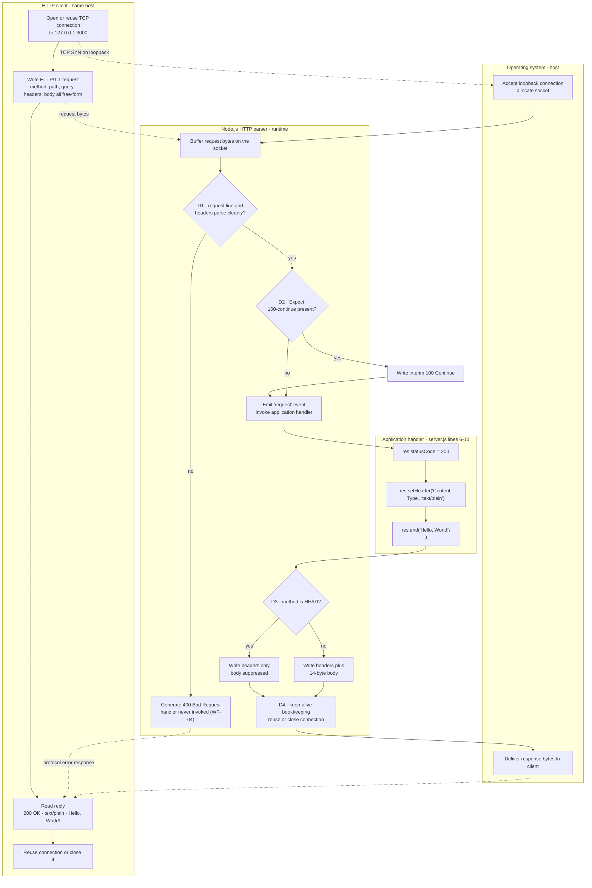

### 4.3.4 Rules, Error Paths, and Timing per Step

- **Business rules and validation at each step** are tabulated in 4.8; the operative ones here are that the status is unconditionally 200, the media type is exactly `text/plain`, and the payload is exactly 14 bytes ending in `0a`.
- **Error paths out of this flow:** D1 fails into WF-04 (4.6). A client aborting mid-response destroys the socket; the application observes nothing, logs nothing, and is unaffected, because it holds no per-request state. A bind failure never reaches this flow (WF-05, 4.7).
- **Timing:** steps 6-8 execute synchronously in one turn of the event loop with no I/O, so no timing constraint exists inside the application. The only timing constraints in this flow are the runtime's: an idle keep-alive socket closed at ~6005 ms (5 s default), header completion is bounded by `headersTimeout` 60000 ms, and whole-request completion by `requestTimeout` 300000 ms. There is no rate limiter, queue, or concurrency cap; `maxRequestsPerSocket` is 0 (unlimited).
- **Concurrency:** because the handler captures nothing but `res` and the module scope holds only `const` bindings, simultaneous requests cannot interfere. This is the mechanism behind the identical replies observed under parallel load rather than an explicit concurrency-control design.


## 4.4 WF-03: Connection Session, Keep-Alive, and Pipelining

A single TCP connection carries an unbounded sequence of identical exchanges. This flow is entirely runtime-managed: `server.js` never inspects the `Connection` header, never sets a keep-alive option, and never closes a socket, so the session behaviour is whatever the Node.js HTTP server does by default.

### 4.4.1 Session Parameters in Effect

| Parameter | Value in this process | Source | Consequence for the flow |
| --- | --- | --- | --- |
| `keepAliveTimeout` | 5000 ms | Runtime default (`http.Server` has no options object in `server.js` line 6) | After the last response the socket lingers 5 s waiting for another request; measured close was 6005 ms |
| `Keep-Alive` response header | `timeout=5` | Runtime, added to every response; observed on every capture | The client is told the idle window without any application code participating |
| `headersTimeout` | 60000 ms | Runtime default | A client that never completes headers cannot hold a socket longer than a minute |
| `requestTimeout` | 300000 ms | Runtime default | Whole-request completion bound |
| `timeout` (socket inactivity) | 0 | Runtime default | No application-level inactivity cut-off beyond the parameters above |
| `maxRequestsPerSocket` | 0 | Runtime default | No per-connection request cap: one socket may serve any number of exchanges |
| `maxHeadersCount` | `null` (runtime default, not overridden) | Runtime default | No header-count limit is imposed by the application |
| Application-level session state | None | No cookie, `Set-Cookie`, session identifier, or auth header anywhere in `server.js` | Two requests on one connection are not correlated; there is no "session" beyond the transport |

### 4.4.2 Integration Sequence

The capture below reflects what was observed: an interim `100 Continue` preceding the final reply when the client asks for it, two pipelined requests served in order on one socket, and an idle socket released roughly 5 s after the last response.

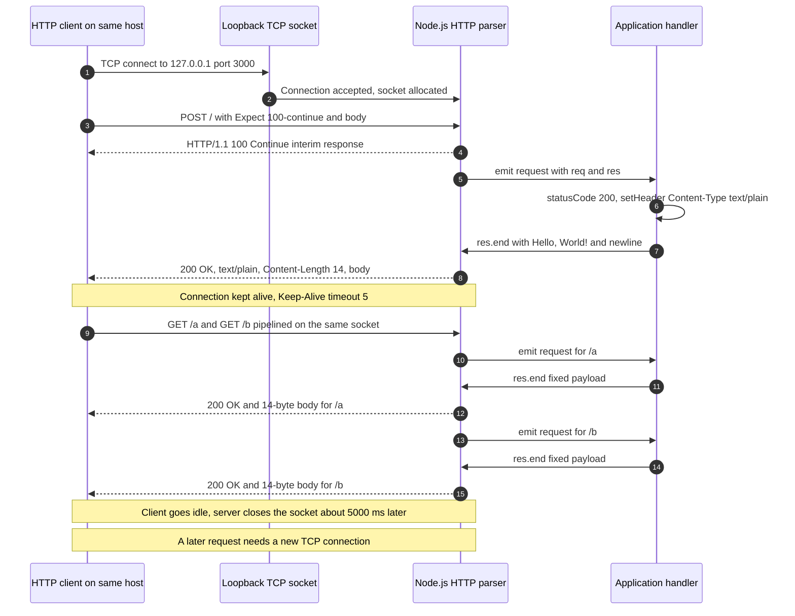

### 4.4.3 Behaviour and Constraints

- **Pipelining is ordered, not parallel.** Two requests written back-to-back on one socket produced two `200` status lines and two `Hello, World!` bodies in the order the requests were written. The application cannot reorder responses because it never defers a response — every `res.end` call happens synchronously inside the request callback.
- **Reuse is free of application cost.** No connection registry, pool, or per-socket bookkeeping exists in the code; each request re-enters the same handler with no memory of previous exchanges.
- **The idle-close decision is the only session-level timing constraint that a consumer can observe.** A client that waits longer than the keep-alive window before reusing a socket must expect the connection to be gone and to open a new one; nothing in the repository advertises the window other than the `Keep-Alive: timeout=5` response header.
- **No backpressure or queueing is implemented.** A slow client does not block other clients because each response is 14 constant bytes written to a socket the kernel buffers; per-connection and global concurrency are bounded only by the runtime and the host.
- **Termination is abrupt with respect to sessions.** Because no `server.close()` call and no signal handler exist (WF-06, 4.7), in-flight responses are not drained on shutdown; the sockets end when the process ends.


## 4.5 Integration Workflows: External Systems, Events, and Batch

The repository contains one integration, inbound and loopback-only. This sub-section enumerates it, states the request/response contract precisely, and records the integration categories that are absent so a reader does not search for them.

### 4.5.1 Integration Inventory

| Integration | Direction | Protocol / mechanism | Status | Evidence |
| --- | --- | --- | --- | --- |
| HTTP client on the same host → server | Inbound | HTTP/1.1 over TCP on `127.0.0.1:3000` | Implemented | `server.js` lines 3-4, 12; exchanges observed |
| Node.js standard library `http` | In-process | Function calls within the same runtime | Implemented | `server.js` line 1 — the only `require` in the tree |
| npm CLI → project | Tooling, pre-runtime | Manifest and lockfile parsing | Implemented, empty graph | `package.json`; `package-lock.json` (`lockfileVersion` 3, single root entry); `npm install` fetches nothing |
| "Backprop integration" named in the README | Undetermined | Undetermined | Not implemented — no code, configuration, endpoint, or interface artifact | `README.md` line 2 mentions it; nothing in the tree references it |
| Outbound HTTP/RPC, database, cache, message broker, identity provider, log shipper, metrics/tracing agent, scheduler | Outbound | — | Absent | The only import in the tree is `http`; no client of any kind exists |

### 4.5.2 API Interaction Contract

| Request attribute | Influence on the response | Observation |
| --- | --- | --- |
| Method | None | `GET /`, `POST /nope?q=1` with a JSON body, and `HEAD /missing` all returned `200 OK`; `HEAD` additionally had its body suppressed by the runtime |
| Path and query | None | `/`, `/missing`, `/nope?q=1`, `/r/1` … `/r/50` — every one returned the same reply |
| Headers | None at application level; `Host`, `Expect`, and `Connection` are acted on by the runtime only | `Expect: 100-continue` produced an interim `100 Continue`; `Connection: keep-alive` reuse was honoured |
| Body | None — never read, parsed, or acknowledged | A JSON body on `POST` left the reply unchanged |
| Response status and payload | Constant | `HTTP/1.1 200 OK`, `Content-Type: text/plain`, `Content-Length: 14`, body `Hello, World!` + line feed, plus runtime-generated `Date`, `Connection`, `Keep-Alive` |

Because nothing from the request reaches the response, this is an integration with no data coupling: the request is an event that triggers a constant, not an input that parameterises an output.

### 4.5.3 Event Processing Flows

None exist. `server.js` registers exactly one callback — the inline request handler at lines 6-10 — and passes a second callback to `server.listen` at line 12 for the one-shot readiness message. No `server.on(...)`, no `process.on(...)`, no `EventEmitter` subscription, no timer (`setTimeout`/`setInterval`), no worker or child process, and no message-broker client appears in the tree. Consequently there is no event schema, no at-least-once or at-most-once delivery question, no dead-letter path, and no consumer group to reason about. Unhandled runtime events are therefore fatal rather than handled: the `error` event on a failed bind is thrown (WF-05, 4.7).

### 4.5.4 Batch Processing Sequences

None exist. There is no scheduler, cron entry, job queue, bulk import, or periodic reconciliation anywhere in the tree, and the manifest's single script is the npm placeholder `echo "Error: no test specified" && exit 1` (`package.json` line 7), which is a deliberate failure rather than a batch job. The only sequential processing the system performs is the ordered serving of pipelined requests on a single connection (4.4), and that ordering comes from the socket buffer, not from a batch scheduler.

### 4.5.5 Data Flow Across the Boundary

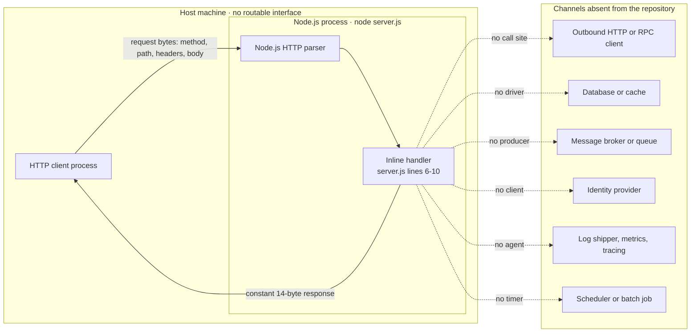

The dashed edges are drawn only to show that each channel is verifiably absent: no call site, driver, producer, client, agent, or timer exists in `server.js`, `package.json`, or `package-lock.json`. Third-party service integrations are correspondingly empty (see 3.4), and deployment integration is limited to the toolchain described in 3.6.


## 4.6 WF-04: Malformed Request and Protocol Error Path

Protocol errors are the first flow in which application code does not run. The Node.js HTTP parser owns the decision, and because `server.js` registers no `clientError` listener, the runtime's default handling applies: an error status is written to the client and the application neither observes nor records the event.

### 4.6.1 Two Observed Error Outcomes

| Variant | Client behaviour | Runtime outcome | Latency observed | Application involvement |
| --- | --- | --- | --- | --- |
| Syntactically invalid request | Sent `GARBAGE` followed by a blank line | `HTTP/1.1 400 Bad Request`; handler never invoked | Immediate | None — no log line, no state change |
| Incomplete header block | Sent `GET / HTTP/1.1` with a `Host` header but never terminated the headers | `HTTP/1.1 408 Request Timeout` with `Connection: close` | 88,922 ms, consistent with `headersTimeout` 60000 ms checked on the runtime's ~30 s interval | None |

Both outcomes are produced entirely below the application: the handler at `server.js` lines 6-10 is bound to the `request` event, which the parser emits only after a request has been accepted, so a rejected request never reaches it. There is no `server.on('clientError', ...)` in the tree, and no logging statement other than the startup line, so a protocol error leaves no trace in the process output — the client's status code is the only evidence it happened.

### 4.6.2 Error-Handling Flowchart

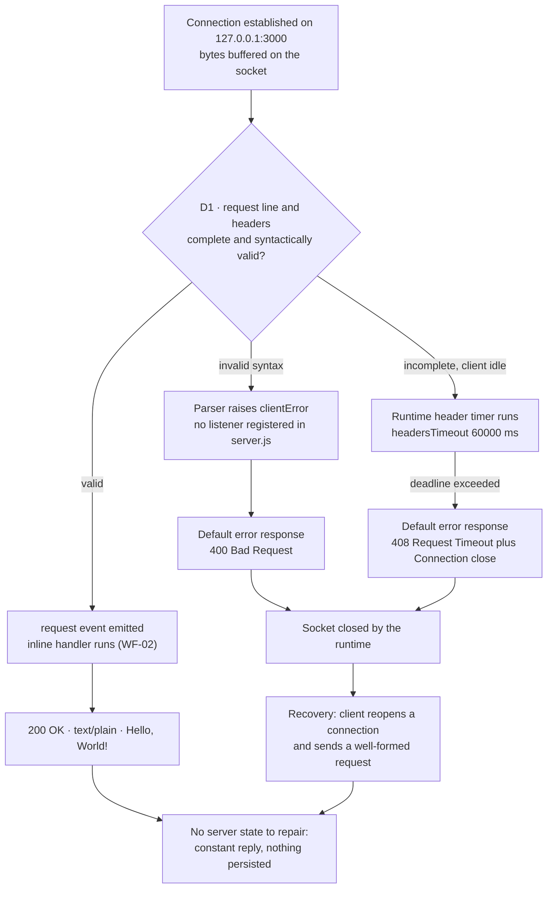

### 4.6.3 Error States, Recovery, and Timing

- **Error states reachable in this flow:** `400 Bad Request` (unparsable request) and `408 Request Timeout` (header block never completed). Neither is represented anywhere in application code, so they cannot be customised, localised, or given a custom body without adding a `clientError` listener.
- **Recovery path:** entirely client-side. The server holds no per-connection or per-request state, so a rejected request leaves nothing to clean up; the client must open a new connection (the idle socket is closed on the 408 path) or send a well-formed request.
- **Retry semantics:** safe by construction, though not implemented. Because every successful reply is byte-identical and no side effect is produced, a client may retry an arbitrarily large number of times without changing server state.
- **Notification flow:** none. No counter, log, metric, or webhook announces a protocol error, so an operator can detect them only by capturing traffic or by a client-side error rate. This matches the readiness-line-only observability recorded in 1.2.3 and F-003-RQ-002.
- **Timing constraints:** the 400 path is instantaneous; the 408 path is bounded by `headersTimeout` (60000 ms) and was measured at 88.9 s end to end, which a client-side timeout must exceed if it is to distinguish the server's 408 from its own deadline.
- **Related requirements:** no functional requirement covers this flow because no requirement in 2.2 addresses protocol rejection; the behaviour follows from the absent `error`/`clientError` handlers noted under F-001-RQ-003 and F-003-RQ-002.


## 4.7 WF-05 and WF-06: Bind Failure, Signals, and Termination

The process has exactly one way to fail and one way to end. Both are outside application control: `server.js` contains no `error` listener, no signal handler, no `close()` call, and no exit-code assignment.

### 4.7.1 WF-05: Bind Failure

| # | Step | Actor | Evidence | Observed |
| --- | --- | --- | --- | --- |
| 1 | Operator starts a second instance while the first holds the port | Operator | `server.js` line 12 binds a hard-coded `127.0.0.1:3000` | Process starts |
| 2 | `listen` asks the OS for the port | Application → OS | No `exclusive` or retry option passed | Request refused with `EADDRINUSE` |
| 3 | Runtime emits `error` on the server object | Node.js | No `server.on('error')` anywhere in the tree | Event has no listener |
| 4 | Runtime throws the unhandled event | Node.js | Stack begins `node:events:497  throw er; // Unhandled 'error' event` | Stack trace on stderr |
| 5 | Process exits | Node.js | — | Exit code **1**; the readiness line is never printed |

The full observed stderr identifies the failure precisely — `Error: listen EADDRINUSE: address already in use 127.0.0.1:3000`, with `code: 'EADDRINUSE'`, `errno: -98`, `syscall: 'listen'`, `address: '127.0.0.1'`, `port: 3000` — followed by `Node.js v22.23.5`.

Operational consequences of having no handler:

- **No retry and no backoff.** The process makes one bind attempt and dies; nothing in the tree re-attempts, waits, or backs off.
- **No fallback port.** The port is a source literal (`server.js` line 4), so a second instance cannot select an alternative and cannot be redirected by environment or configuration.
- **Readiness-based supervision must time out.** Because the success line is the only readiness signal (F-003-RQ-001), a supervisor waiting for it sees silence followed by exit status 1, never a partial-start message.
- **Recovery is manual and outside the process.** The operator frees port 3000 or edits the literal at `server.js` line 4 and restarts; the failing process leaves no state, lock, or partial socket behind.

### 4.7.2 WF-06: Signals and Termination

| Signal | Application handler | Observed behaviour | Exit status |
| --- | --- | --- | --- |
| `SIGTERM` | None | Process ends; the startup line is the only output; nothing is logged on shutdown | 143 (128 + 15) |
| `SIGINT` | None | Same abrupt end | 130 (128 + 2) |

Because no `process.on('SIGTERM'|'SIGINT')` handler and no `server.close()` call exist, the runtime's default disposition applies: the process is terminated as soon as the signal is delivered. No drain phase runs, no in-flight response is completed deliberately, no connection is closed gracefully, and no shutdown event is recorded. The listening socket is released by the OS, which is why a new instance can bind immediately afterwards — verified by successfully starting a fresh instance after each signal. Any supervisor, restart policy, or log-capture responsibility therefore belongs to the environment, not the repository (see 3.6.4).

### 4.7.3 Failure and Termination Flowchart

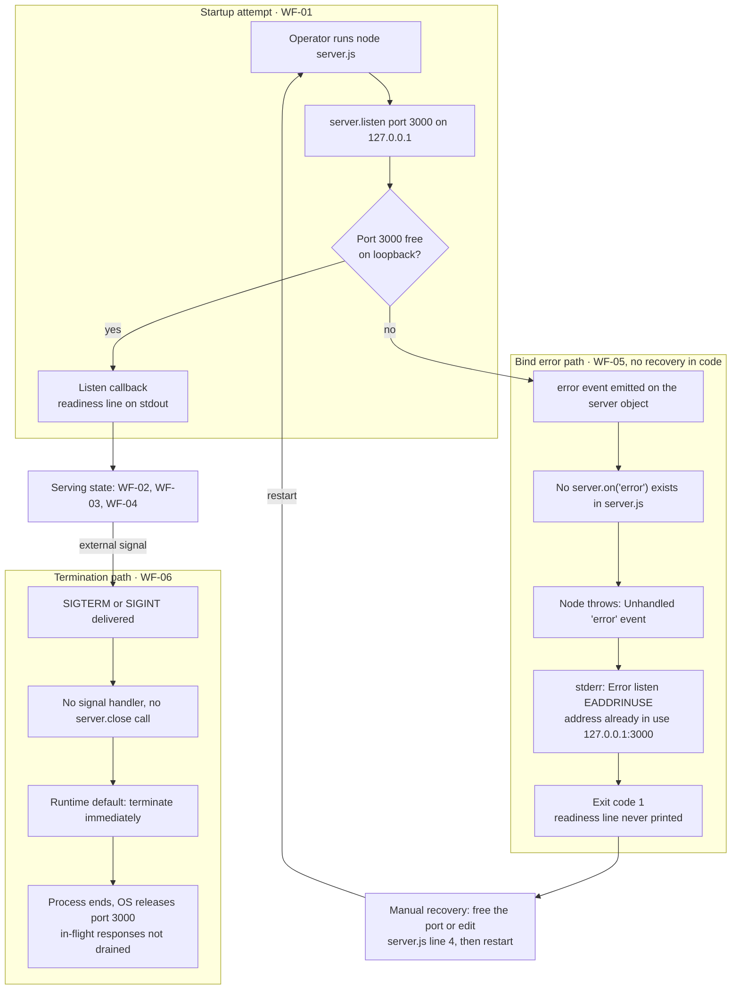

The two failure paths share one property: the application never runs while they are in progress. A bind failure is decided by the OS before the handler can be reached, and termination is decided by the runtime without consulting the application, so neither can be compensated for in code that exists today.


## 4.8 Validation Rules and Checkpoints

Validation in this system happens at the transport layer, not in the application. Every rule below is either a compile-time property of the source or an HTTP-grammar check performed by the runtime; the handler at `server.js` lines 6-10 validates nothing because it reads nothing.

### 4.8.1 Business Rules at Each Step

| Step | Business rule | Enforced by | Evidence | Consequence if broken |
| --- | --- | --- | --- | --- |
| WF-01 bind | The endpoint is always `127.0.0.1:3000` | Source literals, not configuration | `server.js` lines 3-4 | A relocated endpoint requires editing source; no environment override exists |
| WF-01 readiness | Success is announced exactly once, with the address derived from the same constants that govern the bind | Template literal | `server.js` line 13; F-003-RQ-003 | A supervisor matching the readiness string would need the same edit as the bind |
| WF-02 status | Every request receives `200`, unconditionally | Unbranched assignment | `server.js` line 7 | A non-200 reply would indicate a runtime failure, not a business outcome |
| WF-02 media type | The media type is exactly `text/plain` with no parameter | Header literal | `server.js` line 8; passed on GET, POST, HEAD | A charset or other suffix would change the compared bytes |
| WF-02 payload | The body is exactly `Hello, World!` plus one line feed, 14 bytes | String literal argument to `res.end` | `server.js` line 9; observed `Content-Length: 14` | Byte-level consumers would reject the reply |
| WF-02 request shape | No request attribute may influence the reply | Absence of branching on `req` | `server.js` line 6; identical replies for differing method, path, query, body | Any added branch breaks the fixed-contract property in F-002-RQ-004 |
| WF-03 connection | An idle socket is retained for the runtime's keep-alive window and then released | Runtime default | `Keep-Alive: timeout=5`; measured close at 6005 ms | A client reusing a socket later than the window must expect a new connection |
| WF-02 verification | Only payload bytes are compared; `Date` is excluded from byte-exact checks | Verifier convention | Observed `Date` header varies per response | A naive byte-diff of whole responses produces false negatives |

### 4.8.2 Data Validation Surface

| Data | Validator | Rule applied | Outcome on violation |
| --- | --- | --- | --- |
| Raw request bytes | Node.js HTTP parser | HTTP/1.1 message grammar | `400 Bad Request`, handler not invoked (WF-04, 4.6) |
| Header block completion | Runtime header timer | Complete within `headersTimeout` (60000 ms) | `408 Request Timeout` + `Connection: close`, measured at 88,922 ms |
| Request body | Nothing | Never read, parsed, or stored | Silently ignored; a JSON body on `POST` left the reply unchanged |
| Method, path, query, headers | Nothing at application level | No rule exists | Ignored entirely |
| Host and port literals | Nothing at runtime | Must remain a loopback address and an integer port | Not reachable — values are literals, not inputs |
| Address tokens, credentials, configuration | Nothing | No `process.env` read, no config file, no secret | Nothing to inject or misconfigure |

Because no request data is handed to a deserialiser, template engine, shell, query builder, or filesystem call — the tree's only import is `http` — the code paths that typically carry injection risk do not exist in this handler. That is a statement about the code that is present, not an assurance beyond it.

### 4.8.3 Authorization Checkpoints

| Checkpoint | Implemented | Mechanism in effect | Consequence |
| --- | --- | --- | --- |
| Network reachability | Yes, implicitly | Bind to `127.0.0.1` (`server.js` lines 3-4, 12) | Only processes on the same host can connect; no firewall rule is needed |
| Authentication (who is calling) | No | No credential parsing, no auth header inspection | Any local process is served identically |
| Authorization (what they may do) | No | No roles, scopes, or per-resource rules; a single resource exists | No privilege difference between callers is expressible |
| Session or token validation | No | No cookie, session store, or token verification | Requests are neither correlated nor accountable to an identity |
| Rate limiting / quota | No | `maxRequestsPerSocket` 0; no counter exists | A local client may send unlimited requests |
| Transport encryption | No | `http` module only; no TLS options | Traffic is plaintext on the loopback interface |
| Audit trail | No | No request logging anywhere in the tree | No record exists of who connected or when |

The loopback bind is the only boundary that is actually enforced, which is why the deployment constraint in 3.6.4 matters: rebinding to a routable interface would publish an unauthenticated, unencrypted, unlimited endpoint in a single-line change.

### 4.8.4 Regulatory and Compliance Checks

No regulatory control is implemented, and none is triggered by the data the system handles.

| Consideration | Position in this repository | Evidence |
| --- | --- | --- |
| Personal or sensitive data | None processed; the only payload is a public constant | `server.js` line 9 |
| Data retention | Nothing persisted, cached, or logged, so no retention period applies | No `fs`, database, or cache import; single startup log line |
| Access logging / audit obligations | No access log exists, so no audit requirement can be met by the code | Zero stdout lines added by traffic |
| Licence obligations | MIT declared consistently in manifest and lockfile | `package.json` line 10; `package-lock.json` line 10; F-004-RQ-004 |
| Supply-chain vetting | Empty dependency graph, so nothing third-party executes | `package-lock.json` `packages` map holds only the root `""` entry |

These rows record the absence of controls together with the absence of the data that would require them; they are not a compliance attestation, and a control such as access logging would have to be added rather than configured.


## 4.9 State Management and State Transitions

The system has no domain state, no persistence, no cache, and no transaction. What it does have is two short lifecycle state machines — the process and the TCP connection — both of which are driven entirely by the runtime and the OS.

### 4.9.1 State Inventory

| State carrier | States | Who drives transitions | Application-visible state | Evidence |
| --- | --- | --- | --- | --- |
| Node.js process | Starting → Binding → Listening → Serving → Terminated, or Binding → Failed | Runtime and OS | None — the module scope holds three immutable `const` bindings (`http`, `hostname`, `port`, `server`) and no mutable field | `server.js` lines 1-14; no `let`/`var` in the file |
| TCP connection | Accepted → Parsing → Handled → Idle → Parsing …, or Parsing → Rejected | Node.js HTTP parser | None — the handler keeps no reference to a socket, request, or earlier exchange | `server.js` line 6 ignores `req`; no connection registry exists |
| Application data | A single immutable literal, `'Hello, World!\n'` | Not applicable | The same value for every request in every process instance | `server.js` line 9 |

There is no session, order, or entity state anywhere: two requests cannot be distinguished by the server, and a restarted process is behaviourally indistinguishable from its predecessor.

### 4.9.2 Persistence Points, Caching, and Transaction Boundaries

| Concern | Status | Evidence |
| --- | --- | --- |
| Database or key-value store | Absent | Only import is `http` (`server.js` line 1); `package-lock.json` lists no dependency |
| Filesystem writes | Absent | No `fs` import; the only I/O is the startup `console.log` to stdout (`server.js` line 13) |
| In-memory cache or memoisation | Absent | Nothing is stored between requests; there is only the constant literal |
| HTTP caching directives | Absent | Observed replies carry `Content-Type`, `Date`, `Connection`, `Keep-Alive`, `Content-Length` only — no `Cache-Control`, `ETag`, `Last-Modified`, or `Expires` |
| Client-side cache revalidation | Not supported | No conditional-request handling and no `304` path exists |
| Transaction boundary | A single response write | Steps 6-8 of WF-02 (`server.js` lines 7-9) mutate only the response object; `res.end` at line 9 is the commit point that makes the reply observable |
| Rollback or compensation | Not applicable | Nothing outside the socket is modified, so there is nothing to roll back; a connection lost mid-write simply truncates the reply |
| Atomicity or isolation requirement | None | Every request produces the same constant reply, so interleaving cannot produce an inconsistent result — which is why 50 concurrent requests returned 50 × `200` |

The one write path deserves a precise reading: `res.statusCode` and `res.setHeader` buffer state inside the runtime's response object, and `res.end('Hello, World!\n')` flushes status line, headers, and body. If the process is killed between those lines and the flush, the client sees a failed or truncated connection and no durable effect exists anywhere else.

### 4.9.3 Process Lifecycle State Transitions

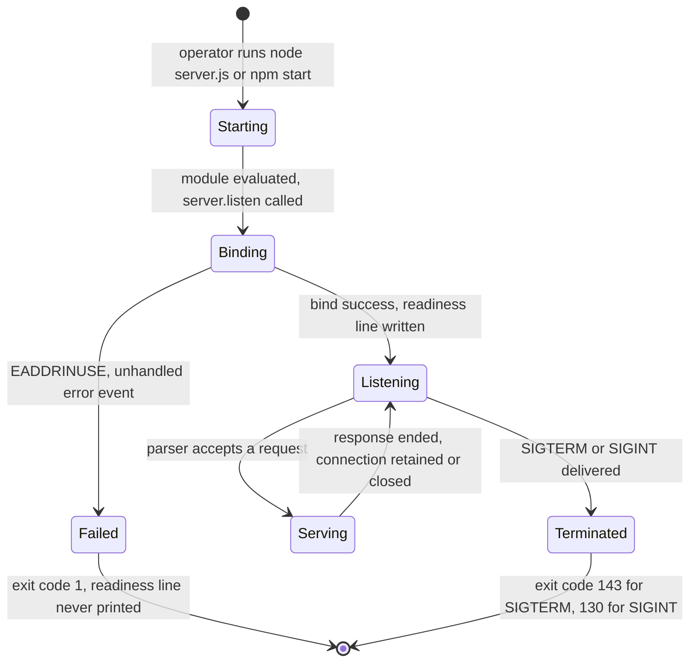

### 4.9.4 Connection Lifecycle State Transitions

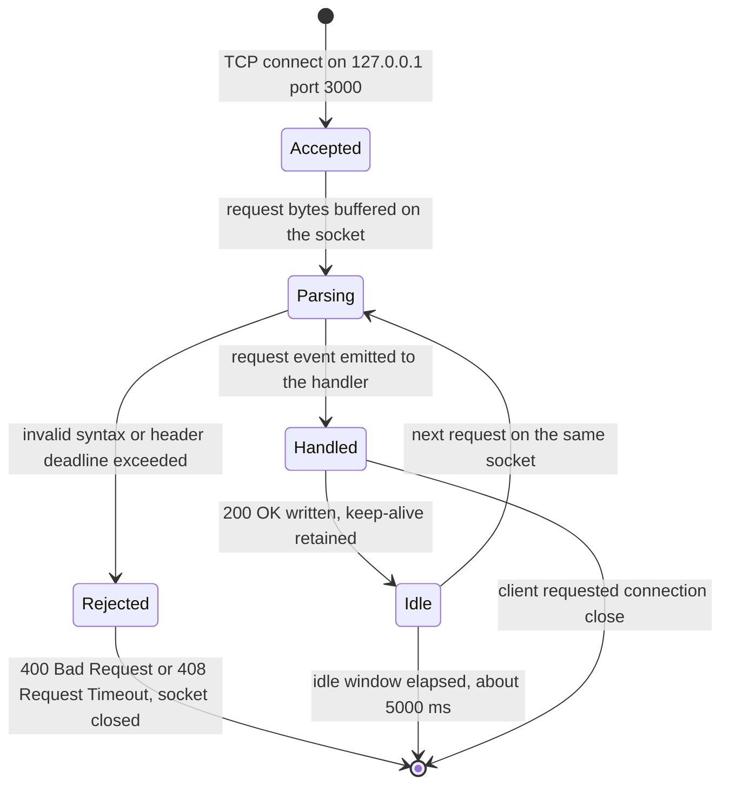

Each transition above is backed by an observation: the bind success and failure branches by the readiness line and the `EADDRINUSE` exit, the request transition by request/response captures, the idle timeout by the measured 6005 ms socket close, the rejection branches by the `400` and `408` captures, and the termination branch by exit statuses 143 and 130. No transition depends on application-held state, which is why the diagrams contain no guard conditions other than the runtime's own.


## 4.10 Error Handling Mechanisms

No retry, fallback, notification, or recovery mechanism is implemented. The error-handling design is a single decision: let the runtime do what it does by default. This sub-section records that design explicitly so that nothing is assumed to exist.

### 4.10.1 Mechanism Coverage

| Mechanism | Present in code | Closest construct that exists | Consequence |
| --- | --- | --- | --- |
| Retry | No | None — no `setTimeout`, no backoff, no reconnect, no second `listen` attempt | A failed bind ends the process; a rejected request is the client's problem |
| Fallback | No | None — the port is a literal, so no alternate port can be selected; the payload is a literal, so no alternate response exists | Any failure has exactly one outcome, and it is a hard stop or a protocol error status |
| Circuit breaking / bulkheads | No | None | Not applicable — there is no downstream to protect |
| Error notification | Minimal | stderr and the process exit code for a bind failure; nothing at all for request-time errors | An operator learns of startup failure from the process, and of request-time failures only from clients |
| Automated recovery | No | None — no supervision, restart policy, or self-healing logic in the repository | Restart is the responsibility of the supervising environment (3.6.4) |
| Graceful shutdown | No | None — no signal handler, no `server.close()` | In-flight responses are not drained on termination |
| Idempotency (enables safe external retry) | Yes, by construction | Constant reply, no side effects | A client may retry freely; repeated calls cannot change server state |

### 4.10.2 Failure Scenario Matrix

| # | Scenario | Detected by | In-code handling | Observed outcome | Notification | Recovery |
| --- | --- | --- | --- | --- | --- | --- |
| 1 | Port 3000 already in use | `listen` callback with `EADDRINUSE` | None — no `error` listener | Stack trace on stderr, exit code 1, no readiness line | stderr + exit code | Operator frees the port or edits `server.js` line 4, then restarts |
| 2 | Syntax-invalid request | HTTP parser | None — no `clientError` listener | `400 Bad Request`, handler never runs | None | Client reconnects with a well-formed request |
| 3 | Header block never completed | Runtime header timer | None | `408 Request Timeout` + `Connection: close` after 88,922 ms | None | Client reconnects |
| 4 | Client aborts mid-exchange | Runtime socket teardown | None | Process unaffected: a subsequent request returned `200`, log stayed at one line | None | Not required — no state was created |
| 5 | `SIGTERM` / `SIGINT` | OS | None — no signal handler | Process ends immediately; port released | exit code 143 / 130 | Supervisor restarts; a fresh instance binds successfully |
| 6 | Exception thrown inside the handler | Node.js `uncaughtException` path | None — no `try`/`catch` | Would terminate the process with a stack trace | stderr + exit code | Restart; no partial state to repair |
| 7 | Downstream dependency unavailable | — | Not applicable | No downstream call site exists | — | — |
| 8 | Data store unavailable or full | — | Not applicable | Nothing is written anywhere | — | — |
| 9 | Heavy traffic or many connections | — | None — no rate limit, no queue cap (`maxRequestsPerSocket` 0) | 50 concurrent requests all returned `200` | None | Not applicable at observed volumes; capacity is bounded only by the host |

Scenario 6 is structural rather than observed: the handler performs only assignments to `res` and one `res.end` call on a valid response object, so no input can drive it into an exception; the row is included because the absence of a `try`/`catch` is the reason a handler fault would be fatal rather than handled.

### 4.10.3 Notification Flows

| Channel | Emitted when | Content | Machine-readable? |
| --- | --- | --- | --- |
| stdout | Once, after a successful bind | `Server running at http://127.0.0.1:3000/` | Yes — exact string match (F-003-RQ-001) |
| stderr | On bind failure only | Node's `Uncaught Error: listen EADDRINUSE` stack, including `code`, `errno`, `syscall`, `address`, `port` | Partially — the stack text carries the kernel error code |
| Process exit status | On termination or failure | `1` bind failure, `143` SIGTERM, `130` SIGINT | Yes |
| Request- or error-level logging | Never | Nothing | — |

No email, webhook, syslog forwarding, metrics endpoint, health endpoint, or tracing span exists, so a monitoring system must treat the process's liveness, the exit status, and the readiness line as its entire signal set.

### 4.10.4 Recovery Procedures

1. **Startup failure (scenario 1).** Confirm the port owner, stop the conflicting process, then rerun `node server.js` and wait for the readiness line. Editing `server.js` line 4 is the only way to change the port; there is no configuration surface.
2. **Protocol errors (scenarios 2 and 3).** No server-side action; the connection is already closed and the process is serving normally. Investigate on the client, or capture traffic — the server records nothing.
3. **Termination (scenario 5).** Restart the process; no cleanup, lock release, or data repair is required, and the port is released by the OS on exit.
4. **Verification after any recovery.** Request `http://127.0.0.1:3000/` and require `200`, `Content-Type: text/plain`, and a 14-byte body. Do not use `npm test` as the gate — the script exits 1 by design (`package.json` line 7).


## 4.11 Timing Constraints and SLA Considerations

The repository defines no service level, objective, or indicator of any kind, and the code contains no timer, delay, or deadline. Every timing constraint in the system is either a runtime default or an external verifier's assumption. Both are recorded below with the measurements taken on this checkout.

### 4.11.1 Observed Timings

| Event | Measured | Bounded by | Notes |
| --- | --- | --- | --- |
| Readiness after launch | Line already present at the first check, 1.2 s after start | Nothing in code — no install, build, or dependency resolution precedes the bind | The line is written in the listen callback, so it cannot precede the bind |
| Server-side work per request | Constant and synchronous: three assignments and one `res.end`, no I/O | Nothing — no artificial delay, no queue, no lookup | Reply latency is dominated by socket handling, not by application logic |
| 50 concurrent requests at parallelism 25 | 50 × `200` | Host capacity only (`maxRequestsPerSocket` 0, no rate limit) | No queueing, throttling, or backpressure path exists |
| Idle keep-alive socket release | 6005 ms after the last response | `keepAliveTimeout` 5000 ms (runtime default) | Advertised to clients as `Keep-Alive: timeout=5` |
| Incomplete header block rejection | `408 Request Timeout` at 88,922 ms | `headersTimeout` 60000 ms, enforced when the runtime's periodic connection check runs (default 30 s interval) | Consistent with a 60-90 s window; a client deadline must exceed it to observe the 408 rather than its own timeout |
| Whole-request completion | Not exercised (would require a 300 s window) | `requestTimeout` 300000 ms (runtime default) | Applies to requests whose body or framing never completes |
| Socket inactivity cut-off | None | `timeout` 0 (runtime default) | Only the headers and request deadlines bound a stalled exchange |

### 4.11.2 Constraints a Consumer Must Respect

1. **Wait for readiness, not for elapsed time.** The only proof the listener is bound is the exact stdout line `Server running at http://127.0.0.1:3000/` (F-003-RQ-001). A caller that sends traffic before it appears risks a refused connection, and one that waits on a fixed sleep risks being slower than necessary or still too early on a loaded host.
2. **Reuse connections only inside the keep-alive window.** A socket idle for longer than 5 s is closed by the server; the next request needs a fresh connection. The window is communicated by the `Keep-Alive: timeout=5` header and nowhere else.
3. **Bound client timeouts above the server's own.** To distinguish a slow exchange from a server-side deadline, a client deadline must exceed 60 s for headers (observed rejection at 88.9 s).
4. **Own your retry budget.** The server implements no retries, so retry counts, delays, and idempotency assumptions are purely a consumer concern; the constant reply makes any number of retries safe.
5. **Serialise startup against the port.** Only one instance can hold `127.0.0.1:3000`; a second start fails with exit 1, so parallel verification runs require distinct hosts or a source edit (F-001-RQ-001, F-001-RQ-004).
6. **Expect an abrupt end.** Termination is immediate on `SIGTERM`/`SIGINT` with no drain, so any in-flight comparison should treat a mid-flight reset as a normal shutdown outcome rather than a protocol defect.

### 4.11.3 SLA Position

| SLA element | Value in this repository | Evidence |
| --- | --- | --- |
| Availability target | None defined | No documentation of uptime; F-001-RQ-003 deliberately sets no target |
| Latency target | None defined | No timing statement in `README.md`, `package.json`, or `server.js` |
| Throughput target | None defined | No capacity configuration; concurrency is bounded only by the host |
| Error budget or SLO | None defined | No metrics, no monitoring integration, no alerting |
| Retention or recovery objective | Not applicable | Nothing is persisted, so no RPO/RTO exists |
| Health or readiness probe | The stdout line only | `server.js` line 13; no HTTP health endpoint exists |
| Observable request-level metric | None | Traffic adds no output; measured log length stayed at one line |

For an external gate — including the "backprop integration" named in `README.md` line 2 — the practical contract is therefore: start the process, poll for the readiness line, exercise the endpoint while respecting the connection and timeout constraints above, and terminate the process. Everything an SLA would normally state must be supplied by that surrounding harness, because the repository states nothing.


## 4.12 References

All evidence in this section comes from the checkout itself; no external or web source was consulted.

| Source | What it established |
| --- | --- |
| `server.js` | The whole implementation under study: `require('http')` (line 1), the `hostname`/`port` literals (lines 3-4), the inline request handler with `statusCode = 200`, `Content-Type: text/plain`, `res.end('Hello, World!\n')` (lines 6-10), and `server.listen(port, hostname, callback)` with the readiness `console.log` (lines 12-14). Its absence of `error` listeners, signal handlers, timers, `process.env` reads, and exports defines WF-04, WF-05, and WF-06 and the no-retry / no-fallback / no-persistence findings in 4.9 and 4.10 |
| `package.json` | Package identity `hello_world` 1.0.0 / MIT / author `hxu`; `main: "index.js"` which does not exist (so `node .` fails); the single `test` script `echo "Error: no test specified" && exit 1`; no `start`, `build`, `dependencies`, or `engines` field — the basis for the startup flow in 4.2 and the no-batch finding in 4.5 |
| `package-lock.json` | `lockfileVersion` 3 with one `packages` entry (the root `""`), proving an empty dependency graph and no third-party code in any flow (4.5, 4.8) |
| `README.md` | Two lines: the project name and the statement that it is a test project for backprop integration that must not be modified — the only reference to the external "backprop integration", which no artifact implements (4.5, 4.11) |
| `.blitzyignore.txt`, `test.blitzyignore.txt`, `test.py.txt` | Zero-byte placeholders; confirmed that no repository path is excluded and that no additional code or configuration flow exists |
| Repository root (`""`) | Flat structure of exactly seven tracked files and no sub-directories, establishing that the six workflows enumerated in 4.1 are the complete set |
| Runtime observations on Node.js v22.23.5 / npm 11.21.3 at commit `6c2a446` | All measured behaviour: `200 OK` with `Content-Type: text/plain`, `Content-Length: 14`, body `Hello, World!` for GET, POST, HEAD, and arbitrary paths; 50 concurrent requests returning 50 × `200`; pipelined requests served in order; interim `100 Continue`; idle socket closed at 6005 ms; `400 Bad Request` for an invalid request line; `408 Request Timeout` at 88,922 ms for incomplete headers; `EADDRINUSE` with exit code 1 on a second bind; exit 143 on `SIGTERM` and 130 on `SIGINT`; runtime defaults `keepAliveTimeout` 5000, `headersTimeout` 60000, `requestTimeout` 300000, `timeout` 0, `maxRequestsPerSocket` 0; one stdout line regardless of traffic |
| Cross-referenced specification sections | 1.2 System Overview (capability set, limitations, success criteria and KPIs), 2.2 Functional Requirements Table (requirement identifiers F-001-RQ-001 to F-004-RQ-004 used for traceability in 4.1-4.3 and 4.8), 3.4 Third-Party Services (no external service), 3.6 Development & Deployment (start commands, absent CI/CD, operational constraints in 3.6.4) |


# 5. System Architecture

## 5.1 High-Level Architecture

### 5.1.1 System Overview

**Architecture style.** `hao-backprop-test` is a single-process, single-threaded, event-driven HTTP responder built entirely on the Node.js standard-library `http` module. Every runtime responsibility beyond response construction belongs to the runtime: TCP accept, HTTP parsing and framing, connection reuse, timeout enforcement, and protocol-error status generation. The repository contributes four runtime decisions — a bind address and port, a listener, an inline request listener that writes three response fields, and one startup log line. All of it lives in one 14-line CommonJS module, `server.js`, which is simultaneously the composition root, the configuration surface, and the request handler. There is no layering, no module graph, no dependency injection, and no middleware chain, because there is exactly one module and one callback.

**Rationale.** The functional surface is three statements (`server.js` lines 7-9: assign `res.statusCode`, call `res.setHeader`, call `res.end` with a literal). A web framework would contribute routing, middleware, body parsing, and templating — capabilities the file demonstrably does not use, since `req` appears only as an unused parameter on line 6. `package-lock.json` records a single root package entry, so `npm install` fetches nothing and no transitive version can drift. `README.md` line 2 declares the checkout a test fixture that must not be modified, which makes the smallest possible file with zero dependency surface the cheapest artifact to keep frozen. The trade-off is deliberate and total: no routing, no content negotiation, no request logging, no security headers, no lifecycle hooks.

**Style characterization.**

| Attribute | Value in this system | Evidence |
| --- | --- | --- |
| Process model | One OS process, one JavaScript thread; no `cluster`, `worker_threads`, or `child_process` usage | Full-tree keyword scan returns no such construct; only `require('http')` exists (`server.js` line 1) |
| Concurrency | Non-blocking event loop multiplexing sockets; the handler is synchronous and performs no I/O | 100 concurrent HTTP/1.1 requests completed in 38 ms total, slowest 30 ms, all `200` |
| Communication | HTTP/1.1 request-response over plaintext TCP, IPv4 loopback only | Live responses; `http` is the only import, `https`/`tls` are never imported |
| Composition | Single module, no exports, socket bind as a load-time side effect | `server.js` has no `module.exports`; `server.listen` is called at module scope (lines 12-14) |
| State | None. Only immutable module-scope constants; no per-connection structure in application code | `server.js` lines 3-4, 6-10; the handler mutates `res` only |
| Deployment unit | A single file run as `node server.js` | `node .` fails because `package.json` `main` names `index.js`, which does not exist |
| Layer count | Two: application code and the runtime it delegates to | `server.js` (application) plus the Node HTTP/TCP stack |

**Architectural principles.**

- **Delegate protocol mechanics to the runtime.** The application never parses bytes, never frames responses, and never decides whether a connection survives. All of that arrives from and returns to `http` module internals.
- **One responsibility per artifact.** The only application file answers every request identically; nothing else in the tree executes.
- **Stateless by construction.** No mutable module binding, no session, no cache, no store: request order, concurrency, and history cannot influence a response.
- **Fail fast, recover outside.** No `error` listener, no `clientError` listener, no `try`/`catch`, no signal handler. A bind conflict ends the process with a stack trace and exit code 1; signals end it with 130 (`SIGINT`) or 143 (`SIGTERM`). Recovery is the supervisor's job.
- **Configuration as source literal.** Host and port are `const` literals (`server.js` lines 3-4). This removes every configuration failure mode and, in exchange, makes the service unrelocatable without a source edit.

**System boundaries and major interfaces.**

| Boundary | Interface | Direction | What crosses it |
| --- | --- | --- | --- |
| Process (OS) | stdout, stderr, exit status, signals | Out and in | Readiness line on stdout; `EADDRINUSE` stack trace on stderr; exit codes `1`, `130`, `143`; unhandled `SIGTERM`/`SIGINT` |
| Network listener | TCP/IPv4 listening socket on `127.0.0.1:3000` | Inbound only | HTTP/1.1 request bytes; no other port, interface, or protocol is opened |
| HTTP protocol | Request methods, targets, headers, bodies in; one fixed response shape out | Both | Inbound request data is parsed by the runtime and then discarded; outbound is `200 OK`, `text/plain`, a 14-byte body |
| Runtime library | CommonJS `http` API | In-process | `createServer`, `listen`, plus `res.statusCode`, `res.setHeader`, `res.end` |
| Filesystem, database, outbound network, telemetry | No interface exists | — | `fs`, `path`, `stream`, `net`, `https`, and `http.request` are never imported |

**Architectural assumptions.** Each is a precondition the code relies on without checking:

- A Node.js runtime exposing the `http` module is present. `package.json` declares no `engines` floor, so the host pins the version; behaviour was verified on v22.23.5 with HTTP parser llhttp 9.4.4 and event loop library libuv 1.51.0.
- TCP port 3000 on `127.0.0.1` is free at start, because the port is a source literal rather than a parameter.
- The service is launched explicitly as `node server.js`; the manifest entry point is unusable.
- Clients run on the same host, or reach it through an externally provided forwarding mechanism, since the listener is bound to the IPv4 loopback address.
- Clients speak plaintext HTTP/1.1. There is no TLS termination in-process and no certificate handling in the repository.
- A supervisor or operator restarts the process after any failure, since no in-code recovery, retry, or graceful shutdown exists.
- Runtime defaults are acceptable as the system's operating limits (5 s keep-alive idle, 60 s header timeout, 300 s request timeout, 16,384-byte header block cap).
- The checkout's content stays frozen, per the `README.md` instruction, so responses remain byte-comparable.

**High-level view.**

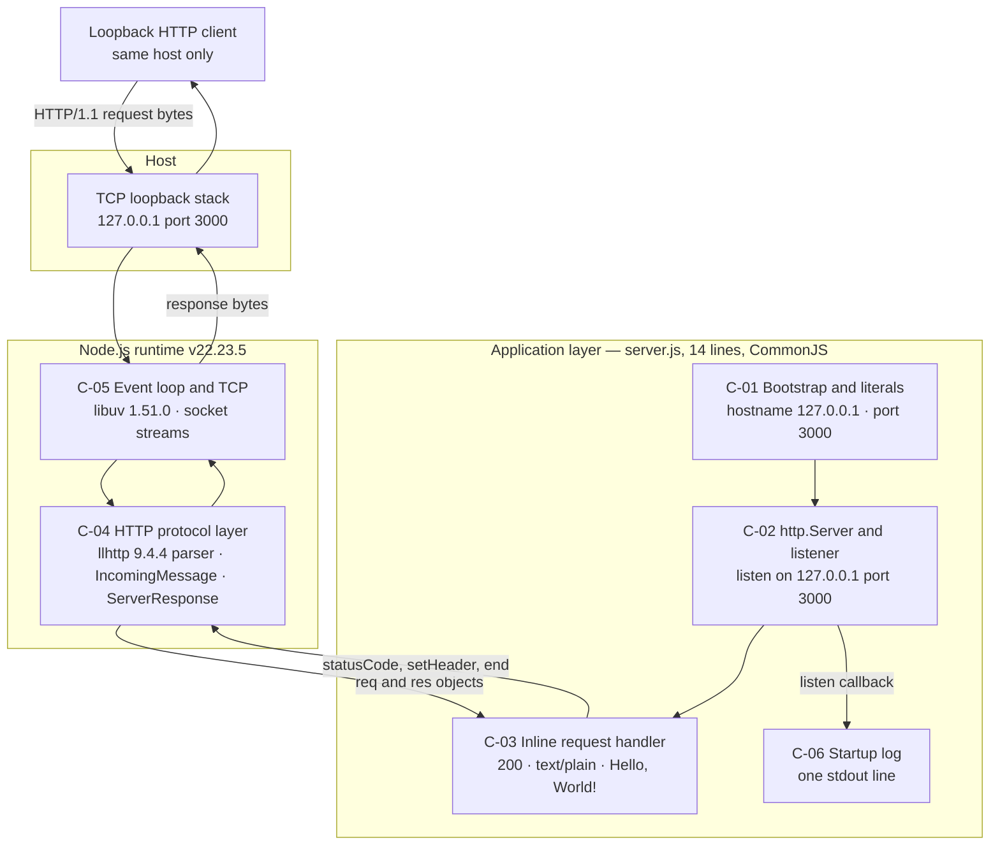

### 5.1.2 Core Components Table

| Component Name | Primary Responsibility | Key Dependencies | Integration Points | Critical Considerations |
| --- | --- | --- | --- | --- |
| **C-01 Bootstrap and configuration** (`server.js` lines 1-4) | Binds the `http` module and declares the system's identity: `hostname = '127.0.0.1'`, `port = 3000` | Node.js `http` (line 1) | Consumed by C-02 for `listen` and by C-06 for log interpolation | The only configuration surface in the system; no environment variable, config file, or CLI flag exists, so any address change is a source edit |
| **C-02 HTTP server and listener** (`server.js` lines 6, 12-14) | Constructs the `http.Server`, registers the request listener, and binds the socket | `http.createServer`, `server.listen` | Owns the single listening socket; invokes C-03 per parsed request; emits the listen callback consumed by C-06; emits an unhandled `error` event on bind failure | Sole network exposure; bind failure is fatal with exit code 1 and no custom message; no `error`, `clientError`, or signal hooks |
| **C-03 Inline request handler** (`server.js` lines 6-10) | Produces the invariant response: `statusCode = 200`, `Content-Type: text/plain`, body `Hello, World!` + newline | `req`/`res` objects supplied by C-04; no other dependency | Invoked by C-04 once per parsed request; returns three mutated response fields | The entire business logic; never reads `req`, so there is no routing, validation, or body handling; synchronous and allocation-light |
| **C-04 HTTP protocol layer** (runtime, not in repository) | Parses bytes into `IncomingMessage`, serializes `ServerResponse`, manages keep-alive and pipelining, enforces header and request timers, generates `400`/`408`/`431` replies | llhttp 9.4.4, `http` module internals | Upward boundary to C-03 via callback; downward boundary to C-05 via socket writes | Every protocol-error status, timeout, and connection-reuse decision originates here; no project code observes them, so these events are invisible to the application |
| **C-05 TCP socket and event loop layer** (runtime, not in repository) | Accepts connections, buffers bytes, dispatches readiness callbacks on the single JavaScript thread | libuv 1.51.0, host TCP/IP stack | Kernel-facing `accept`/`read`/`write`; boundary to C-04 | Sets the concurrency ceiling and latency floor; a blocking handler would stall every connection, which cannot occur here because the handler performs no I/O |
| **C-06 Startup logger** (`server.js` line 13) | Emits the readiness line `Server running at http://127.0.0.1:3000/` once, from the listen callback | `console` global writing to stdout | Fires once after a successful bind; consumed by operators and verifiers | The system's only observability output: no timestamps, levels, request logs, metrics, or trace identifiers |
| **C-07 Manifest and entry contract** (`package.json`, `package-lock.json`; build time only) | Declares package identity, an empty dependency graph, and scripts; `main` names `index.js`, which does not exist | `package-lock.json` with a single root entry | Consumed by npm and Node module resolution | Cannot start the service (`node .` fails); `npm test` exits 1 by design; `node server.js` is the only working entry point |

### 5.1.3 Data Flow Description

**Primary inbound flow.** A request traverses six stages, and only the fourth is application code:

1. **Connection establishment.** The kernel accepts a TCP connection on the listening socket; libuv hands the resulting socket to the `http.Server` connection listener.
2. **Byte accumulation.** Incoming bytes land in socket read buffers and are streamed to the HTTP parser as they arrive.
3. **Message parsing.** llhttp 9.4.4 parses the request line and header block into an `IncomingMessage` (`req`), enforcing protocol strictness and size limits before any application code runs.
4. **Handler dispatch.** The runtime constructs a `ServerResponse` (`res`) and invokes the single registered listener (`server.js` lines 6-10). The handler writes `statusCode = 200`, sets one header (`Content-Type: text/plain`), and calls `res.end('Hello, World!\n')`. `req` is never dereferenced, so method, target, headers, and body have no influence on the outcome.
5. **Response serialization.** `ServerResponse` emits the status line, the mandatory `Date` header, the handler's `Content-Type`, a computed `Content-Length: 14`, and the connection-management headers (`Connection: keep-alive` with `Keep-Alive: timeout=5`, or `Connection: close` when the request or the protocol version requires it), followed by the 14-byte body.
6. **Connection disposition.** The runtime either keeps the socket open for the next request or closes it, then returns control to the event loop. A request that arrives pipelined behind the first is already parsed and is answered on the same connection in order.

**Data transformation points.**

| # | Input | Output | Performed by |
| --- | --- | --- | --- |
| T1 | TCP segments | Ordered byte stream on a socket | Host TCP stack and libuv |
| T2 | Byte stream | Parsed HTTP message, or a `400`/`431`/`408` rejection | llhttp 9.4.4 inside C-04 |
| T3 | Parsed message | One callback invocation with `IncomingMessage` and `ServerResponse` | C-04 |
| T4 | `statusCode`, header map, body string | Status line, headers with computed `Content-Length` and `Date`, body bytes | `ServerResponse` |
| T5 | Request protocol version and `Connection` header | Keep-alive or close, plus the `Keep-Alive: timeout=5` hint | C-04 (HTTP/1.1 defaults to keep-alive; HTTP/1.0 is answered with `Connection: close`) |
| T6 | `hostname` and `port` constants | Log line `Server running at http://127.0.0.1:3000/` | C-06 template literal |

Observed transformations include several that only the runtime performs: `HEAD` requests receive the status line and `Content-Type` but no body and no `Content-Length`; a request carrying `Expect: 100-continue` receives an interim `100 Continue` before the final `200`; a 100,000-byte `POST` body is answered `200` without ever being read.

**Data stores and caches: none.** No database, cache, session store, or file I/O exists; `fs`, `path`, and `stream` are never imported. The only data held in memory are immutable module constants, per-request `req`/`res` objects that are garbage-collected after the response, and kernel socket buffers. Nothing survives a request beyond the response bytes, and nothing survives a restart, so there is no persisted state to migrate, back up, or reconcile. No cache-control, `ETag`, or `Last-Modified` header is emitted; the response is not cacheable by contract, only by its constant content.

**Backpressure.** Because the handler ends the response without consuming the request body, unread body bytes are discarded by the runtime rather than processed. This bounds application memory to the parser's header block and eliminates any request-size-driven memory growth in project code.

### 5.1.4 External Integration Points

The system integrates in exactly four directions, three of which are infrastructure rather than services. It has no outbound integration of any kind: no HTTP client, database driver, message broker, identity provider, log shipper, or telemetry agent appears anywhere in the tree.

| System Name | Integration Type | Data Exchange Pattern | Protocol/Format | SLA Requirements |
| --- | --- | --- | --- | --- |
| Loopback HTTP client (any process on the same host) | Synchronous request-response over a TCP connection | One request yields one invariant response; the connection is reused until 5 s idle, or closed when requested | HTTP/1.1 over plaintext TCP, IPv4 `127.0.0.1:3000` | None defined by the repository; measured 100 concurrent requests in 38 ms, slowest 30 ms |
| Node.js runtime (`http` standard library) | In-process library boundary | Application calls `createServer`/`listen`; runtime calls back on each request and on `listening` | CommonJS module API; no version pinned by `package.json`, v22.23.5 verified | Runtime must be present and expose the APIs used on `server.js` lines 6-14; no `engines` constraint is declared |
| Host TCP/IP stack | Operating-system socket API | Kernel accepts connections and buffers bytes both ways | IPv4 TCP, listening socket on `127.0.0.1:3000` | Port must be free at start; a conflict terminates the process with `EADDRINUSE` and exit code 1 |
| Process supervisor / operator shell | Process lifecycle | Start with `node server.js`, watch stdout for readiness, restart after exit | Text on stdout and stderr, exit codes `0`/`1`/`130`/`143`, `SIGTERM`/`SIGINT` | No liveness or readiness endpoint; the supervisor must treat process liveness plus the readiness line as the entire health signal |
| Backprop integration (named in `README.md` line 2) | Declared only — no implementation | None | None | No artifact, client, credential, or interface for it exists in the repository |

Two consequences follow from this shape. First, the service is a pure sink: it consumes requests and produces responses, with no downstream dependency that could fail, time out, or require a circuit breaker. Second, the integration contract is narrow enough to be verified with a single HTTP request — status `200`, `Content-Type: text/plain`, and a 14-byte body — which is why the fixture needs no test harness of its own.


## 5.2 Component Details

### 5.2.1 C-01 Bootstrap and Configuration

- **Purpose and responsibilities.** Establishes the process's entire configuration by declaring three module-scope bindings: the `http` module reference (`server.js` line 1), `hostname = '127.0.0.1'` (line 3), and `port = 3000` (line 4). Loading the module performs these declarations once and then binds the socket, so bootstrap and configuration are the same act.
- **Technologies and frameworks.** Node.js CommonJS module system; no configuration library, no `.env` reader, no CLI parser. `package.json` has no `"type"` field, so the file loads as CommonJS and `require` resolves from the runtime's own module set.
- **Key interfaces and APIs.** No public interface: the module exports nothing, accepts no arguments, and reads no environment. Its constants are consumed only internally — `port` and `hostname` by `server.listen` (line 12), and both again by the readiness log (line 13).
- **Data persistence requirements.** None. The literals exist only in the loaded module image and are recreated identically on every start.
- **Scaling considerations.** Because the address is a literal, the process cannot be relocated and a second instance on the same host fails immediately with `EADDRINUSE` (verified: exit code 1). Horizontal scaling therefore requires a source edit or a network-namespace wrapper, not a configuration change — the single most consequential scaling constraint in the system.

### 5.2.2 C-02 HTTP Server and Listener

- **Purpose and responsibilities.** Creates the `http.Server` with a single request listener (`server.js` line 6) and binds it to the loopback interface (`lines 12-14`). The server object owns the listening socket, dispatches every parsed request to C-03, and emits a `listening` event that fires the readiness callback.
- **Technologies and frameworks.** `http.createServer` and `server.listen(port, hostname, callback)` from the Node.js standard library; no TLS options, no backlog argument, no `SO_REUSEPORT`, no timeout overrides. All `http.Server` defaults therefore govern the system: `keepAliveTimeout` 5,000 ms, `headersTimeout` 60,000 ms, `requestTimeout` 300,000 ms, `timeout` 0 (no legacy socket timeout), `maxHeadersCount` unlimited, `maxRequestsPerSocket` unlimited — each inspected directly on a `http.createServer()` instance in the verified v22.23.5 runtime.
- **Key interfaces and APIs.** Inbound: the TCP listening socket on `127.0.0.1:3000`. Upward: the request-listener callback signature `(req, res)`. Events: `listening` (consumed by the callback on line 12), `error` (unconsumed — a bind failure throws), and `clientError` (unconsumed — the runtime answers protocol errors itself).
- **Data persistence requirements.** None. The server holds connection objects only for the lifetime of each socket.
- **Scaling considerations.** One listening socket per process, so capacity is per-process and vertical. Idle connections are reclaimed after the 5,000 ms keep-alive timeout (measured socket close at ~6.0 s including timer granularity), and no cap is placed on requests per socket, so a single connection may serve an unbounded sequence of requests.

### 5.2.3 C-03 Inline Request Handler

- **Purpose and responsibilities.** The sole business logic: for every request, set `res.statusCode = 200`, set the header `Content-Type: text/plain`, and end the response with the 14-byte literal `Hello, World!` plus a newline (`server.js` lines 7-9). It reads nothing else — no path, method, query, header, cookie, or body.
- **Technologies and frameworks.** A plain arrow function registered with `http.createServer`; no router, controller, view engine, or validation library. `res.setHeader` is called once, so the response carries exactly one application-controlled header.
- **Key interfaces and APIs.** Consumes the runtime-supplied `IncomingMessage` (`req`, unused) and `ServerResponse` (`res`). Uses three `ServerResponse` members: the `statusCode` property, `setHeader(name, value)`, and `end(chunk)`. Its observable contract is fixed: status `200`, media type `text/plain` without a charset parameter, `Content-Length: 14`, body `Hello, World!\n`.
- **Data persistence requirements.** None. The handler allocates no state that outlives the response, which makes it idempotent and safe for unlimited client retries.
- **Scaling considerations.** Synchronous, CPU-trivial, and free of I/O, so it cannot block the event loop; 100 concurrent requests completed in 38 ms with a 30 ms worst case. Its uniformity also means any number of replicas would answer identically, so the handler itself places no limit on scaling — the port literal in C-01 does.

### 5.2.4 C-04 HTTP Protocol Layer

- **Purpose and responsibilities.** Everything HTTP that the repository does not implement: parsing the request line and header block, framing the response, computing `Date` and `Content-Length`, negotiating connection reuse, enforcing timers, and generating protocol-error responses. Verified behaviours in this layer include `400 Bad Request` for a malformed request line, for an unsupported version (`HTTP/9.9`), for `Content-Length` combined with `Transfer-Encoding`, for conflicting duplicate `Content-Length` values, and for an HTTP/2 prior-knowledge preface; `431 Request Header Fields Too Large` for a header block exceeding 16,384 bytes; an interim `100 Continue` for `Expect: 100-continue`; and `Connection: close` for every rejected request.
- **Technologies and frameworks.** Node.js `http` internals built on the llhttp parser, version 9.4.4 in the verified runtime, with `http.maxHeaderSize` measured at 16,384 bytes.
- **Key interfaces and APIs.** Upward to C-03: the request-listener callback and the `IncomingMessage`/`ServerResponse` pair. Downward to C-05: socket reads, buffered writes, and connection teardown. Its status-code vocabulary is entirely generated, never authored — the application can only ever produce `200`.
- **Data persistence requirements.** Per-connection parser state only, discarded with the socket; no cross-connection memory.
- **Scaling considerations.** Per-connection memory is bounded by the 16,384-byte header cap and by whatever request body the client sends, which the application never buffers. Reuse amortizes handshake cost: the same connection answers sequential and pipelined requests, each independently dispatched to C-03.

### 5.2.5 C-05 TCP Socket and Event Loop Layer

- **Purpose and responsibilities.** Accepts connections on the listening socket, buffers reads and writes, and dispatches readiness callbacks on the single JavaScript thread under the libuv event loop. It converts the concurrency of many sockets into sequential callback invocations.
- **Technologies and frameworks.** Node.js v22.23.5 with libuv 1.51.0 and the host IPv4 loopback stack. No thread pool, worker, or cluster is configured, and no work in the system would use one: nothing performs file, DNS, crypto, or compression work.
- **Key interfaces and APIs.** Kernel-facing `accept`, `read`, and `write`; upward, the socket handles that C-04 consumes. Backpressure surfaces as write-buffer draining, which matters only if a client reads slowly.
- **Data persistence requirements.** None. Kernel socket buffers are transient and released when a connection closes.
- **Scaling considerations.** A single event-loop thread bounds throughput to one core, which is far above the observed workload (100 concurrent requests, 38 ms). The practical ceilings are the host's file-descriptor limit and the kernel accept backlog, neither of which the code configures. Because the handler never blocks, no latency coupling exists between concurrent connections.

### 5.2.6 C-06 Startup Logger

- **Purpose and responsibilities.** Announces readiness exactly once, from the listen callback: `console.log` with a template literal interpolating `hostname` and `port` (`server.js` line 13). It produces no other output at any time, and no request produces a log entry.
- **Technologies and frameworks.** The `console` global writing to stdout; no logging library, level, formatter, or transport.
- **Key interfaces and APIs.** A single unformatted text line: `Server running at http://127.0.0.1:3000/`. Verifiers can match it exactly, which makes it the system's only machine-detectable readiness signal.
- **Data persistence requirements.** None; stdout may be captured by the supervisor but nothing writes a log file.
- **Scaling considerations.** One write per process lifetime, so logging cost is effectively zero. Its corollary is that per-request observability must come from outside the process.

### 5.2.7 Component Interaction Diagram

The diagram below traces the call path of one request, including the runtime components that carry it.

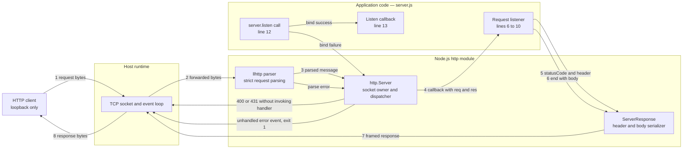

Interaction characteristics worth noting:

- The application layer occurs at steps 4 to 6 only; steps 1 to 3 and 7 to 8 are runtime work that no repository code can observe or alter.
- Parsing precedes dispatch, so a rejected request never reaches the handler — the application has no opportunity to log, count, or shape a protocol error.
- The listen callback and the request listener are the only two callbacks the repository defines, and neither is shared state.

### 5.2.8 State Transition Diagrams

**Connection lifecycle.** Each accepted socket follows the states below; the labels name the trigger and the observed evidence.

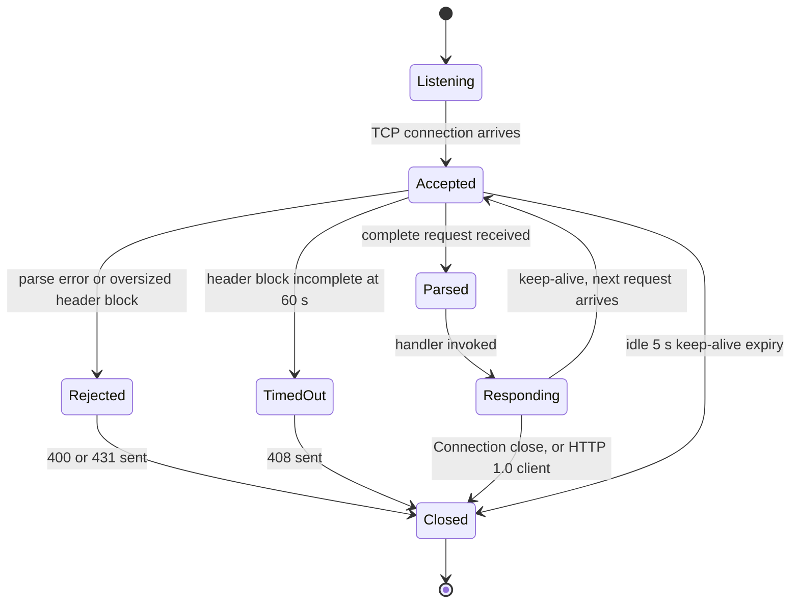

**Process lifecycle.** The process has exactly one successful steady state and no in-code recovery path.

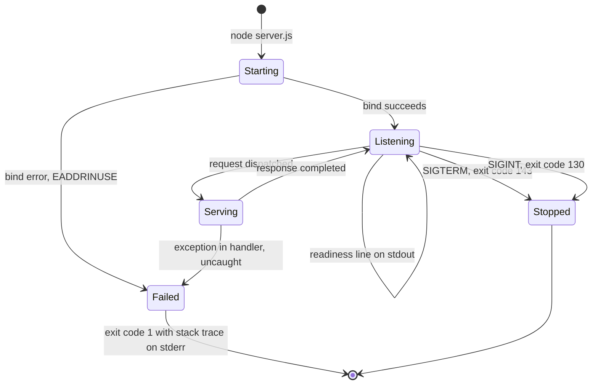

The `Serving --> Failed` edge is structural rather than observed: the handler performs only assignments on a valid response object and one `end` call, so no input can drive it to throw. It is drawn because the absence of `try`/`catch` is what would make such a fault fatal.

### 5.2.9 Sequence Diagrams

**Normal request-response cycle.**

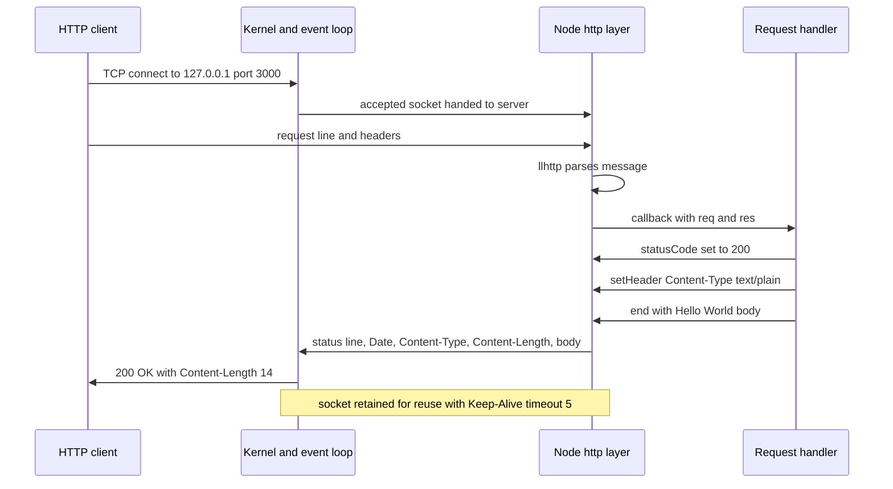

**Keep-alive and pipelining.** Verified by writing two requests into one TCP segment: both were answered on the same connection, in order, the second honouring `Connection: close`.

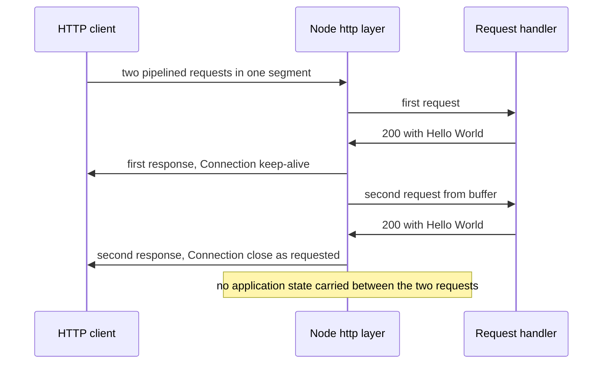

**Protocol error path.** The handler is never invoked, and the client receives a bare runtime-generated rejection with no body.

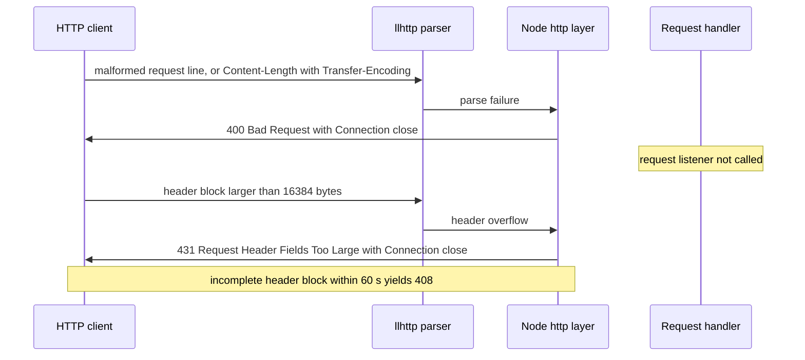

**Startup failure.** The only failure path that reaches the operator is the bind error.

```mermaid
sequenceDiagram
    participant O as Operator or supervisor
    participant N as Node process
    participant K as Kernel
    O->>N: node server.js
    N->>K: listen on 127.0.0.1 port 3000
    K->>N: EADDRINUSE because the port is held
    N->>N: emit error event with no listener
    N->>O: stack trace on stderr, exit code 1
    Note over O: no readiness line is written to stdout
```


## 5.3 Technical Decisions

### 5.3.1 Architecture Style Decisions and Tradeoffs

| Decision | Chosen approach | Alternatives rejected | Tradeoff accepted |
| --- | --- | --- | --- |
| Runtime and HTTP framework | Node.js standard-library `http` module, used directly (`server.js` line 1) | Express, Fastify, Koa, or a hand-written socket server | Zero dependencies and no CVE or upgrade surface, at the cost of having no middleware, routing, or logging facility to reuse |
| Code organization | One 14-line CommonJS module holding bootstrap, configuration, and handler | Layered modules, controller/service separation, exported factory | Trivial to audit and freeze, at the cost of testability: the module cannot be imported without binding the socket, since `listen` runs at module scope |
| Concurrency model | Runtime-managed event loop; synchronous handler; no `cluster`, worker threads, or forks | Multi-process clustering, thread pools, per-request processes | Single-core throughput ceiling in exchange for no shared-state hazards, no locks, and no worker lifecycle to manage |
| Configuration source | Source literals for host and port (`server.js` lines 3-4) | Environment variables, JSON/YAML file, CLI flags, parameter store | No configuration failure mode and no secrets to leak, at the cost of relocatability: a second instance on the same host fails with `EADDRINUSE` |
| Failure posture | No `error`, `clientError`, or signal handlers; fail fast | Retry on bind, fallback port, graceful drain on `SIGTERM` | Operators get a truthful exit code and stack trace instead of a partially functional process, at the cost of dropped in-flight responses on termination |

The style is deliberately the smallest thing that satisfies the requirement "answer HTTP requests with a constant payload". Nothing in the repository argues for more: the handler has no branch, no data access, and no dependence on request content, so every additional architectural element would be unused. The tradeoff is concentrated in two places — the module cannot be unit-tested without network side effects, and the address cannot vary at runtime.

### 5.3.2 Communication Pattern Choices

| Aspect | Choice | Evidence | Consequence |
| --- | --- | --- | --- |
| Interaction style | Synchronous request-response, one reply per request | Handler ends the response inside the single callback (`server.js` lines 6-10) | Simplest possible contract; no streaming, no server push, no callbacks |
| Transport | Plaintext TCP, IPv4 loopback, port 3000 | `http` imported; `https`/`tls` never imported; host literal `127.0.0.1` | Plaintext is acceptable only because the listener is unreachable off-host |
| Protocol version | HTTP/1.1 with runtime defaults; HTTP/1.0 clients answered on an HTTP/1.1 status line with `Connection: close` | Live probe of a `GET / HTTP/1.0` request | No HTTP/2 or HTTP/3 path: a prior-knowledge preface is rejected with `400` |
| Connection reuse | Keep-alive by default, 5,000 ms idle timeout, pipelining supported in order | Observed `Connection: keep-alive` and `Keep-Alive: timeout=5`; two pipelined requests answered on one socket; idle close at ~6.0 s | Amortizes handshakes without any application-level connection bookkeeping |
| Content encoding | None. No `Content-Encoding`, no `Accept-Encoding` negotiation, no compression | Only one header is set by the application (`server.js` line 8) | 14-byte payloads make compression pointless; no CPU cost per response |
| Response body delivery | Single `res.end` chunk, not a stream | `server.js` line 9 | Content-Length is computed and sent; no chunked encoding in practice |
| Outbound communication | None | No `http.request`, `https`, `net`, `fetch`, or socket client anywhere in the tree | The service cannot depend on a downstream system, so no timeout, retry, or circuit-breaker policy is needed |

### 5.3.3 Data Storage Solution Rationale

No storage technology was selected because no data must persist. The system's only datum is the string literal `Hello, World!\n` in `server.js` line 9; the host and port are also literals (lines 3-4). There is no schema, no migration, no connection string, no credential, and no backup target, and the process never opens a file — `fs`, `path`, and `stream` are absent from the import list.

The rationale is coherence with the fixture's purpose rather than an oversight: a verifier needs a deterministic byte-for-byte response, and any store would introduce variability (content drift, connection failure, migration state) that the response contract cannot express. The cost of the choice is that the system cannot be extended toward stateful behaviour without changing three layers at once — a dependency and lockfile regeneration, a configuration surface for connection details, and lifecycle handling for connect and disconnect, none of which exists today.

### 5.3.4 Caching Strategy Justification

No cache exists at any tier, and no cache directive is emitted. The application sets exactly one header (`Content-Type`, `server.js` line 8); the runtime adds `Date`, `Content-Length`, `Connection`, and `Keep-Alive`, none of which is a caching validator. There is no `Cache-Control`, `ETag`, `Last-Modified`, or `Vary` header, no in-memory response cache, and no reverse proxy in the repository.

This is defensible on two counts. First, the response is a constant 14-byte string, so a cache adds latency and invalidation logic to save microseconds. Second, the meaningful reuse in this system is connection reuse, not response reuse: keep-alive with a 5-second idle window already removes the dominant per-request cost (the handshake). The absence has one consequence worth noting: because no explicit directive is sent, caching behaviour is left entirely to whatever client or intermediary a verifier uses, and none is deployed here.

### 5.3.5 Security Mechanism Selection

**Authentication and authorization: none.** There is no credential, token, session, cookie, or header inspection anywhere in the tree — a full-text scan of all seven tracked files for `auth`, `token`, `secret`, and `session` constructs finds only the `author` field in `package.json` line 9. The handler never reads `req`, so it cannot distinguish callers even in principle.

| Control | Status | Mechanism that stands in its place | Residual risk |
| --- | --- | --- | --- |
| Network exposure control | Partial | Bind to the IPv4 loopback literal `127.0.0.1` (`server.js` line 3), which limits reachability to the same host | Anyone with local access can use the port; no IP allow-list, no port randomization |
| Transport confidentiality | Absent | None; only `http` is imported, so traffic is plaintext | Loopback traffic is not exposed to the network, but is visible to privileged local processes |
| Input validation | Delegated | llhttp 9.4.4 strict parsing: `400` for malformed request lines, unsupported versions, `Content-Length` combined with `Transfer-Encoding`, and conflicting duplicate `Content-Length` values | The application performs no validation of its own because it consumes no input |
| Resource-exhaustion limits | Runtime defaults only | 16,384-byte header block cap (`431` beyond it), 60,000 ms header timer, 300,000 ms request timer, 5,000 ms keep-alive idle close | `maxHeadersCount` is unlimited and `maxRequestsPerSocket` is unlimited; no rate limit, connection cap, or body-size policy exists |
| Injection and disclosure surface | Inherently minimal | The response is a constant literal; the request is never reflected, evaluated, or stored | No injection, XSS, or path-traversal route exists in the code as written |
| Security response headers | Absent | None; no HSTS, CSP, `X-Content-Type-Options`, or `X-Frame-Options` is emitted | Acceptable only for a non-browser, loopback-only fixture |

The security posture is therefore "unreachable by design" rather than "protected by mechanism": the compensating control is the loopback binding, and everything else — TLS, identity, rate limiting, hardening headers — is absent by deliberate omission. Any change that moved the bind address off loopback would invalidate all of it at once.

### 5.3.6 Decision Tree Diagrams

**How a request is dispositioned.** Every branch below was exercised against the running process.

```mermaid
flowchart TD
    Start(["Request bytes on the connection"])
    Q1{"Header block within 16384 bytes"}
    R431["431 Request Header Fields Too Large<br/>Connection close"]
    Q2{"Header block complete within 60 s"}
    R408["408 Request Timeout<br/>Connection close"]
    Q3{"Parses under llhttp strict rules"}
    R400["400 Bad Request<br/>Connection close"]
    Q4{"Body left unread by the handler"}
    Handler["Handler sets 200, text/plain, Hello World"]
    R200["200 OK with Content-Length 14"]
    Q5{"Connection header or HTTP version allows reuse"}
    Keep["Socket kept open for the next request"]
    Close["Connection closed"]
    Start --> Q1
    Q1 -->|no| R431
    Q1 -->|yes| Q2
    Q2 -->|no| R408
    Q2 -->|yes| Q3
    Q3 -->|no| R400
    Q3 -->|yes| Q4
    Q4 -->|discarded in both cases| Handler
    Handler --> R200
    R200 --> Q5
    Q5 -->|yes| Keep
    Q5 -->|no| Close
    Keep --> Start
```

**The design-scope decision path that produced this architecture.** Each condition is read directly from the repository rather than assumed.

```mermaid
flowchart TD
    D0{"Does the system need routing, middleware, or request parsing by application code?"}
    No1["No: req is never referenced<br/>choose the http standard library"]
    D1{"Must configuration vary at runtime?"}
    No2["No: declare host and port as const literals"]
    D2{"Must any data persist across requests?"}
    No3["No: no store, no cache, no filesystem access"]
    D3{"Is TLS or identity required for the client set?"}
    No4["No: loopback only, plaintext http, no authn or authz"]
    D4{"Must the process survive a bind failure or a signal?"}
    No5["No: fail fast, exit codes 1, 130, 143, recovery outside the process"]
    Result["Result: one file, one listener, one constant response"]
    D0 -->|no| No1 --> D1
    D1 -->|no| No2 --> D2
    D2 -->|no| No3 --> D3
    D3 -->|no| No4 --> D4
    D4 -->|no| No5 --> Result
```

### 5.3.7 Architecture Decision Records

| ID | Decision | Alternatives considered | Consequences |
| --- | --- | --- | --- |
| ADR-01 | Use the Node.js `http` standard-library module as the entire server stack | Express, Fastify, Koa, raw `net` socket parsing | Adopted: an empty dependency graph, an install that fetches nothing, and no upgrade path to maintain. Rejected alternatives would each have added middleware the handler does not use |
| ADR-02 | Keep bootstrap, configuration, and handler in one 14-line CommonJS module with `listen` at module scope | Exported `createServer` factory, separate config module, `index.js` entry | Adopted: one artifact to audit and freeze. Cost: no importable API, no unit-test seam, and a manifest whose `main` cannot start the service |
| ADR-03 | Hard-code the bind address as `127.0.0.1:3000` literals | Environment variables, config file, CLI arguments | Adopted: no configuration failure mode and no accidental public exposure. Cost: relocation and multi-instance operation require a source edit; a second instance exits with `EADDRINUSE` |
| ADR-04 | Return one constant response and ignore the request entirely | Echo the path, route by method, serve static files | Adopted: a byte-exact verification target with no input-dependent behaviour. Cost: no endpoint variety, no content negotiation, no state-dependent responses |
| ADR-05 | Delegate all protocol handling, timers, and error statuses to runtime defaults | Custom parser, tuned `keepAliveTimeout`/`headersTimeout`, `clientError` hook | Adopted: correct HTTP/1.1 behaviour with no code. Cost: `400`/`408`/`431` replies carry no body and are invisible to the application, and limits cannot be tuned without code changes |
| ADR-06 | Bind only to the loopback interface and omit TLS, authentication, and hardening headers | Bind `0.0.0.0`, add `https` with a certificate, add identity checks | Adopted: an off-host-unreachable service whose entire security posture is one literal. Cost: no confidentiality on-host, no caller identity, no rate limiting |
| ADR-07 | Hold no state: no database, cache, session store, or file I/O | SQLite file, in-memory cache, session cookie | Adopted: idempotent requests and restart-without-repair. Cost: nothing can be remembered, and adding state would touch dependency, configuration, and lifecycle concerns simultaneously |
| ADR-08 | Emit exactly one startup log line and no per-request telemetry | Request logging, metrics endpoint, OpenTelemetry SDK | Adopted: zero observability overhead. Cost: diagnostics depend entirely on external probing and on stdout capture |
| ADR-09 | Fail fast: no `error` listener, no `clientError` hook, no signal handlers, no `server.close()` | Graceful shutdown with drain, bind retry loop, supervisor-integrated health endpoint | Adopted: a truthful exit and a stack trace instead of a half-working process. Cost: in-flight responses are dropped on `SIGTERM`, and every recovery is an external restart |

Two implications tie the records together. ADR-03 and ADR-07 make the process stateless and self-contained, which is what allows ADR-09's fail-fast posture to be safe — there is no state to flush and no peer to notify. ADR-05 and ADR-06 concentrate all protocol and exposure behaviour in the runtime, so the repository's own surface stays at fourteen lines while the observable behaviour still matches HTTP/1.1.


## 5.4 Cross-Cutting Concerns

### 5.4.1 Monitoring and Observability

The system carries no monitoring stack: no metrics registry, no health or readiness endpoint, no OpenTelemetry SDK, no heartbeat, and no admin surface. It is observable only from outside, through four signals the operating system already provides.

| Signal | Source | What it proves | Limits |
| --- | --- | --- | --- |
| Process liveness | The PID of `node server.js` | The runtime has not exited | Says nothing about whether the listener is bound or answering |
| Readiness line | `console.log` on the listen callback (`server.js` line 13) | Bind succeeded; the socket is accepting | Emitted once per process lifetime; never repeated, so it cannot detect later degradation |
| Exit status | Process termination | `0` on clean exit, `1` on bind failure, `130` on `SIGINT`, `143` on `SIGTERM` | Only available after the fact |
| stderr | Node's uncaught-error path | The specific failure, including `code`, `errno`, `syscall`, `address`, and `port` | Written only on startup failure; nothing at request time |

Because no in-process health check exists, the only meaningful probe is a black-box HTTP request asserting `200`, `Content-Type: text/plain`, and a 14-byte body. That probe also exercises the entire code path, since the handler branches on nothing. Note the asymmetry this creates: a `400`, `408`, or `431` response proves the process is alive and the listener is working, yet produces no signal inside the process at all.

### 5.4.2 Logging and Tracing

There is no logging framework, no log level, no structured format, and no trace instrumentation. The complete logging behaviour is one statement (`server.js` line 13).

| Attribute | Value | Evidence |
| --- | --- | --- |
| Destination | stdout only | `console.log`; nothing writes to stderr except the runtime's own crash path |
| Frequency | Exactly once per process lifetime, after a successful bind | Verified across every probe run, including a 100-request concurrency test: stdout stayed at one line |
| Format | Plain text, no timestamp, no level, no fields, no JSON | Template literal `Server running at http://${hostname}:${port}/` |
| Content | `Server running at http://127.0.0.1:3000/` | Exact bytes confirmed from the running process |
| Per-request logging | None | The handler contains no logging call; success and protocol-error requests are equally silent |
| Trace correlation | None. No request ID, span, or correlation header | No such construct appears in the tree |

The practical consequences are worth stating explicitly. A successful request leaves no record; a rejected request leaves no record; a client disconnect leaves no record. Diagnosis of request-time behaviour requires reproducing traffic from the outside, and because the response is constant, the response itself is the only evidence available. For a fixture whose contract is a fixed reply, this is sufficient; for any operational use it would not be.

### 5.4.3 Error Handling Patterns

The pattern is uniform: the runtime detects and reports, the application does nothing. There is no `try`/`catch`, no `throw`, no `error` or `clientError` listener, no retry, no fallback, and no graceful shutdown — verified by a full-text scan of all tracked files.

| Condition | Status or outcome | Generated by | Visible to application code |
| --- | --- | --- | --- |
| Request line unparsable, unsupported version, `Content-Length` with `Transfer-Encoding`, conflicting duplicate `Content-Length`, HTTP/2 preface | `400 Bad Request` + `Connection: close`, no body | llhttp 9.4.4 parser inside the `http` module | No; the handler never runs |
| Header block exceeds 16,384 bytes | `431 Request Header Fields Too Large` + `Connection: close` | `http` module header parser | No |
| Header block incomplete inside 60,000 ms | `408 Request Timeout`; Section 4.10 records the observed reply at 88,922 ms | `http` module header timer | No |
| Idle keep-alive connection past 5,000 ms | Socket closed silently | `http.Server` keep-alive timer | No |
| Client aborts mid-exchange | Socket torn down, process unaffected | libuv / socket layer | No |
| Port 3000 already bound | Uncaught `error` event: stack trace on stderr, exit code 1 | `net` layer | No; nothing catches it |
| Exception inside the handler | Would terminate the process with a stack trace | Node.js `uncaughtException` path | Not catchable as written; no input can trigger it |

```mermaid
flowchart TD
    Boot(["Process start: node server.js"])
    Bind{"Bind 127.0.0.1 port 3000"}
    subgraph StartupFailure["Startup failure path"]
        BindErr["Unhandled error event<br/>EADDRINUSE stack trace on stderr"]
        Exit1["Exit code 1<br/>no readiness line"]
    end
    Ready["Readiness line on stdout<br/>listener accepted connections"]
    Req(["Request arrives"])
    Parse{"llhttp strict parse and size checks"}
    subgraph RequestRejection["Runtime rejection path, handler not invoked"]
        S400["400 Bad Request with Connection close"]
        S431["431 Request Header Fields Too Large"]
        S408["408 Request Timeout"]
    end
    Handler["Handler runs: 200, text/plain, Hello World"]
    subgraph Termination["Termination path, external recovery"]
        SigTerm["SIGTERM exit 143"]
        SigInt["SIGINT exit 130"]
    end
    Restart["Operator or supervisor restarts the process"]
    Boot --> Bind
    Bind -->|fails| BindErr --> Exit1
    Bind -->|succeeds| Ready
    Ready --> Req --> Parse
    Parse -->|malformed, ambiguous framing, bad version| S400
    Parse -->|header block too large| S431
    Parse -->|header block incomplete| S408
    Parse -->|valid| Handler
    Ready --> SigTerm
    Ready --> SigInt
    Exit1 --> Restart
    SigTerm --> Restart
    SigInt --> Restart
```

The recovery loop is entirely external. Nothing in the code observes an error, classifies it, retries it, or reports it to another system; the design assumption is that a supervisor notices the exit and relaunches, which is safe precisely because the process holds no state to repair.

### 5.4.4 Authentication and Authorization

Neither exists. There is no authentication mechanism, no session, no token or cookie handling, no authorization rule, and no identity concept — the handler never reads `req`, so a caller cannot be identified even in principle. A full-text scan of all seven tracked files for `auth`, `token`, `secret`, and `session` constructs returns a single match, the `author` field in `package.json` line 9.

The framework that stands in for identity is the bind address: `127.0.0.1` (`server.js` line 3) makes the service unreachable from any other host, so the access-control boundary is the host's own user and process isolation rather than any application logic. This is coherent with the fixture's purpose — it exists for byte-level verification, not for data access — but it means that any change to the bind address would expose an unauthenticated service, and any consumer needing caller identity must supply it out of band. There is also no authorization surface to extend: no resource is addressed, because the response is identical for every path.

### 5.4.5 Performance Requirements and SLAs

The repository defines no SLA, SLO, latency target, throughput target, or alert. The only stated contract is behavioural: every well-formed request receives `200`, `text/plain`, and a 14-byte body. The figures below are measurements from the verified runtime, reported as observations rather than commitments.

| Metric | Observed value | Conditions |
| --- | --- | --- |
| Request latency | 30 ms worst case | 100 concurrent requests over a keep-alive agent, single process, v22.23.5 |
| Burst completion | 38 ms for 100 concurrent requests, all `200` | Same run; no failures, no queueing artifacts |
| Time to readiness | Readiness line immediately after bind; under ~1.2 s end to end including process launch | Measured wall clock from launch to first successful request |
| Payload size | 14 bytes per response, constant | `Hello, World!\n` |
| Per-request application work | Three property or method calls, no allocation of persistent state | `server.js` lines 7-9 |

Operating limits are the runtime defaults, none of which the repository overrides:

| Limit | Default value | Effect when exceeded |
| --- | --- | --- |
| `keepAliveTimeout` | 5,000 ms | Idle connection closed; measured close at ~6.0 s including timer granularity |
| `headersTimeout` | 60,000 ms | `408` and connection close |
| `requestTimeout` | 300,000 ms | Request abandoned by the runtime |
| `timeout` (legacy socket timeout) | 0, disabled | No socket inactivity timeout at that layer |
| `http.maxHeaderSize` | 16,384 bytes | `431` and connection close |
| `maxHeadersCount` | unlimited | No per-message header-count cap |
| `maxRequestsPerSocket` | unlimited | No per-connection request cap |

Capacity is therefore bounded by the host, not by the code: one event-loop thread, the process's file-descriptor limit, and the kernel accept backlog. Because the handler performs no I/O and no computation proportional to input, throughput degrades only through connection-count limits, never through per-request work. The system has no vertical or horizontal scaling configuration of its own — a second instance on the same host cannot start at all, since the port is a literal.

### 5.4.6 Disaster Recovery Procedures

Because the process persists nothing, recovery is restart. There is no backup, no replica, no failover, no snapshot, and no data repair step, and none is needed: the only retained artefact is a constant in source, which is restored by checking out the repository.

| Scenario | Recovery action | Data exposure | Verification |
| --- | --- | --- | --- |
| Bind failure (`EADDRINUSE`, exit 1) | Identify and stop the process holding `127.0.0.1:3000`, then relaunch `node server.js` | None; nothing was written | Readiness line on stdout, then a probe returning `200` with a 14-byte body |
| Termination by `SIGTERM`/`SIGINT` (143/130) | Relaunch the process; the OS releases the port on exit | None | Same probe; confirm exactly one readiness line |
| Uncaught fault in the runtime or handler | Relaunch the process | None | Same probe |
| Host restart | Start the process by whatever external mechanism the environment provides; nothing in the repository declares a service unit or `start` script | None | Same probe; note that `package.json` has no `start` entry and `main` points at a missing `index.js`, so the launch command must be `node server.js` |
| Source drift | Restore the checkout to the committed state; history is a single commit and `main` and `QA-25-nov-branch` are identical, so any deviation is detectable with `git status` or `git diff` | None | Re-run the byte-level probe: `200`, `text/plain`, `Content-Length: 14`, `Hello, World!` |

Two properties make these procedures unusually simple and unusually fragile. Statelessness means there is no recovery point objective to reason about — no data can be lost because none exists — and the recovery time objective is simply process start plus bind, measured under ~1.2 seconds. Fragility comes from the absence of any automated recovery: no supervision, restart policy, or health endpoint exists inside the repository, so every one of these actions is manual or must be supplied by the surrounding environment. The final check after any recovery is the byte-level probe, not `npm test`, which exits 1 by design (`package.json` line 7).


## 5.5 References

- `server.js` - The system's only implementation code (14 lines): `http` import (line 1), `hostname`/`port` literals (lines 3-4), the `http.createServer` request handler that sets `statusCode = 200`, `Content-Type: text/plain`, and ends with `Hello, World!\n` (lines 6-10), and the `server.listen` bind with its readiness log callback (lines 12-14). Establishes every component, interface, boundary, and decision recorded in this section.
- `package.json` - Package identity (`hello_world`, `1.0.0`, MIT, author `hxu`), a `main` of `index.js` that does not exist, no `type` field (so CommonJS), no `engines` floor, no dependency blocks, and the placeholder `test` script that exits 1.
- `package-lock.json` - `lockfileVersion` 3 with a single root package entry, proving an empty dependency graph and therefore a zero-install runtime footprint.
- `README.md` - Two lines declaring the checkout a test fixture for backprop integration that must not be modified; the basis for the immutability assumption.
- `.blitzyignore.txt` - Zero-byte file; the repository-level ignore list, which excludes nothing.
- `test.blitzyignore.txt` - Zero-byte file; contributes no configuration.
- `test.py.txt` - Zero-byte file; filename suggests Python source but no content exists, and nothing in the system loads it.
- Repository root (folder `""`) - Flat structure of exactly seven files and no sub-directories, confirming that the inventory above is complete and that no other source, configuration, test, container, or deployment artifact exists.

Runtime facts reported in this section — Node.js v22.23.5, HTTP parser llhttp 9.4.4, libuv 1.51.0, V8 12.4.254.21-node.57, and the `http.Server` default values (5,000 ms keep-alive, 60,000 ms header timeout, 300,000 ms request timeout, disabled legacy socket timeout, unlimited header count and requests per socket, 16,384-byte `http.maxHeaderSize`) — were observed directly from the installed runtime (`process.versions` and a `http.createServer()` instance) and from live requests against `node server.js`. No external web source was consulted for this section.


# 6. SYSTEM COMPONENTS DESIGN

## 6.1 Core Services Architecture

### 6.1.1 Applicability Assessment and Verdict

**Core Services Architecture is not applicable for this system.**

`hao-backprop-test` contains no decomposition into services. It is one CommonJS module, `server.js` (14 lines), executed by one Node.js process, publishing one listener on `127.0.0.1:3000`, and answering every request with the same 14-byte body. There is no second deployable unit, no inter-service boundary, no registry, no balancer, and no orchestration artifact anywhere in the seven tracked files. The absence is deliberate rather than incomplete: `README.md` line 2 declares the checkout a test fixture for backprop integration that must not be modified, and Section 5.1.1 records the same single-process, single-threaded, event-driven characterization.

The table below tests the defining criteria of a core services architecture against what the repository actually contains.

| Criterion | What a core services architecture requires | What this repository has | Evidence |
| --- | --- | --- | --- |
| Service decomposition | Two or more independently deployable units with distinct responsibilities | One executable file; one process; one listener; one handler that ignores `req` | Only `server.js` executes (`require('http')`, `server.js` line 1); `package.json` `main` names a nonexistent `index.js` and declares no `start` script |
| Inter-service communication | A network or message contract between services | Inbound loopback HTTP only; no outbound call of any kind | `http` is the sole import; `https`, `net`, and `http.request` never appear in the tree |
| Service discovery | A registry, DNS/SRV record, or configuration source resolving peers | None; the address is a source literal the caller must already know | `hostname` and `port` are `const` literals (`server.js` lines 3-4); no `process.env` reference |
| Independent scaling | Each service scales on its own resource profile | Impossible on one host: a second instance cannot bind | Verified: second `node server.js` exits 1 with `listen EADDRINUSE: address already in use 127.0.0.1:3000` |
| Failure isolation | Bulkheads, circuit breakers, per-service retry budgets | Process-level isolation only, provided by the OS; nothing in code | No `error` listener, `try`/`catch`, retry loop, or breaker construct in any tracked file (Section 5.4.3) |
| Distributed state | Replication, consensus, or shared store | No state at all, therefore nothing to replicate | No database, cache, session, or `fs` use (Section 3.5, Section 4.9.2) |

Three consequences follow, and they frame every remaining sub-section of 6.1:

- **The unit of architecture is the process, not the service graph.** "Service" below means this single OS process; "caller" means any process on the same host that opens a TCP connection to it. No other topology exists to document.
- **Each distributed-systems capability is marked absent with its evidence and its governing constraint**, because the useful architectural fact is not merely that there is no load balancer but that the port literal at `server.js` line 4 is what makes one impossible.
- **The system's entire inter-component contract is three response fields** — `statusCode = 200`, `Content-Type: text/plain`, and the body `Hello, World!` plus a newline (`server.js` lines 7-9). That contract, not a service contract, is the thing any change must preserve (Section 5.2.3).

Component-level detail for the seven elements that do exist — C-01 through C-07 — belongs to Section 5.2, and request-level and lifecycle behavior belongs to Section 4.2 through Section 4.10. This section confines itself to what those components mean for service boundaries, scaling, and resilience.


### 6.1.2 Service Components

#### 6.1.2.1 Service Boundary and Responsibility

One boundary exists: the OS process running `server.js`. Its published interface is a TCP listening socket on `127.0.0.1:3000` speaking HTTP/1.1. Everything inside that boundary shares one address space, one JavaScript thread, and one failure domain, so none of it can be deployed, restarted, or scaled separately.

| Boundary element | Interface it publishes | Independently deployable | Why it is or is not a service boundary |
| --- | --- | --- | --- |
| The process (`node server.js`) | TCP `127.0.0.1:3000`, HTTP/1.1 | Yes — but only one instance per host and port | The sole network-reachable unit; the only thing a caller can address |
| Node.js HTTP layer (C-04, Section 5.2.4) | In-process callback API (`(req, res)`) | No | Ships inside the runtime; shares the process's memory and failure domain |
| Request handler (C-03, Section 5.2.3) | None — an anonymous arrow function | No | No identity, no lifecycle, no independent failure mode; invoked only by the runtime |
| Startup logger (C-06, Section 5.2.6) | One unformatted text line on stdout | No | A single `console.log` inside the listen callback (`server.js` line 13) |
| Manifest (C-07, Section 5.2.7) | npm package metadata | No | Build-time only; cannot start the service, since `main` points at a missing `index.js` |

Responsibility splits cleanly in two, and only the smaller half is code in this repository.

| Responsibility | Implemented in the repository | Actual executor |
| --- | --- | --- |
| Accept TCP connections on `127.0.0.1:3000` | Yes — the address literals and `server.listen` (`server.js` lines 3-4, 12) | Kernel accept queue, then libuv |
| Parse the request line and header block, enforce size and framing limits | No | llhttp 9.4.4 inside the `http` module |
| Route, validate, authenticate, authorize | No | Nobody — the handler never dereferences `req` (`server.js` line 6) |
| Construct the response payload | Yes — three assignments (`server.js` lines 7-9) | `ServerResponse` serializes them |
| Manage connection reuse, timeouts, and protocol-error replies | No | `http.Server` timers and parser (Section 5.4.5) |
| Report readiness | Yes — one `console.log` (`server.js` line 13) | The `console` global writing to stdout |
| Emit metrics, traces, or per-request logs | No | No such mechanism exists (Section 5.4.1, Section 5.4.2) |

#### 6.1.2.2 Inter-Service Communication Patterns

Only one communication relationship exists inside the system: caller to service, synchronous and connection-oriented. The system never originates a call, so there is no client, no correlation, no timeout budget, and no retry loop anywhere in the tree.

| Relationship | Pattern | Protocol and format | Failure semantics |
| --- | --- | --- | --- |
| Loopback caller → the service | Synchronous request-response, one reply per request | HTTP/1.1 over plaintext TCP, IPv4 `127.0.0.1:3000` | No in-band error channel: either a `200` with a 14-byte body, a runtime-generated `400`/`408`/`431`, or a socket-level failure (`ECONNREFUSED` when nothing is bound) |
| Service → Node.js runtime | In-process function call and callback | CommonJS module API | A throw or unhandled `error` event terminates the process (Section 4.7) |
| Service → any downstream system | Does not exist | None | Not applicable — there is no callee that could be slow, unavailable, or partially failing |
| Service → "backprop integration" named in `README.md` | Declared intent only | None | Nothing is implemented (Section 5.1.4) |

Because the exchange is synchronous and reply-bearing in the caller's thread, the caller's own timeout governs its experience; the service contributes no latency budget of its own, having no dependency to wait on. Pipelining and keep-alive are handled entirely by the runtime (Section 4.4), and the application keeps no notion of which request belongs to which connection.

#### 6.1.2.3 Service Discovery, Load Balancing, Circuit Breaking, Retry and Fallback

| Capability | Present | What stands in for it | Evidence |
| --- | --- | --- | --- |
| Service discovery | No | The caller hard-codes `127.0.0.1:3000`; the address is a source literal and is also printed at startup as the only advertisement | `server.js` lines 3-4 and 13; no `process.env`, DNS, SRV, or registry reference in any tracked file |
| Load balancing | No | The kernel's accept queue on a single listening socket; no reverse proxy, no upstream pool, no `SO_REUSEPORT` | `server.listen(port, hostname, callback)` passes no backlog, `reusePort`, or `exclusive` option (`server.js` line 12); a second instance exits 1 with `EADDRINUSE` |
| Circuit breaker | Not applicable | Nothing to break away from: the handler makes no outbound call, so no dependency can fail repeatedly | `http` is the only import (`server.js` line 1); the handler body is three statements |
| Retry | No | One bind attempt and one response attempt; a failed bind ends the process | `EADDRINUSE` produces exit code 1 with no loop, backoff, or re-attempt (Section 4.7.1) |
| Fallback | No | No alternate port, host, or degraded payload exists | Port is the literal `3000` (`server.js` line 4); the body is the literal `'Hello, World!\n'` (line 9) |
| Health and readiness checking | No HTTP endpoint | One readiness line on stdout, plus a black-box request that asserts the full contract | Section 5.4.1 |

**Discovery.** The only mechanism is out-of-band knowledge: a caller must already know that the service lives on the loopback interface at port 3000. The startup line `Server running at http://127.0.0.1:3000/` is the closest thing to registration, and it addresses no consumer — it is written to stdout for a human or a log scraper (Section 5.2.6). Nothing re-binds on failure, so a restarted process reappears at exactly the same address, which makes hard-coding the address viable in practice.

**Load balancing.** There is no balancing layer and no capacity to balance across. Every request to the host reaches the same process, and the only queue in the path is the kernel accept backlog, whose size the repository does not set because `listen` is called without a backlog argument. A caller wanting redundancy cannot get it by starting a second instance: the bind fails deterministically, as verified. Section 6.1.3 treats the consequences.

**Circuit breaker.** A breaker exists to stop a caller from repeatedly invoking a failing dependency. This service has no dependency, so the pattern has no place inside it. The mirror-image gap is worth naming: consumers of this service have no breaker either, and because the service publishes no health endpoint, a consumer cannot learn its state except by attempting a connection and interpreting `ECONNREFUSED` or a truncated reply.

**Retry and fallback.** The repository defines neither. Two properties nonetheless make retries safe for whoever retries: the handler ignores method, path, headers, and body, so the response is a pure function of nothing, and it mutates no state outside the response object (Section 4.9.2). Any number of retries therefore produce the identical result, and the client-side retry policy — if one exists — lives entirely outside this repository.

#### 6.1.2.4 Service Interaction Diagram

The diagram shows the one interaction path that exists and, alongside it, the service components the architecture omits, so the boundary is visible rather than inferred.

```mermaid
flowchart LR
    Caller["Caller process on the same host<br/>loopback IPv4 client"]
    subgraph Svc["The service — one process running server.js"]
        Listener["Listening socket<br/>127.0.0.1 port 3000, source literal"]
        Handler["Request handler<br/>server.js lines 6 to 10"]
        Ready["Readiness line on stdout<br/>one per process lifetime"]
    end
    subgraph Omitted["Service components absent from this system"]
        Registry["Service registry or discovery"]
        Balancer["Load balancer or reverse proxy"]
        Broker["Message broker or event bus"]
        Peer["Peer service"]
        Downstream["Downstream system"]
    end
    Caller -->|"HTTP/1.1 request bytes"| Listener
    Listener -->|"parsed request"| Handler
    Handler -->|"200 text/plain, 14 bytes"| Caller
    Listener -.->|"shown on startup only"| Ready
    Caller -.->|"no lookup is performed"| Registry
    Caller -.->|"no intermediate hop"| Balancer
    Handler -.->|"no publish or subscribe"| Broker
    Handler -.->|"no inter-service call"| Peer
    Handler -.->|"no outbound request"| Downstream
```

Read the solid edges as the whole of the system's interaction architecture: two of them are runtime work the application never observes, and one is the three-statement handler. Every dashed edge is a capability a core services architecture would supply, drawn to show that its absence is structural rather than an oversight — no code exists that could participate in it.


### 6.1.3 Scalability Design

#### 6.1.3.1 Horizontal and Vertical Scaling Approach

The system scales in exactly one direction — vertically, within a single process — and it does so only by consuming more of the host, not by adding replicas. The discriminating constraint is the source literal at `server.js` line 4: because every instance demands the same `127.0.0.1:3000`, a second instance on the same host cannot start. Verified: the second process exits 1 with `listen EADDRINUSE: address already in use 127.0.0.1:3000`.

| Dimension | Mechanism available | Hard limit | Evidence |
| --- | --- | --- | --- |
| Vertical, CPU | None beyond one event-loop thread | One core; a second core is unused | No `cluster`, `worker_threads`, or `child_process` in any tracked file |
| Vertical, memory | Runtime default heap growth | Host memory | No `--max-old-space-size` or memory limit declared anywhere; measured baseline 47.7 MB RSS |
| Horizontal, same host | Not available | One bind per host and port; `reusePort` is not set | `server.listen(port, hostname, callback)` passes no socket options (`server.js` line 12) |
| Horizontal, another host | Requires editing the bind address or isolating the loopback in a network namespace | Neither present in the repository | Bind is the literal `'127.0.0.1'` (`server.js` line 3); no container, IaC, or orchestration artifact exists (Section 3.6.3) |
| Connection concurrency per process | Event-loop multiplexing over sockets | File-descriptor limit and accept backlog, neither configured | Handler performs no I/O, so concurrency is not limited by per-request work |

Two practical consequences deserve emphasis. First, adding CPU to the host improves nothing: the entire application runs on one JavaScript thread, and the seven OS threads measured in the process are runtime internals (the main thread, the libuv thread pool, and V8 helper threads) with no work to do, because the handler never touches the filesystem, DNS, crypto, or compression. Second, replicating the process *is* architecturally free in the only sense that matters — the handler is stateless and constant, so any number of instances would answer identically (Section 5.2.3) — but the repository offers no way to express that replication. Horizontal scaling is therefore a source change, not a deployment change, and the repository's `README.md` instruction not to modify the checkout makes it a change to the fixture's contract rather than a scaling knob.

#### 6.1.3.2 Auto-Scaling Triggers and Rules

No auto-scaling trigger, rule, or metric exists in the repository, and no signal is emitted that a controller could consume without looking at the process from outside.

| Signal | Available | Granularity | Who could consume it |
| --- | --- | --- | --- |
| Process liveness and exit status | Yes | Per process lifetime (`0`, `1`, `130`, `143`) | A supervisor or init system |
| Readiness line `Server running at http://127.0.0.1:3000/` | Yes, exactly once | Per process lifetime, after a successful bind | A log scraper (Section 5.4.1) |
| Black-box HTTP probe (`200`, `text/plain`, 14 bytes) | Yes, by construction | Per request | Any external prober; the only signal that survives degradation |
| Request rate, latency percentiles, error counts, CPU, memory | No | — | Must be inferred externally from probe traffic or host metrics |
| Connection count or queue depth | No | — | The runtime holds these privately; nothing exposes them |

An auto-scaler therefore cannot be built from the application. The workable pattern — outside this repository — is a static replica count plus external liveness probing, or host-level CPU metrics plus a restart policy. Because there is no drain phase (Section 4.7.2), scale-in must be treated as an abrupt termination that drops in-flight requests rather than a graceful removal from rotation.

#### 6.1.3.3 Resource Allocation Strategy

| Resource | Observed allocation | Declared in the repository | Note |
| --- | --- | --- | --- |
| JavaScript thread | 1, saturated only while a handler runs | No | Runtime default; no worker or cluster configured |
| OS threads | 7 at baseline | No | Node.js internals; none is used by the handler |
| Memory (RSS) | 47,660-47,756 kB across three launches | No limit or request declared | Stable baseline; no per-request growth in application state |
| File descriptors | Host soft limit 1,048,576 on the verification host | No | Approximately one descriptor per open connection plus the listener |
| Per-connection memory | Bounded by the 16,384-byte header cap plus kernel socket buffers | No | `http.maxHeaderSize` default; request bodies are never buffered by application code (Section 5.1.3) |
| Disk | None used | No | No `fs` import; the only write is one stdout line |
| Network endpoints | One TCP port on the loopback interface | Yes — literals at `server.js` lines 3-4 | No TLS, no second port, no admin socket |

Allocation is thus entirely implicit: the process takes what it needs from the host, and the host alone decides the ceiling. There is no cgroup, ulimit, JVM-style heap flag, or runtime tuning in the repository to govern it.

#### 6.1.3.4 Performance Optimization Techniques

| Technique | Used | Detail |
| --- | --- | --- |
| Event-loop multiplexing without threads | Yes | One thread serves all sockets; no context switching per request |
| Zero I/O in the request path | Yes | Handler performs three in-memory assignments (`server.js` lines 7-9) |
| Connection reuse | Yes | Keep-alive with the runtime's 5,000 ms idle window; measured socket close at ~6.0 s (Section 5.4.5) |
| Pipelining | Yes, by runtime | Requests buffered in one segment are answered in order on one connection (Section 4.4) |
| Minimal response surface | Yes | One application header, computed `Content-Length: 14`, no body serialization work |
| No persistent per-request allocation | Yes | Nothing survives a response, so there is no cache to invalidate or leak (Section 4.9.2) |
| Clustering, worker threads, HTTP/2, TLS | No | Absent from the tree; TLS termination would have to occur outside the process |
| Compression, caching headers, CDN behaviour | No | No `Cache-Control`, `ETag`, or `Last-Modified` is emitted (Section 4.9.2) |

The design is fast for the narrow reason that it does almost nothing, and that is the property to preserve: an optimization effort here would add latency variance (compression, TLS handshakes, cache lookups) to a path currently measured in single-digit milliseconds.

#### 6.1.3.5 Capacity Planning Guidelines

- **Plan per host, not per replica.** The schedulable unit is one `127.0.0.1:3000` endpoint per host. Capacity multiplies only by adding hosts, or by isolating each instance's loopback in its own network namespace — a capability no artifact in this repository provides.
- **Bound concurrency by descriptors, not by compute.** Throughput ceiling = `min(file-descriptor limit, kernel accept backlog)`; both are host properties. Measured host limit was 1,048,576 descriptors with the runtime's default backlog, since `listen` passes none.
- **Use the measured burst as a floor, not an SLA.** 100 concurrent requests completed in 38-40 ms total with a 30-33 ms worst case and zero failures across two independent runs — roughly 2,500 responses per second in a burst. Sustained throughput was not measured, and no target exists in the repository (Section 5.4.5).
- **Budget ~48 MB resident per instance** for the baseline process, plus a per-connection bound of about 16 KB (the header cap) on top of kernel socket buffers. Memory does not grow with request volume, because no application state accumulates.
- **Assume no elastic response.** With no metrics endpoint and no autoscaling hook (Section 6.1.3.2), capacity must be provisioned for the peak, or scaled by an external controller watching host metrics and probe success.
- **Treat replacement as cheap and lossy.** Statelessness makes a restart safe and fast — readiness within roughly one second of launch — but the absence of `server.close()` and any signal handler means in-flight requests are dropped rather than drained, so capacity plans should carry headroom for the termination window.

#### 6.1.3.6 Scalability Architecture Diagram

```mermaid
flowchart TB
    Clients["Concurrent loopback clients<br/>HTTP/1.1 keep-alive connections"]
    subgraph Current["Current capacity unit — one process on one host"]
        Sock["Listening socket<br/>127.0.0.1 port 3000"]
        Loop["Event loop<br/>single JavaScript thread"]
        Handler["Stateless handler<br/>no I/O, no shared state"]
    end
    subgraph Vertical["Vertical scaling — the only direction available"]
        Core["One core saturated at peak<br/>additional cores unused"]
        Mem["~47.7 MB RSS baseline<br/>no growth with request count"]
    end
    subgraph Horizontal["Horizontal scaling — blocked on a single host"]
        Second["Second instance on the same host"]
        Fail["EADDRINUSE<br/>exit code 1"]
        Name["Distinct network namespace or container<br/>requires artifacts not in repository"]
        Edit["Edit bind literals<br/>server.js lines 3 and 4"]
    end
    Clients --> Sock --> Loop --> Handler
    Handler -->|"14-byte reply"| Clients
    Loop -.-> Core
    Loop -.-> Mem
    Second --> Fail
    Edit -.->|"required first"| Second
    Name -.->|"required first"| Second
```

The solid path is the only one the code implements. The dotted edges into `Second` are prerequisites, not features: without a source edit or a network namespace, horizontal scaling terminates at `EADDRINUSE` before the handler ever runs.


### 6.1.4 Resilience Patterns

#### 6.1.4.1 Fault Tolerance Mechanisms

Tolerance is entirely inherited: the runtime detects and answers the faults it can classify, the OS provides process isolation, and no application code participates in either. The absence of `try`/`catch`, of an `error` listener, and of any signal handler is what makes this uniform (Section 5.4.3, Section 4.7).

| Fault class | Detected by | Handled where | Observed outcome |
| --- | --- | --- | --- |
| Malformed request line, unsupported version, `Content-Length` with `Transfer-Encoding`, conflicting duplicate `Content-Length`, HTTP/2 preface | llhttp 9.4.4 inside the `http` module | Runtime, before the handler runs | `400 Bad Request` + `Connection: close`; the handler is never invoked |
| Header block above 16,384 bytes | `http` header parser | Runtime | `431 Request Header Fields Too Large` + `Connection: close` |
| Header block incomplete past the 60,000 ms `headersTimeout` | `http.Server` header timer | Runtime | `408 Request Timeout`, then close |
| Idle keep-alive connection past 5,000 ms | `http.Server` keep-alive timer | Runtime | Socket closed silently; measured at ~6.0 s including timer granularity |
| Client aborts mid-exchange | Socket layer / libuv | Runtime and OS | Socket torn down; the process is unaffected and keeps serving |
| Port `3000` already bound | OS `listen` syscall | Nothing — the `error` event has no listener | Stack trace on stderr, exit code 1, no readiness line |
| `SIGTERM` / `SIGINT` | OS signal delivery | Nothing — no handler exists | Immediate termination, exit `143` / `130`, no drain of in-flight responses |
| Exception inside the handler | Would reach the runtime's `uncaughtException` path | Nothing — no guard exists | Process would exit. Structurally unreachable: the handler makes three calls on a valid response object, so no request can drive it to throw |

Two properties are worth separating. The service is **crash-tolerant at the process level only** — a fault ends the process and recovery is external — while being **exceptionally tolerant at the request level**, because nothing in a request can alter the code path. There is no bulkhead, no timeout budget, and no isolation between connections beyond what the event loop provides: a blocking handler would stall every socket, but no handler in this system can block.

#### 6.1.4.2 Disaster Recovery Procedures

Recovery is restart, and restart is sufficient because nothing is retained. The full procedure set, including the byte-level verification step, is recorded in Section 5.4.6; the architectural properties are:

| Property | Value in this system | Basis |
| --- | --- | --- |
| Recovery point objective (RPO) | Not applicable — no durable state exists to lose | No database, cache, session, or filesystem write (Section 4.9.2) |
| Recovery time objective (RTO) | Readiness within about one second of launch; a probe succeeded within 1.2 s end to end | Measured launch-to-first-`200`; consistent with Section 5.4.5 |
| Recovery granularity | Whole process, replaced wholesale | No partial recovery, no in-process repair, no reconnect logic |
| Automation inside the repository | None | No `start` script, no supervisor unit, no `SIGTERM` handler, no restart logic (`package.json`; `server.js`) |
| Automation required outside | Supervisor or orchestrator that relaunches `node server.js` on exit | Section 3.6.4 |
| Verification after recovery | One request asserting `200`, `Content-Type: text/plain`, `Content-Length: 14`, body `Hello, World!` | The contract at `server.js` lines 7-9; `npm test` is not a gate, it exits 1 by design |

The clean-restart property carries a cost that a recovery plan must state: because there is no `server.close()` and no signal handler, a restart drops in-flight requests rather than draining them. Recovery is therefore *fast but ungraceful*, and any caller must tolerate a `ECONNREFUSED` or truncated reply during the handover window.

#### 6.1.4.3 Data Redundancy Approach

There is no data redundancy because there is no data. The only artifact that must survive a failure is the source itself: `server.js`, whose response body is the literal `'Hello, World!\n'`, plus a manifest with an empty dependency graph. Redundancy for that artifact lives in version control, not in the runtime — a single commit `6c2a446` with `main` and `QA-25-nov-branch` content-identical (Section 3.6.1), so any deviation from the committed state is detectable with `git diff`.

| Data category | Exists | Redundancy mechanism | Consequence |
| --- | --- | --- | --- |
| Persistent business data | No | None needed | Nothing to back up, replicate, or reconcile after failure |
| Session or request state | No | None needed | Connections are interchangeable and any instance would answer identically |
| Configuration | Yes — two source literals | Git history only | Recovery is `git checkout`, not a restore procedure |
| In-memory caches | No | None needed | No warm-up, no cold-start penalty, no staleness window |
| Logs | One line written once to stdout | Whatever captures stdout | Nothing is written to disk by the process |

#### 6.1.4.4 Failover Configuration

No failover configuration exists: no standby instance, no replica set, no leader election, no VIP, no health-checked pool. Two structural facts prevent the usual active/passive arrangement on one host: the bind address is a literal, and `reusePort` is not enabled, so the standby cannot hold the port while the primary runs — it exits at bind with code 1. Failover is consequently a **sequential handover**: stop the old process, start the new one.

| Failover attribute | Value | Constraint |
| --- | --- | --- |
| Topology | Single active instance per host; no standby | One bind per host and port (`server.js` lines 3-4; no `reusePort`) |
| Trigger | Process exit, detected externally | No health endpoint, so failover cannot be health-driven from inside the system |
| Handover window | Bind plus readiness, roughly one second | Callers see `ECONNREFUSED` for the duration; no balancer absorbs it |
| Split-brain risk | None | Only one process can bind, by construction |
| State transfer | None required | The new instance is behaviourally identical to the old (Section 4.9.1) |
| Automation | None in the repository | Supervisor or orchestrator, outside the checkout (Section 3.6.4) |

#### 6.1.4.5 Service Degradation Policies

There is no degradation policy, and the reason is architectural rather than an omission: a service can only degrade *relative to a dependency*, and this one has none. Its outcome set is binary — the contract response, a runtime-generated protocol rejection, or a socket-level failure.

| Degradation control | Present | Closest existing behaviour |
| --- | --- | --- |
| Graceful degradation of response content | No | The body is a constant; there is no reduced mode to fall back to |
| Rate limiting or request shedding | No | The runtime's parser limits shed only malformed or oversized traffic (`400`, `431`, `408`) |
| Timeout budget tuning | No | Only runtime defaults apply: `keepAliveTimeout` 5,000 ms, `headersTimeout` 60,000 ms, `requestTimeout` 300,000 ms |
| Per-connection request cap | No | `maxRequestsPerSocket` is unlimited, so one connection may serve an unbounded sequence |
| Header-count cap | No | `maxHeadersCount` is unlimited |
| Circuit breaking or bulkheads | Not applicable | No outbound dependency, therefore no failing dependency to isolate from |
| Load shedding under CPU pressure | No | Nothing measures load; the event loop simply queues callbacks |

The implicit admission control that does exist is the runtime's strictness: malformed framing and oversized header blocks are rejected before the handler runs, which protects the process from a class of abusive input without any code in the repository. Everything beyond that — fairness, quotas, backpressure toward the client — would have to be supplied in front of the service, which today means on the host, since no proxy tier exists.

#### 6.1.4.6 Resilience Pattern Diagram

```mermaid
flowchart TD
    Req["Request arrives on the loopback socket"]
    Parse{"Runtime parse, framing and size checks"}
    subgraph RuntimeAbsorbed["Fault classes absorbed by the runtime, handler not invoked"]
        Bad["Malformed or ambiguous framing<br/>400 plus Connection close"]
        Big["Header block above 16384 bytes<br/>431 plus Connection close"]
        Slow["Header block incomplete at 60 s<br/>408 then close"]
    end
    subgraph AppUnhandled["Fault classes with no in-process handling"]
        Bind["Port already bound<br/>exit 1, no retry"]
        Signal["SIGTERM or SIGINT<br/>exit 143 or 130, no drain"]
        Crash["Uncaught exception<br/>process exit"]
    end
    OK["Handler answers<br/>200, text/plain, 14 bytes, identical every time"]
    Ext["External supervisor or operator<br/>relaunch node server.js"]
    Idle["Idle keep-alive expiry at 5000 ms<br/>socket closed silently"]
    Req --> Parse
    Parse -->|"invalid"| Bad
    Parse -->|"oversized"| Big
    Parse -->|"incomplete"| Slow
    Parse -->|"valid"| OK
    OK -.-> Idle
    Bind --> Ext
    Signal --> Ext
    Crash --> Ext
    Ext -->|"restart, roughly one second to readiness"| Req
```

The runtime-absorbed box is the only place where a fault produces a protocol answer. Everything in the unhandled box produces a process exit, and the external restart edge is the whole of the recovery mechanism — which is safe here precisely because the process holds no state to restore (Section 4.9.1).


### 6.1.5 Capability Matrix and Architectural Constraints for Change

#### 6.1.5.1 Capability Matrix

The matrix consolidates the findings of 6.1.2 through 6.1.4, each row naming the single constraint that governs it — the useful part of a gap analysis is knowing what would have to change, not merely what is missing.

| Capability | Present | Governing constraint | Where it lives |
| --- | --- | --- | --- |
| Service decomposition into multiple deployable units | No | One executable file; the handler ignores `req`, so there is no behavior to split by domain | `server.js` lines 6-10; `git ls-files` lists seven files total |
| Service discovery | No | Address is a source literal, not configuration | `server.js` lines 3-4 |
| Load balancing | No | One listener; `reusePort` not enabled, so only one bind per host and port | `server.js` line 12 |
| Circuit breaker | Not applicable | No outbound dependency exists to fail | `http` is the only import (`server.js` line 1) |
| Retry and backoff | No | Single bind attempt; the request path cannot fail | `server.js` lines 12-14; exit code 1 on `EADDRINUSE` |
| Fallback path | No | Port and body are literals | `server.js` lines 4 and 9 |
| Auto-scaling trigger | No | No metrics, no health endpoint; only stdout and exit status escape the process | `server.js` line 13 (Section 5.4.1) |
| Graceful shutdown | No | No signal handler and no `server.close()` call | `server.js` lines 12-14 (Section 4.7.2) |
| Health or readiness endpoint | No | The listen callback writes one line to stdout and nothing else | `server.js` line 13 |
| Redundancy and failover | No | Single active instance; a standby cannot bind alongside it | `server.js` lines 3-4, 12 |
| Degradation controls (rate limit, shedding, quotas) | No | No dependency to degrade against; only runtime parser limits apply | Section 6.1.4.5 |
| Externalized configuration | No | `hostname` and `port` are `const` literals; no `process.env` reference exists | `server.js` lines 3-4 |
| Multiple instances per host | No | Same literal port, no network namespace or container artifact | `server.js` line 4; Section 3.6.3 |

#### 6.1.5.2 Invariants Any Change Must Preserve

Whatever topology is introduced later, four observable properties constitute the system's contract and are what external verification compares against:

- **Response identity.** `200`, `Content-Type: text/plain` with no charset parameter, `Content-Length: 14`, body `Hello, World!` plus newline (`server.js` lines 7-9).
- **Readiness signal.** The exact line `Server running at http://127.0.0.1:3000/`, emitted once per process lifetime from the listen callback (`server.js` line 13).
- **Exit semantics.** `1` on bind failure, `143` on `SIGTERM`, `130` on `SIGINT` — all produced by the runtime's default disposition, which any added handler would change.
- **Zero external dependencies.** `package-lock.json` records only the root package, so introducing a proxy, a registry client, or an instrumentation agent adds a dependency surface the checkout currently does not have.

#### 6.1.5.3 Constraints on Introducing a Service Architecture

`README.md` line 2 states that the checkout is a test fixture for backprop integration which must not be modified, so the following is descriptive guidance rather than a recommendation to change it — it identifies the order in which work would necessarily occur if the fixture ever needed to become a service.

| Step | Change required | Blocks | Cost |
| --- | --- | --- | --- |
| 1 | Externalize the bind address and port out of `server.js` lines 3-4 | Every form of horizontal scaling and any non-default port | Small, but changes the file the fixture exists to freeze |
| 2 | Add a `SIGTERM` handler calling `server.close()` to enable draining | Safe scale-in and rolling replacement | Small; changes exit-code semantics from `143` to `0` |
| 3 | Add a health or readiness endpoint distinct from the business response | Health-driven failover and load-balancer membership | Moderate; adds a route where the handler currently has none |
| 4 | Introduce a proxy or balancer tier in front of the listener | Load balancing, retry, circuit breaking at the edge | Large; requires deployment artifacts none of which exist (Section 3.6.3) |
| 5 | Decompose the handler by responsibility | Any genuine service boundary | Not feasible as written: the handler has one behavior, so there is nothing to separate |

Steps 1 through 3 are properties of the single process; only step 4 creates a topology in which "core services architecture" becomes a meaningful subject for this system.


### 6.1.6 References

- `server.js` — the only executable artifact: 14-line CommonJS module binding `127.0.0.1:3000` from literals on lines 3-4, the inline handler on lines 6-10 (`200`, `text/plain`, `Hello, World!\n`), the `listen` call on lines 12-14, and the readiness log on line 13. Supplied every fact in 6.1 about service boundaries, the published contract, retry and fallback absence, scaling limits, and resilience behavior.
- `package.json` — package identity, `main: index.js` (nonexistent), the placeholder `test` script that exits 1, and the absence of `start`, `engines`, dependency, and `type` fields; established that the manifest cannot start the service and that no runtime version is pinned.
- `package-lock.json` — `lockfileVersion` 3 with a single root entry and no external packages; established the zero-dependency graph that removes any third-party partial-failure surface.
- `README.md` — two lines: the project name and the declaration that this is a test fixture for backprop integration which must not be modified; established the design intent behind the absence of service architecture and the constraint cited in 6.1.1 and 6.1.5.
- Repository root (`./`) — flat checkout of seven tracked files and no sub-directories, confirmed by `git ls-files` and a filesystem walk; established that no second deployable unit, container definition, proxy configuration, orchestration manifest, or pipeline descriptor exists anywhere in the tree.
- Cross-referenced specification sections used for consistency rather than as primary evidence: Section 3.5 (no databases or storage), Section 3.6 (no build, container, IaC, or CI artifacts), Section 4.2 (request-response cycle), Section 4.4 (keep-alive and pipelining), Section 4.7 (bind failure, signals, termination), Section 4.9 (absence of state), Section 5.1.4 (external integration points), Section 5.2 (component inventory C-01 through C-07), Section 5.4.1 through 5.4.6 (observability, error handling, performance limits, disaster recovery).

No web sources were used; every statement in this section derives from the repository files above or from executed verification of the running process on Node.js v22.23.5 (response bytes, `EADDRINUSE` exit code 1, `SIGTERM` 143, `SIGINT` 130, 100 concurrent requests in 40 ms, 47.7 MB baseline RSS, runtime default timeout values).


## 6.2 Database Design

### 6.2.1 Applicability Determination

**Database Design is not applicable to this system.**

`hao-backprop-test` contains no database, no cache, no object store, no search index, and no persistent file. The runtime state of the service is three module-scope literals compiled into `server.js`, and the only output is a constant 14-byte HTTP body. There is no schema to model, no row to insert, no index to plan, and no replica to configure. Section 3.5 reached the same conclusion from the technology-stack angle; this section records the consequence for data architecture, and names the constraint that governs each absent capability rather than omitting it.

The table below tests the defining concerns of a database design against what the checkout actually holds.

| Concern | What a database design would describe | What this repository contains | Evidence |
| --- | --- | --- | --- |
| Persistent schema | Tables/collections, columns, types, keys, relationships | Nothing; no `.sql`, `.db`, `.sqlite`, `.json` schema, or ORM model file exists in the tree | Seven tracked files total (`git ls-files`); no data file in the flat root |
| Datastore client | Driver or ODM, connection string, pool settings | Nothing; the single `require` is the Node built-in `http` | `server.js` line 1; `package.json` has no dependency block; `package-lock.json` records only the root package |
| Query surface | Statements, prepared queries, query builder | Nothing; the handler never dereferences `req`, so it cannot even read a request path to select data | `server.js` lines 6-10 |
| Migration tooling | Versioned DDL scripts or an ORM migration runner | Nothing; no migration directory, no CLI script, no `start` script | `package.json` `scripts` holds only the placeholder `test`; repository root is flat |
| Indexes and constraints | Primary/foreign keys, unique and secondary indexes, check constraints | Nothing at the data layer; the only enforced limits are network-level (one bind per host and port, 16,384-byte header cap) | `server.js` lines 3-4, 12; runtime defaults described in Section 6.1.4.5 |
| Backup and restore | Dump schedule, retention, restore drill | Nothing; restart is the whole recovery procedure, and it is lossless because nothing is retained | Section 6.1.4.2; no `fs` import anywhere |
| Replication and failover | Replica set, read replicas, promotion rules | Nothing; a second instance cannot bind — `listen EADDRINUSE` with exit code 1 | Verified; `server.listen(port, hostname, callback)` sets no `reusePort` (`server.js` line 12) |
| Cache tier | Cache technology, key schema, TTL, invalidation | Nothing; no cache client and no cache header is emitted | No `Cache-Control`, `ETag`, or `Last-Modified` in the handler (`server.js` lines 7-9) |

**The data the service does handle.** Absence of storage does not mean absence of data types; it means the data never outlives the response that carries it.

| Datum | Type and lifetime | Storage location | Governing evidence |
| --- | --- | --- | --- |
| `hostname` = `'127.0.0.1'` | `const` string; process lifetime, immutable | Process memory (module scope) | `server.js` line 3 |
| `port` = `3000` | `const` number; process lifetime, immutable | Process memory (module scope) | `server.js` line 4 |
| `'Hello, World!\n'` | String literal, 14 bytes; process lifetime, immutable | Process memory, serialized per response | `server.js` line 9 |
| `req` (the inbound request) | `http.IncomingMessage`; request lifetime, readable but never read | Process memory, created and discarded by the runtime | `server.js` line 6 — the parameter is never referenced in the body |
| `res` (the outbound response) | `http.ServerResponse`; request lifetime, mutated then flushed | Process memory plus kernel socket buffer, then released | `server.js` lines 6-9 |

**Runtime confirmation.** The running service was inspected rather than inferred: after `node server.js` bound `127.0.0.1:3000`, its open file descriptors were a single listening socket plus `/dev/null`, `eventfd`/`eventpoll`/`io_uring` anonymous inodes and pipes — no regular file handle and no datastore socket of any kind. A request returned `HTTP/1.1 200 OK`, `Content-Type: text/plain`, `Content-Length: 14`, and the process terminated with status `143` on `SIGTERM`, having written only the one startup line to stdout. Nothing in that exchange touched a store.

**How the remainder of this section reads.** Because the prompt's areas are mandatory subjects, 6.2.2 through 6.2.5 address each of them and record it as conforming-absent, with the mechanism that makes it absent. 6.2.6 diagrams the one data path that exists and the persistence topology that does not. 6.2.7 states what introducing a datastore would cost. Any reader looking for an ERD, an index list, or a retention schedule will find the finding "none, for this reason" rather than a manufactured design.


### 6.2.2 Schema Design

#### 6.2.2.1 Entity Relationships

There are no entities and therefore no relationships. An entity in the database-design sense is a set of homogeneous records with identity and attributes; this system materializes exactly one output — a status line, one header, and a constant body — and retains no record of having produced it. The entity-relationship diagram is consequently empty, and the empty diagram is the accurate finding, not a placeholder (6.2.6.1 renders it).

| Candidate entity | Records persisted | Attributes | Why it does not exist |
| --- | --- | --- | --- |
| Request | 0 | Method, path, headers, body — all present on `req` and all never read | The handler ignores its `req` parameter entirely (`server.js` line 6) |
| Client or caller | 0 | No identity, address, or session is captured | No authentication, session, cookie, or address logging code exists |
| Response record | 0 | `statusCode`, `Content-Type`, body | The three values are assigned per request and discarded when the socket flushes (`server.js` lines 7-9) |
| Configuration | 0 rows; two source constants | `hostname`, `port` | Compiled into the module, not loaded from a store (`server.js` lines 3-4) |

Cardinality is therefore not a design decision anywhere in the system: there is no pair of stores between which a relationship could hold, and no key that could join them. The data flow in 6.2.6.2 shows the single request-to-response path in which nothing is looked up.

#### 6.2.2.2 Data Models and Structures

The only model is the HTTP response envelope, and it is a constant function of nothing: given any request, the output is `200`, `Content-Type: text/plain`, `Content-Length: 14`, and `Hello, World!\n`. The runtime computes the framing header itself.

| Response field | Source | Value | Mutability |
| --- | --- | --- | --- |
| Status line | `res.statusCode = 200` | `HTTP/1.1 200 OK` | Assigned per request, always the same literal |
| `Content-Type` | `res.setHeader('Content-Type', 'text/plain')` | `text/plain`, no charset parameter | Constant string literal |
| `Content-Length` | Runtime-computed from the body | `14` | Derived, never set by application code |
| Body | `res.end('Hello, World!\n')` | `Hello, World!` plus newline (14 bytes) | Constant string literal |

**Structures that exist but carry no persistence semantics:** `req` (`http.IncomingMessage`) and `res` (`http.ServerResponse`) are runtime objects with a request-scoped lifetime; the module scope holds three `const` bindings (`hostname`, `port`, `server`) that are immutable for the process lifetime. `server.js` declares no class, no factory, no export, and no data-access function, so there is no place in the code where a record type could be introduced without new code (6.2.7).

**Serialization formats.** None are produced or consumed. The response body is plain text; there is no JSON, XML, CSV, Protobuf, or Avro encoder or decoder in the tree, no `JSON.parse`/`JSON.stringify` call, and no request payload is ever read — `server.js` never touches `req` at all.

#### 6.2.2.3 Indexes and Constraints

**Indexes: none exist.** No table, collection, or key-value space is defined, so there is nothing to index; no `CREATE INDEX`, no ORM index decorator, and no index configuration file appears in the seven tracked files.

**Constraints: none exist at the data layer.** The only invariants the running system enforces are network and runtime properties, and documenting them is the closest honest analogue to a constraint inventory.

| Constraint | Layer enforcing it | Behaviour on violation | Evidence |
| --- | --- | --- | --- |
| One listener per host and port | OS `bind` via `server.listen` | Stack trace, exit code `1` (`EADDRINUSE`) | `server.js` lines 3-4, 12; verified by launching a second instance |
| Bind address fixed at `127.0.0.1:3000` | Source literals | Any other port or interface requires editing the file | `server.js` lines 3-4; no `process.env` reference in the tree |
| Header block ≤ 16,384 bytes | Node.js HTTP parser default | `431 Request Header Fields Too Large`, connection closed | Runtime default (Section 6.1.4.5) |
| Response body fixed at 14 bytes | Literal at `server.js` line 9 | No alternative body can be produced | Runtime computes `Content-Length: 14` |

There is no uniqueness constraint, no foreign key, no check constraint, no not-null constraint, and no transaction boundary, because there is no writable store in which any of them could be declared or violated.

#### 6.2.2.4 Partitioning Approach

No partitioning exists, and none could: partitioning distributes rows of one logical dataset, and this system has no dataset. The nearest structural facts are single-valued limits rather than partitions.

| Partitioning dimension | Status | What bounds the system instead |
| --- | --- | --- |
| By key range or hash | Not present | No keys and no rows exist |
| By time (daily/monthly tables) | Not present | No timestamped records are written; the only timestamp is the runtime-generated `Date` header |
| By tenant or region | Not present | No tenancy, localization, or regional configuration exists (Section 1.3.1) |
| By process or host | Not present | Capacity is one listener per host; a second instance fails to bind with `EADDRINUSE` (Section 6.1.3.1) |

#### 6.2.2.5 Replication Configuration

No replication configuration exists: no replica set, no read replica, no primary/standby pair, no log shipping, and no consensus participation. Replication exists to copy durable state; there is no durable state to copy.

| Replication attribute | Value | Governing constraint |
| --- | --- | --- |
| Topology | Single active process per host; no standby | The bind address is a literal and `reusePort` is not set, so the standby exits `1` at bind (`server.js` lines 3-4, 12) |
| Replicated dataset | None | All state is three immutable literals recreated at each start (6.2.2.2) |
| Lag, conflict resolution, quorum | Not applicable | Nothing is written, so nothing can conflict or fall behind |
| Cross-host arrangement | Requires editing the bind literals or isolating each loopback in its own network namespace | No container, IaC, or orchestration artifact exists in the checkout |

#### 6.2.2.6 Backup Architecture

There is no backup job, no snapshot, no dump, and no restore procedure, because there is nothing whose loss a backup could mitigate. The artifact that must survive failure is the source itself, and its redundancy is supplied by version control.

| Object | Backup mechanism | Restore procedure | Consequence of loss |
| --- | --- | --- | --- |
| `server.js`, `package.json`, `package-lock.json`, `README.md` | Git history — a single commit `6c2a446`; `main` and `QA-25-nov-branch` are content-identical | `git checkout` / `git clone` | Recoverable from any clone; no data is lost, only code |
| Runtime data | None needed — nothing is written at runtime | Restart the process; readiness within about one second | No recovery point objective applies, since no durable state exists (Section 6.1.4.2) |
| Emitted log | The single readiness line on stdout is captured (or not) by whatever supervises the process | Not restorable by the system | No application behaviour depends on it |


### 6.2.3 Data Management

#### 6.2.3.1 Migration Procedures

There are no migration procedures: no DDL directory, no migration runner, no schema-state table, no ORM CLI, and no `db:migrate`-style script. `package.json` declares exactly one script, the npm placeholder `"test": echo "Error: no test specified" && exit 1`, and no `start`, `build`, `prepare`, or `postinstall` hook that could carry a migration step. Deployment is `node server.js` and nothing else (Section 3.6), so a release has no data step to sequence against.

The absence is structural rather than an unimplemented task: a migration changes the shape of stored records, and no stored records exist. The equivalent change in this system is editing `server.js`, which is a source change reviewed and reverted through Git, not a data-migration procedure.

#### 6.2.3.2 Versioning Strategy

Two version axes exist, neither of which is a data-schema version.

| Version axis | Present | Value | Mechanism |
| --- | --- | --- | --- |
| Artifact version | Yes | `1.0.0` | Declared in `package.json` and mirrored in `package-lock.json` under the root `""` package entry |
| Source change history | Yes | One commit, `6c2a446` "Add files via upload"; `main` and `QA-25-nov-branch` content-identical | Git; deviation from the committed state is detectable with `git diff` |
| Data-schema version | No | — | No schema exists; no version table, no `schema_version` column, no `PRAGMA user_version` |
| Payload or contract version | No | — | The response is a fixed literal; no version header, no `Accept` negotiation, no URI versioning |

Because the artifact version is the only declared version, two running instances of the same commit are indistinguishable in behaviour: the response bytes are identical, and no data format exists that could drift between them.

#### 6.2.3.3 Archival Policies

Nothing is archived, because nothing accumulates. The system writes no record that could age out: there is no table to partition by date, no log file to rotate, and no bucket lifecycle rule.

| Data category | Volume per process | Archival policy | Where it goes instead |
| --- | --- | --- | --- |
| Business records | Zero | None | Never created |
| Request or access history | Zero | None | `req` is never read, so no request history is even observable to the application (`server.js` line 6) |
| Application log | One line, written once at startup | None | stdout only: `Server running at http://127.0.0.1:3000/` (`server.js` line 13) |
| Configuration snapshots | Not applicable | None | Two literals under version control (`server.js` lines 3-4) |

Retention of the one startup line is entirely a property of whatever captures the process's stdout; the process itself holds no file open and writes nothing to disk, as the file-descriptor inspection in 6.2.1 confirmed.

#### 6.2.3.4 Data Storage and Retrieval Mechanisms

Storage is memory and a socket; retrieval is the HTTP request itself, whose result never depends on stored content.

| Medium | Direction | Content | Lifetime |
| --- | --- | --- | --- |
| Process memory, module scope | Read-only source of all response bytes | `hostname`, `port`, `server`, the body literal | Process lifetime; recreated at each start |
| Process memory, request scope | Written then released | `req` (unread) and `res` (three assignments) | One request |
| Kernel socket buffers | Written toward the client | The serialized response bytes | Until the transmission completes or the socket closes |
| Filesystem | Neither read nor written | Nothing | Not used — `fs`, `path`, and `stream` are never imported |

Retrieval semantics are degenerate in a precise sense: the handler performs no lookup, so the response is a pure function of the code, not of any input. Method, path, headers, and body cannot alter the outcome, and no cache or index stands between the request and the reply. This is why the exchange is safe to retry without idempotency concerns (Section 6.1.2.3).

#### 6.2.3.5 Caching Policies

No caching policy exists at any layer — application, HTTP, or data.

| Cache layer | Present | Detail | Evidence |
| --- | --- | --- | --- |
| Application cache (Redis, in-process map) | No | No cache client, no map, no memoization; each request re-executes three assignments | `server.js` lines 6-10; no dependency in `package-lock.json` |
| HTTP response cache directives | No | No `Cache-Control`, `Expires`, `ETag`, `Last-Modified`, or `Vary` header is emitted | Handler sets only `Content-Type` (`server.js` line 8) |
| Conditional request handling | No | `If-None-Match` and `If-Modified-Since` are never inspected, since `req` is never read; `304` can never be returned | `server.js` line 6 |
| Connection reuse (not a data cache) | Yes, by runtime default | Keep-alive with a 5,000 ms idle window; the observed reply carried `Connection: keep-alive` and `Keep-Alive: timeout=5` | Runtime defaults (Section 6.1.3.4) |
| Datastore query cache | Not applicable | No datastore, therefore no query cache and no invalidation problem | Section 3.5 |

The practical consequence: any intermediary is free to cache the response indefinitely, since the bytes never change for a given code revision, but the service itself neither invites nor prevents it. Adding `Cache-Control: no-store` would be a one-line change that the fixture's "do not touch" instruction (`README.md` line 2) does not permit.


### 6.2.4 Compliance Considerations

#### 6.2.4.1 Data Retention Rules

No retention rule exists, and none is needed, because the application retains nothing: no record survives a request, and nothing survives a restart. The compliance posture is the strongest short of a controlled store — there is no store to retain from.

| Data class | Retained by the application | Retention period | Deletion or purge mechanism |
| --- | --- | --- | --- |
| Personal data (names, addresses, identifiers) | No | Not applicable | Nothing is collected, so there is nothing to erase |
| Tenant or customer content | No | Not applicable | No multi-tenancy exists (Section 1.3.1) |
| Request metadata (path, headers, client address) | No | Not applicable | `req` is never dereferenced (`server.js` line 6) |
| Derived or aggregated analytics | No | Not applicable | No analytics, metrics, or counters exist |
| Configuration | Only within the source file and Git history | Life of the repository | `git` history rewrite is the only removal path |

The restart semantics make the strongest retention guarantee available to any system: no data outlives the process, so a right-to-erasure request for runtime data is satisfied by termination, and no residual copy exists in a backup, replica, or cache.

#### 6.2.4.2 Backup and Fault Tolerance Policies

There is no backup policy and no fault-tolerance mechanism inside the application, because the recoverable object is source code held in version control (6.2.2.6).

| Policy element | Value in this system | Basis |
| --- | --- | --- |
| Recovery point objective (RPO) | Not applicable — no durable state exists to lose | No datastore, cache, session, or filesystem write (Section 6.1.4.2) |
| Recovery time objective (RTO) | Readiness within roughly one second of `node server.js` | Verified launch-to-first-`200` measurement recorded in Section 6.1.4.2 |
| Restore source | A Git clone of commit `6c2a446` | Single commit; `main` and `QA-25-nov-branch` identical |
| Fault tolerance in process | None — no `try`/`catch`, no `error` listener, no `server.close()`, no signal handler | `server.js` lines 1-14 contain none of these constructs |
| Fault tolerance inherited | Runtime protocol rejections (`400`, `408`, `431`) and OS process isolation | Section 6.1.4.1 |
| Consequence for in-flight requests | Termination is abrupt: `SIGTERM` yields exit `143`, `SIGINT` exit `130`, with no drain phase | Verified signal behaviour, Section 4.7 |

Because the process holds no state, a crash is data-safe by construction: the worst outcome is an interrupted response the client must retry, and any retry produces the identical result.

#### 6.2.4.3 Privacy Controls

No privacy control is implemented, and the reason is the absence of personal data rather than an omission of policy: the payload is a public constant, and the request is never inspected.

| Privacy concern | Exposure | Control in place |
| --- | --- | --- |
| Collection of personal data | None — no field of `req` is read, so path, headers, cookies, and body are never stored or logged | Structural: the handler references only `res` (`server.js` lines 6-10) |
| Data at rest | None — nothing is written to disk | No `fs` import; file-descriptor inspection showed no regular file handles |
| Data in transit | Plaintext HTTP on the loopback interface; the payload carries no sensitive content | Bind restricted to `127.0.0.1` (`server.js` line 3); no TLS |
| Telemetry egress | None — no outbound socket is ever opened by application code | `http` is the only import; the handler makes no client call (Section 6.1.2.3) |
| Third-party data sharing | None | Empty dependency graph in `package-lock.json`; no SDK of any kind |

The one per-request value the service emits that it does not control is the runtime-generated `Date` response header, which discloses server time to the caller. It carries no personal information, and it is the only varying byte in the entire exchange.

#### 6.2.4.4 Audit Mechanisms

There is no audit trail. The process emits exactly one application-controlled line in its lifetime, and the remaining auditable evidence comes from the OS and the caller.

| Auditable event | Record produced | Where it lands | Available to the application |
| --- | --- | --- | --- |
| Process start and successful bind | `Server running at http://127.0.0.1:3000/` — once per process lifetime | stdout, via `console.log` (`server.js` line 13) | Not retained in memory; no log framework, level, or format |
| Individual request served | None | Nowhere | No request log, no counter, no trace identifier |
| Bind failure (`EADDRINUSE`) | Node.js stack trace on stderr | stderr; process exits `1` | Not captured by application code |
| Signal-driven termination | Nothing written | Process exit status `143` / `130` | No handler runs |
| Data modification | Not applicable — no data is modified | — | Nothing to audit |

An auditor therefore cannot reconstruct request history, caller identity, or traffic volume from the service; those facts are recoverable only from external capture (socket-level tracing within the host) or from the exit status and stdout stream that the supervisor recorded.

#### 6.2.4.5 Access Controls

No authentication, authorization, or role model exists in any tracked file. Access control is entirely delegated to the operating system's handling of the loopback interface, which is a network boundary, not an application control.

| Control layer | Present | Mechanism | Limitation |
| --- | --- | --- | --- |
| Network reachability | Yes — OS mediated | Listener bound to `127.0.0.1`, so only processes on the same host can connect (`server.js` line 3) | Any local process may connect; there is no per-caller restriction |
| Authentication | No | None | No credential, token, or certificate is examined; `req` is never read |
| Authorization | No | None | Every caller receives the same response; no protected resource exists |
| Transport security | No | Plaintext HTTP/1.1 | Loopback-only binding is the sole mitigation; no TLS module is imported |
| Datastore credentials or roles | Not applicable | None exist | No connection string or secret is stored anywhere in the tree |

In short: the security boundary is the host. Nothing inside the process distinguishes one caller from another, and nothing in the checkout could, since it holds no identity data and no authorization data to consult.


### 6.2.5 Performance Optimization

#### 6.2.5.1 Query Optimization Patterns

No query is executed, prepared, planned, or cached, because no datastore is contacted. The measured characteristics of the request path are those of an in-memory constant, not of a tuned query.

| Optimization pattern | Applicable | Why |
| --- | --- | --- |
| Index selection, covering indexes, statistics refresh | No | No table, index, or planner exists (6.2.2.3) |
| Query plan caching, prepared statements | No | No statement is built; the handler executes three assignments (`server.js` lines 7-9) |
| N+1 avoidance, join elimination, denormalization | No | No entity graph, therefore no join and no fan-out |
| Projection and pagination tuning | No | No result set; the body is 14 bytes and cannot vary |
| Connection reuse as latency reduction | Yes, indirectly | Runtime keep-alive avoids a TCP handshake per request; observed `Keep-Alive: timeout=5` |

The only optimization that exists is the absence of I/O in the handler. That property is what makes the measured latency floor low and stable, and it should be treated as the invariant any future change is measured against (Section 6.1.3.4).

#### 6.2.5.2 Caching Strategy

There is no caching strategy: no cache tier, no in-process cache, no HTTP cache directive, and no negative or conditional caching (6.2.3.5). Because the response is a compile-time constant, caching would save work that costs three assignments — the caching layer would add more latency variance than it removes.

| Layer | Cached | Effect on latency |
| --- | --- | --- |
| Client or intermediary | Permitted but not instructed | No validator or freshness header is sent, so intermediaries must fall back to heuristic behaviour |
| Application memory | Nothing | No warm-up cost, no staleness window, no invalidation path |
| Datastore | Not applicable | No store exists |

#### 6.2.5.3 Connection Pooling

No connection pool exists anywhere in the system, inbound or outbound.

| Pool direction | Present | What actually handles concurrency | Evidence |
| --- | --- | --- | --- |
| Outbound (database or HTTP client pool) | No | Nothing to connect to: the handler makes no outbound call | `http` is the only import; no client is constructed (`server.js` line 1) |
| Inbound (accepted-connection handling) | No application-level pool | One listening socket plus the kernel accept queue and the libuv event loop; `listen` is called without a backlog argument | `server.listen(port, hostname, callback)` (`server.js` line 12) |
| Connection reuse toward clients | Runtime keep-alive only | Idle connections held for 5,000 ms; measured close at about 6.0 s including timer granularity | Runtime default, Section 5.4.5 |
| Per-connection limits | Runtime defaults only | `maxRequestsPerSocket` and `maxHeadersCount` unlimited; header block capped at 16,384 bytes | Section 6.1.4.5 |

Concurrency ceilings are therefore host properties — the file-descriptor limit and the accept backlog — not pool settings the repository can tune. A future pool would have to be introduced together with a datastore (6.2.7).

#### 6.2.5.4 Read/Write Splitting

Not applicable: there is no read path against stored data and no write path to any store.

| Operation class | Present | What the system does instead |
| --- | --- | --- |
| Read from a store | No | Reads only module-scope constants resolved at load time |
| Write to a store | No | Writes only to the response object and the socket (`res.setHeader`, `res.end`) |
| Read replica routing | No | No replica exists (6.2.2.5) |
| Transaction or consistency handling | No | No transaction boundary exists; each response is independent of every other |

#### 6.2.5.5 Batch Processing Approach

The system performs no batch processing: it has no queue, no scheduler, no timer, no job runner, and no bulk endpoint. The unit of work is exactly one request and one response.

| Batch mechanism | Present | Note |
| --- | --- | --- |
| Scheduled or cron-triggered job | No | No timer, no scheduler dependency, no script |
| Queue or worker consuming messages | No | No broker client; the only socket is the inbound listener |
| Bulk or multi-record endpoint | No | The handler ignores path and method, so distinct endpoints cannot exist (`server.js` line 6) |
| Request pipelining (closest analogue) | Yes, by runtime | Several requests buffered in one TCP segment are answered in order on one connection (Section 4.4); this is transport multiplexing, not data batching |
| Import/export or ETL | No | No file I/O, no data format, no record feed |

The performance envelope this leaves is narrow and well characterised: at the protocol level, 100 concurrent requests completed in 38-40 ms with a 30-33 ms worst case and no failures across two runs, with a baseline resident set of roughly 47.7 MB that does not grow with request volume (Section 6.1.3.5). Neither figure involves a datastore, and no capacity target exists in the repository.


### 6.2.6 Data Flow and Schema Diagrams

#### 6.2.6.1 Entity-Relationship Diagram

The ERD contains no table, no key, and no row. What it can show is the only structure the system materializes — the response envelope, produced per request from module-scope constants and never written anywhere.

```mermaid
erDiagram
    CONSTANT_LITERALS {
        string hostname "127.0.0.1, server.js line 3"
        number port "3000, server.js line 4"
        string body "Hello, World plus newline, 14 bytes, line 9"
    }
    RESPONSE_ENVELOPE {
        number statusCode "always 200"
        string contentType "text plain, no charset"
        number contentLength "runtime derived, 14"
    }
    CONSTANT_LITERALS ||--|| RESPONSE_ENVELOPE : "materialises per request, never persisted"
```

| ERD element | Count in this system |
| --- | --- |
| Persisted entities (tables or collections) | 0 |
| Relationships, foreign keys, junction structures | 0 |
| Primary, unique, or secondary indexes | 0 |
| Constraints declared at the data layer | 0 |

Reading the diagram as a schema would be a mistake: both boxes are in-memory facts. `CONSTANT_LITERALS` is a module scope, not a table, and `RESPONSE_ENVELOPE` is discarded when the socket flushes. The diagram's value is that it makes the absence explicit and shows where a schema would attach if one were introduced (6.2.7).

#### 6.2.6.2 Request Data Flow

The flow has one source of truth — the constants — and no read or write against any store. Every dashed edge below is a storage tier the request path does not touch.

```mermaid
flowchart LR
    Client["Loopback client process"]
    subgraph Service["Service process running server.js"]
        Sock["Listening socket<br/>127.0.0.1 port 3000"]
        Parse["Socket buffer and llhttp parse<br/>runtime, not application code"]
        Handler["Handler lines 6 to 10<br/>ignores the request object"]
        Consts["Module scope constants<br/>hostname, port, body literal"]
        Emit["Serialize 200, text plain, 14 bytes<br/>res.setHeader and res.end"]
    end
    subgraph Absent["Storage tiers absent from this system"]
        DB[("Relational or document database")]
        Cache[("Cache or key-value store")]
        Disk[("Filesystem or object store")]
        Sink[("Queue, log sink, analytics store")]
    end
    Client -->|"HTTP/1.1 request bytes"| Sock
    Sock --> Parse
    Parse -->|"valid request"| Handler
    Consts -->|"only input to the response"| Handler
    Handler --> Emit
    Emit -->|"reply bytes"| Client
    Parse -.->|"no lookup"| DB
    Handler -.->|"no cache read or fill"| Cache
    Handler -.->|"no read or write"| Disk
    Emit -.->|"no publish, no log record"| Sink
```

The solid path is the entire data architecture: bytes in, three assignments, bytes out. Because the handler's only input is the constant scope, the request cannot influence the response — the property that makes every retry safe and leaves nothing to reconcile after a failure.

#### 6.2.6.3 Replication Architecture

There is no replication architecture to draw, so the diagram shows the two facts that decide the matter: a single active instance per host, and the bind conflict that blocks a second one.

```mermaid
flowchart TB
    subgraph Active["Active instance — the only configuration that can exist today"]
        P1["node server.js on the host<br/>binds 127.0.0.1 port 3000 from literals"]
        Reply["Constant reply<br/>200, text plain, 14 bytes"]
    end
    subgraph Blocked["Second instance on the same host"]
        P2["node server.js, second launch"]
        Err["listen EADDRINUSE<br/>stack trace and exit code 1"]
    end
    subgraph Prereq["Prerequisites for any replica or standby"]
        Edit["Re-derive bind address and port<br/>server.js lines 3 and 4"]
        Host["Distinct host or separate network namespace"]
        Route["External router, proxy or service discovery<br/>no such artifact in the repository"]
    end
    P1 --> Reply
    P2 --> Err
    Edit -.->|"required first"| Host
    Host -.->|"required first"| Route
    Route -.->|"would then distribute to"| P1
```

Any replication of this service would replicate behaviour, not data: the reply is identical across instances, so there is no state to synchronise, no lag to bound, and no conflict to resolve. What blocks it is expressiveness, not correctness — the literal port at `server.js` line 4 admits one listener per host, and no artifact in the checkout provides a second host or a routing layer (Section 6.1.3.1).


### 6.2.7 Persistence Introduction Impact

**Nothing in the repository anticipates a datastore.** `README.md` line 2 declares the checkout a test fixture for backprop integration that must not be modified, so what follows is descriptive: it states what a persistence layer would cost, not a recommendation to add one. Every item is absent today, and each one is a prerequisite of the next.

| Step | Change required | Why it is prerequisite | Current blocker |
| --- | --- | --- | --- |
| 1 | Add a datastore driver or client to `package.json` and regenerate `package-lock.json` | No client means no connection, and the lockfile currently records only the root package | Zero-dependency graph; first external dependency would appear in the tree |
| 2 | Introduce a configuration surface for the connection (host, port, credentials, pool size) | Credentials and endpoints cannot be source literals in a service that must run in more than one environment | Host and port are `const` literals (`server.js` lines 3-4); no `process.env` reference exists |
| 3 | Add connection lifecycle handling — connect, health-check, close on `SIGTERM` | A pool that outlives an abrupt exit leaks connections; there is no drain phase today | No `server.close()`, no signal handler, no `error` listener (`server.js` lines 1-14) |
| 4 | Define the schema and a migration path | A store without a schema version cannot be changed safely after first deployment | No DDL, migration runner, or version table exists (6.2.3.1, 6.2.3.2) |
| 5 | Read from `req` for the first time | Any data-bearing endpoint needs a path, method, header, or body to select records | The handler never dereferences `req` (`server.js` line 6) |
| 6 | Establish backup, retention, and access-control policy | Stored data creates obligations that constant data does not | No backup, retention, credential, or audit mechanism exists (6.2.4) |

**Invariants a persistence change would break or must preserve.** Sections 6.1.5.2 and 5.2.3 record the observable contract; from the data-architecture side, three of those properties are exactly what a store would put at risk:

- **Response identity.** `200`, `Content-Type: text/plain`, `Content-Length: 14`, body `Hello, World!\n` (`server.js` lines 7-9) must remain byte-identical unless the fixture's purpose changes.
- **Zero external dependencies.** `package-lock.json` records only the root package, so any driver adds a dependency surface — including transitive-vulnerability and version-drift exposure — that the checkout does not have today.
- **Stateless restart.** Recovery is `git checkout` plus `node server.js`, safe because nothing is retained. A store converts every restart into a recovery that depends on external data being reachable, which changes the recovery time objective from about one second to the datastore's own availability.

Until such a change is made, this section's finding stands unchanged: the system holds no persistent data, so it has no schema, no index, no migration, no replication, no backup, no retention rule, and no cache — and every one of those absences is a direct consequence of the three constants that are its entire data model.


### 6.2.8 References

- `server.js` — the only executable artifact (14 lines). Established every data fact in this section: the two module-scope constants `hostname` = `'127.0.0.1'` (line 3) and `port` = `3000` (line 4), the inline handler that never references `req` (lines 6-10), the response values `statusCode = 200` / `Content-Type: text/plain` / body `'Hello, World!\n'` (lines 7-9), the `listen` call with no socket options (lines 12-14), and the single startup log (line 13) — i.e. the entire data model, the absence of any store, and the one bind constraint.
- `package.json` — package identity `hello_world` at version `1.0.0`, `main: index.js` (nonexistent), the single placeholder `test` script that exits 1, and the absence of any `dependencies`, `devDependencies`, `start`, `engines`, or `type` field; established that no datastore client can be resolved and that no migration or lifecycle hook can exist.
- `package-lock.json` — `lockfileVersion` 3 with one root `""` entry carrying only name, version, and license; established the empty dependency graph, hence no driver, ORM, cache client, or SDK anywhere in the tree.
- `README.md` — two lines: `# hao-backprop-test` and "test project for backprop integration. Do not touch!"; established the fixture intent behind the absent persistence layer and the constraint that makes 6.2.7 descriptive rather than prescriptive.
- `.blitzyignore.txt`, `test.blitzyignore.txt`, `test.py.txt` — all three verified as zero-byte placeholders; established that no ignore rule excludes content from this analysis and that no Python or data artifact exists.
- Repository root (`./`) — flat checkout of seven tracked files and no sub-directories (`git ls-files`), single commit `6c2a446` with `main` and `QA-25-nov-branch` content-identical (`git diff --stat` empty); established the absence of any schema file, migration directory, backup script, container definition, or infrastructure artifact.
- Runtime verification of `node server.js` on Node.js v22.23.5 — response `HTTP/1.1 200 OK`, `Content-Type: text/plain`, `Connection: keep-alive`, `Keep-Alive: timeout=5`, `Content-Length: 14`; `/proc/<pid>/fd` showed only `/dev/null`, `eventfd`/`eventpoll`/`io_uring` anonymous inodes, pipes, and sockets with no regular file handle and no datastore socket; exit status `143` on `SIGTERM`. Established that the running process holds no connection to any store and no open data file.
- Cross-referenced specification sections used for consistency rather than as primary evidence: Section 1.3.1 (data domains and tooling boundary), Section 3.5 (no database, cache, or storage layer), Section 4.4 (keep-alive and pipelining), Section 4.7 (bind failure and signal semantics), Section 4.9.2 (absence of state), Section 5.2.3 (the response contract), Section 6.1.3.1-6.1.3.5 (single-listener scaling limits, `EADDRINUSE`, measured burst and resident set), Section 6.1.4.1-6.1.4.5 (runtime-absorbed faults, RPO/RTO, runtime timeout and parser limits), Section 6.1.5.2 (invariants any change must preserve).

No web sources were used; every statement derives from the repository files above or from executing the server locally.


## 6.3 Integration Architecture

### 6.3.1 Integration Scope and Applicability Verdict

**Integration Architecture is not applicable to this system in the outbound, peer, or third-party sense, and applicable in exactly one inbound sense: the project publishes a network API and consumes nothing.** `hao-backprop-test` contains no call to an external service, no vendor SDK, no broker client, no scheduled job, and no declared dependency — `package-lock.json` records a single root `""` entry and `npm ls --all` reports an empty graph. What it does expose is one listening socket, created by `http.createServer(...)` and bound by `server.listen(port, hostname, ...)` to the literals `'127.0.0.1'` and `3000` (`server.js` lines 3-4, 6, 12). Every party that integrates with this project therefore does so as a loopback HTTP client, and the contract that client observes is the entire integration surface.

Because a published network contract is a legitimate subject for documentation, API design is documented in 6.3.2 rather than dismissed. Message processing (6.3.3) and external systems (6.3.4) are recorded as absent, each with the mechanism that makes it absent, so that no reader concludes a capability was simply overlooked.

| Prompt area | Applicability | Basis in this repository |
| --- | --- | --- |
| API design | Applicable, inbound only | One listener publishing a fixed HTTP/1.1 contract (`server.js` lines 6-9); protocol, auth, rate limiting, versioning and documentation standards are all decidable from it |
| Message processing | Not applicable | No broker, queue, stream, timer, scheduler or event subscription; a full-text scan for `emit`, `.on(`, `queue`, `stream`, `cron`, `batch`, `webhook` returns zero matches |
| External systems | Not applicable | No outbound client of any kind; the only `require` in the tree is `http` (`server.js` line 1) |
| Gateway and service contracts | Not applicable | No proxy, gateway, or infrastructure artifact among the seven tracked files; the caller addresses the socket directly |

### Boundary Properties

| Boundary property | Value | Evidence |
| --- | --- | --- |
| Reachability | Loopback IPv4 only; connections from the host's routable address are refused | Literal `'127.0.0.1'` (`server.js` line 3); `/proc/net/tcp` shows the listener at `0100007F:0BB8`; a request to `10.11.1.8:3000` produced no response |
| Transport security | Plaintext HTTP; no TLS handshake, no certificate | `http` at line 1; no `tls` or `https` reference in any tracked file; the runtime's OpenSSL 3.5.9 is never used by project code |
| Endpoint cardinality | One socket, one behaviour for every method and path | GET, POST, PUT, PATCH, DELETE, OPTIONS and TRACE across `/`, `/health`, `/api/v1/greet`, `/v1/`, `/api/v2/x`, `/admin` and `/%00bad` all returned `200` with a 14-byte body; CONNECT closed the socket with zero bytes |
| Address source | Compiled-in literals, not configuration | No `process.env`, `.env`, JSON/YAML config, or CLI-argument parsing exists anywhere in the tree |

Four consequences follow, and they govern everything in the rest of this section.

- **The caller must already know where the service is.** Nothing performs registration or discovery; the address is a source literal, and the only advertisement is the single readiness line `Server running at http://127.0.0.1:3000/` on stdout (`server.js` line 13), which is emitted once per process lifetime and addressed to no consumer.
- **No integration can be added without editing source.** A proxy, gateway, or off-host consumer in front of the endpoint requires changing the bind address at `server.js` lines 3-4, which is exactly what `README.md` line 2 ("Do not touch!") forbids. The checkout is a fixture, so the integration topology is frozen by design, not by omission.
- **The contract is byte-level, not schema-level.** It consists of a status line, one application header, a runtime-computed length, and a constant 14-byte body (`server.js` lines 7-9). Section 6.1.5.2 records these as the invariants any change must preserve.
- **The system is integration-safe by construction.** Because the handler dereferences neither `req` nor any external state, every request is idempotent without declared idempotency keys, and any number of client retries produce the identical reply (Section 4.9.2).


### 6.3.2 API Design

The API exists, exposes no operations in any meaningful sense, and is nonetheless fully specified by observation: one listener, one behaviour, five response headers, and a 14-byte payload. The sub-sections below record that contract and then each API-design concern the specification requires — authentication, authorization, rate limiting, versioning, documentation — as conforming-absent, with the property that makes it absent.

#### 6.3.2.1 Protocol Specification

The service speaks HTTP/1.1 over plaintext IPv4 TCP on the loopback interface. Version 1.1 is the only protocol: there is no TLS, no HTTP/2 (the prior-knowledge preface `PRI * HTTP/2.0` is rejected with `400`), no WebSocket upgrade handling, and no alternative content coding. The version is also unconditional — a request sent as HTTP/1.0 receives an `HTTP/1.1 200 OK` status line.

| Protocol property | Observed value | Evidence |
| --- | --- | --- |
| Transport | TCP/IPv4, `127.0.0.1:3000` | `server.js` lines 3-4, 12; `/proc/net/tcp` listener `0100007F:0BB8` |
| Application protocol | HTTP/1.1 only; HTTP/1.0 requests answered with a 1.1 status line and `Connection: close` | Raw-socket probe |
| Message syntax | RFC 9112 request line and header block, parsed by llhttp 9.4.4 with strict framing checks | `400` for `GARBAGE`, `HTTP/9.9`, `Content-Length` with `Transfer-Encoding`, and the HTTP/2 preface |
| Header block limit | 16,384 bytes; above it the runtime answers `431` and closes | `http.maxHeaderSize` = 16384 on this build |
| Content negotiation | None; `Content-Type: text/plain` is emitted without a charset parameter and `Accept` is never consulted | `Accept: application/vnd.api.v2+json` produced an identical reply |
| Interim responses | `100 Continue` is emitted for `Expect: 100-continue`, followed by the normal `200` | Probe: `HTTP/1.1 100 Continue` then `200 OK` |
| Connection semantics | Keep-alive by default on 1.1; idle sockets closed at the 5,000 ms `keepAliveTimeout` (measured 6,028 ms); pipelined requests answered in order | Probes recorded in Section 4.4 |

Two framing details matter to a client and are not symmetric with the common case. `Content-Length: 14` accompanies every bodied HTTP/1.1 response, including one that closes the connection. It is **absent** on `HEAD` responses (no body is written) and on HTTP/1.0 responses, which the runtime frames by connection close and marks `Connection: close`. A client that omits `Connection: keep-alive` handling must therefore tolerate both framings.

#### 6.3.2.2 Endpoint and Message Contract

There is one operation and it is total: every method on every path returns the same reply. The request line, headers, and body are parsed by the runtime and then discarded — `req` is declared at `server.js` line 6 and never dereferenced.

| Request attribute | Value accepted | Effect on the response |
| --- | --- | --- |
| Method | GET, POST, PUT, PATCH, DELETE, OPTIONS, TRACE | None; all return `200` with 14 bytes. CONNECT receives no HTTP response — the socket is closed, because no `connect` listener is registered |
| Path and query | Any string, including percent-encoded segments and query strings | None; routing does not exist |
| Headers | Any (subject to the 16 KB block limit) | None at application level; `Host`, `Expect`, and `Connection` are acted on by the runtime |
| Body | Any, or none | None; a `POST` declaring `Content-Length: 1000` was answered in full after only 10 body bytes were sent, proving the entity is never consumed |

The response is a constant envelope. Exactly five headers are written to a bodied keep-alive response, and only one of them originates in application code.

| Response element | Value | Origin |
| --- | --- | --- |
| Status line | `HTTP/1.1 200 OK` | `res.statusCode = 200` (`server.js` line 7) |
| `Content-Type` | `text/plain`, no charset parameter | `res.setHeader(...)` (`server.js` line 8) — the only application-set header |
| `Content-Length` | `14` on bodied HTTP/1.1 responses | Computed by the runtime from the body |
| Body | `Hello, World!` plus line feed, 14 bytes | `res.end(...)` (`server.js` line 9) |
| Runtime headers | `Date`, `Connection`, `Keep-Alive: timeout=5` | `http.Server` |
| Absent by design | `Server`, `Cache-Control`, `ETag`, `Last-Modified`, `Vary`, CORS, `RateLimit-*`, `Retry-After`, `WWW-Authenticate`, `Location`, HSTS/CSP/X-Content-Type-Options | No code emits them; the complete header set was captured on the wire |

Because nothing in the request reaches the response, the accurate description of this API is a liveness beacon with a fixed payload: the request is an event that triggers a constant, not an input that parameterises an output (Section 4.5.2).

#### 6.3.2.3 Status Code and Error Semantics

The status space is closed and small. Every code except `200` is produced by the Node.js runtime before the handler runs, and every rejection carries an empty body, so no error representation exists to document.

| Status | Condition | Body | Produced by |
| --- | --- | --- | --- |
| `200 OK` | Any request that parses | `Hello, World!` + LF, 14 bytes | The handler (`server.js` lines 7-9) |
| `100 Continue` | Request carries `Expect: 100-continue` | None (interim) | Runtime |
| `400 Bad Request` + close | Unparsable request line, unsupported version, `Content-Length` with `Transfer-Encoding`, conflicting duplicate `Content-Length`, HTTP/2 preface | None | llhttp parser |
| `431 Request Header Fields Too Large` + close | Header block above 16,384 bytes | None | Runtime header parser |
| `408 Request Timeout` + close | Header block never completed within `headersTimeout` 60,000 ms | None | Header timer (Section 4.10 recorded the reply at 88,922 ms) |
| No response | `CONNECT` | None; socket closed | Absence of a `connect` listener |
| Connection refused | Nothing bound on the port | — | Kernel |

Five families are unreachable, each for a structural reason rather than an unimplemented branch: `401` and `403` (no identity or policy concept), `404` and `405` (no routing table, so no path or method can be unknown), `429` (no limiter), and `5xx` (the handler makes three assignments on a valid response object and cannot throw). A client library therefore needs to handle exactly three outcomes: a `200`, a runtime protocol rejection with an empty body, and a socket-level failure.

#### 6.3.2.4 Authentication Methods

No authentication mechanism of any kind is implemented. The handler never reads `req`, so it cannot observe a credential even in principle, and no challenge is ever issued.

| Mechanism | Present | Evidence |
| --- | --- | --- |
| API key, Bearer token, Basic auth, or HMAC signature | No | A request carrying `Authorization: Bearer faketoken` and `X-Api-Key` received the ordinary `200` with an identical header set — no `401`, no `WWW-Authenticate` |
| Mutual TLS or client certificates | No | No `tls` reference in the tree; listener is plaintext `http` |
| Session cookie or server-side session | No | No `Set-Cookie` is emitted and no cookie is parsed |
| Signed request body or nonce / replay defence | No | Body is never read |

The functional substitute is the bind address: `'127.0.0.1'` (`server.js` line 3) confines the API to processes on the same host, so the authentication boundary is the host's own user and process isolation, mediated by the operating system (Section 6.2.4.5). Two consequences follow for anyone integrating: caller identity must be established out of band and cannot be attributed inside the service, and any change of bind address would publish an unauthenticated API to the network.

#### 6.3.2.5 Authorization Framework

There is no authorization framework: no role, scope, claim, policy engine, ACL, tenant, or ownership concept, and therefore no authorization decision to make. Authorization presupposes a protected resource, and this API addresses none — the response is identical for `/admin` and for `/`, which removes the object that a policy would guard.

The absence is symmetric and worth naming for integrators. The service cannot enforce access, and it also does not delegate enforcement: no token introspection call, no policy-decision request, no upstream identity check exists, because no outbound call exists at all (`server.js` line 1 is the only import). If authorization were ever required, it would be the first code in the system to read the request, and the first to introduce an outbound dependency (Section 6.3.6).

#### 6.3.2.6 Rate Limiting Strategy

No rate limiting exists at any scope: no per-client quota, no token bucket, no concurrency cap, no queue with bounded depth, and no throttling response. The measured behaviour is acceptance at the rate the event loop can serve.

| Control | Present | Evidence |
| --- | --- | --- |
| Per-caller request quota or `429` response | No | 1,000 requests over 50 keep-alive sockets completed in 93 ms with status counts `{"200":1000}`; no `429` and no `Retry-After` |
| Per-connection request cap | No | `maxRequestsPerSocket` = 0 (unlimited) on this build |
| Header-count cap | No | `maxHeadersCount` = null (unlimited) |
| Size- and time-based shedding | Yes, runtime level only | `431` above 16,384-byte header blocks, `400` on malformed framing, `408` on incomplete headers, silent close on 5,000 ms idle keep-alive |
| Limit advertisement in responses | No | No `RateLimit-*`, `X-RateLimit-*`, or `Retry-After` header is emitted |

The only admission control is therefore protocol-conformance based, not fairness based. Nothing isolates one caller from another: a single event-loop thread serves every connection, and a client is bounded only by the header-size cap and the header/keep-alive timers. Any real quota would have to be imposed in front of the listener, which today means on the same host, since no proxy tier exists (Section 6.3.4.3).

#### 6.3.2.7 Versioning Approach

No API versioning scheme exists. Neither the URI, the request headers, nor the response headers carry a version, and the payload never varies, so a version identifier would have no field to occupy.

| Versioning mechanism | Present | Evidence |
| --- | --- | --- |
| URI path versioning (`/v1/...`) | Cosmetic only — the segment is ignored | `/v1/` and `/api/v2/x` returned the same `200` and 14-byte body as `/` |
| Header or media-type negotiation | No | `Accept: application/vnd.api.v2+json` ignored; no version header emitted |
| Query-parameter version (`api-version`) | No | Query string never parsed |
| Artifact version | Yes — `1.0.0` | `package.json` line 3 and the root entry in `package-lock.json`; the only declared version in the checkout |
| Contract or schema version | No | No schema, no contract file, no `Version` header |

The effective contract version is the source revision itself: a single commit `6c2a446`, with `main` and `QA-25-nov-branch` content-identical (Section 3.6.1). Because the response is a constant, a client can detect a breaking change only by comparing bytes, and it cannot signal which contract it expects. Introducing URI versioning would be a source edit, which `README.md` line 2 forbids for this fixture.

#### 6.3.2.8 Documentation Standards

No machine-readable or prose API documentation exists in the repository. There is no OpenAPI, Swagger, AsyncAPI, RAML, or JSON Schema document, no `docs/` directory (the checkout is a flat root of seven files), no JSDoc, and not one comment in `server.js`. The README is two lines — a title and the instruction that this is a test fixture which must not be modified.

| Documentation artifact | Present | Note |
| --- | --- | --- |
| API specification (OpenAPI, AsyncAPI, JSON Schema, protobuf) | No | No specification file of any kind among the seven tracked files |
| Prose API reference or `docs/` tree | No | Flat root, no sub-directories |
| Inline code documentation | No | `server.js` contains zero comments across its 14 lines |
| Executable contract tests or examples | No | The only script is the npm placeholder `echo "Error: no test specified" && exit 1` (`package.json` line 7) |

The description in 6.3.2.1 through 6.3.2.7 is therefore the project's only written statement of its API; the authoritative sources remain the 14-line source file and the bytes on the wire. There is likewise no deprecation policy, changelog, or support channel — documentation standards are not merely unmet, they have no artifact to attach to. Any consumer must verify the contract by probing rather than by reading a specification.


### 6.3.3 Message Processing

The system processes a message in the narrowest sense available to a networked program: it accepts a request, hands it to a runtime parser, and emits a constant. There is no message-processing layer — no broker, no queue, no stream pipeline, no scheduler, and no asynchronous event surface beyond the two callbacks in `server.js`. Each required concern below is recorded with the mechanism that makes it absent.

#### 6.3.3.1 Event Processing Patterns

Exactly two callbacks exist in the checkout: the inline request handler passed to `http.createServer` (`server.js` lines 6-10) and the one-shot listen callback (`server.js` line 12). Both are synchronous, invoked by the runtime, and neither publishes or subscribes to anything.

| Pattern | Present | Closest behaviour in this repository |
| --- | --- | --- |
| Request/response dispatch | Yes, the only pattern | Runtime invokes the handler once per parsed request; the handler returns one response |
| Publish/subscribe or event bus | No | No `EventEmitter` subscription, no `.on(` or `.once(` call anywhere in the tree |
| Event sourcing, outbox, or domain events | No | Nothing records that an event occurred; there is no store and no egress |
| CQRS or command handling | No | No command type, no queue, no handler registry |
| Timer, poll, or scheduler-driven work | No | No `setTimeout`, `setInterval`, or scheduler dependency exists |
| Retry or re-drive loop | No | No loop, backoff, or re-attempt construct; a failed bind ends the process |

The event itself carries no information that can affect handling: method, path, headers, and body are parsed by the runtime and then dropped, because `req` is never dereferenced (`server.js` line 6). The system is thus event-*triggered* but not event-*driven* — there is no state transition that an event can cause. Unhandled runtime events are fatal rather than handled: the `error` event on a failed bind terminates the process with exit code `1` (Section 4.7.1).

#### 6.3.3.2 Message Queue Architecture

No queue architecture exists in any element. There is no producer, no topic or queue name, no consumer group, no broker connection, no acknowledgement, no dead-letter destination, and no persistence of in-flight messages.

| Queue element | Present | Evidence |
| --- | --- | --- |
| Broker or queue service connection | No | Only socket in the process is the inbound listener; no broker client dependency and no outbound call |
| Producer or publisher | No | The handler performs three assignments and returns; nothing is sent anywhere |
| Consumer or subscriber loop | No | No polling loop, no subscription, no worker |
| Acknowledgement, redelivery, deduplication, dead-letter | No | No delivery semantics of any kind are implemented or claimed |

The transport-level analogue that does exist is a kernel accept queue feeding a keep-alive socket: connections are buffered by the OS before `accept`, and pipelined requests are answered in the order they arrive on one connection (Section 4.4). That is transport sequencing, not queue semantics — it offers no ordering guarantee across connections, no redelivery, no acknowledgement, and no durability, since a request buffered in a socket is lost if the process terminates (Section 4.7.2).

#### 6.3.3.3 Stream Processing Design

No stream processing exists. `stream` is never imported, no pipeline is constructed, and no backpressure is managed: the response is written in a single `res.end(...)` call of 14 bytes, so no chunked encoding or flow-control decision ever arises.

The absence has a specific consequence for inbound messages. `req` is an `http.IncomingMessage` — a readable stream — so a request body could be streamed, but the application never reads it. Two probes confirm the behaviour: a `POST` declaring `Content-Length: 1000` but sending only 10 body bytes received the complete `200` response in 2 ms, and a `POST` with a 100,000-byte body with a matching length also received the ordinary 14-byte reply. The body therefore remains in the runtime's buffer or in the kernel socket buffer and is discarded when the connection is closed or the socket reset. There is no incremental processing, no window management, and no application-level flow control in either direction.

#### 6.3.3.4 Batch Processing Flows

No batch processing exists: no scheduler, cron entry, job queue, worker pool, bulk endpoint, import/export, or reconciliation job appears in the tree. The unit of work is exactly one request and one response, and the manifest's only script is the npm placeholder that exits `1` by design (`package.json` line 7).

| Batch mechanism | Present | Note |
| --- | --- | --- |
| Scheduled or cron-triggered job | No | No timer, no scheduler dependency, no `start` script |
| Queue-driven batch consumer | No | No broker client, no consumer loop |
| Bulk or multi-record endpoint | No | Distinct endpoints cannot exist — path is ignored, so every path is the same endpoint |
| Request pipelining (closest analogue) | Yes, by runtime | Two requests in one TCP segment were answered in order on one connection; this is transport multiplexing with no atomicity, no all-or-nothing outcome, and no batch-level status |

#### 6.3.3.5 Message Error Handling Strategy

The strategy is uniform and entirely inherited: the runtime classifies and rejects, the application neither observes nor reports. There is no `try`/`catch`, no `throw`, no `error` or `clientError` listener, and no retry, fallback, dead-letter, or compensation path in any tracked file (Section 5.4.3).

| Failure class | Client-visible outcome | Application involvement |
| --- | --- | --- |
| Malformed request line, unsupported version, ambiguous framing, HTTP/2 preface | `400 Bad Request`, `Connection: close`, empty body | None; the handler is never invoked |
| Header block above 16,384 bytes | `431 Request Header Fields Too Large`, close, empty body | None |
| Header block never completed | `408 Request Timeout` after the 60,000 ms header timer, close | None |
| Idle keep-alive connection | Socket closed silently at 5,000 ms | None |
| Client aborts mid-exchange | Socket torn down; the process keeps serving | None |
| Handler throws (structurally unreachable) | Process would exit via the uncaught-exception path | No guard exists |

Three properties describe the resulting delivery semantics. First, from the server's point of view every message is handled **at most once**: a response is attempted once and never repeated, so a lost reply is invisible to the service. Second, the **poison-message equivalent is a protocol rejection** — malformed input is answered with a status and the connection closed, which bounds the damage without any quarantine, retry counter, or dead-letter record. Third, rejection is **silent in the observability sense**: a `400` leaves no trace anywhere in the process, because the only application-controlled output in its lifetime is the startup line (`server.js` line 13). Retry policy therefore belongs entirely to the client, and is safe to apply because the reply is a constant (Section 6.1.2.3).


### 6.3.4 External Systems

No external system participates. The checkout makes no outbound connection, consumes no vendor API, and declares no third-party package: `package-lock.json` holds one root entry and `npm ls --all` reports an empty graph, so the dependency surface that would carry an integration is absent rather than merely unused. Section 4.5 records the same finding from the workflow angle; the sub-sections below record it against each concern the specification names.

#### 6.3.4.1 Third-Party Integration Patterns

| Pattern | Present | Evidence |
| --- | --- | --- |
| Outbound REST or RPC client | No | No `http.request`, `https`, `fetch`, `net.connect`, gRPC, or message-broker call exists in any tracked file |
| Vendor SDK or connector | No | No `dependencies` or `devDependencies` block; the lockfile resolves zero packages |
| Webhook receiver or sender | No | No signature check, no callback URL, no egress |
| Identity provider, payment, email/SMS, object-storage, analytics integration | No | No credential, endpoint, or client of any kind is referenced |
| Telemetry or log-shipping agent | No | No metrics, tracing, or log framework; one startup line on stdout (`server.js` line 13) |

One distinction prevents a common misreading: the `http` module that `server.js` imports at line 1 contains a complete client implementation (`http.request`, `Agent`, pooling), so the *capability* to originate a call ships with the runtime. The project never exercises it — there is no call site, no agent is constructed, and no outbound socket is ever opened. Capability in the runtime is not an integration in the system.

The checkout's own name-bearing hint is prose only. `README.md` line 2 describes the project as a "test project for backprop integration", yet nothing in the tree names a backprop endpoint, protocol, or payload; the phrase records an intent, not an interface. A reader looking for the integration it references will not find one, and Section 1.3 classifies it as out of scope for that reason.

#### 6.3.4.2 Legacy System Interfaces

No legacy interface exists: no SOAP or XML endpoint, no CORBA, EDI, or fixed-width flat-file exchange, no FTP or file drop, no database link, and no screen-scraping adapter. The evidence is structural rather than incidental — the tree contains no `fs`, `net`, `tls`, `dns`, or `xml` reference, and no data-format library at all, so none of these interface families has a mechanism.

One legacy-compatibility behaviour does exist, and it is supplied entirely by the runtime: **an HTTP/1.0 client is served correctly.** A request of the form `GET / HTTP/1.0` with no `Host` header receives `HTTP/1.1 200 OK`, `Content-Type: text/plain`, `Date`, `Connection: close`, and the full 14-byte body, framed by connection close because no `Content-Length` is emitted. Older clients that also use `Connection: keep-alive` explicitly are honoured as described in 6.3.2.1. This is the only sense in which the service accommodates an older peer: the protocol downgrade is handled by Node's HTTP layer, not by code in `server.js`.

#### 6.3.4.3 API Gateway Configuration

No gateway, reverse proxy, or edge tier exists, and no configuration artifact for one is present: the checkout is a flat root of seven files with no `nginx.conf`, no YAML or TOML configuration, no container definition, and no infrastructure descriptor (Section 3.6.3).

| Edge capability | Present | Consequence for the integration |
| --- | --- | --- |
| TLS termination | No | Traffic is plaintext; the loopback bind is the only protection |
| Authentication or authorization offload | No | No identity is injected or checked at any tier |
| Path or host routing | No | The listener has no routes, so there is nothing to route |
| Rate limiting, retry, circuit breaking at the edge | No | The only limits are the runtime's size and time caps (6.3.2.6) |
| Load balancing across instances | No | One bind per host and port; a second instance exits `1` with `EADDRINUSE` (Section 6.1.3.1) |
| Centralized access logging or tracing | No | Requests leave no record anywhere |

The integration topology is consequently one hop: the client opens a socket to `127.0.0.1:3000` and speaks to the process directly, with no intermediary that could add security, resilience, or observability. Placing a gateway in front would require the listener to be reachable on another address — an edit to the literals at `server.js` lines 3-4 — which the fixture's "do not touch" instruction (`README.md` line 2) rules out. Any such tier would therefore live entirely outside this checkout and would not be a property of the system as delivered.

#### 6.3.4.4 External Service Contracts

No external contract of any kind is declared, consumed, or published: no OpenAPI or AsyncAPI document, no consumer-driven contract or pact, no SLA or SLO statement, no webhook signature specification, no data-processing agreement, and no authentication or quota terms. There is no party on the other side of a contract — the system's only peer is a client process on the same host.

| Contract artifact | Present | Evidence |
| --- | --- | --- |
| Published API specification | No | No specification file among the seven tracked files (6.3.2.8) |
| Consumed third-party contract or SDK terms | No | Zero dependencies; no outbound call exists |
| SLA, SLO, or quota terms | No | Section 5.4.5 records that no target exists in the repository |
| Webhook, event, or payload schema | No | No event or payload schema is defined |

What exists instead is an **implicit wire contract**, established only by observation and frozen by the fixture instruction: `200` with `Content-Type: text/plain` and `Content-Length: 14` over the 14-byte body `Hello, World!\n`, one readiness line `Server running at http://127.0.0.1:3000/` per process lifetime, and exit codes `1` on bind failure, `143` on `SIGTERM`, `130` on `SIGINT` (Section 6.1.5.2). It is unversioned (6.3.2.7), undocumented in the repository (6.3.2.8), and enforceable only by probing. The performance figures elsewhere in this specification — 100 concurrent requests in 38-40 ms, ~2,500 responses per second in a burst, readiness within about one second — are measurements of that contract, not service-level commitments, since nothing in the repository declares a target.


### 6.3.5 Integration and Message Flow Diagrams

Four diagrams record the integration as it exists: one flow of request bytes across the process boundary, one layering of the API surface, and two message sequences — the ordinary exchange and its rejection path. Every dashed edge in these diagrams is a channel or layer that is verifiably absent from the checkout, drawn so the reader sees the boundary rather than inferring it.

#### 6.3.5.1 Integration Flow Diagram

```mermaid
flowchart LR
    Caller["Loopback HTTP client<br/>any process on the same host"]
    subgraph Proc["Service process - node server.js"]
        Sock["Listening socket<br/>127.0.0.1 port 3000 from source literals"]
        Parse["HTTP parse and framing checks<br/>llhttp 9.4.4 inside http module"]
        Handler["Inline handler<br/>server.js lines 6 to 10"]
        Envelope["Constant envelope<br/>200, text plain, 14 bytes"]
        Ready["Readiness line on stdout<br/>emitted once per process lifetime"]
    end
    subgraph Absent["Integration channels absent from the repository"]
        Gateway["API gateway or reverse proxy"]
        Egress["Outbound HTTP or RPC client"]
        Broker["Message broker or queue"]
        Store[("Database or cache")]
        Identity["Identity provider"]
        Telemetry["Log shipper, metrics, tracing"]
    end
    Caller -->|"HTTP/1.1 request bytes"| Sock
    Sock --> Parse
    Parse -->|"valid request, req never read"| Handler
    Handler --> Envelope
    Envelope -->|"reply bytes on the same socket"| Caller
    Sock -.->|"announced at bind only"| Ready
    Caller -.->|"no intermediate hop exists"| Gateway
    Handler -.->|"no call site"| Egress
    Handler -.->|"no producer"| Broker
    Handler -.->|"no driver"| Store
    Handler -.->|"no credential check"| Identity
    Handler -.->|"no agent"| Telemetry
```

The three solid edges into and out of the handler are the whole integration: bytes in, three assignments, bytes out. No edge crosses the host boundary, because the listener is bound to the loopback literal at `server.js` line 3 and an attempt to reach it at the host's routable address produced no response.

#### 6.3.5.2 API Architecture Diagram

```mermaid
flowchart TB
    subgraph Present["API layers that exist"]
        Addr["Address layer<br/>loopback and port literals, server.js lines 3 and 4"]
        Proto["Protocol layer<br/>llhttp parse, keep-alive and header timers"]
        App["Application layer<br/>one handler, no routing, req unread"]
        Resp["Response layer<br/>status 200, one application header, constant body"]
        Log["Readiness layer<br/>one stdout line, no per-request output"]
    end
    subgraph Missing["API layers that do not exist"]
        Edge["Gateway, proxy or TLS termination"]
        AuthN["Authentication middleware"]
        AuthZ["Authorization and policy engine"]
        Router["Router, version negotiation, content negotiation"]
        Limiter["Rate limiter and quota store"]
        Spec["Published API specification"]
    end
    Addr --> Proto
    Proto --> App
    App --> Resp
    Proto -.->|"reports readiness"| Log
    Edge -.->|"would attach here"| Addr
    AuthN -.->|"would attach here"| App
    AuthZ -.->|"would attach here"| App
    Router -.->|"would attach here"| App
    Limiter -.->|"would attach here"| Proto
    Spec -.->|"would describe"| Resp
```

Read top to bottom: the API is four layers deep and every one of them is occupied by either a source literal or the runtime. The six absent layers are the ones a client would normally rely on — they are named where they would attach so that the gap is locatable rather than vague.

#### 6.3.5.3 Message Flow Diagram: Ordinary Exchange

```mermaid
sequenceDiagram
    participant C as Loopback client
    participant S as Listening socket
    participant P as llhttp parser in http module
    participant H as Handler, server.js lines 6 to 10
    C->>S: connect to 127.0.0.1 port 3000 and send GET / HTTP/1.1
    S->>P: request bytes
    P->>P: parse request line and header block, enforce 16384-byte cap
    P->>H: invoke with req and res, req never dereferenced
    H->>H: statusCode = 200
    H->>H: setHeader Content-Type text/plain
    H->>H: end with the 14-byte body literal
    H-->>S: serialized response
    S-->>C: 200 OK, Content-Type, Date, Connection, Keep-Alive, Content-Length 14, body
    Note over C,H: The reply is byte-identical for every method, path, header and body
```

#### 6.3.5.4 Message Flow Diagram: Connection Reuse, Pipelining, and Idle Expiry

```mermaid
sequenceDiagram
    participant C as Client
    participant K as http.Server connection layer
    participant H as Handler
    C->>K: request 1 with implicit keep-alive
    K->>H: invoke
    H-->>K: 200 with Content-Length 14
    K-->>C: response 1, socket held open, Keep-Alive timeout 5
    C->>K: request 2 with Connection close on the same socket
    K->>H: invoke
    H-->>K: 200 with Content-Length 14
    K-->>C: response 2, socket closed by the runtime
    Note over C,K: Requests pipelined in one TCP segment are answered in arrival order
    Note over C,K: With no further request the server closes the socket after about 6028 ms
```

No state crosses requests: the handler is invoked afresh each time, so a connection is a transport convenience and never a session. This is why the same client behaviour works whether it reuses one socket or opens a new one per request.

#### 6.3.5.5 Message Flow Diagram: Protocol Rejection

```mermaid
sequenceDiagram
    participant C as Client
    participant P as llhttp parser in http module
    participant H as Handler, never invoked
    C->>P: malformed request line, ambiguous framing, or header block above 16384 bytes
    P->>P: classify and reject before dispatch
    P-->>C: 400 Bad Request or 431, Connection close, empty body
    Note over P,H: Nothing is logged and no error queue exists, the client owns recovery
```

The contrast with 6.3.5.3 is the point of the diagram: a rejected message never reaches application code, so it produces a protocol answer but no application record, no retry, and no dead-letter destination.


### 6.3.6 External Dependency Inventory

The inventory has two tiers and no third: nothing is declared in the manifest, and the only dependencies that exist are the ones the Node.js runtime brings with it. `package-lock.json` holds a single root `""` entry and `npm ls --all` prints `└── (empty)`, so the count of direct and transitive packages is zero.

| Integration dependency | Direction | Present | Note |
| --- | --- | --- | --- |
| Loopback HTTP client | Inbound, caller-supplied | Yes — the only integration | Any process on the host may connect to `127.0.0.1:3000` |
| Outbound HTTP or RPC client | Outbound | No | No `http.request`, `fetch`, `https`, or `net` call site exists |
| Database, cache, or object store client | Outbound | No | No driver and no connection string (Section 6.2) |
| Message broker or queue client | Outbound | No | No producer, consumer, or broker dependency |
| Identity provider or secret store | Outbound | No | No credential, token, or `process.env` reference |
| Telemetry, log shipper, or APM agent | Outbound | No | One startup line on stdout is the entire output |

| Runtime component | Version observed | Used by project code |
| --- | --- | --- |
| Node.js | v22.23.5 | Yes — executes the module and provides `http` (`server.js` line 1) |
| llhttp (HTTP parser) | 9.4.4 | Yes, implicitly — every request and every protocol rejection passes through it |
| libuv (event loop, sockets) | 1.51.0 | Yes, implicitly — accept, read, write, and the timer wheel |
| V8 (JavaScript engine) | 12.4.254.21-node.57 | Yes, implicitly — runs the three statements of the handler |
| OpenSSL | 3.5.9 | No — the project imports only `http`; no TLS path is exercised |
| undici (bundled HTTP client) | 6.29.1 | No — the client API is present in the runtime but never called |

| Build and tooling dependency | Present | Note |
| --- | --- | --- |
| npm | Yes — 11.21.3 on the verification host | `lockfileVersion` 3 manifest; no `start` script, so `npm start` falls through to npm's implicit `node server.js` default |
| Git | Yes | One commit `6c2a446`; `main` and `QA-25-nov-branch` content-identical |
| CI/CD, container runtime, infrastructure tooling | No | No pipeline, Dockerfile, or infrastructure descriptor in the tree (Section 3.6) |

Two consequences follow for anyone integrating against this system.

- **The supply-chain surface is empty.** With zero packages there is no third-party vulnerability exposure, no transitive version drift, and no dependency licence beyond the MIT declaration in `package.json`. Conversely, nothing can be updated to fix a defect in a dependency — there is no dependency to update.
- **The documented protocol behaviour is runtime-bound, not pinned.** `package.json` declares no `engines` field, so nothing constrains the Node.js version, and every limit recorded in this section belongs to the runtime actually observed (v22.23.5): `keepAliveTimeout` 5,000 ms, `headersTimeout` 60,000 ms, `requestTimeout` 300,000 ms, `http.maxHeaderSize` 16,384 bytes, `maxHeadersCount` unlimited, `maxRequestsPerSocket` unlimited, and llhttp 9.4.4's strictness. A different major version could change any of them without a single line of repository code changing — the one integration risk this system carries is version drift in the runtime that hosts it.


### 6.3.7 References

- `server.js` — the only executable artifact (14 lines). Established the entire integration surface: `require('http')` as the sole import (line 1), the bind literals `'127.0.0.1'` and `3000` (lines 3-4), the handler that never dereferences `req` (lines 6-10), the response values `statusCode = 200`, `Content-Type: text/plain` and the 14-byte body literal (lines 7-9), the `listen` call with no socket options (lines 12-14), and the single readiness line (line 13). Also established the absence of comments, JSDoc, exports, `try`/`catch`, signal handlers, and outbound client code.
- `package.json` — `hello_world` at version `1.0.0` (the only version axis in the system), `main: index.js` which does not exist, the placeholder `test` script that exits `1`, and the absence of `dependencies`, `devDependencies`, `engines`, `type`, and `start` fields; established that no third-party integration can be resolved and that the runtime version is unpinned.
- `package-lock.json` — `lockfileVersion` 3 with a single root `""` entry carrying only name, version, and licence; established the empty dependency graph that makes the external-systems dimension inapplicable.
- `README.md` — `# hao-backprop-test` and "test project for backprop integration. Do not touch!"; established that the "backprop integration" is declared intent with no artifact, and that the fixture must not be modified, which freezes the integration topology.
- `.blitzyignore.txt`, `test.blitzyignore.txt`, `test.py.txt` — all three verified as zero-byte placeholders; established that no ignore rule excluded content and that no Python or data artifact exists.
- Repository root (`./`) — flat checkout of seven tracked files, no sub-directories (`git ls-files`, `find`); established that no gateway configuration, proxy descriptor, API specification, container definition, or infrastructure artifact exists anywhere in the tree.
- Runtime verification of `node server.js` on Node.js v22.23.5 (llhttp 9.4.4, libuv 1.51.0, V8 12.4.254.21-node.57, OpenSSL 3.5.9, undici 6.29.1, npm 11.21.3) — established the protocol and message contract by direct observation: the five-header `200` response with a 14-byte body; the 7-path × 8-method equivalence matrix; `CONNECT` closing the socket with zero bytes; `HTTP/1.0` and `HEAD` responses framed without `Content-Length`; `100 Continue` for `Expect: 100-continue`; in-order answers to two pipelined requests; idle keep-alive close at 6,028 ms; `400` for a garbage request line, `HTTP/9.9`, `Content-Length` with `Transfer-Encoding`, and the HTTP/2 preface; `431` for a 17,000-byte header value; full response in 2 ms to a `POST` with only 10 of 1,000 declared body bytes; `200` for requests carrying `Authorization: Bearer`, `X-Api-Key`, and a versioned `Accept` header with no CORS headers on a preflight; 1,000 keep-alive requests in 93 ms with status counts `{"200":1000}`; exactly one stdout line after ~1,100 requests; `/proc/net/tcp` listener `0100007F:0BB8` with the host's routable address refusing connections; and the runtime defaults `maxHeaderSize` 16,384, `keepAliveTimeout` 5,000, `headersTimeout` 60,000, `requestTimeout` 300,000, `timeout` 0, `maxHeadersCount` null, `maxRequestsPerSocket` 0.
- `npm ls --all` and `npm install` output — reported an empty tree and no `node_modules`; established the zero-package dependency graph and, with it, the absence of any supply-chain integration surface.
- Git metadata (`git log`, `git ls-files`, `git remote -v`) — single commit `6c2a446` "Add files via upload", branch `QA-25-nov-branch` content-identical to `main`, origin `https://github.com/Sandeep01Kumar/002-existing-projects-qa-test.git`; established the source revision that stands in for a contract version.
- Cross-referenced specification sections used for consistency rather than as primary evidence: Section 3.6 (no build, container, IaC, or CI artifacts), Section 4.5 (integration inventory, event and batch absence), Section 4.7 (bind failure, signals, termination), Section 4.9 (absence of state), Section 4.10 (header-timeout observation at 88,922 ms), Section 5.4 (observability, error handling, runtime limits), Section 6.1 (service-architecture verdict and the invariants any change must preserve), Section 6.2 (no datastore, cache, or credential).

No web sources were used; every statement in this section derives from the repository files listed above or from executed verification of the running process.


## 6.4 Security Architecture

### 6.4.1 Applicability Assessment and Verdict

**Detailed Security Architecture is not applicable for this system.**

`hao-backprop-test` has no identity, no protected resource, and no data. It is a 14-line CommonJS module (`server.js`) that binds the loopback interface at `127.0.0.1:3000` (`server.js` lines 3-4, 12) and answers every request with the same three assignments: `statusCode = 200`, `Content-Type: text/plain`, and the 14-byte body `Hello, World!\n` (`server.js` lines 7-9). The request object is never dereferenced. There is no credential, no session, no token, no role, no permission, no stored record, and no cipher anywhere in the seven tracked files.

The absence is structural rather than an unfinished feature. Authentication and authorization require a subject to identify and a resource to protect; this service has neither, because its reply is a public constant and an independent section confirms the same conclusion from the integration angle (Section 3.4, Section 5.4.4). Three properties carry the entire security posture:

- **Reachability is controlled by the bind literal.** `hostname` is `'127.0.0.1'` (`server.js` line 3), verified in `/proc/net/tcp` as a listening socket on `0100007F:0BB8`. A connection to the host's routable address `10.11.1.8:3000` was refused outright, so the access-control boundary is the kernel's loopback rule plus host user isolation, not application code.
- **There is no attack surface to compromise inside the process.** The only import is the built-in `http` module (`server.js` line 1); `package-lock.json` records `lockfileVersion` 3 with a single root entry and zero packages, so no third-party code ships in the tree.
- **Nothing is retained or emitted from a request.** No `fs`, `crypto`, or `net` import exists, the handler performs no I/O, and no request-derived value is ever written to a response or a log.

| Security domain | Applicable here | Governing fact | Evidence |
| --- | --- | --- | --- |
| Authentication | No | No subject concept; `req` is never read, so a caller cannot be identified even in principle | `server.js` line 6 handler signature only |
| Authorization | No | One behavior for every method and path; no resource is addressed | Verified identical `200` for `/`, `/admin/secret?x=1`, `POST /login`, `TRACE` |
| Session and token handling | No | No `Set-Cookie`, no `WWW-Authenticate`, no session store | Full response header set captured from the running process |
| Credential and password management | No | No credential store, no hashing call, no `crypto` import | Exhaustive file scan returns only `"author": "hxu"` (`package.json` line 9) |
| Encryption in transit | No | Cleartext `http` only; `https` is never imported and a TLS handshake fails | `curl -k https://127.0.0.1:3000/` → OpenSSL "wrong version number" |
| Encryption at rest | No | Nothing is written to disk or to a datastore (Section 3.5) | No `fs` import; descriptors limited to stdin, stdout, stderr and the listening socket |
| Key and secret management | No | No key, certificate, `.env`, or vault reference in the tree or in git history | No matching file name in any commit; no `process.env` reference |
| Data masking and redaction | No | The only payload is a 14-byte public constant; no request data is retained | `server.js` line 9 |
| Audit logging | No | One startup line per process lifetime; requests leave no record | stdout stayed at one line across every probe including rejected and credential-bearing requests |
| Rate limiting and edge filtering | No | No throttle, quota, proxy, or allowlist; parser limits are the only admission control | 200 concurrent connections and 500 requests on one socket all served |
| Compliance scoping | No personal or regulated data | No PII, no tenants, no cardholder data, no health data, no data at rest | Section 3.5, Section 6.4.7 below |

**Assumptions the verdict rests on.** The posture is sound only while these hold, and each is one change away from failing:

| Assumption | Consequence if violated |
| --- | --- |
| The bind address stays `127.0.0.1` (`server.js` line 3) | Rebinding to `0.0.0.0` or a routable address publishes an unauthenticated, unencrypted, unlogged HTTP service; Section 3.4 names this the single change with the largest security consequence in the stack |
| No process publishes the loopback port across a container or proxy boundary | A published port or local tunnel converts a host-local service into a network-reachable one without any code change |
| Host user and process isolation is intact | Any local process of any uid can already connect to `127.0.0.1:3000`; isolation is the only thing separating callers from each other |
| The checkout is used as delivered, per `README.md` line 2 | Added dependencies, routes, or logging would introduce exactly the surfaces this section reports as absent |

**What this section therefore contains.** Each of the areas the specification calls for is documented as absent, with the evidence that establishes the absence and with the runtime or operating-system mechanism that stands in its place: the authentication framework in 6.4.2, the authorization system in 6.4.3, data protection in 6.4.4, and trust boundaries in 6.4.5. Section 6.4.6 consolidates the control matrix, 6.4.7 records compliance scoping, and 6.4.8 states the standard security practices actually followed in place of a security architecture. Behavioral detail on the request path belongs to Sections 4.2 through 4.10, and the component inventory to Section 5.2.


### 6.4.2 Authentication Framework

No authentication mechanism exists at any layer of this system. The handler supplied to `http.createServer` accepts `(req, res)` and never reads `req` (`server.js` line 6), so there is no code path in which a credential could be examined, a challenge issued, or a caller rejected. Every response is the constant defined on lines 7-9 regardless of what the caller presents.

#### 6.4.2.1 Identity Management

The system has no identity model: no user, service account, tenant, or principal representation, and no store in which one could exist (Section 3.5). All callers are anonymous and mutually indistinguishable.

| Identity element | Present | Evidence | Consequence |
| --- | --- | --- | --- |
| Subject or principal concept | No | Handler ignores `req`; no variable holds a caller | Identity cannot be established even in principle |
| User or account store | No | No datastore, no `fs`, no in-memory map | Nothing to authenticate against |
| Identity provider or directory | No | No SDK, no outbound request, no OIDC/SAML/LDAP construct | No federation, no single sign-on |
| Credential presented by caller | Ignored | `Authorization: Bearer faketoken` combined with `Cookie: session=abc` returned the standard `200` | Credentials are accepted as bytes and discarded |
| Identity recorded anywhere | No | No per-request log line; stdout fixed at one startup line | No attribution, no non-repudiation |

The only identity that governs access is an operating-system one, and it is not supplied by the application: the process runs under whatever uid launches `node server.js`. The repository declares no privilege requirement and contains no user-drop or `setuid` logic, and the runtime observed during verification ran as `Uid: 0 0 0 0` only because the launching shell was root. Access decisions about the listener are therefore made entirely by the host's user and process model.

#### 6.4.2.2 Multi-Factor Authentication

No second factor exists, and none is meaningful here. Multi-factor authentication protects a credential-gated operation; this service has no credential gate, no privileged operation reachable over HTTP, and no secret whose disclosure a second factor could mitigate. The startup bind is the only privileged action in the system, and it is mediated by the operating system's port and permission rules rather than by any protocol exchange.

| Factor class | Present | Note |
| --- | --- | --- |
| Something the caller knows | No | No password, PIN, or shared secret field anywhere in the tree |
| Something the caller has | No | No TOTP, push, hardware key, or device binding; no challenge is ever issued |
| Something the caller is | No | No biometric or device-attestation input is read |
| Challenge-response exchange | No | Every request receives `200` with a body; no `401` and no `WWW-Authenticate` header was ever observed |

#### 6.4.2.3 Session Management

There is no session. The only conversation state is the TCP connection itself, which the Node.js runtime owns: the handler writes a complete response and retains nothing, so requests on the same connection are as unrelated as requests on different connections. No session identifier is created, stored, or transmitted.

| Session attribute | Value | Evidence |
| --- | --- | --- |
| Session creation | None | No identifier generated; no state object survives a response |
| Client-side session artifact | None | No `Set-Cookie` header in any response; no cookie is read |
| Server-side session store | None | No cache, datastore, or in-memory map (Section 3.5) |
| Session lifetime | The connection's, bounded by the runtime's 5,000 ms keep-alive idle window | Response carries `Connection: keep-alive` and `Keep-Alive: timeout=5`; idle sockets close at ~6.0 s (Section 5.4.5) |
| Logout or revocation | Does not exist | Nothing to revoke; closing the socket ends the only state |
| Fixation or hijacking surface | None | Without an identifier there is nothing to fix, guess, or steal |

#### 6.4.2.4 Token Handling

No token is issued, validated, refreshed, or stored. A bearer token supplied by a client has no effect on the response, and no JWT, HMAC, signature-verification, or key-material code exists to process one — the exhaustive scan for `token`, `jwt`, `hmac`, `signature`, and `nonce` across all tracked files returned nothing.

| Token concern | Status | Evidence |
| --- | --- | --- |
| Issuance and expiry | Absent | No token generation code; no clock or TTL logic |
| Validation | Absent | Presented bearer tokens ignored; response identical to an unauthenticated request |
| Storage and transport rules | Absent | No cookie, no `Authorization` parsing, no header inspection |
| Signing keys and rotation | Absent | No `crypto` import; no key file in the tree or in git history |

The zero-dependency lockfile removes the usual indirect token exposure as well: no third-party SDK, agent, or client library is present that could hold an API key or transmit one (`package-lock.json` contains only the root entry).

#### 6.4.2.5 Password Policies

No password exists in the system, so composition, rotation, lockout, and hashing policies have no subject. A `POST /login` carrying `username=admin&password=admin` was answered with the same `200` and the same 14-byte body as `GET /`; the body was never parsed, and nothing compared it to anything.

| Policy area | Status | Evidence |
| --- | --- | --- |
| Credential storage | None | No account store; nothing to protect |
| Password hashing or salting | None | No `crypto`, `bcrypt`, `scrypt`, or `argon2` reference; `crypto` is never imported |
| Request-body inspection | None | The handler performs no read of `req`; the body in the probe above had no effect |
| Hard-coded credential in source | None found | The only `author`-matching token in the tree is the package metadata field `"author": "hxu"` (`package.json` line 9) |

Any requirement to authenticate callers would therefore be a new capability, not a configuration of an existing one, and it would have to land in a handler that currently has no branching at all.

#### 6.4.2.6 Authentication Flow Diagram

The diagram traces the flow that exists and marks the authentication stage that does not: the parser admits the request or rejects it on framing grounds, and every admitted request reaches the same three-statement handler with no identity check between them.

```mermaid
flowchart TD
    Client["Caller on the same host<br/>any method, path, header or body"]
    Parse{"Runtime parse: framing, Host header,<br/>16384-byte header cap"}
    Handler["Handler runs unconditionally<br/>server.js lines 6 to 10"]
    Reply["200 OK, Content-Type text/plain<br/>Content-Length 14, Hello World"]
    Reject["400 Bad Request or 431 Header Fields Too Large<br/>Connection close, handler not invoked"]
    subgraph AbsentAuthN["Authentication stage absent from the system"]
        NoClaim["No identity claim is read<br/>no credential parsed, no principal derived"]
        NoChallenge["No challenge is emitted<br/>no 401, no WWW-Authenticate, no Set-Cookie"]
        NoDecision["No accept-or-deny branch exists"]
    end
    Client --> Parse
    Parse -->|"malformed framing or missing Host"| Reject
    Parse -->|"header block above 16384 bytes"| Reject
    Parse -->|"valid request"| Handler
    Handler --> Reply
    Handler -.->|"credentials ignored"| NoClaim
    NoClaim -.-> NoChallenge
    NoChallenge -.-> NoDecision
    NoDecision -.->|"every caller is admitted"| Reply
```

Read the solid path as the whole of the system's request admission: the only rejections are protocol rejections produced by the runtime before the handler runs. The dashed chain is the authentication flow that a credential-gated service would have; here it terminates without a branch, which is why no caller can be rejected for lack of identity.


### 6.4.3 Authorization System

The system enforces no authorization decision. Because the handler ignores method, path, query string, headers, and body, there is nothing to authorize: every request is granted the same action, which is to receive the constant response on `server.js` lines 7-9. Verified against the running process, `GET /`, `GET /admin/secret?x=1` with credentials attached, `POST /login` with a credential body, `TRACE /nope`, and `GET /%3Cscript%3E` all returned byte-identical replies.

#### 6.4.3.1 Role-Based Access Control

No role model exists — no role definition, no assignment, no hierarchy, and no subject to assign one to.

| RBAC element | Present | Evidence |
| --- | --- | --- |
| Role definitions | None | No role name, enum, or constant in any tracked file |
| Subject-to-role assignment | None | No identity exists to assign (6.4.2.1) |
| Role resolution at request time | None | Handler has no lookup of any kind before responding |
| Privileged versus ordinary paths | None | One behavior serves every path; nothing is privileged |

#### 6.4.3.2 Permission Management

There are no permissions to grant, revoke, or administer. No management interface, API, CLI flag, or configuration key exists — the configuration surface of the entire system is two `const` literals (`server.js` lines 3-4) and no `process.env` reference.

| Permission concern | Status | Consequence |
| --- | --- | --- |
| Permission catalogue | None | No action vocabulary exists beyond "respond" |
| Grant and revoke operations | None | No administration endpoint, file, or command |
| Configuration-driven policy | None | Host and port are literals; no policy file is read |
| Access request workflow | None | Out of scope by construction; access is a loopback connection |

#### 6.4.3.3 Resource Authorization

No resource is addressed, so no resource can be authorized. The handler never consults `req.url`, `req.method`, or any header, and the response body is a string literal rather than a derived value. That removes whole classes of resource-level weakness: there is no routing table to misconfigure, no identifier to enumerate, no path resolution against the filesystem, and no query or header value that reappears in the output.

| Resource-level risk | Present | Evidence |
| --- | --- | --- |
| Unauthorized access to a named resource | Not applicable | `/admin/secret?x=1` returned the same `200` as `/`; no resource distinction exists |
| Directory traversal or static file exposure | Not applicable | `fs` and `path` are never imported; no file is served or read |
| Identifier enumeration or insecure direct object reference | Not applicable | No identifier appears in any response |
| Injection through reflected input | Not applicable | An `X-Echo: <script>alert(1)</script>` header and a `/%3Cscript%3E` path were both discarded; the body stayed `Hello, World!` |

#### 6.4.3.4 Policy Enforcement Points

Enforcement exists only below the application. Four layers are involved in deciding whether a request reaches the handler, and each one enforces a different kind of rule; the application layer enforces nothing.

| Enforcement layer | Rule applied | Enforced by | Effect when violated |
| --- | --- | --- | --- |
| Kernel loopback binding | Only traffic addressed to `127.0.0.1:3000` is delivered | TCP stack; socket bound to `0100007F:0BB8` | Off-host connection refused; `10.11.1.8:3000` was unreachable |
| Host user and process isolation | Which local uids may open a loopback socket | Operating system | Determined entirely outside the repository; undeclared |
| Node.js HTTP parser (llhttp 9.4.4) | Framing, `Host` presence, header-size and timeout limits | `http` module, before the handler | `400` for missing `Host` or `Content-Length` with `Transfer-Encoding`; `431` for a 20,000-byte header; `408` on header timeout |
| Application handler | None | Nothing | No rule exists to violate |

Two enforcement gaps follow directly. There is no allowlist, mutual TLS, reverse proxy, or IP filter, so any local process of any uid that can reach the loopback socket is admitted. And there is no method restriction: `TRACE /nope` was answered `200`, and `CONNECT example.com:443` produced a closed connection only because the runtime has no `connect` listener — the application neither allowed nor denied it.

#### 6.4.3.5 Audit Logging

The system keeps no audit record. Its complete output is one unformatted line written once per process lifetime by the listen callback (`server.js` line 13). Successful requests, credential-bearing requests, protocol rejections, and abuse-pattern traffic are all equally silent; across every probe run, stdout remained exactly one line.

| Audit attribute | Value | Evidence |
| --- | --- | --- |
| Per-request record | None | No logging call in the handler |
| Fields captured | No timestamp, level, caller, method, path, status, or byte count | Single template literal emitting `Server running at http://127.0.0.1:3000/` |
| Rejected-request record | None | `400` and `431` replies produced by the runtime never reach application code |
| Destination and retention | stdout only; retention belongs to whatever captures it | No `fs` write, no log file, no shipper, no rotation |
| Integrity control | None in the repository | Any tamper resistance would have to come from the host's logging stack |

Consequently there is no non-repudiation, no attribution (6.4.2.1), no forensic trail, and no basis for an access-review process inside the application. Any required audit evidence must be collected externally — host audit, supervisor records, or socket-level capture — and would then record traffic the handler itself discards.

#### 6.4.3.6 Authorization Flow Diagram

The diagram contrasts the single path every request takes with the authorization stages a resource-protecting service would place on it. Every absent stage is drawn to show that no branch exists through which a request could be denied.

```mermaid
flowchart TD
    Req["Request: any method, path, query, header or body"]
    Route{"Route or resource match"}
    Grant["Constant response issued<br/>200, text/plain, 14 bytes"]
    subgraph AbsentAuthZ["Authorization stages absent from the system"]
        Role["Role resolution: no role model exists"]
        Perm["Permission lookup: no permission catalogue exists"]
        ResRule["Resource rule: no resource is addressed"]
        Deny["Denial branch: no 401 or 403 path exists"]
    end
    Req --> Route
    Route -.->|"no routing table to match against"| Role
    Role -.-> Perm
    Perm -.-> ResRule
    ResRule -.->|"nothing to deny"| Deny
    Route -->|"the only reachable edge"| Grant
    Deny -.->|"unreachable code path"| Grant
```

The solid edge from `Route` to `Grant` is unconditional and is the entire authorization architecture: the decision node has one outlet because the handler contains no conditional statement at all. The enforcement that actually matters sits outside this flow, in the kernel loopback rule and the runtime parser described in 6.4.3.4 and drawn as zones in 6.4.5.


### 6.4.4 Data Protection

Data protection in this system is a question of what exists to protect, and the answer is a 14-byte public literal. There is no confidential payload, no stored record, no credential, and no personal data, so the controls that normally accompany them — encryption at rest, masking, tokenization, retention limits — have no input. What remains relevant is the transport, the absence of any cryptographic material, and the fact that no request data is ever emitted.

#### 6.4.4.1 Encryption Standards

No cryptographic operation occurs anywhere in the system. The `crypto` module is never imported, no cipher suite is selected, no certificate is loaded, and no hashing call exists for either passwords or payloads.

| Channel or store | Encrypted | Evidence |
| --- | --- | --- |
| Client to service (in transit) | No — cleartext HTTP/1.1 | `require('http')` is the only import (`server.js` line 1); a TLS handshake against the listener fails with OpenSSL "wrong version number" |
| Service to any downstream system | Not applicable | No outbound connection exists (Section 3.4) |
| At rest | Not applicable | Nothing is written to disk or to a store (Section 3.5) |
| Credentials or secrets | Not applicable | No credential or secret exists to hash, wrap, or protect (6.4.2.5) |
| Response body | Plain literal | `res.end('Hello, World!\n')` (`server.js` line 9`) |

#### 6.4.4.2 Key Management

There is no key material to manage: no TLS certificate or private key, no signing key, no API key, no `.env` file, and no vault or secret-manager reference. Neither the current tree nor any commit in git history contains a security-, certificate-, key-, or env-named file.

| Key-management concern | Status | Evidence |
| --- | --- | --- |
| Key and certificate inventory | Empty | No `.pem`, `.crt`, `.key`, or keystore file in any commit |
| Generation, rotation, revocation | Not applicable | No key exists; the process holds no cryptographic state |
| Secret injection and storage | None | No `process.env` reference; host and port are literals (`server.js` lines 3-4) |
| Secret exposure in source control | None found | Scan for `secret`, `token`, `password`, `credential` returns only the metadata field `"author": "hxu"` |

The absence has a corollary worth stating for operations: because no secret is held, restarting or relocating the process requires no secret provisioning, and there is no credential that a compromise of the host could yield. The single-piece-of-state that must be protected is the source itself, and its integrity is a version-control concern.

#### 6.4.4.3 Data Masking Rules

No masking, redaction, or pseudonymization rule is needed, and none exists, because no request-derived value ever leaves the process. The handler reads no header, path, query, or body, so there is no channel through which sensitive input could re-enter a response or a log. This is the strongest possible masking posture by omission — not a policy applied to data, but the absence of a data path.

| Data category | Enters the system | Retained | Emitted | Masking needed |
| --- | --- | --- | --- | --- |
| Request headers, path, query, body | Yes, at the socket | No | No | None — never read or echoed |
| Response payload | No — a compiled literal | No | Yes, 14 bytes, identical for all callers | None — public constant |
| Caller identity or address | Reachable at the socket | No | No | None — never inspected or logged |
| Operational log line | Generated internally | No | One line, no caller data | None — contains only the bind address |

Verified: a header value of `<script>alert(1)</script>` and a percent-encoded path `/%3Cscript%3E` both left the response unchanged, so no reflection sink exists that a masking rule would have to guard.

#### 6.4.4.4 Secure Communication

Communication is plaintext and confined to the loopback interface. The confidentiality guarantee comes from reachability, not from cryptography: traffic never leaves the host, and no off-host connection is possible while the socket is bound to `127.0.0.1` (`server.js` line 3). The trade-off is explicit — loopback traffic is unencrypted, so a privileged local process able to observe host sockets can read it, and nothing of value is disclosed by doing so because the payload is a public constant.

The response carries no security headers, and most of them would be meaningless here: the body is `text/plain` rather than HTML, so there is no script context for a content-security policy to govern, no framing surface for `X-Frame-Options`, and no MIME-sniffing risk beyond the declared type. `Strict-Transport-Security` cannot apply to a cleartext listener.

| Header | Emitted | Assessment |
| --- | --- | --- |
| `Content-Type`, `Content-Length`, `Date`, `Connection`, `Keep-Alive` | Yes | The complete header set; `Content-Type: text/plain` and `Content-Length: 14` are exact and unambiguous |
| `Set-Cookie` | No | No session artifact exists (6.4.2.3) |
| `Strict-Transport-Security`, `Content-Security-Policy` | No | Inapplicable: cleartext transport, non-HTML body |
| `X-Content-Type-Options`, `X-Frame-Options`, `Referrer-Policy`, `Permissions-Policy` | No | Low relevance for a `text/plain` constant; would become relevant if the response ever became HTML |
| `Server` and version banners | No | No technology or version disclosure in the response |

Enabling TLS would be a source change rather than a configuration change: the listener is created with `http.createServer` (`server.js` line 6), the `https` module is absent, and no proxy or terminator configuration exists in the tree (Section 3.4). The alternative — terminating TLS in front of the process — would place the plaintext hop outside the repository and require deployment artifacts the checkout does not contain.

#### 6.4.4.5 Compliance Controls

The system is out of scope for data-protection regulation by construction: it processes no personal data, stores nothing, and integrates with no third-party processor (Section 3.4, Section 3.5). The compliance-relevant controls that do exist are licensing and source integrity.

| Control | Status | Basis |
| --- | --- | --- |
| License declaration | `MIT` (SPDX identifier) in `package.json` line 10 and in `package-lock.json` | Permissive; imposes no distribution obligation beyond notice retention |
| Data-processing obligations | Not applicable | No personal, health, financial, or tenant data is received, stored, or transmitted |
| Third-party processors and sub-processors | None | Zero dependencies; no external service, SDK, or agent |
| Source and artefact integrity | Git history; a single commit `6c2a446`, with `main` and `QA-25-nov-branch` identical | Any deviation from the committed state is detectable with `git status` or `git diff` |

Compliance scoping by framework, including the reasoning for each determination, is consolidated in 6.4.7.


### 6.4.5 Security Zones and Trust Boundaries

The system has one enforceable boundary — the loopback interface — and everything inside it is equally trusted. Three zones follow from that single fact, and the security architecture is the statement of which zone may reach the listener and what mediates each crossing.

| Zone | Who may reach `127.0.0.1:3000` from this zone | Mediating control | Evidence |
| --- | --- | --- | --- |
| Zone 1 — the service itself | The process running `server.js` and its listeners | None needed; same address space and same failure domain | One process, one listener, no privilege separation (`server.js` lines 6-14) |
| Zone 2 — other host-local processes | Any local process of any uid permitted by the host's socket policy | Host user and process isolation only; the application mediates nothing | Loopback socket `0100007F:0BB8`; no allowlist, mutual TLS, or authentication (6.4.3.4) |
| Zone 3 — off-host network | Nobody | Kernel refuses delivery on the routable interface; connect to `10.11.1.8:3000` failed immediately | Bind literal `'127.0.0.1'` (`server.js` line 3) |

| Boundary crossed | Crossing mechanism | Mediation | Evidence |
| --- | --- | --- | --- |
| Zone 3 → Zone 2 | None possible today | Loopback binding plus host isolation | Non-loopback connect refused; `curl` reported no route to the service |
| Zone 2 → Zone 1 | TCP connect to `127.0.0.1:3000` | Kernel socket policy, then the runtime parser | 200 concurrent connections from local clients all succeeded |
| Zone 1 → stdout | One `console.log` per process lifetime | None; the capturing process decides retention | The only egress from the process (`server.js` line 13) |
| Zone 1 → disk, network egress | No such path exists | Not applicable | No `fs`, `net`, `https`, or `crypto` import; no outbound request in any tracked file |

```mermaid
flowchart TB
    subgraph OffHost["Zone 3 - off-host network"]
        Remote["Remote client<br/>connect to routable address fails"]
    end
    subgraph HostZone["Host - the only trust boundary that matters"]
        subgraph LoopbackZone["Zone 1 - loopback 127.0.0.1"]
            Listener["Listening socket<br/>bound to 0100007F port 0BB8"]
            Process["Node.js process running server.js<br/>uid inherited from the launcher"]
            Listener --> Process
        end
        subgraph LocalZone["Zone 2 - other host-local processes"]
            Peer["Local process of any uid"]
        end
        Capture["Whatever captures stdout"]
    end
    Peer -->|"permitted: loopback connect"| Listener
    Remote -.->|"refused by the kernel"| Listener
    Process -.->|"one readiness line, once"| Capture
```

Two properties of this zone model govern any future change. First, Zone 2 is undifferentiated: the system cannot tell one local process from another, so all host-local callers are equivalent, and the security of the boundary rests entirely on host account hygiene rather than on anything in the repository. Second, Zone 3's isolation is a property of the bind literal alone, not of a firewall, proxy, or network policy — which means it is one edit (`server.js` line 3) or one port-publishing rule away from disappearing, with every other section's conclusion about exposure changing with it.


### 6.4.6 Security Control Matrix

The matrix consolidates 6.4.2 through 6.4.5 into a single control inventory. Status vocabulary is exact: **Present** means implemented in repository code, **Inherited** means supplied by the Node.js runtime, the kernel, or the host with no repository code involved, **Absent** means no mechanism exists, and **Not applicable** means the control has no subject in this system.

| Control | Status | Where it comes from | Evidence |
| --- | --- | --- | --- |
| Authentication of callers | Absent | — | Handler never reads `req` (`server.js` line 6); credentials ignored |
| Authorization of actions | Absent | — | Identical `200` for every path and method probed |
| Session and token handling | Absent | — | No `Set-Cookie`, no token code, no session store |
| Password and credential management | Not applicable | — | No credential exists in the system (6.4.2.5) |
| Network exposure limitation | Present | `server.js` line 3 | `'127.0.0.1'` bind; off-host connect refused |
| Transport encryption | Absent | — | Cleartext `http`; TLS handshake fails |
| Secrets and key management | Not applicable | — | No key, certificate, `.env`, or vault reference |
| Input validation in application code | Not applicable | — | No input is read, so none can be trusted or mistrusted |
| Protocol-level validation and framing rejection | Inherited | `http` module, llhttp 9.4.4 | `400` on missing `Host` and on `Content-Length` with `Transfer-Encoding` |
| Resource-limit enforcement | Inherited | `http` module defaults | `431` above 16,384 header bytes; `408` on header timeout; `5,000` ms keep-alive idle close |
| Output encoding and injection prevention | Inherited | Constant literal body | No reflection sink exists; `X-Echo` and encoded path discarded |
| Security response headers | Absent | — | Zero of `CSP`, HSTS, `X-Content-Type-Options`, `X-Frame-Options`, `Referrer-Policy`, `Permissions-Policy` |
| Error-message information disclosure | Inherited | `http` module, stderr-only reporting | Protocol rejections are bare status lines; the `EADDRINUSE` stack trace goes to stderr, never to a client |
| Rate limiting, quota, and request shedding | Absent | — | 200 concurrent connections and 500 requests on one socket all served |
| Per-connection and per-header caps | Absent | — | `maxRequestsPerSocket` and `maxHeadersCount` unlimited by default; 150 headers accepted |
| Audit logging and request attribution | Absent | — | stdout fixed at one startup line across all probes |
| Third-party dependency risk | Not applicable | Zero packages | `package-lock.json` holds only the root entry |
| Runtime patch currency | External | Operator | Node.js version is not pinned by the repository; no `engines` field; observed v22.23.5 |
| Privilege of the running process | External | Launcher | No user drop in code; observed `Uid: 0 0 0 0` because the launching shell was root |
| Source and configuration integrity | Present | Git | Single commit `6c2a446`; `main` and `QA-25-nov-branch` identical |
| Change control | Present | `README.md` line 2 | The checkout is declared a fixture that must not be modified |

Three readings of the matrix matter more than the row count. Every **Present** row is a statement about reachability or source control, never about identity or confidentiality — there is no application security logic anywhere. Every **Inherited** row would survive a change of the handler, which is why the protocol rejections in Section 4.6 are properties of the platform rather than of this code. And every **Absent** row would become an exploitable gap the moment the bind literal changed, because none of the runtime defaults supplies authentication, transport security, rate limiting, or logging.


### 6.4.7 Compliance Requirements

Compliance obligations attach to data and to processing, and this system has neither. The determinations below are scoping statements, not certifications: they record why each framework is out of scope and identify the small set of obligations that do apply to the repository itself.

| Framework or regulation | Status | Basis for the determination |
| --- | --- | --- |
| GDPR and UK GDPR | Not applicable | No personal data is received, stored, logged, or transmitted; no data subject, controller, or processor relationship exists (Section 3.5) |
| CCPA / CPRA | Not applicable | No consumer personal information is collected or sold; no caller attribute is read (6.4.4.3) |
| HIPAA | Not applicable | No protected health information, no covered entity, no business associate |
| PCI DSS | Not applicable | No cardholder data and no payment flow; the entire payload is a 14-byte constant |
| SOX and financial reporting controls | Not applicable | No financial record, ledger, or reporting output |
| ISO/IEC 27001 and SOC 2 | Out of scope as system controls | These certify organizational management systems; the repository implements no control that either framework would assess, and host or organizational controls sit outside the checkout |
| OWASP ASVS | Partially satisfied by inheritance | Protocol-level validation, framing rejection, and header-size limits are supplied by the `http` module (6.4.6); authentication, session, access-control, and logging chapters have no subject |
| Supply-chain frameworks (SBOM, SLSA, dependency review) | Trivially satisfied | Zero dependencies: `package-lock.json` records `lockfileVersion` 3 with the root package only, so no third-party component enters the build |
| License obligations | Applicable | `MIT` declared in `package.json` line 10; retention of the copyright and permission notice is the only distribution obligation |

**Obligations that do apply, and how they are met.** Three are real and small. The MIT notice must travel with any redistribution of the source. The checkout must not be modified while it serves as the integration fixture, per `README.md` line 2 — a change-control obligation whose evidence is that `main` and `QA-25-nov-branch` remain identical to commit `6c2a446`. And wherever the process runs, its runtime must be patch-current, because Node.js is the only component with a vulnerability surface; the repository pins no version (`package.json` declares no `engines` field) and therefore neither records nor enforces the patch level observed at runtime (v22.23.5).

**What an assessor would have to gather outside the repository.** Evidence for anything not listed above — host hardening baseline, process privilege, runtime patch cadence, network isolation of the loopback interface, and any audit trail — cannot be produced from the seven tracked files. Section 6.4.6 records which controls are absent versus inherited, and 6.4.8 states the operating practices that compensate.


### 6.4.8 Standard Security Practices Adopted in Place of a Security Architecture

Because no security architecture applies, the protections that do apply are operating and design practices rather than implemented controls. They are followed today and are what the absence of authentication, authorization, and encryption is offset by.

| Practice | How it is followed in this system | Why it is sufficient here |
| --- | --- | --- |
| Bind to loopback and treat the address as an invariant | `hostname` is the literal `'127.0.0.1'` (`server.js` line 3); no configuration surface can change it | The listener is unreachable from any other host, which removes the entire remote attacker class |
| Keep the dependency surface at zero | Only the built-in `http` module is imported; `package-lock.json` contains no packages; `npm install` fetches nothing | No third-party code, advisory feed, or transitive compromise path exists |
| Hold no data and emit no request-derived value | No `fs`, no datastore, no reflection of path, headers, or body | There is nothing to leak, mask, retain, or purge; injection sinks do not exist |
| Keep secrets out of source control | No credential, token, key, or `.env` in the tree or any commit | Nothing to rotate, vault, or redact |
| Let the runtime enforce protocol strictness | Framing, `Host` presence, header size, and timeout limits are handled by `http` before the handler | Malformed and oversized traffic is rejected without any application code (`400`, `431`, `408`) |
| Keep error output off the wire | Protocol rejections are bare status lines; bind failures report to stderr only | No stack trace, path, or version reaches a caller, and no `Server` banner is emitted |
| Run the process without elevation | The repository requires no privilege; nothing in the code calls `setuid` or binds a port below 1024 | Launching as an unprivileged uid is sufficient — the elevated `Uid: 0` observed during verification was the launcher's, not a requirement |
| Keep the runtime patch-current | A host or platform responsibility; the code relies on no deprecated API | The runtime is the only component with a CVE surface |
| Protect source integrity | Git; a single commit `6c2a446`, with `main` and `QA-25-nov-branch` identical | Any drift from the fixture's defined behaviour is visible with `git diff` |
| Verify by black-box probe, not by inspection | One request asserting `200`, `Content-Type: text/plain`, `Content-Length: 14`, body `Hello, World!` | The handler branches on nothing, so a single probe exercises the whole security-relevant path; `npm test` exits 1 by design and is not a gate |

**Guardrails if exposure is ever required.** `README.md` line 2 declares the checkout a fixture that must not be modified, so the following is descriptive — the ordered prerequisites that would have to be met before this process could legitimately serve traffic from another host. They are listed in dependency order, because each earlier step is defeated by leaving a later one undone.

| Order | Required action | What it buys |
| --- | --- | --- |
| 1 | Keep the bind literal at `127.0.0.1` and expose nothing through port publishing, tunnels, or a host proxy that forwards to it | Preserves the only boundary the system has; without this step nothing below matters |
| 2 | Place an authenticating, TLS-terminating reverse proxy in front of the process | Supplies the authentication, transport encryption, and request logging the application cannot provide (6.4.2, 6.4.3.5, 6.4.4.4) |
| 3 | Add external access logging and rate limiting at that proxy | Restores the audit trail and abuse controls the process lacks (6.4.3.5, 6.4.6) |
| 4 | Run the process as an unprivileged uid and pin the Node.js version | Bounds the impact of a runtime compromise and makes the patch level auditable |
| 5 | Re-baseline every control matrix row, since steps 2 to 4 move protection outside the repository | Keeps 6.4.6 an accurate record rather than a stale claim |

Until step 2 exists, any change to the bind literal at `server.js` line 3 publishes an unauthenticated, unencrypted, unlogged HTTP endpoint that answers every request identically — the single highest-consequence change available in this codebase, and the reason the loopback bind is documented here as a security invariant rather than a configuration default.


### 6.4.9 References

- `server.js` — the only executable artifact and the source of every claim in this section: `require('http')` as the sole import (line 1), the `hostname` and `port` literals `'127.0.0.1'` and `3000` (lines 3-4), the 3-statement handler that never reads `req` (lines 6-10), and the `listen` call with its single readiness log (lines 12-14). Established the absence of authentication, authorization, session, token, password, TLS, and logging logic, and identified the loopback bind as the system's only access control.
- `package.json` — package identity `hello_world` 1.0.0, `main: index.js` (a file that does not exist), the placeholder `test` script that exits 1, `author: hxu` as the only `auth`-matching token in the tree, the `MIT` license declaration (line 10), and the absence of `engines`, dependency, and `start` fields. Established that no credential or secret is declared and that no runtime version is pinned.
- `package-lock.json` — `lockfileVersion` 3 with a single root `""` entry and zero packages. Established the zero-dependency supply-chain surface that removes third-party credential, token, and advisory exposure.
- `README.md` — `# hao-backprop-test` and the line "test project for backprop integration. Do not touch!". Established the fixture intent behind the absent security architecture and the change-control obligation cited in 6.4.1, 6.4.7, and 6.4.8.
- Repository root (`./`) — flat checkout of seven tracked files with no sub-directories, confirmed by `git ls-files` and a filesystem walk. Established that no certificate, key, `.env`, policy file, container definition, proxy configuration, CI workflow, or dependency-scanning configuration exists anywhere in the tree or in any commit of the single-commit history `6c2a446`.
- Cross-referenced specification sections, used for scope boundaries and consistency rather than as primary evidence: Section 3.4 (no third-party service, and the same conclusion about the rebinding risk), Section 3.5 (no database, cache, or storage, hence no encryption-at-rest obligation), Section 4.6 (malformed request and protocol error path), Section 5.2 (component inventory), Section 5.4.4 (authentication and authorization summary this section expands), Section 5.4.5 (runtime default limits and keep-alive timing), and Section 6.1 (single-process topology and the absence of rate limiting, health endpoints, and graceful shutdown).

No web sources were used. Runtime facts in this section — the exact response header set, refusal of off-host connections to `10.11.1.8:3000`, the TLS handshake failure, `400`/`431`/`408` behavior, connection and header-count ceilings, unchanged stdout across all probes, and the process's effective uid — were observed from the running process on Node.js v22.23.5 with the socket confirmed in `/proc/net/tcp` as a listener on `0100007F:0BB8`.


## 6.5 Monitoring and Observability

### 6.5.1 Applicability Assessment and Verdict

**Detailed Monitoring Architecture is not applicable for this system.**

`hao-backprop-test` emits exactly one piece of telemetry in its entire lifetime: a single line of plain text on stdout, written once from the listen callback (`server.js` line 13). A full-text scan of all seven tracked files for `metric`, `health`, `ready`, `log`, `trace`, `span`, `alert`, `monitor`, `telemetry`, `probe`, `prometheus`, `opentelemetry`, `statsd`, `datadog`, `sentry`, `newrelic`, `winston`, `pino`, `bunyan`, `console`, `uptime`, `heartbeat`, `sla`, `slo`, `dashboard`, and `audit` returns one match — that `console.log`. There is no metrics registry, no instrumentation SDK, no log framework or level, no trace context, no alerting client, no dashboard, and no admin or health route anywhere in the tree. `package-lock.json` records a single root package, so no observability agent could even be present transitively.

The absence is by design rather than unfinished. `README.md` line 2 declares the checkout a test fixture for backprop integration that must not be modified, and a fixed response makes in-service measurement redundant: the handler branches on nothing (`server.js` lines 6-10), so a single probe exercises the whole code path. Instrumenting it would add a dependency surface and a latency source to a path whose purpose is byte-level verification.

| Monitoring criterion | What a monitoring architecture requires | What this repository has | Evidence |
| --- | --- | --- | --- |
| Metrics collection | An instrumented endpoint or push agent exposing counters, gauges, histograms | Nothing | No metrics construct in any tracked file; `/metrics` returns the ordinary business reply |
| Log aggregation | Structured, leveled, timestamped events shipped to a collector | One unformatted startup line on stdout per process lifetime | `server.js` line 13; stdout stayed at one line across 200 requests |
| Distributed tracing | Span creation, trace context propagation, a collector | Nothing; one process, one hop, no outbound call | `require('http')` is the only import (`server.js` line 1); no `traceparent`, no request ID |
| Alert management | Rules evaluated against metrics or logs, with routing and paging | Nothing | No alerting client, no rule, no notification channel |
| Dashboard design | A time-series store and a visualization layer | Nothing | No agent, store, or visualization configuration in the tree |
| Health or readiness endpoint | A dedicated route reporting process state | None; a readiness line on stdout is the only readiness signal | `server.js` line 13; `/health`, `/healthz`, `/ready`, `/livez` all returned `200` with the 14-byte body |
| SLA/SLO instrumentation | Recorded targets and an error-budget calculation | Nothing defined and nothing measured | No target in `README.md`, `package.json`, or `server.js` (Section 4.11.3) |

**What escapes the process.** Four signals exist, and each is provided by the operating system or the Node.js runtime rather than by the application. They are the entire substrate a monitoring practice has to work with.

| Signal | Mechanism | What it proves | Limitation |
| --- | --- | --- | --- |
| Process liveness | The PID of `node server.js` | The runtime has not exited | Says nothing about whether the listener is bound or answering |
| Readiness line | `console.log` in the listen callback (`server.js` line 13) | The bind succeeded and the socket is accepting | Emitted once per process lifetime; cannot detect later degradation |
| Exit status | Process termination: `0`, `1`, `143`, `130` | How the process ended — clean, bind failure, `SIGTERM`, `SIGINT` | Available only after the fact |
| stderr | Node.js uncaught-error path | The exact failure, including `code`, `syscall`, `address`, `port` | Written only on startup failure; nothing per request |

**The verdict rests on these assumptions**, each one change away from failing:

| Assumption | Consequence if violated |
| --- | --- |
| The process stays a single loopback-bound fixture (`README.md` line 2; `server.js` lines 3-4) | Multi-instance or multi-host operation creates traffic a single stdout line cannot attribute |
| A surrounding harness owns supervision and probing | Without it, a fault is invisible until a caller attempts a connection |
| No consumer needs request-level attribution or latency percentiles | Any such requirement forces new code, since the handler reads no request attribute and logs nothing |
| The reply remains constant (`server.js` lines 7-9) | A branching handler makes single-probe verification insufficient, and real health checks become necessary |

**What this section therefore contains.** Each required monitoring area is documented as absent, with the evidence that establishes the absence and the mechanism that stands in its place: monitoring infrastructure in Section 6.5.2, observability patterns in Section 6.5.3, the architecture of the observable surface in Section 6.5.4, alert flow and thresholds in Section 6.5.5, dashboard layouts in Section 6.5.6, and incident response in Section 6.5.7. Section 6.5.8 states the basic monitoring practices actually followed, the metric definitions those practices rely on, and the SLA position. Cross-cutting summaries of logging and error reporting live in Sections 5.4.1 and 5.4.2, timing constraints and the SLA position in Section 4.11, and component identifiers C-01 through C-07 in Section 5.2.


### 6.5.2 Monitoring Infrastructure

No monitoring infrastructure exists in the repository. There is no collection agent, no collector endpoint, no time-series store, no log pipeline, no tracing SDK, no alerting integration, and no visualization configuration. The seven tracked files contain one `console.log` (`server.js` line 13) and nothing else that emits, formats, or ships a signal; `package-lock.json` holds a single root entry, so no observability library is installed directly or transitively. Every infrastructure element below is therefore recorded as absent, together with the runtime or operating-system facility that supplies the equivalent observation from outside the process.

#### 6.5.2.1 Metrics Collection

Metrics collection is absent at both ends: nothing in the process produces a metric, and nothing outside it scrapes one. An HTTP scrape against any conventional path is answered by the ordinary handler, so a collector cannot even distinguish "no endpoint" from "endpoint served".

| Probed path | Response observed | Dedicated endpoint exists |
| --- | --- | --- |
| `/metrics` | `200`, `text/plain`, 14 bytes `Hello, World!\n` | No |
| `/health`, `/healthz`, `/ready`, `/livez` | Identical `200`, `text/plain`, 14 bytes | No |
| `/status`, `/actuator/health` | Identical `200`, `text/plain`, 14 bytes | No |
| `/` (any method, any path) | Identical `200`, `text/plain`, 14 bytes | Not applicable — one behaviour for all requests |

The consequence is exact: **every path returns the same bytes, so the response cannot reveal which metric family was requested, and no counter, gauge, or histogram is ever incremented.** Request counts, status-code distributions, latency percentiles, connection counts, and queue depth are all unobservable from within the process. The handler performs three in-memory assignments (`server.js` lines 7-9) and performs no I/O, so there is also no internal quantity worth instrumenting: no cache hit ratio, no pool utilization, no dependency latency.

What can be measured is measured by the kernel, from outside the process. These values were read directly from `/proc` during verification and are the only quantitative facts a monitoring practice can obtain without changing the source.

| Quantity | Source | Observed value | Sampling mechanism available |
| --- | --- | --- | --- |
| Resident memory | `/proc/<pid>/status` `VmRSS` | 49,168 kB and 58,128 kB on two launches; 47,660-47,756 kB on three earlier launches | Any host agent reading `/proc` |
| OS thread count | `/proc/<pid>/status` `Threads` | 7 at baseline (runtime internals, no application work) | Same |
| Open descriptors | `/proc/<pid>/fd` | 22 at idle (stdio, eventpoll/eventfd/io_uring, pipes, one listening socket) | Same |
| Descriptor ceiling | `ulimit -n` | 1,048,576 on the verification host | Host configuration, not the repository |
| Listening socket | `/proc/net/tcp` | `0100007F:0BB8` in state `0A` (LISTEN) — `127.0.0.1:3000` | Same; also proves the bind address |

The runtime's own limits are the quantities a real metrics design would key on, and none of them is exported. They are fixed defaults that the repository never overrides: `keepAliveTimeout` 5,000 ms, `headersTimeout` 60,000 ms, `requestTimeout` 300,000 ms, `timeout` 0 (disabled), `maxHeadersCount` unlimited, `maxRequestsPerSocket` unlimited, and `http.maxHeaderSize` 16,384 bytes. A request rejected at one of these limits produces a protocol reply (`400`, `408`, `431`) and **no counter anywhere** — the runtime absorbs the event and the application never learns of it (Section 5.4.3).

#### 6.5.2.2 Log Aggregation

There is no log aggregation because there is no log stream to aggregate: one line per process lifetime, plain text, on stdout, with no timestamp, level, field structure, or correlation identifier.

| Attribute | Value | Evidence |
| --- | --- | --- |
| Complete output | `Server running at http://127.0.0.1:3000/` | Exact bytes captured from the running process |
| Frequency | Once per process lifetime, after a successful bind | stdout stayed at exactly one line after 200 sequential requests and across every probe run |
| Format | Plain text, no JSON, no timestamp, no level, no fields | Template literal at `server.js` line 13 |
| Per-request records | None | No logging call exists in the handler (`server.js` lines 6-10) |

Three properties make aggregation impossible without external work. First, **there is nothing to aggregate**: a scaling deployment would emit one identical line per process and no traffic records, so rate-based analysis has no input. Second, **there is no destination**: the process never opens a file (`fs` is never imported), so retention, rotation, and shipping are entirely the concern of whatever captures stdout. Third, **there is no correlation surface**: no timestamp means ordering against other hosts is impossible, and no request identifier means a caller cannot be tied to a record even if logging were added. Rejected traffic is equally invisible — the `400`, `408`, and `431` replies are generated by llhttp 9.4.4 and the `http.Server` timers before the handler runs, so they never reach application code. The one line written to stderr in the system's lifetime is Node.js's own uncaught-error output on bind failure, which a capturing process receives as unstructured multi-line text.

#### 6.5.2.3 Distributed Tracing

Distributed tracing is not applicable: there is exactly one hop, it is synchronous, and the handler makes no outbound call. `http` is the only import (`server.js` line 1); `https`, `net`, `http.request`, and `fetch` never appear in the tree, so there is no second span to join and no context to propagate.

| Tracing element | Present | Evidence |
| --- | --- | --- |
| Span or transaction instrumentation | No | No tracing construct in any tracked file |
| Trace-context propagation (`traceparent`, `X-B3-*`) | No | Response carries 5 headers only: `Content-Type`, `Date`, `Connection`, `Keep-Alive`, `Content-Length`; no correlation header |
| Request ID generation or echo | No | The handler never dereferences `req`, so no inbound identifier is read or returned |
| Collector or exporter | No | Zero dependencies; no agent, endpoint, or exporter configuration |

Because the server contributes no latency of its own — the handler does no I/O and no work proportional to input — a trace would consist of a single span whose duration is socket handling. The useful consequence for an observer is negative but worth stating: **there is no path by which a request could be lost inside the system.** With no intermediary and no asynchronous stage, either the response bytes arrive on the connection or the connection failed, so tracing would add no diagnostic value that a probe result does not already give (Section 4.3).

#### 6.5.2.4 Alert Management

No alerting mechanism exists: no rule, no threshold, no evaluation loop, no deduplication, no notification channel, and no paging integration. Nothing in the process knows whether it is healthy, and nothing external is configured to ask.

| Alert-management element | Present | Closest existing behaviour |
| --- | --- | --- |
| Rule or threshold definition | No | None; no configuration file of any kind exists in the tree |
| Metric or log source to evaluate | No | Only stdout and exit status escape the process (6.5.1) |
| Notification channel (webhook, mail, chat, pager) | No | No outbound client exists; the process cannot send anything |
| Deduplication, suppression, or grouping | No | Not reachable without an alerting layer |
| Signal a supervisor could act on | Partly inherited | Non-zero exit (`1` on `EADDRINUSE`, `143` on `SIGTERM`, `130` on `SIGINT`) plus a stack trace on stderr |

The one failure the system reports on its own is a bind failure, and it reports it in the least actionable form available: an unhandled `'error'` event printing `Error: listen EADDRINUSE: address already in use 127.0.0.1:3000` to stderr and exiting 1, with **no readiness line on stdout**. That asymmetry is the only built-in health verdict — the presence of the line means the bind succeeded; its absence together with a non-zero exit means it did not. No threshold, severity, or routing decision is expressed anywhere in the repository; those are supplied by the surrounding harness, as Section 6.5.5 sets out.

#### 6.5.2.5 Dashboard Design Tooling

No dashboard exists and no tooling for one is configured: there is no Grafana, Kibana, or equivalent provisioning file, no query, no panel definition, and no metric or log source for a panel to read. Any visualization would be built entirely outside the checkout against host metrics and probe results, which is the design Section 6.5.6 documents — including the fact that a panel for "requests served" or "error rate" has no data source in this system at all.


### 6.5.3 Observability Patterns

Observability here is entirely external and black-box. The process publishes no state, so every pattern below is expressed as "what an observer can determine from outside" rather than "what the system reports". Three of the five patterns are measurable from the operating system or from probe traffic; two — business metrics and SLA monitoring — have no data source at all, because no target is defined and no outcome is recorded.

#### 6.5.3.1 Health Checks

No health or readiness endpoint exists. A probe against any conventional health path is answered by the ordinary handler with the ordinary body, which means **the system cannot distinguish a health request from a business request, and a `200` proves only that the listener is bound and the handler ran** — it says nothing about a dependency, because there is none.

| Check tier | What it establishes | Mechanism | Signal on failure |
| --- | --- | --- | --- |
| Process liveness | The runtime has not exited | PID presence, or supervisor state | Process absent; exit status non-zero |
| Bind readiness | The listening socket is accepting | Exact stdout line `Server running at http://127.0.0.1:3000/` (`server.js` line 13) | Line missing on stdout plus exit code `1` and an `EADDRINUSE` stack trace on stderr |
| Functional readiness | A request is answered per the contract | One HTTP request asserting `200`, `Content-Type: text/plain`, `Content-Length: 14`, body `Hello, World!` | `ECONNREFUSED`, a truncated reply, or a status other than `200` |

The functional probe is the only check that survives degradation, and it is also the cheapest possible one, because the handler branches on nothing: a single request exercises the entire code path from socket accept through llparse tokenisation, the handler, and response serialisation. Two design rules follow from the code and are worth stating explicitly.

- **Assert the bytes, not the status.** Any path returns `200` with a 14-byte body, so a bare status check cannot detect a corrupted or substituted payload. The probe must compare the body (`Hello, World!` plus newline) or the `Content-Length: 14` header.
- **Read a protocol rejection as liveness, not as failure.** A `400`, `408`, or `431` proves the process is alive and the listener is working: those replies are produced by llhttp 9.4.4 and the `http.Server` timers inside the running process. The corollary is the sharpest observability gap in the system — **an abusive or malformed request pattern leaves no trace inside the process at all**, while a successful request leaves the same none.

#### 6.5.3.2 Performance Metrics

No performance metric is collected or exposed. The figures below are point measurements taken from the running process during verification; they characterize the system but are not reported by it, and no consumer can read them without probing from outside.

| Metric | Observed value | Condition | Exportable from the process |
| --- | --- | --- | --- |
| Readiness time | 37 ms from launch to the readiness line; ~1.2 s launch to first successful `200` | Cold start, single run | No |
| Request latency, worst case | 30-33 ms | 100 concurrent requests over a keep-alive agent | No |
| Burst completion | 38-40 ms total for 100 concurrent requests, zero failures | Same runs; ~2,500 responses/second | No |
| Response payload | 14 bytes, constant | `Hello, World!\n` | No — implicit in `Content-Length` only |

The absence has a structural cause rather than a missing call site: the handler's application work is three property or method calls with no I/O and no computation proportional to input (`server.js` lines 7-9), so there is no internal quantity — no queue, no pool, no cache, no dependency — whose value would predict latency. **Latency is entirely a function of socket handling and host load**, which means the meaningful performance metrics are host metrics: CPU, resident memory, descriptor count, and accept-queue behaviour. Sustained throughput was never measured and no target exists to measure it against (Section 4.11.1).

#### 6.5.3.3 Business Metrics

There are none, and there is no business event to instrument. The system's only outcome is the constant reply on `server.js` lines 7-9: it does not record a transaction, address a resource, identify a caller, or mutate state (Sections 4.9.2 and 6.4.3.3). A business metric requires an outcome that varies; here the outcome is byte-identical for every input.

| Business question | Metric that would answer it | Instrumented | What exists instead |
| --- | --- | --- | --- |
| How many verifications succeeded? | Counter of contract-conformant responses | No | The harness's own probe count |
| How many requests failed? | Counter by status class | No | Nothing; protocol rejections are silent |
| Who used the service? | Caller or tenant counter | No | No identity concept exists (Section 6.4.2.1) |
| What was requested? | Path or method distribution | No | Nothing; `req` is never read (`server.js` line 6) |

The nearest substitute is the external harness's own bookkeeping: because the reply is a pure constant, a probe result is a complete statement about the service's business function, and a probe failure count is the only available proxy for "business" impact. For a fixture whose purpose is byte-level verification, this is adequate; for any service whose output varies, the same design would make outcome reporting impossible.

#### 6.5.3.4 SLA Monitoring

SLA monitoring cannot exist because no service level is defined and no indicator is measured. Section 4.11.3 records the position: availability, latency, throughput, and error-budget targets are all absent from `README.md`, `package.json`, and `server.js`, and no metric instrument exists to evaluate them against.

| SLA element | Target defined | Measured by the system | Monitoring mechanism available |
| --- | --- | --- | --- |
| Availability | None | No | Supervisor state plus external probe success rate |
| Latency | None | No | External probe timing only; no percentile data |
| Throughput | None | No | External load generator only; sustained rate unknown |
| Error budget or SLO | None | No | Not computable — neither a target nor an error count exists |

What can be monitored is the outcome set rather than a rate: a probe either returns the contract response or it does not. That binary is sufficient to detect an outage and insufficient to express any objective, so the SLA requirements documented in Section 6.5.8 are stated as harness-side checks — max time to readiness, probe interval, response-byte assertion, and permitted termination behaviour — rather than as service-level targets the process could ever satisfy or breach on its own.

#### 6.5.3.5 Capacity Tracking

Capacity is not tracked by the system and cannot be, because nothing counts requests or connections. The measurable capacity facts are all host-side, and the unit of capacity is one endpoint per host: because `hostname` and `port` are literals (`server.js` lines 3-4) and `listen` passes no `reusePort`, a second instance cannot bind — verified as exit code `1` with `EADDRINUSE`.

| Capacity dimension | Observable | Observed value | Tracked by the system |
| --- | --- | --- | --- |
| Resident memory | `/proc/<pid>/status` `VmRSS` | 47.7-58.1 MB across launches; no growth with request volume | No |
| Concurrency ceiling | Host descriptor limit and kernel accept backlog | `ulimit -n` 1,048,576; backlog not set by the code | No |
| Connections in flight | Descriptor count per socket | ~1 descriptor per open connection plus listener | No |
| Instances per host | Bind attempt outcome | Exactly one; the second exits `1` | No |
| Per-connection memory | `http.maxHeaderSize` and socket buffers | 16,384-byte header cap; request bodies never buffered by application code | No |

Two properties make capacity planning unusually simple and unusually rigid. Memory does not grow with request volume because no application state survives a response (Section 4.9.2), so the resident-set baseline is the whole memory story. And because adding a second process on the same host is impossible, capacity multiplies only by adding hosts — a deployment change the repository has no artifact to express (Section 6.1.3.5). Headroom must therefore be provisioned for peak rather than scaled elastically, and it must include allowance for the termination window, since a restart drops in-flight requests rather than draining them (Section 4.7.2).


### 6.5.4 Monitoring Architecture Diagram

The architecture below draws the complete observable surface of the system and, beside it, the monitoring stack that does not exist. Solid edges are the four signals that actually escape the process; dashed edges are the capabilities a monitoring architecture would supply, drawn to show that their absence is structural — no code exists that could participate in them.

```mermaid
flowchart TB
    subgraph InProcess["In-process surface - the only code in the repository"]
        Proc["node server.js process<br/>single JavaScript thread"]
        Listener["Listening socket<br/>127.0.0.1 port 3000"]
        Handler["Inline handler<br/>server.js lines 6 to 10"]
        Ready["Readiness line on stdout<br/>console.log, once per lifetime"]
        Silent["No metric, no health route<br/>no trace context, no request log"]
        Proc --> Listener
        Listener --> Handler
        Handler -.->|"three assignments only"| Silent
        Listener -.->|"bind succeeded"| Ready
    end
    subgraph RuntimeSignals["Runtime and kernel signals"]
        Stderr["stderr stack trace<br/>EADDRINUSE on bind failure"]
        Exit["Exit status<br/>0, 1, 130 or 143"]
        HostProc["proc metrics<br/>VmRSS, Threads, fds"]
    end
    subgraph Harness["External harness - owned outside the repository"]
        Capture["stdout and stderr capture"]
        Supervisor["Supervisor or init system<br/>restart on exit"]
        Prober["Black-box prober<br/>asserts 200, text per plain, 14 bytes"]
        HostAgent["Host metric reader"]
    end
    subgraph AbsentStack["Monitoring stack absent from this system"]
        Registry["Metrics registry or exporter"]
        Store["Collector and time-series store"]
        Tracing["Tracer and context propagation"]
        Rules["Rule engine and notification channel"]
        Board["Dashboards"]
    end
    Ready -->|"one line, once"| Capture
    Proc -.->|"uncaught error event"| Stderr
    Proc -.->|"process termination"| Exit
    Proc -.->|"read-only, outside the process"| HostProc
    Stderr --> Capture
    Exit --> Supervisor
    HostProc --> HostAgent
    Prober -->|"HTTP request on loopback"| Listener
    Handler -->|"contract response"| Prober
    Prober -->|"probe verdict"| Supervisor
    HostAgent --> Supervisor
    Handler -.->|"no counter is incremented"| Registry
    Registry -.-> Store
    Handler -.->|"no span is created"| Tracing
    Store -.-> Rules
    Tracing -.-> Rules
    Capture -.->|"one line, no records to evaluate"| Rules
    Rules -.-> Board
    Prober -.->|"only surviving data source"| Board
```

Read the solid path as the entire mechanism: the process writes one line, terminates with a status, and answers requests. Everything a monitoring architecture would normally contribute sits in the dashed region, connected to nothing that can feed it. The single useful asymmetry is the edge from `Prober` to `Board` — because the reply is a constant, an external probe result is a complete statement about functional state, which is why the harness in Section 6.5.8 is built from probes rather than from telemetry.

| Signal to monitor | Where it originates | Who can consume it | Latency of the signal |
| --- | --- | --- | --- |
| Process alive or exited | Kernel process table | Supervisor, host agent | Immediate |
| Listener bound | Readiness line on stdout (`server.js` line 13) | Log capture, harness | Once, at startup |
| Request answered correctly | Response bytes over loopback | External prober | Per probe interval |
| Fault detail on startup | stderr stack trace | Log capture, operator | Once, at failure |
| Resource consumption | `/proc` VmRSS, Threads, fd count | Host agent | Per sampling interval |


### 6.5.5 Alert Flow and Alert Threshold Matrix

No alert routing exists in the system. There is no rule engine, no threshold, no severity model, no notification channel, and no paging integration; the process cannot send a message anywhere, since it makes no outbound connection of any kind (`http` is the only import, `server.js` line 1). Alerting is therefore an entirely external activity: the harness observes the four escaping signals described in Section 6.5.1, classifies them, and routes the result. The flow and thresholds below describe that external arrangement, because nothing inside the repository supplies either.

```mermaid
flowchart TD
    Evt["Lifecycle or request event<br/>no rule is evaluated inside the process"]
    subgraph Detection["Detection layer - every check runs outside the process"]
        DProbe["Prober: refused connection<br/>non 200 status or wrong body bytes"]
        DExit["Supervisor: process exited<br/>0, 1, 130 or 143"]
        DReady["Capture: readiness line absent<br/>within the launch window"]
        DHost["Agent: RSS, thread count or fd count<br/>outside the measured baseline"]
    end
    subgraph Classify["Severity classification - supplied by the harness"]
        SevC["Critical: no contract response available"]
        SevW["Warning: contract served but drift detected"]
        SevI["Info: expected termination or restart"]
    end
    subgraph Route["Routing and notification - absent from the repository"]
        Pager["Notify the fixture owner<br/>on the agreed channel"]
        Record["Record the observation<br/>in the harness log"]
    end
    Rbk["Operator follows the runbook<br/>relaunch node server.js"]
    Esc["Escalation to a second responder<br/>if not acknowledged in the window"]
    Review["Periodic review of recorded events"]
    Evt --> DProbe
    Evt --> DExit
    Evt --> DReady
    Evt --> DHost
    DProbe --> SevC
    DReady --> SevC
    DExit -->|"exit 1, EADDRINUSE"| SevC
    DExit -->|"exit 143 or 130"| SevI
    DHost --> SevW
    SevC --> Pager --> Rbk
    SevW --> Record
    SevI --> Record
    Pager -.->|"acknowledgement window expires"| Esc
    Esc --> Rbk
    Record --> Review
```

**Metric definitions.** Five quantities are derivable without changing the source, and each is defined precisely enough to be computed identically by any harness. They are the complete metric vocabulary this system supports.

| Metric | Definition | Collection method | Unit |
| --- | --- | --- | --- |
| M-01 Readiness latency | Elapsed time from process launch to the appearance of the exact readiness line | Tail stdout; timestamp launch and first line | ms |
| M-02 Probe status | HTTP status of a request to the listener | HTTP client on `127.0.0.1:3000` | status code |
| M-03 Contract conformance | Whether the reply equals `Hello, World!` plus newline, `Content-Type: text/plain`, `Content-Length: 14` | Byte comparison of the response | pass or fail |
| M-04 Exit status | Termination code of the process | Supervisor child reaping | code |
| M-05 Resident memory | `VmRSS` of the running process | Read `/proc/<pid>/status` | kB |

**Alert threshold matrix.** Every threshold is expressed against a measured baseline, not a declared one, because the repository declares none. Measured baselines: readiness `37 ms` (line observed) and `~1.2 s` to first `200`; worst latency `30-33 ms` under 100 concurrent requests; resident memory `47.7-58.1 MB`; exit codes `0`, `1`, `130`, `143`.

| Condition | Threshold | Severity | Response |
| --- | --- | --- | --- |
| Readiness line absent (`M-01`) | No line within 5 s of launch | Critical | Read stderr for `EADDRINUSE`; stop the process holding `127.0.0.1:3000`; relaunch `node server.js` |
| Probe unavailable or incorrect (`M-02`, `M-03`) | 3 consecutive failures at a 10 s interval | Critical | Relaunch; confirm the readiness line, then the 14-byte body |
| Unexpected exit status `1` (`M-04`) | Any occurrence not caused by an intentional stop | Critical | Inspect stderr; the cause is a port conflict, since nothing else produces exit `1` |
| Unexpected exit status `143` or `130` (`M-04`) | Any termination the operator did not initiate | Warning | Identify the signalling source; treat in-flight requests as dropped, not drained |
| Duplicate readiness line in one deployment window | More than one line per expected process | Warning | Indicates a restart loop; inspect supervisor policy and port release timing |
| Resident memory (`M-05`) | Above 100 MB, roughly twice the observed baseline | Warning | Investigate host state; expect no growth with request volume, so growth implies an external cause |
| Response latency above measurement | Single probe slower than 1 s, versus `30-33 ms` measured worst case | Warning | Treat as host saturation, not application work — the handler does no I/O |

Two conditions deliberately have **no** alert, and the gap should be stated rather than hidden. There is no error-rate alert, because a `400`, `408`, or `431` is generated by the runtime before the handler runs and increments nothing, so an abusive client is invisible. And there is no "service degraded" alert short of outright failure, because the service has one behaviour and therefore no intermediate state to detect.


### 6.5.6 Dashboard Design and Layouts

No dashboard is provisioned in the repository, so the layout below is the minimal arrangement a harness can build from the five metrics of Section 6.5.5 — and it is drawn deliberately with a fourth row of panels that cannot be built at all, because the boundaries of what is displayable are more useful to a reader than a layout that implies more telemetry than exists.

```mermaid
flowchart TB
    subgraph StateRow["Row 1 - current state, refreshed each probe interval"]
        A1["Panel A<br/>Contract probe, last 20 results"]
        A2["Panel B<br/>Process state and exit code, M-04"]
        A3["Panel C<br/>Readiness line present and latency, M-01"]
    end
    subgraph TrendRow["Row 2 - probe history, one series per panel"]
        B1["Panel D<br/>Probe success rate over a rolling window"]
        B2["Panel E<br/>Probe latency, single series, no percentiles"]
    end
    subgraph HostRow["Row 3 - host resources sampled from proc"]
        C1["Panel F<br/>Resident memory, M-05"]
        C2["Panel G<br/>Open descriptor count"]
        C3["Panel H<br/>Thread count, flat at the 7 thread baseline"]
    end
    subgraph EmptyRow["Row 4 - panels that cannot be built from this system"]
        D1["Requests per second<br/>no counter is incremented"]
        D2["Error rate by status class<br/>runtime rejections are never counted"]
        D3["Latency percentiles p50 p95 p99<br/>no in-process timing exists"]
        D4["Connection and accept queue depth<br/>the runtime holds these privately"]
    end
    Gap["All four panels require a code change<br/>that the fixture forbids"]
    A1 --> B1
    A1 --> B2
    B1 --> C1
    D1 -.-> Gap
    D2 -.-> Gap
    D3 -.-> Gap
    D4 -.-> Gap
```

**Panel specification.** Rows 1 through 3 are buildable today from probe traffic, `/proc`, and stdout capture. Each panel is single-purpose because there is no dimension to break a series down by: no caller identity, no route, and no status variety.

| Panel | Signal or metric shown | Data source | Refresh |
| --- | --- | --- | --- |
| A — Contract probe | Pass or fail for the last 20 probes | M-03 byte comparison over loopback | Probe interval |
| B — Process state | Alive, uptime, last exit code | Supervisor state, M-04 | Per event |
| C — Readiness | Line present, plus M-01 latency at launch | stdout capture | Per deployment |
| D — Probe success rate | Fraction of conformant replies in a rolling window | M-02 and M-03 history | Rolling window |
| E — Probe latency | Single time series of probe duration | Prober timing | Probe interval |
| F — Resident memory | RSS against the 47.7-58.1 MB baseline | `/proc/<pid>/status` | Sampling interval |
| G — Descriptors | Open fd count against the host ceiling | `/proc/<pid>/fd` | Sampling interval |
| H — Threads | Thread count, expected flat at 7 | `/proc/<pid>/status` | Sampling interval |

**Design rules the code imposes on any dashboard.**

- **One probe target, no route dimension.** Because every path returns the same bytes, a panel split by endpoint would show a single line repeated; the only meaningful axis is time.
- **No percentage-based SLO panels.** With no target defined (Section 4.11.3) and no error counter, availability must be shown as raw probe outcomes rather than as a compliance percentage.
- **Bimodal state, not graded state.** The panels show "contract served" or "not served". There is no intermediate condition to visualize, since the service has one behaviour and no dependencies to degrade against.
- **Readiness is a step, not a series.** The readiness line is emitted once per process lifetime, so Panel C is a step change at each restart rather than a continuous signal — a subtlety worth encoding, because a flat line after startup means "no restart", not "no data".


### 6.5.7 Incident Response

No incident-response process is defined in the repository: no runbook, no escalation policy, no on-call rotation, no incident record, and no post-mortem template. What does exist is a set of failure modes with deterministic causes and exit codes, which makes the response side unusually mechanical — every incident resolves to "restart the process" or "restore the checkout", because nothing is persisted and nothing is configurable (Sections 5.4.6 and 6.1.4.2). The five elements below therefore describe the external procedure the code permits, with the evidence each step relies on.

#### 6.5.7.1 Alert Routing

There is no routing mechanism inside the system: the process cannot emit a notification, and no channel, webhook, or paging integration exists in the tree. Routing must therefore be supplied by the harness, and it has only four originating signals to route — process exit status, the presence or absence of the readiness line, probe conformance, and host resource samples (Section 6.5.1).

| Originating signal | Route destination | Basis for the route | Latency |
| --- | --- | --- | --- |
| Probe failure (`M-02`, `M-03`) | Fixture owner on the active channel | The only signal that detects a live-but-wrong or unreachable listener | One probe interval |
| Exit status `1` with stderr trace | Fixture owner, with stderr attached | The trace names `EADDRINUSE`, `address`, and `port` directly | Immediate at process exit |
| Missing readiness line | Whoever launched the process | Proves the bind failed before any request was served | Launch window |
| Host resource drift (`M-05`, fds, threads) | Fixture owner, low urgency | Never indicates a functional fault in this system | Sampling interval |

Ownership is undeclared. The only identity-like field anywhere in the repository is `"author": "hxu"` (`package.json` line 9); there is no `CODEOWNERS`, no `SECURITY.md`, no contact address, no service catalogue entry, and no runbook directory. A routing decision has to name an owner from outside the checkout.

#### 6.5.7.2 Escalation Procedures

No escalation path, timer, or severity ladder is defined. The triggers that would justify one are, however, fully determined by the code's failure semantics, so the ladder can be stated concretely.

| Trigger | Level | Why it warrants escalation | Resolution owner |
| --- | --- | --- | --- |
| Probe failing across 3 consecutive intervals | First responder | The contract is not being served; all verification dependent on the fixture is blocked | Fixture owner |
| Readiness absent 5 s after launch, stderr shows `EADDRINUSE` | First responder | A competing process holds `127.0.0.1:3000`; only one instance can bind | Owner of the host |
| Restart loop — duplicate readiness lines per deployment window | Second responder | Indicates port release timing or supervision misconfiguration, not a code fault | Host or platform owner |
| Response bytes differ from the contract | Second responder | Source drift: the checkout no longer matches commit `6c2a446`, since `main` and `QA-25-nov-branch` are content-identical | Repository owner |
| Runtime compromise or patch gap suspected | Security owner | Node.js is the only component with a vulnerability surface (Section 6.4.7) | Platform owner |

The escalation design constraint to record: **no escalation can be triggered by the system itself**, because the process holds no state and emits nothing at request time. Every trigger above is evaluated by the harness from outside.

#### 6.5.7.3 Runbooks

The repository ships no runbook. The four that its behaviour supports are reproduced here because each is short enough to be exact, and because each verification step is a byte comparison rather than a judgement call.

| Trigger | First check | Action | Verification |
| --- | --- | --- | --- |
| Listener will not bind (`EADDRINUSE`, exit `1`) | `grep -i 0100007F:0BB8 /proc/net/tcp` or inspect stderr for `address already in use 127.0.0.1:3000` | Stop the process holding port 3000, then relaunch `node server.js` | Readiness line appears, then a probe returns `200`, `text/plain`, 14 bytes |
| Process exited (any status) | Exit code: `1` bind failure, `143` `SIGTERM`, `130` `SIGINT`, `0` clean | Relaunch `node server.js`; the OS has already released the port | Same probe; confirm exactly one readiness line for the new process |
| Probe returns wrong status or bytes | `git status` and `git diff` against commit `6c2a446` | Restore the checkout, then relaunch | Probe equals `Hello, World!` plus newline, `Content-Type: text/plain`, `Content-Length: 14` |
| Restart loop | Count readiness lines per deployment window in the captured stdout | Correct supervision timing so the old process has exited before the new one binds | One line per process; stable probe results across the window |

Two cautions belong with these runbooks. First, **do not use `npm test` as a health gate**: `package.json` line 7 defines it as `echo "Error: no test specified" && exit 1`, so it always fails by design. Second, **do not launch with `node .`**: `main` points at `index.js`, which does not exist, so the runtime aborts with "Cannot find module"; the only working entry is `node server.js`.

#### 6.5.7.4 Post-Mortem Processes

No post-mortem process exists, and the evidence available for one is thin by construction: a successful request leaves no record, a rejected request leaves no record, and a request-time fault leaves no record (Section 5.4.2). What a post-mortem can establish is limited to the lifecycle facts below — there is no request timeline to reconstruct, and therefore no duration, throughput, or blast-radius figure to compute.

| Post-mortem input | Available | What it establishes |
| --- | --- | --- |
| Exit status | Yes | How the process ended: bind failure, signal, or clean exit |
| stderr trace | Only for bind failure | The exact syscall, address, and port that failed |
| Readiness lines in stdout | Yes, one per process lifetime | How many process instances started in the window, and when |
| Per-request history | No | Nothing — no request was ever recorded |

A workable process is correspondingly narrow: record the exit status and the captured stderr, count readiness lines to reconstruct restarts, compare the checkout against commit `6c2a446` for source drift, and classify the incident as either a port conflict, an external termination, or a source deviation. Blameless framing is automatic rather than aspirational here, because no request can influence the code path — the handler branches on nothing, so no caller can trigger a fault.

#### 6.5.7.5 Improvement Tracking

No improvement backlog, issue template, or change record exists in the repository, and `README.md` line 2 states that the checkout must not be modified — so observability improvements cannot land where they would naturally belong. Tracking must therefore live outside, and the candidates are worth naming with their blocker, because each is a real gap this section reports rather than a stylistic preference.

| Improvement candidate | Blocked by | Workable alternative today |
| --- | --- | --- |
| Per-request access log with status and byte count | Fixture rule (`README.md` line 2); would change the only code file | Capture probe results in the harness, which already sees every reply |
| A `/health` or `/metrics` route | The handler has no routing; adding one changes the response contract for that path | Probe `/` and assert the contract bytes |
| Structured JSON startup line with a timestamp | The line is asserted verbatim by external verification (Section 6.5.8) | Timestamp the line in the capturing process on arrival |
| Runtime version pinning via `engines` | Would add a manifest field the fixture does not carry | Record the observed runtime (v22.23.5) in the harness report |
| Graceful shutdown to make restarts lossless | Requires a `SIGTERM` handler, which would change exit semantics from `143` to `0` | Treat in-flight drops as normal and retry from the caller |

Because every row is blocked at the source, improvement tracking for this system reduces to tracking the harness: probe coverage, threshold accuracy against the measured baselines, and owner assignment. That is the honest scope.


### 6.5.8 Basic Monitoring Practices and SLA Requirements

In place of a monitoring architecture, five basic practices are followed. All of them are external, all are driven by the readiness line, the exit status, and probe traffic, and together they are sufficient for a fixture whose reply is a constant and whose state is empty.

| Practice | How it is performed | Signal relied on | Cadence |
| --- | --- | --- | --- |
| Launch gate | Poll stdout for the exact readiness line before sending traffic; never sleep a fixed interval | Readiness line (`server.js` line 13) | Once per launch |
| Contract probe | One request asserting status `200`, `Content-Type: text/plain`, `Content-Length: 14`, and the 14-byte body | Response bytes over loopback | Every 10 s, or per verification run |
| Exit-status watch | A supervisor treats any exit as a restart trigger and records the code | Exit status `0`, `1`, `130`, `143` | Per process termination |
| Failure triage | Read stderr after any non-zero exit; `EADDRINUSE` names the address and port | stderr stack trace | Per failure |
| Source integrity check | `git status` and `git diff` against commit `6c2a446` before trusting a result | Git worktree | Before each verification campaign |

The launch gate and the contract probe are the two that carry the system, and both are three lines of shell:

```bash
node server.js > /tmp/fixture.log 2>&1 &
until grep -qx 'Server running at http://127.0.0.1:3000/' /tmp/fixture.log; do sleep 0.05; done
[ "$(curl -s -o /tmp/body -w '%{http_code} %{content_type} %{size_download}' http://127.0.0.1:3000/)" = "200 text/plain 14" ]
```

**SLA requirements.** The repository defines no service level, objective, or indicator (Section 4.11.3), and this section does not invent one. What can be stated precisely is the harness-side requirement each measurement supports, which is the form an SLA takes for a fixture: a check, a threshold, and a verification step, rather than a commitment the process could satisfy autonomously.

| SLA element | Requirement for the surrounding harness | Basis |
| --- | --- | --- |
| Time to readiness | Readiness line within 5 s of launch; abort and read stderr otherwise | Measured 37 ms to the line and ~1.2 s to the first `200` |
| Functional availability | Every well-formed request returns `200`, `text/plain`, `Content-Length: 14`, body `Hello, World!` plus newline | The contract at `server.js` lines 7-9; verified on every probe run |
| Detection window | Outage detected within 30 s: 3 failed probes at a 10 s interval | Derived from the probe cadence, not from any repository setting |
| Probe deadline | 1 s per probe; a slower probe is treated as host saturation | Measured worst case 30-33 ms under 100 concurrent requests |
| Connection reuse window | Callers must not rely on a socket idle longer than 5 s | `keepAliveTimeout` 5,000 ms; socket closed at ~6.0 s with timer granularity |
| Termination tolerance | Callers must tolerate abrupt loss of in-flight requests at restart | No `server.close()`, no signal handler; exit `143` / `130` with no drain |
| Port exclusivity | Exactly one instance per host on `127.0.0.1:3000` | Literal port; a second instance exits `1` with `EADDRINUSE` |
| Resource envelope | ~48-58 MB resident per instance, no growth with request volume | Measured 47.7-58.1 MB across launches; no application state accumulates |
| Error budget | Not computable — no error counter and no target exist | Section 6.5.3.4 |

**Boundaries of what monitoring can establish.** Two lists, stated explicitly so no reader infers capability that is absent.

| Established without changing the source | Requires a code change |
| --- | --- |
| Whether the process is running and how it exited | Requests per second, or any rate metric |
| Whether the bind succeeded, from the readiness line | Error-rate or status-code distribution |
| Whether the contract is served, byte for byte | Latency percentiles, or any in-process timing |
| Resident memory, thread count, and descriptor count | Connection count, accept-queue depth, or per-connection metrics |
| Whether the checkout matches commit `6c2a446` | Caller identity, route distribution, or any attribute of a request |

The last template row explains every absence in this section: the handler never dereferences `req` (`server.js` line 6), so no request attribute — method, path, header, body, or caller — is available to be measured even in principle. Monitoring coverage cannot exceed the code's own knowledge of what it is doing.


### 6.5.9 References

- `server.js` — the only executable artifact and the source of every claim about what the system can observe: `require('http')` as the sole import (line 1), the `hostname` and `port` literals `'127.0.0.1'` and `3000` (lines 3-4), the three-statement handler that never reads `req` (lines 6-10), the `listen` call (lines 12-14), and the single `console.log` readiness line (line 13). Established the absence of metrics, health routes, log levels, trace context, and alerting, and the exact content of the one signal the process emits.
- `package.json` — package identity `hello_world` 1.0.0, `main: index.js` (a file that does not exist, so `node .` aborts), the placeholder `test` script that always exits 1 (line 7), `author: hxu` as the only identity-like field in the tree, and the absence of `start`, `engines`, and dependency fields. Established that no monitoring library, runtime pin, or launch script is declared.
- `package-lock.json` — `lockfileVersion` 3 with a single root `""` entry and zero packages. Established that no observability SDK or agent is installed, directly or transitively.
- `README.md` — `# hao-backprop-test` and the line "test project for backprop integration. Do not touch!". Established the fixture intent behind the absent monitoring architecture and the change-control constraint that blocks instrumentation.
- Repository root (`./`) — flat checkout of seven tracked files and no sub-directories, confirmed by `git ls-files`, a filesystem walk, and `git log --all` (a single commit `6c2a446`). Established that no collector configuration, dashboard provisioning, alerting rule, runbook, on-call policy, or CI workflow exists anywhere in the tree or in history.
- `.blitzyignore.txt` and `test.blitzyignore.txt` — both zero bytes, confirmed by file-size inspection. Established that no path is excluded from this analysis.
- Runtime observations (not repository files) on Node.js v22.23.5, llhttp 9.4.4, uv 1.51.0: the captured readiness line and its 37 ms latency from launch; stdout remaining at exactly one line after 200 sequential requests; identical `200`/`text/plain`/14-byte replies for `/health`, `/healthz`, `/metrics`, `/actuator/health`, `/status`, `/ready`, and `/livez`; the five-header response set; exit codes `143` on `SIGTERM`, `130` on `SIGINT`, and `1` with an `EADDRINUSE` trace on a second instance; and `/proc/<pid>/status`, `/proc/<pid>/fd`, and `ulimit -n` readings for `VmRSS` 49,168 and 58,128 kB, 7 threads, 22 idle descriptors, and a 1,048,576 descriptor ceiling. Established every threshold baseline in Sections 6.5.5 and 6.5.8.
- Cross-referenced specification sections, used for scope boundaries and consistency rather than as primary evidence: Section 4.7 (bind failure, signals, termination), Section 4.9.2 (absence of state), Section 4.11 (timing constraints and the SLA position this section's requirements build on), Section 5.2 (component inventory C-01 through C-07), Section 5.4.1 and 5.4.2 (observability and logging summaries this section expands), Section 5.4.3 (runtime-generated protocol rejections), Section 5.4.5 (runtime default limits), Section 5.4.6 (disaster recovery), Section 6.1.3.5 (capacity planning), and Section 6.4.3.5 (absence of audit logging).

No web sources were used; every statement derives from the repository files above or from executed observation of the running process.


## 6.6 Testing Strategy

### 6.6.1 Applicability Assessment and Verdict


**Detailed Testing Strategy is not applicable for this system.**

`hao-backprop-test` is a 14-line, dependency-free fixture that binds one loopback socket and answers every request with a constant 14-byte payload. It ships no test, no test framework, no test command that succeeds, and no pipeline that could run one. There is no second component to integrate with, no persisted data to set up or tear down, no user interface, and no dependency whose version could vary. Every level of a conventional test pyramid — unit, integration, end-to-end — therefore collapses onto the same single assertion: *a request to `127.0.0.1:3000` returns `200`, `text/plain`, `Content-Length: 14`, and the exact bytes `Hello, World!` followed by a newline* (`server.js` lines 7-9).

**What is absent, and the evidence for it.** Each row below is a capability a testing strategy would normally be built on; none exists in the checkout, in its history, or in its configuration.

| Capability | Status in this repository | Evidence |
| --- | --- | --- |
| Test file of any kind | Absent | `git ls-files` and `git log --all --name-only` both list the same seven paths: `README.md`, `package.json`, `package-lock.json`, `server.js`, `test.py.txt`, `.blitzyignore.txt`, `test.blitzyignore.txt`. No `test/`, `spec/`, `__tests__/`, or `*.test.js` path exists in the tree or in history. |
| Test framework | Absent | No `dependencies` or `devDependencies` block in `package.json`; `npm ls --all` prints `hello_world@1.0.0 … └── (empty)`; a text search of every tracked file for `describe(`, `it(`, `test(`, `beforeEach`, `jest`, `mocha`, `vitest`, `karma`, `playwright`, `cypress`, `pytest` matches nothing. |
| Working test command | Absent | `package.json` line 7: `"test": "echo \"Error: no test specified\" && exit 1"`. Verified: `npm test` prints `Error: no test specified` and exits `1`. |
| Content in the test-named files | Absent | `test.py.txt` is 0 bytes (confirmed by `wc -c`), so it holds no Python source, no assertion, and no import. `test.blitzyignore.txt` is likewise 0 bytes. The names imply test roles that the contents do not implement. |
| CI pipeline or scheduled verification | Absent | No `.github/` directory, no `Jenkinsfile`, no `.gitlab-ci.yml`, no `azure-pipelines.yml`, no `Makefile`. Nothing runs on push, pull request, or schedule. |
| Runner, coverage, lint, or type configuration | Absent | No `jest.config.*`, `.mocharc.*`, `.nycrc`, `c8` config, `.eslintrc*`, `tsconfig.json`, or `.editorconfig`. `package.json` declares no `engines` and no `type`. |
| Build or artifact stage a test could gate | Absent | No `build` script, no bundler config, no output directory; the source file is executed directly (Section 3.6.2). |

**Why the absence is design rather than incompleteness.** Four properties of the code and its stated purpose make a comprehensive strategy redundant, and each is verifiable in the source:

- **One behaviour, no branches.** The handler ignores `req` entirely (`server.js` line 6), sets three values, and ends the response. There is no path, method, header, body, or query that changes the outcome, so a single request exercises the entire application code path. Additional test cases cannot increase behavioural coverage — they can only restate the same assertion (Section 4.3).
- **No collaborators to isolate.** `require('http')` (`server.js` line 1) is the only import in the tree. There is no database, cache, queue, HTTP client, clock, filesystem write, or environment read (`process.env` never appears), so there is nothing to stub, fake, or fixture. Mocking would have no subject.
- **No state and no data.** The response is a string literal; no file is written, no record is created, and nothing survives a request (Section 4.9.2). Test data management reduces to a byte-compare against a constant, and teardown reduces to releasing a port.
- **Immutability instruction.** `README.md` line 2 reads *"test project for backprop integration. Do not touch!"*. Any test committed inside the checkout — a `test/` directory, a real `test` script, a `start` script, or an exported handler — would violate the stated change-control rule. Verification must therefore live outside the repository, which is exactly how the fixture is consumed: an external backprop comparison drives it from the outside (Section 1.3.1).

**What this section documents instead.** The remainder records the basic testing approach that is applicable and was verified to work, rather than a strategy the repository cannot host:

| Sub-section | Content |
| --- | --- |
| 6.6.2 | The three test levels, each assessed against the code: the unit approach (`node:test`, the only zero-dependency option), the integration surface (one loopback socket), and the end-to-end scenario catalog |
| 6.6.3 | Automation: why no pipeline exists, the `npm test` trap, verified reporter formats, the serial-execution constraint that port 3000 imposes, and failure triage |
| 6.6.4 | Metrics: why a line-coverage gate is not meaningful here (with the measured coverage behaviour that proves it), performance thresholds from measured baselines, and the quality gates that do hold |
| 6.6.5 | Test environment architecture, test execution flow, and test data flow |
| 6.6.6 | Sources cited |

The recommended approach was exercised against a copy of the checkout placed outside the repository: five `node:test` cases covering startup, the exact contract, path/method invariance, a protocol rejection, and the second-instance failure, all passing in 130-143 ms with no dependency installed (Section 6.6.2.2). The checkout itself was not modified.


### 6.6.2 Testing Approach


Testing this system is a matter of where the boundary is drawn, not of how many levels are layered. The application code is one module with no exports, no collaborators, and one behaviour, so the only honest seam is the process boundary: launch `server.js`, observe a socket and a stdout line, send bytes, compare bytes, terminate, and check the exit status. Everything below is arranged around that seam.

**Test strategy matrix.** Applicability was assessed per level against the code, not assumed. Two levels apply in a collapsed form; one is inapplicable as usually conceived but maps onto a real axis (client protocol variants) that is worth testing.

| Test level | Applicability | Mechanism available | Evidence for the assessment |
| --- | --- | --- | --- |
| Unit | Partly — process-scoped, not in-process | Node.js built-in `node:test` runner plus `node:assert/strict`; the module cannot be imported and called | `require('./server.js')` returns `exports: []` and binds port 3000 as a side effect of import (`server.js` lines 12-14) |
| Integration | Yes, in one narrow sense | An HTTP client on the loopback socket plus the runtime's own protocol handling | `require('http')` is the only import (`server.js` line 1); there is no other system to integrate with |
| End-to-end | Yes — the fixture *is* one end-to-end path | Spawn the process, assert the readiness line, assert the response bytes, assert termination | The full lifecycle is 14 lines (`server.js`), verified live: readiness → `200`/`text/plain`/14 bytes → exit `143` on `SIGTERM` |
| Performance | Yes, as a single-probe latency bound | No load tooling in the repository; an external generator is required for anything beyond one probe | Measured baselines exist only as external observation (Section 6.5.3.2) |
| Security | Minimal, black-box only | Assert the loopback bind, the absence of TLS, and the absence of authentication by observing the response | Loopback literals (`server.js` lines 3-4); `http` not `https`; no credential handling (Section 6.4) |
| UI / browser | No | — | No HTML, CSS, JSX, or DOM code exists in the tree; the payload is a plain-text literal |

**The single assertion, restated per level.** Because every level reduces to the same observable, the strategy is best expressed as one contract with progressively more context around it:

```text
HTTP GET http://127.0.0.1:3000/ → 200 · Content-Type: text/plain · 14 bytes · "Hello, World!\n"
```

The unit level adds nothing around it, the integration level adds a real socket and the runtime's HTTP parser, and the end-to-end level adds the process lifecycle — readiness line before, exit status after. Section 6.6.2.1 covers what can be tested without a network, Section 6.6.2.2 what the socket adds, and Section 6.6.2.3 the lifecycle scenarios.


#### 6.6.2.1 Unit Testing


**Frameworks and tools.** None is installed, and the only option that preserves the fixture's zero-install property is the runner built into the runtime. Node.js v22.23.5 — the version verified in this environment (Section 3.6.1) — ships `node:test` and `node:assert`, so a suite needs no registry access, no lockfile change, and no `node_modules` directory. The capabilities below were read from `node --help` and exercised in the prototype suite described at the end of Section 6.6.2.2.

| Runner capability | Flag observed in Node.js v22.23.5 | Used for this system |
| --- | --- | --- |
| Test runner entry point | `--test` | Runs the suite; bare `node --test` discovered `test/server.test.js` with no argument |
| Assertions | `require('node:assert/strict')` | Byte-exact body, header, and exit-code assertions; no third-party matcher needed |
| Report formats | `--test-reporter=spec\|tap\|junit`, `--test-reporter-destination=<file>` | Human output, machine TAP, and JUnit XML for a pipeline to consume |
| Coverage | `--experimental-test-coverage`, `--test-coverage-lines`, `-branches`, `-functions`, `-include`, `-exclude` | Measurable, but not usable as a gate for this system (Section 6.6.2.1) |
| Concurrency and sharding | `--test-concurrency=<n>`, `--test-shard=<i>/<n>` | Concurrency must be forced to 1; sharding is unusable against a fixed port (Section 6.6.3.2) |
| Timeouts and exits | `--test-timeout=<ms>`, `--test-force-exit` | Bounds a hung child process |
| Selection | `--test-name-pattern`, `--test-only`, `--test-skip-pattern` | Re-running one scenario during triage |
| Module mocking | `--experimental-test-module-mocks` | Available, deliberately unused: there is no collaborator to mock |

**Test organization structure.** No test directory exists, and none may be added inside the checkout (`README.md` line 2). The structure below is the layout that was validated outside the repository and that a surrounding harness should adopt, mirroring the flat source tree rather than inventing layers.

| Path (outside the checkout) | Contents | Purpose |
| --- | --- | --- |
| `test/server.test.js` | All five cases: startup, contract, invariance, protocol rejection, second instance | One file is sufficient; process-level cases share the launch and teardown hooks, and separate files would collide on port 3000 |
| `server.js`, `package.json` (copied or referenced by absolute path) | The fixture under test, unmodified | The child process must run with the repository as its working directory because the module has no configurability |
| Harness log or `--test-reporter-destination` target | Captured `spec`, `tap`, `junit` XML, `lcov.info` | Evidence a pipeline can archive |

Three structural constraints follow from the source and shape any layout. The suite must be CommonJS (`package.json` declares no `"type"` field, so a `.js` test file is loaded as CommonJS and can use `require`), the child process must be started as `node server.js` rather than `node .` (`main` points at a non-existent `index.js`), and the test file must not import `server.js` unless it intends to bind port 3000.

**Unit-testability boundary.** A conventional unit test imports the module under test, calls a function, and asserts a return value. None of that is possible here, and the reason is structural rather than incidental:

- `server.js` sets no `module.exports`, so `require('./server.js')` yields an empty object — verified: `exports: []`.
- Importing it executes `server.listen(port, hostname, callback)` at module scope (`server.js` lines 12-14), so the act of importing binds a fixed TCP port; importing it twice in one process, or importing it while a fixture is already running, raises `EADDRINUSE`.
- The handler is an anonymous arrow function passed inline to `http.createServer` (`server.js` line 6), so it has no name, no reference, and no export through which a test could invoke it with a synthetic `req`/`res`.
- There is no request data to vary: the handler never reads `req` — not the method, path, headers, or body.

Three ways to obtain a unit seam were considered; the first is the one that was validated.

| Approach | What it tests | Verdict |
| --- | --- | --- |
| Spawn `server.js` as a child process and drive it over the socket | The observable contract: response status, headers, exact bytes, exit status, readiness line | Adopted. Verified 5/5 passing in 130-143 ms; requires no change to the fixture |
| `require('./server.js')` in the test process | Only the module-load side effects; the returned value is `{}`, and the port stays bound for the test process's lifetime with no handle to close it | Rejected: nothing to assert, and it poisons the port for every later case |
| Refactor to export the handler (or accept a port parameter) so a unit test can call it directly | Handler behaviour in isolation, plus a configurable port that would enable parallel runs | Rejected: modifies the only implementation file, which `README.md` line 2 forbids, and would change the artifact being verified |

Because of that boundary, the "unit" level here means *one process instance and one request*, with the process treated as the unit. The prototype expresses it with a shared `before`/`after` pair — launch once, wait for the readiness line, run the cases, terminate with `SIGTERM` and await the exit:

```js
before(async () => { child = await launch(); });          // resolves on the readiness line
after(async () => { await new Promise(r => { child.on('exit', r); child.kill('SIGTERM'); }); });
```

**Mocking strategy.** There is nothing in the system to mock, and the standard mock targets have no counterpart in the code:

| Conventional mock target | Present in this system | Why mocking is inapplicable |
| --- | --- | --- |
| Database driver, repository, ORM | No | No driver, no schema, no query, `fs` never imported; nothing is persisted (Section 6.2) |
| Outbound HTTP client | No | `require('http')` is the only import and is used solely to create the server; no `http.request`, `fetch`, `axios`, or URL literal appears in the tree |
| Clock, scheduler, randomness | No | No `Date`, `setTimeout`, `setInterval`, or `Math.random` call exists; the `Date` header is emitted by the runtime, not the code |
| Configuration or environment | No | Host and port are literals (`server.js` lines 3-4); `process.env` is never read, so there is no config loader to fake |
| Third-party module | No | Dependency graph is empty (`package-lock.json` holds a single root entry), so no import can be intercepted meaningfully |

Two consequences are worth recording. First, the only test double that would make sense — replacing `http.createServer` with a fake to capture the handler — is impossible in a way that proves the point: the module exposes no handler reference, so the fake would only observe the call and not the behaviour. Second, the module-mocking flag the runtime offers (`--experimental-test-module-mocks`) must not be used to substitute `http`, because that would replace the very runtime behaviour (status-line formatting, `Content-Length` computation, `keep-alive` headers) that the contract assertions exist to verify.

**Code coverage requirements.** No coverage tool, configuration, or threshold exists in the repository: no `c8`, `nyc`, or `jest` config, no `coverage` script, no badge, and no target stated anywhere. Measuring with the built-in runner produced the following results, and they are the reason this section sets no line-coverage target:

| Measurement setup | Reported result for `server.js` | Interpretation |
| --- | --- | --- |
| Full prototype suite, `--experimental-test-coverage` | Lines 71.43%, branches 100%, functions 0%; lines 7-9 and 13 uncovered | The only `server.js` data merged came from the second-instance child, which exited normally with the `EADDRINUSE` exception. That process ran the module top level but never the handler, so the handler body and the readiness `console.log` are reported as uncovered even though both ran successfully in the serving process. |
| Startup-only selection (`--test-name-pattern=startup`) | No `server.js` row at all, and the total line printed `all files 100.00` | The serving child is always killed by a signal, and a signal-terminated process flushes no V8 coverage — verified separately: a child launched with `NODE_V8_COVERAGE` and stopped with `SIGTERM` produced **zero** coverage files. The empty table then totals 100%, a misleading pass any naive gate would accept. |
| `--test-coverage-include=server.js --test-coverage-lines=100` | Exit status `1` at 71.43% | A coverage gate fails permanently and for the wrong reason, because the executed lines are invisible to the collector. |

The substitute for line coverage is assertion coverage of the response contract, which is complete by construction: the handler's three statements map one-to-one onto three asserted observables, and the fourth statement (the readiness `console.log`) is asserted as the launch gate.

| Handler statement | Line | Asserted observable | Assertion in the prototype |
| --- | --- | --- | --- |
| `res.statusCode = 200` | 7 | Status line | `assert.equal(res.status, 200)` |
| `res.setHeader('Content-Type', 'text/plain')` | 8 | Response header | `assert.equal(res.headers['content-type'], 'text/plain')` |
| `res.end('Hello, World!\n')` | 9 | Body and computed length | `assert.equal(res.body, 'Hello, World!\n')`; `assert.equal(res.headers['content-length'], '14')` |
| `console.log(...)` in the listen callback | 13 | Readiness line | The `launch()` helper resolves only when the exact line appears on stdout |

**Test naming conventions.** With no existing convention to follow, the pattern used and recommended is `<layer>: <observable behaviour>`, in lower case, stating the outcome rather than the method name. The five verified names illustrate it: `startup: prints the exact readiness line and binds 127.0.0.1:3000`, `response: 200, text/plain, and the exact 14-byte body`, `response: any path, method and payload get the same bytes`, `protocol: a malformed request line is rejected with 400`, `lifecycle: a second instance exits 1 with EADDRINUSE`. Each name is a sentence about behaviour, which matters here because the failure message is the only diagnostic the repository can produce.

**Test data management.** Test data is the contract itself, held as literals in the suite rather than loaded from a file, generated, or randomised — the system accepts no input that would justify a data set.

| Vector | Request | Expected outcome | Purpose |
| --- | --- | --- | --- |
| D-01 | `GET /` (HTTP/1.1, keep-alive) | `200`, `text/plain`, `Content-Length: 14`, body `Hello, World!\n` | The contract, byte for byte |
| D-02 | `GET /health`, `GET /metrics`, `GET /deep/path?x=1` | Identical to D-01 | Proves there is no routing and no path dimension |
| D-03 | `POST /` with body `x=1` | Identical to D-01 | Proves `req` is never read and the method is irrelevant |
| D-04 | Malformed request line (`GARBAGE\r\n\r\n`) and a 20,000-byte header | `400 Bad Request` / `431 Request Header Fields Too Large` | Protocol rejection produced by the runtime, before the handler |

Two practices follow from the code. Assert the exact body including the trailing newline (14 bytes) rather than using a substring match: the newline is part of the contract, and `Content-Length: 14` derives from it, so a truncation or an extra byte must fail the test. And assert the header the runtime computes (`content-length`) rather than only the header the code sets, because that single assertion catches a changed payload even when the status and type still look correct. No teardown of data is required: nothing is written, no file is created, and there is no state to reset between cases.


#### 6.6.2.2 Integration Testing


**Service integration test approach.** There are no services to integrate. The system's entire integration surface is one loopback TCP socket plus the runtime's HTTP implementation, both of which are exercised by every request. The table records each integration category a strategy normally covers, together with the evidence that it has no subject here.

| Integration category | Status | Evidence |
| --- | --- | --- |
| Database or persistence | Not applicable | No driver, no connection string, no schema, no migration; `fs` is never imported and no file is written at runtime (Section 6.2) |
| Cache, queue, or message broker | Not applicable | No client library, no topic, no producer or consumer code; the dependency graph is empty (`package-lock.json` single root entry) |
| External API or third-party HTTP service | Not applicable | No outbound request exists anywhere in the tree: `http` is imported only to call `createServer` (`server.js` lines 1, 6); no `fetch`, no `http.request`, no URL |
| Identity provider or secret store | Not applicable | No authentication, no token handling, no `process.env` read, no `.env` file (Section 6.4.2) |
| Reverse proxy, TLS termination, ingress | Not applicable | Plaintext `http` on `127.0.0.1:3000`; no certificate, keystore, or proxy configuration (Section 6.4.4) |
| Loopback socket and Node.js `http` runtime | **Applicable — the only one** | `server.listen(port, hostname, callback)` (`server.js` lines 12-14); verified reachable, and verified to refuse a second bind with `EADDRINUSE` |

Because the runtime supplies the HTTP implementation, an integration test here verifies the seam between the three-line handler and Node's request/response machinery — status-line formatting, header serialisation, `Content-Length` computation, connection reuse, and protocol-error handling — not any application-to-application boundary.

**API testing strategy.** The API is a single endpoint with a single response, so the strategy is a contract matrix rather than a set of endpoint cases. Every row below was executed against a running instance and is reproducible with `curl` or a raw socket; the expected values are the assertion targets.

| Request | Expected status | Expected headers | Expected body |
| --- | --- | --- | --- |
| `GET /` (HTTP/1.1) | `200` | `Content-Type: text/plain`, `Content-Length: 14`, `Connection: keep-alive`, `Keep-Alive: timeout=5`, plus runtime `Date` | `Hello, World!\n` (14 bytes) |
| `GET /anything`, `GET /health`, `GET /metrics` | `200` | Same as above | Identical bytes — no route dimension exists |
| `POST /` with `x=1` | `200` | Same as above | Identical bytes — the body is never read |
| `GET /` (HTTP/1.0) | `200` | Same set, connection handling per the older protocol | Identical bytes |
| Malformed request line, e.g. `GARBAGE\r\n\r\n` | `400` | `Connection: close` | Empty; produced by the runtime before the handler runs |
| Single header line exceeding 16,384 bytes | `431` | `Connection: close` | Empty; produced by the runtime (`http.maxHeaderSize`) |

Two testing rules follow. Assert the exact header set that matters (`content-type`, `content-length`) rather than the whole header map, because `Date` changes per request and connection headers vary with protocol version. And treat the `400`/`431` rows as assertions about *the runtime in use*, not about application logic: they prove the process is alive and the parser is enforcing limits, and they will change if the Node.js version changes, which is why the runtime version belongs in the test environment record (Section 6.6.4.4).

**Database integration testing.** Not applicable. The system stores nothing: `fs`, `net`, `dns`, and every database client are absent from the import graph, `server.js` contains no write call, and the response is a literal in memory. There is no fixture to seed, no schema to migrate, and no isolation problem to solve. Section 6.2 documents the absence of a data model in full.

**External service mocking.** Not applicable, and the point merits precision because the fixture exists *for* an external integration. `README.md` line 2 names a "backprop integration", yet the checkout contains no client, adapter, contract, endpoint, credential, or configuration for it (Section 1.3.2). The fixture is therefore a *provider* driven by a consumer that lives outside the repository; the consumer is the thing under test elsewhere, and mocking it here would fabricate the half of the interaction this repository cannot observe. The correct boundary is the one the code defines: bytes on a socket.

**Test environment management.** The environment is a single Node.js process on the local machine, and its requirements are few but rigid.

| Requirement | Value | Verification | Failure mode if unmet |
| --- | --- | --- | --- |
| Runtime | Node.js exposing `node:test` (v22.23.5 verified); `package.json` declares no `engines` floor | `node -v` | The runner flag set differs by version; `node:test` absent before Node.js 18 |
| Free TCP port 3000 on `127.0.0.1` | Exclusive to one process; the address and port are source literals | Launch, then read the readiness line | `EADDRINUSE`, uncaught `'error'` event, exit status `1`, no readiness line |
| Loopback reachability | `127.0.0.1` only; no firewall or proxy hop | `curl http://127.0.0.1:3000/` | `ECONNREFUSED` |
| Environment variables, secrets, network egress | None required | Absence of `process.env` in the source | Nothing to configure or leak |
| Files written by the test | Only harness artifacts (logs, reporter output) placed outside the checkout | No `fs` call in `server.js` | A stray file inside the checkout would dirty the worktree and break the source-integrity gate (Section 6.6.4.3) |

The launch and teardown discipline that the prototype validated is deliberate in three places. **Wait for the readiness line, not a fixed sleep** — the line appears 33-37 ms after launch, so a one-second sleep is both slow and, under load, insufficient. **Terminate the child and await its exit** before the next launch, because the OS must release port 3000 first. **Clean up on failure paths too**: during verification, a child left running by an aborted script caused every subsequent launch to fail with `EADDRINUSE`, which is exactly the stray-instance condition the triage table in Section 6.6.3.2 diagnoses.

```bash
node server.js > fixture.log 2>&1 &            # environment: the checkout, unmodified
until grep -qx 'Server running at http://127.0.0.1:3000/' fixture.log; do sleep 0.05; done
# … assertions …

kill -TERM $! && wait                            # release port 3000 before the next launch
```

**Prototype result.** The strategy above was executed against a copy of the checkout outside the repository, with no dependency installed. Five cases ran in 130-143 ms: `startup` (readiness line and bind), `response` (status, type, exact 14-byte body, `content-length`), `response` (invariance across `/health`, `/metrics`, `/deep/path?x=1`, and `POST`), `protocol` (malformed request → `400`), and `lifecycle` (second instance → exit `1` with `EADDRINUSE`). Result across repeated runs: `pass 5`, `fail 0`. A separate measurement on the same instance confirmed HTTP keep-alive reuse — a second request on a `keepAlive` agent reported `reused: true` on the same client port — and a readiness latency of 33 ms with an 8 ms first request.


#### 6.6.2.3 End-to-End Testing


**E2E test scenario catalog.** The end-to-end level is where this system's behaviour is fully testable, because the process lifecycle is part of the contract: the readiness line proves the bind, and the exit status reports how the process ended. Each scenario below is observable from outside with no instrumentation, and every one was executed during verification.

| ID | Scenario | Action | Pass criterion |
| --- | --- | --- | --- |
| E2E-01 | Cold start and bind | `node server.js`, tail stdout | Exact line `Server running at http://127.0.0.1:3000/` appears; observed 33-37 ms after launch |
| E2E-02 | Contract response | `GET /` | `200`, `Content-Type: text/plain`, `Content-Length: 14`, body `Hello, World!\n`, plus `Connection: keep-alive` and `Keep-Alive: timeout=5` |
| E2E-03 | Request invariance | `/health`, `/metrics`, `/deep/path?x=1`, `POST /` with body | Byte-identical responses to E2E-02 |
| E2E-04 | Connection session | Two requests on one `keepAlive` agent, `maxSockets: 1` | Second request reports `reused: true` on the same client port; both `200`, 14 bytes |
| E2E-05 | Malformed request | Raw socket write of `GARBAGE\r\n\r\n` | `HTTP/1.1 400 Bad Request` with `Connection: close`, then the socket closes |
| E2E-06 | Oversized header | One request header of 20,000 bytes | `HTTP/1.1 431 Request Header Fields Too Large` |
| E2E-07 | Port exclusivity | Launch a second instance while the first is serving | Second process exits `1`; stderr carries `Error: listen EADDRINUSE: address already in use 127.0.0.1:3000` with `code`, `syscall`, `address`, `port`; no readiness line |
| E2E-08 | Terminate with `SIGTERM` | `kill -TERM <pid>` | Exit status `143`; no drain, in-flight requests are dropped |
| E2E-09 | Terminate with `SIGINT` | `kill -INT <pid>` | Exit status `130` |
| E2E-10 | Source integrity | `git status`, `git diff` against commit `6c2a446` | Clean worktree; the fixture still matches the verified revision |

E2E-07 through E2E-09 are the cases most likely to be skipped and most valuable to keep: they are the only assertions about process lifecycle, and they are the ones that a refactor adding `server.on('error')` or a signal handler would silently change (an `EADDRINUSE` handler would turn exit `1` into a clean exit, and a `SIGTERM` handler calling `server.close()` would turn `143` into `0`).

**UI automation approach.** Not applicable. The repository contains no HTML, CSS, JSX, TSX, DOM manipulation, template, or asset file, and the response body is a plain-text literal (`server.js` line 9), so no browser, driver, or rendering engine has anything to render. There is no screenshot baseline to maintain and no selector strategy to define. The consumer-side verification belongs to the external harness that drives the fixture, not to this repository (Section 6.6.2.2).

**Test data setup and teardown.** With no persisted state, setup and teardown reduce to process and port management. The table states each step with the guarantee it provides, because skipping any one of them produced a real failure during verification.

| Phase | Action | Guarantee it provides | Observed failure if skipped |
| --- | --- | --- | --- |
| Setup | Confirm no listener holds `127.0.0.1:3000` (`/proc/net/tcp` entry `0100007F:0BB8` in state `0A`) | The launch will succeed | `EADDRINUSE` in the first case, exit `1` before any assertion runs |
| Setup | Spawn `node server.js` with the repository as working directory | The module resolves and the literals apply | `Cannot find module` if launched as `node .` (`main` is a missing `index.js`) |
| Setup | Poll stdout for the exact readiness line, with a bounded timeout | The socket accepts before traffic is sent | `ECONNREFUSED` from a fixed sleep that expired too early |
| Exercise | Send requests over a client with an explicit timeout (1 s is ample against a 30-33 ms worst case) | A hung probe fails rather than stalls the run | A blocked suite until `--test-timeout` fires |
| Teardown | `SIGTERM` the child and await its exit event | The process is gone and the port is released | The next case fails on `EADDRINUSE`; observed when an aborted script left an orphan |
| Teardown | Preserve stdout and stderr as artifacts | Readiness count and failure diagnostics survive the run | Nothing to triage from after a failure |

No test data is seeded, mutated, or restored: the expected payload is a constant, and the only mutable resource in the whole suite is the listening socket.

**Performance testing requirements.** No load generator, benchmark script, or performance target exists in the repository, and no service level is defined (Section 4.11.3). What exists is a set of measured baselines from the running process, which is enough to define regression bounds for a single-probe performance check.

| Measurement | Observed baseline | Recommended regression threshold | Basis |
| --- | --- | --- | --- |
| Time to readiness line | 33-37 ms after launch | Line within 5 s, else abort and read stderr | Section 6.5.8 launch gate; anything slower indicates host contention, not application work |
| Single probe latency | 8 ms for the first request | Under 1 s per probe | Handler performs no I/O and no input-proportional work |
| Concurrent burst | 100 concurrent requests, 30-33 ms worst case, 38-40 ms total, zero failures | No failures; worst case under 10× baseline | Section 6.5.3.2 measurement on the same code |
| Sustained throughput | Never measured; ~2,500 responses/second observed in the burst run | Not gated — no target exists | No load tooling and no capacity commitment in the repository |
| Resident memory | 47.7-58.1 MB across launches, flat under request volume | Warning above 100 MB | Section 6.5.5 threshold matrix; no application state accumulates |

Two constraints qualify any performance test. The system cannot be scaled horizontally on one host — the port is a literal and `listen` passes no `reusePort`, so a second instance exits `1` (E2E-07) — which means concurrency beyond one process cannot be measured without editing the source. And every latency figure is dominated by socket handling and host load rather than by application time, so a performance regression here almost always reports a change in the environment, not in the code.

**Cross-browser testing strategy.** Not applicable in the browser sense: there is no client code in the repository to run in a browser, and the payload is `text/plain`. The axis that does matter is the *client and protocol variant*, because the runtime's response framing differs by protocol version. Each variant below was executed; they are the substitute matrix for browser coverage.

| Client / protocol variant | Observed response | Testing implication |
| --- | --- | --- |
| `curl` HTTP/1.1 keep-alive | `HTTP/1.1 200 OK`, `Content-Type: text/plain`, `Date`, `Connection: keep-alive`, `Keep-Alive: timeout=5`, `Content-Length: 14`, then the 14-byte body | The primary contract case (E2E-02) |
| Node.js `http.get` with `keepAlive` agent | Same response; second request reuses the socket (`reused: true`) | Basis for E2E-04; proves the session case is testable in-process |
| `curl --http1.0` / raw `GET / HTTP/1.0` | `HTTP/1.1 200 OK`, `Content-Type: text/plain`, `Date`, `Connection: close` — **no `Content-Length`**, body delimited by the connection closing, captured as `"…Connection: close\r\n\r\nHello, World!\n"` | Refines the loose "same header set" reading: an HTTP/1.0 client gets the same status and body but a different framing, so a header-exact assertion must be scoped per protocol version |
| Raw socket, malformed request line | `HTTP/1.1 400 Bad Request`, `Connection: close` | Basis for E2E-05; asserts runtime behaviour, version-sensitive |
| Raw socket, header line over 16,384 bytes | `HTTP/1.1 431 Request Header Fields Too Large` | Basis for E2E-06; ties to `http.maxHeaderSize` |

Because the framing rules come from the runtime rather than the code, the client-variant matrix should be re-run whenever the Node.js version changes — the repository pins no version (`package.json` has no `engines`, and no `.nvmrc` exists), so the version is an environment property that the test record must capture explicitly.


### 6.6.3 Test Automation


No test automation exists in this repository. Nothing runs on a commit, a push, a pull request, or a schedule, and the one automation hook that does exist — `scripts.test` — is wired to fail by design. The automation described here is therefore what a surrounding harness or pipeline can adopt, each element verified to work against the unmodified fixture.

| Automation element | Status in the repository | Evidence |
| --- | --- | --- |
| Pipeline definition | Absent | No `.github/workflows/`, `Jenkinsfile`, `.gitlab-ci.yml`, `azure-pipelines.yml`, `Makefile`, or `Taskfile` |
| Runnable test command | Absent — the declared one fails | `package.json` line 7 runs `echo "Error: no test specified" && exit 1`; verified exit status `1` |
| Git hook (pre-commit, pre-push) | Absent | No `.husky/`, no `.git/hooks` script tracked, no `lint-staged` field |
| Scheduled verification | Absent | No cron, scheduler, or workflow trigger of any kind |
| Machine-readable test output | Absent | No reporter configuration; nothing produces TAP, JUnit, or a coverage artifact |

The absence has one practical consequence worth stating plainly: the fixture's correctness is currently asserted only by whatever external process consumes it (`README.md` line 2), and nothing in the checkout would detect a drift in the response contract before that consumer does.


#### 6.6.3.1 CI/CD Integration and Automated Test Triggers


**CI/CD integration.** There is no pipeline to integrate with: the repository has no workflow descriptor of any kind, and the only build-ish artifacts are the manifest and lockfile (Section 3.6.3). Integration therefore means writing the pipeline that consumes this checkout, and the single most important fact for that work is that the conventional step will fail.

| Pipeline step a default Node.js workflow would use | Result against this repository | Correct step |
| --- | --- | --- |
| `npm ci` / `npm install` | Succeeds and installs nothing (`package-lock.json` holds one root entry; `npm ls --all` prints `└── (empty)`) | Keep it, or skip it — it changes nothing |
| `npm test` | Always fails: prints `Error: no test specified`, exit `1` | Do **not** use it as a gate. Run `node --test` directly, or point the script at it in a fork (the checkout itself must not change, per `README.md` line 2) |
| `node .` | Fails: `main` is `index.js`, which does not exist | `node server.js` |
| Lint / format | No linter or formatter exists, so there is nothing to run and no style gate to satisfy | Omit, or add tooling outside the checkout |
| Build | No build script and no build step; the source is executed directly | Omit |
| Coverage gate | `--test-coverage-lines=100` exits `1` because the serving process's coverage is never collected (Section 6.6.2.1) | Gate on scenario outcomes instead of line coverage |

If the fixture must remain byte-identical to commit `6c2a446`, the pipeline's test command should be `node --test <path-to-test-dir>` invoking a suite that lives beside the checkout rather than inside it, with the checkout mounted read-only where the platform allows it.

**Automated test triggers.** The trigger set is small because nothing in the repository emits an event a pipeline would listen to. Each row states what should run and what the gate decides; the deciding questions are always the same — did the readiness line appear, did the contract bytes match, and did the process end as expected.

| Trigger | Suite to run | Gate decision | Rationale |
| --- | --- | --- | --- |
| Harness invocation (each verification run) | Full suite: E2E-01 to E2E-10 | Fail the run on any assertion failure | The fixture's only purpose is byte-level verification (Section 1.3.1) |
| Before trusting a verification result | E2E-10 source integrity plus E2E-02 | Abort the campaign on a dirty worktree | A modified fixture invalidates every result derived from it |
| Commit proposed to the checkout | Full suite plus the client-variant matrix (Section 6.6.2.3) | Reject the change if any response byte moves | The response body is the contract; no refactor may alter it |
| Node.js runtime change on the host | Client-variant matrix plus E2E-05 and E2E-06 | Re-baseline before gating | Status lines, framing, and `400`/`431` behaviour come from the runtime, not the code |
| Nightly / scheduled | E2E-01, E2E-02, E2E-08 on the deployed runtime | Report only; no automatic remediation | Detects host drift when nothing else is changing |

**Test execution flow.** The flow below is the sequence the prototype implements and the pipeline should replicate. Note where the run can terminate early: the readiness gate and the port-availability check are the two points at which a failure is environmental rather than contractual, and each yields a distinct diagnosis instead of a generic assertion failure.

```mermaid
flowchart TD
    Start["Trigger: harness run, commit, or scheduled check"] --> Preflight{"Port 127.0.0.1:3000 free?"}
    Preflight -->|"occupied"| AbortEnv["Abort with EADDRINUSE diagnosis<br/>stop the stray instance"]
    Preflight -->|"free"| Launch["Spawn node server.js<br/>cwd = checkout"]
    Launch --> Gate{"Readiness line on stdout<br/>within 5 s?"}
    Gate -->|"absent"| AbortBind["Read stderr<br/>bind failed or wrong entry point"]
    Gate -->|"present"| Contract["E2E-02 and E2E-03<br/>assert status, headers, exact 14 bytes"]
    Contract --> Session["E2E-04 keep-alive reuse"]
    Session --> Protocol["E2E-05 and E2E-06<br/>400 and 431 from raw sockets"]
    Protocol --> Exclusivity["E2E-07 second instance<br/>expect exit 1 with EADDRINUSE"]
    Exclusivity --> Terminate["E2E-08 and E2E-09<br/>SIGTERM 143, SIGINT 130"]
    Terminate --> Release["Kill child, await exit<br/>port released"]
    Release --> Verdict{"All assertions passed?"}
    Verdict -->|"yes"| Pass["Report pass<br/>spec, tap, or junit artifact"]
    Verdict -->|"no"| Fail["Report fail with captured<br/>stdout and stderr"]
    AbortEnv --> Fail
    AbortBind --> Fail
    Fail --> Triage["Triage: environment, source drift,<br/>or runtime change"]
```

The ordering matters. Port availability and the readiness gate run first because every later assertion is meaningless if the wrong process is answering or no process is. E2E-07 deliberately launches a second instance, so it must run while the first is still serving and before teardown. Teardown precedes the verdict so that a failed run still releases the port, which is what keeps a retry from failing for an unrelated reason.


#### 6.6.3.2 Parallel Execution, Test Reporting, and Failure Handling


**Parallel test execution.** Parallelism is blocked by the fixture itself: the listen address and port are source literals (`server.js` lines 3-4) and `listen` is called without `reusePort`, so exactly one instance can bind per host. The Node.js runner parallelises at file granularity by default, which makes that constraint observable — measured with two identical copies of the prototype file:

| Execution mode | Observed result | Explanation |
| --- | --- | --- |
| `node --test` (default concurrency) | `pass 5`, `fail 6` | The two files run concurrently; the second launch loses the port, its `before` hook rejects, and every case in that file fails |
| `node --test --test-concurrency=1` | `pass 10`, `fail 0` | Serial execution; each file's launch and teardown complete before the next begins |
| `node --test --test-shard=1/2` | Runs without error, but only makes sense with isolated ports | Shards are intended for parallel CI legs; both legs would contend for port 3000 |

The practical rules follow directly. Pin `--test-concurrency=1` in any configuration that runs more than one test file. Do not shard this suite across parallel CI jobs unless each job runs on its own host or network namespace. And keep the whole suite in a single file, as the prototype does, so that concurrency never has an opportunity to apply. The deeper fix — a configurable port — is unavailable without editing the source, which the fixture forbids.

**Test reporting requirements.** No reporting configuration exists in the repository; the runner's own reporters were verified and are sufficient. The requirement is that each run emits at least one machine-readable artifact plus the raw stdout and stderr of every child process, because the child's stdout is the only evidence of the readiness line and its stderr is the only evidence of a bind failure.

| Artifact | Produced by | Verified output | Consumer |
| --- | --- | --- | --- |
| Human-readable results | Default reporter, or `--test-reporter=spec` | `✔ startup: prints the exact readiness line and binds 127.0.0.1:3000 (30.7ms)` … `ℹ pass 5` | Developer triage |
| TAP stream | Default when stdout is not a TTY, or `--test-reporter=tap` | `TAP version 13` … `1..5` … `# pass 5` | Legacy CI consumers |
| JUnit XML | `--test-reporter=junit --test-reporter-destination=report.xml` | `<testsuites><testcase name="…" time="0.035" classname="test"/>` | Pipeline test-result ingestion |
| Coverage (informational only) | `--experimental-test-coverage --test-reporter=lcov` | `TN:` `SF:server.js` `FN:6,anonymous_0` … | Trend display; not a gate (Section 6.6.2.1) |
| Child stdout / stderr | Harness capture | The single readiness line; the `EADDRINUSE` stack with `code`, `syscall`, `address`, `port` | Failure diagnosis and post-mortem |

**Failed test handling.** No retry, quarantine, or auto-triage facility exists in the repository, and none should be added: every failure here has a deterministic cause with a distinct signature, so a retry would only hide it. The table maps each observed signature to its cause and action.

| Failure signature | Cause | Action |
| --- | --- | --- |
| `Error: listen EADDRINUSE … 127.0.0.1:3000` inside the launch helper | A stray instance holds the port — either a previous run that aborted before teardown or a second suite running concurrently | Stop the process holding port 3000, re-run; if it recurs, fix teardown and set `--test-concurrency=1` |
| `ECONNREFUSED` on the first request | The child exited before binding, or the readiness poll timed out and traffic was sent anyway | Inspect child stderr; confirm the entry point is `server.js`, not `node .` |
| Body mismatch with status still `200` | Source drift: the checkout no longer matches commit `6c2a446` | `git diff` the checkout, restore it, re-run E2E-10 |
| `content-length` other than `14` | Payload changed, or the trailing newline was dropped | Compare bytes with `od -c`, not with an editor |
| Expected `400`/`431` received as `200` | The runtime now tolerates the malformed input; a Node.js version change is the likely cause | Re-baseline the protocol expectations for the new runtime |
| Expected exit `1` received as `0` | An `'error'` handler was added to the server, so the bind failure no longer aborts the process | Treat as a contract change to the failure semantics (Section 4.7.1) |
| Coverage threshold failure (`--test-coverage-lines=100`) | Structural, not a code defect: the serving child is signal-terminated and contributes no V8 coverage | Remove the line-coverage gate; gate on scenario outcomes |
| Suite hangs after the last assertion | A child process was left running and kept the event loop alive (or `--test-force-exit` was not used) | Ensure teardown awaits the child's `exit` event |

**Flaky test management.** The suite has three theoretical flake sources and all three were exercised repeatedly — across roughly a dozen executions the prototype reported `pass 5, fail 0` every time — so the mitigations below are the ones that remove the flake rather than tolerate it.

| Flake source | Mechanism | Mitigation that removes it | Evidence |
| --- | --- | --- | --- |
| Startup timing | A fixed `sleep` races the bind, which completes in 33-37 ms but varies with host load | Poll stdout for the exact readiness line with a bounded timeout; never sleep a fixed interval | Readiness observed at 33 ms and 37 ms on different launches; the polling helper resolved in both cases |
| Port release between runs | The port is freed asynchronously after the process exits; a relaunch can precede the release | Await the child's `exit` event before the next launch, and check port availability at the start of the run | A child orphaned by an aborted script made every subsequent launch fail with `EADDRINUSE` |
| Keep-alive session timing | An idle socket is closed after `Keep-Alive: timeout=5`, so a session test that pauses too long reconnects instead of reusing | Keep the session assertion to two immediate requests on `maxSockets: 1`; assert `req.reusedSocket`, not elapsed time | Observed reuse on the same client port with `reused: true` on the second request |

What must not be done is equally specific: do not retry a failed contract assertion (a byte mismatch is drift, not noise), do not lengthen timeouts to cover a slow bind (the readiness gate diagnoses it in milliseconds), and do not mark any case skipped when the port is occupied — a skipped contract check would let a broken fixture pass silently.


### 6.6.4 Quality Metrics


The repository defines no quality metric, target, or gate: no coverage threshold, no pass-rate requirement, no performance budget, no review checklist, and no definition of done. The metrics below separate what is measurable and meaningful for this fixture from what is measurable but misleading, and each threshold is anchored to an observed value rather than to an industry default.


#### 6.6.4.1 Coverage Targets and Success Criteria


**Code coverage target: not defined, and not recommended as a gate.** No coverage tool, configuration, threshold, or report exists in the repository, and the built-in collector cannot observe the code that actually runs (Section 6.6.2.1). The measured behaviour is the argument: a `--test-coverage-lines=100` gate exits `1` against a fixture that demonstrably works, while a narrower run reports `all files 100.00` with no source file in the table at all. A gate with those properties rewards the wrong thing and would be switched off within a week.

| Coverage configuration | Reported outcome | Why it cannot be a quality gate |
| --- | --- | --- |
| `--experimental-test-coverage` over the full suite | `server.js` 71.43% lines, 0% functions, lines 7-9 and 13 uncovered | The only merged data came from the child that exited normally (`EADDRINUSE`), which never ran the handler |
| `--test-coverage-include=server.js` with only a startup case selected | Empty table; totals printed as `all files 100.00` | The serving child is signal-terminated and flushes no V8 coverage, so absence is reported as perfection |
| `--test-coverage-lines=100` | Exit status `1` | Fails permanently for a structural reason, not a code defect |

**Assertion coverage target: 100% of the contract, which is achievable and was achieved.** The substitute metric is whether every observable produced by the code is asserted exactly once. For this system that is a closed set of four, as mapped to handler statements in Section 6.6.2.1, and all four are covered by the prototype.

| Quality metric | Target for this system | Basis |
| --- | --- | --- |
| Contract assertions passing | 100% of E2E-01 to E2E-10 | Ten scenarios exhaust the behaviour space; there is no input that selects a different path |
| Handler statements asserted | 3 of 3, plus the readiness line | Each of `server.js` lines 7, 8 and 9 produces exactly one asserted observable |
| Test success rate | 100% per run, no retries and no tolerated failures | The suite is deterministic; observed `pass 5, fail 0` on every execution |
| Execution time | Under 1 s for the whole suite | Measured 130-143 ms |
| Flake rate | 0% | No retry mechanism exists to mask a flake, and none of the three timing hazards was observed to fire when teardown awaited process exit |

**Success criteria.** A verification run passes only when all of the following hold, in order: the port was free at start; the readiness line appeared within 5 s; every request returned `200` with `text/plain` and exactly 14 bytes; protocol rejections matched the runtime for that version; the second instance exited `1`; termination produced `143` on `SIGTERM` and `130` on `SIGINT`; the port was released at teardown; and the worktree matched commit `6c2a446`.


#### 6.6.4.2 Performance Test Thresholds


No performance target exists in code, manifest, or documentation (Section 4.11.3), so the thresholds below are regression bounds derived from measured baselines rather than commitments. Each is chosen so that a breach indicates a real change in the environment or the code, not ordinary variance.

| Quantity | Measurement method | Observed baseline | Regression threshold |
| --- | --- | --- | --- |
| Time to readiness line | Timestamp launch to first matching stdout line | 33 ms and 37 ms on two launches | Line within 5 s; absence aborts the run |
| First-request latency | Single `GET /` over a fresh connection | 8 ms | Under 1 s per probe (Section 6.5.8 probe deadline) |
| Burst worst case | 100 concurrent requests over a keep-alive agent | 30-33 ms worst case, 38-40 ms total, zero failures | Zero failures; worst case under 10× baseline |
| Sustained throughput | Not measured; no load tool exists in the repository | ~2,500 responses/second during the burst | Not gated |
| Resident memory | `/proc/<pid>/status` `VmRSS` | 47.7-58.1 MB across launches, flat under load | Warning above 100 MB (Section 6.5.5) |
| Response size | `Content-Length` on every response | 14 bytes | Exact equality — size is contract, not performance |

Three properties of this system shape how the numbers must be read. Application work is three in-memory assignments with no I/O and no input-proportional computation, so latency measures socket handling and host load. Concurrency beyond one process cannot be measured without editing the source, because the port is a literal and a second instance exits `1`. And the burst figure covers 100 requests only — a sustained-load conclusion would need a generator the repository does not contain, and the honest position is that sustained capacity is unmeasured.


#### 6.6.4.3 Quality Gates


No gate is enforced by the repository — `npm test` exits `1`, there is no pipeline, and no review checklist exists. The gates that can be enforced externally are listed with their current status, so a reader can see which ones already hold and which require deliberate setup.

| Gate | Current status | Mechanism | Enforcement rule |
| --- | --- | --- | --- |
| Test execution | Absent — `npm test` exits `1` by design | `node --test` against an external suite | Run must report zero failures; the placeholder script must not be used as the gate |
| Contract conformance | Absent, but trivially available | Byte comparison of status, `content-type`, `content-length`, body | Exact equality on all four; no tolerance |
| Source integrity | Available and cheap | `git status`, `git diff` against `6c2a446` | Clean worktree before a campaign is trusted |
| Readiness | Absent | Readiness line within 5 s of launch | Absence fails the run and routes to stderr triage |
| Port exclusivity | Absent | Single listener check on `0100007F:0BB8` | No second listener; a second instance must exit `1` |
| Coverage | Not enforceable | `--test-coverage-lines` | Deliberately not gated; see Section 6.6.4.1 |
| Lint, format, types | Not applicable | — | No tool, no configuration, no source of truth to enforce |
| Dependency audit | Vacuously satisfied | `npm audit` against an empty graph | Nothing to patch; re-check only if a dependency is ever added |

**Component-to-test coverage matrix.** Every component identified in Section 5.2 is reachable from the outside, which is why one suite covers the system. The matrix records which level is the only place each component's behaviour can be observed.

| Component | Unit (spawned process) | Integration / E2E | Evidence |
| --- | --- | --- | --- |
| Listener bind and address selection | Not observable without a socket | E2E-01, E2E-07 | Readiness line after bind; second instance exits `1` with `EADDRINUSE` |
| Request handler and response construction | Only via one live request | E2E-02, E2E-03 | `200`, `text/plain`, exact 14 bytes for every path, method, and payload |
| Response framing and connection session | Not observable | E2E-04, client-variant matrix | `Content-Length: 14`, `Connection: keep-alive`, socket reuse, HTTP/1.0 framing difference |
| Protocol error handling (runtime-owned) | Not observable | E2E-05, E2E-06 | `400` for a malformed request line, `431` beyond `http.maxHeaderSize` |
| Startup logging | Stdout of the spawned child | E2E-01 | Exact readiness line, one per process lifetime |
| Lifecycle and termination | Exit status of the spawned child | E2E-08, E2E-09 | `143` on `SIGTERM`, `130` on `SIGINT`, no drain |
| Configuration (host, port literals) | Source inspection only | E2E-07 | No instance can bind elsewhere without editing `server.js` |


#### 6.6.4.4 Documentation Requirements


No testing documentation exists. `README.md` is two lines — a title and the sentence *"test project for backprop integration. Do not touch!"* — with no usage, no testing, and no verification section; `package.json` carries no `description` of test intent beyond the placeholder script; and no `CONTRIBUTING.md`, `TESTING.md`, `docs/` directory, or inline comment exists anywhere in the tree. The requirements below define what a verification record must carry, because the repository supplies none of it.

| Documentation element | Repository status | Required content |
| --- | --- | --- |
| Runtime version under test | Undeclared — no `engines`, no `.nvmrc` | The exact Node.js version (v22.23.5 in this environment), because status lines, framing, and `400`/`431` behaviour come from the runtime |
| Expected contract | Not documented | The verbatim response: `200`, `Content-Type: text/plain`, `Content-Length: 14`, body `Hello, World!` + newline |
| Scenario inventory | Absent | E2E-01 to E2E-10 with pass criteria, as tabled in Section 6.6.2.3 |
| Environment preconditions | Absent | Port 3000 free on `127.0.0.1`, loopback reachable, no environment variables or secrets required |
| Launch and teardown procedure | Absent | `node server.js` (never `node .`); readiness poll; `SIGTERM` and await exit; port released before the next run |
| Expected failure semantics | Partially documented elsewhere | Exit `1` with `EADDRINUSE`, `143` on `SIGTERM`, `130` on `SIGINT`, and no in-flight drain |
| Artifacts to archive | Absent | Reporter output (TAP or JUnit XML) plus the raw stdout and stderr of each child process |
| Ownership and change control | Only `"author": "hxu"` in the manifest | Who may change the fixture, and the rule that `README.md` line 2 imposes: not modified in place |

Two documentation habits are worth more here than a long document. **Record the runtime version and the response bytes verbatim** in every result — those two facts alone let another party reproduce or refute the outcome. And **state the negative expectations explicitly** (that `npm test` exits `1`, that `node .` fails, that only one instance can bind) so that an unfamiliar engineer does not spend time diagnosing designed behaviour as a defect.


### 6.6.5 Test Architecture Diagrams


The three diagrams below describe the only test architecture this system supports: an out-of-process harness that drives the fixture across a socket and reads its stdout and exit status. They are drawn from the verified prototype and the observed runtime behaviour, not from any configuration in the repository.

#### 6.6.5.1 Test Environment Architecture

The environment is one host, two Node.js processes, and one loopback socket. Everything the harness needs to make a judgement comes from three places — the child's stdout, the bytes returned on the socket, and the child's exit status — which is why no agent, sidecar, container, or database appears in the picture.

```mermaid
flowchart TB
    subgraph Host["Verification host - single machine, no container required"]
        subgraph Harness["Harness process - Node.js v22.23.5, outside the checkout"]
            Runner["node:test runner<br/>--test --test-concurrency=1"]
            Assert["Assertions<br/>node:assert/strict"]
            Reporter["Reporters<br/>spec, tap, junit"]
            Client["HTTP client<br/>node:http with keepAlive agent"]
            RawClient["Raw socket client<br/>node:net for malformed input"]
            Runner --> Assert
            Assert --> Reporter
            Runner --> Client
            Runner --> RawClient
        end
        subgraph Fixture["Fixture process - node server.js, unmodified checkout"]
            Module["server.js<br/>14 lines, CommonJS, no exports"]
            Handler["Inline handler<br/>status 200, text plain, 14 bytes"]
            Socket["Listening socket<br/>127.0.0.1 TCP 3000"]
            Ready["stdout: Server running at<br/>http://127.0.0.1:3000/"]
            Module --> Socket
            Socket --> Handler
            Module --> Ready
        end
        Ports["Port 3000<br/>exclusive, must be free before launch"]
    end
    subgraph Absent["Test environment elements that do not exist"]
        DB["Database or fixture store"]
        Broker["Queue or broker"]
        Stub["Third-party service stub"]
        Browser["Browser driver"]
        Img["Container image"]
    end
    Client -->|"HTTP request on loopback"| Socket
    RawClient -->|"raw bytes: 400 and 431 cases"| Socket
    Handler -->|"response bytes"| Client
    Ready -->|"readiness gate"| Runner
    Fixture -->|"exit status 0, 1, 130, 143"| Runner
    Ports -.->|"single listener only"| Socket
    Stub -.->|"nothing to stub: no outbound call"| Module
    DB -.->|"nothing to seed: no persistence"| Module
```

| Resource | Requirement for a test run | Basis |
| --- | --- | --- |
| CPU | One core is sufficient; the suite is I/O-bound and completes in ~140 ms | Measured suite duration 130-143 ms for five cases |
| Memory | ~48-58 MB per fixture instance, plus the harness process | `VmRSS` measured at 47.7-58.1 MB across launches |
| Disk | Negligible: reporter output and captured logs only, written outside the checkout | No file is written by the application (no `fs` import) |
| Network | Loopback only; no egress, no DNS, no registry access after setup | Host and port are literals; `npm install` fetches nothing |
| Hosts | Exactly one fixture instance per host, on `127.0.0.1:3000` | Literal port without `reusePort`; a second instance exits `1` |

#### 6.6.5.2 Test Execution Flow

The sequence below is a single run of the prototype suite, showing the order in which evidence crosses the process boundary. The two failure exits are drawn where they occur in practice: a missing readiness line, and a failed assertion after teardown.

```mermaid
sequenceDiagram
    participant H as Harness (node:test)
    participant F as Fixture child (server.js)
    participant K as Socket 127.0.0.1:3000
    H->>K: preflight: is port 3000 free?
    K-->>H: free
    H->>F: spawn(process.execPath, ['server.js'])<br/>cwd = checkout
    F->>K: listen(3000, '127.0.0.1')
    K-->>F: bound
    F-->>H: stdout "Server running at http://127.0.0.1:3000/"
    Note over H: readiness gate satisfied (33-37 ms)
    H->>K: GET / with keepAlive agent
    K-->>H: 200 · text/plain · Content-Length 14 · Hello, World!\n
    H->>K: second GET on the same socket
    K-->>H: reuse confirmed (reused: true, same client port)
    H->>K: raw bytes GARBAGE\r\n\r\n
    K-->>H: HTTP/1.1 400 Bad Request, Connection close
    H->>F: spawn a second instance
    F-->>H: exit 1, stderr listen EADDRINUSE 127.0.0.1:3000
    H->>F: SIGTERM
    F-->>H: exit 143
    H->>K: confirm port released
    H->>H: emit reporter output (spec, tap, junit)
    Note over H: any failed assertion fails the run,<br/>after teardown has already released the port
```

#### 6.6.5.3 Test Data Flow

Test data enters the system in exactly one form — bytes written to a socket — and leaves in exactly one form, a response whose four asserted properties are fixed. There is no store, no transform, and no intermediate state, so the diagram is a straight line from a literal vector to an assertion.

```mermaid
flowchart LR
    V["Test vector (literal)<br/>GET / , POST / , /health<br/>or raw malformed bytes"] --> C["Client in harness<br/>node:http or node:net"]
    C -->|"request bytes on 127.0.0.1:3000"| P["Runtime HTTP parser<br/>llhttp in Node.js 22"]
    P -->|"well formed"| H["Handler<br/>server.js lines 6 to 10"]
    P -->|"malformed or oversized"| E["Runtime rejection<br/>400 or 431, connection close"]
    H -->|"status, header, body"| R["Response bytes<br/>200 · text/plain · 14 bytes"]
    E --> A["Assertion: status only"]
    R --> A2["Assertion: status, content-type,<br/>content-length, exact body"]
    A --> Out["Pass or fail recorded<br/>in reporter artifact"]
    A2 --> Out
    subgraph NoData["Data handling that does not occur"]
        Store["No fixture store or seed file"]
        Dump["No teardown or cleanup of records"]
        Gen["No random or generated input"]
    end
    Store -.->|"nothing to set up"| C
    Dump -.->|"nothing to reset"| Out
    Gen -.->|"vectors are constants"| V
```

Both diagrams share one implication worth restating: because no test data is stored or generated, a failed assertion can only mean the response changed, the runtime changed, or the environment was dirty — which is why the triage table in Section 6.6.3.2 has a small, closed set of cases.


### 6.6.6 References


- `server.js` — the only executable artifact, and the source of every claim about what can be tested: `require('http')` as the sole import (line 1), the `hostname`/`port` literals `'127.0.0.1'` and `3000` (lines 3-4), the anonymous inline handler passed to `http.createServer` that never reads `req` (lines 6-10: `res.statusCode = 200`, `res.setHeader('Content-Type', 'text/plain')`, `res.end('Hello, World!\n')`), the top-level `server.listen(port, hostname, callback)` (lines 12-14), and the readiness `console.log` (line 13). Established the absence of `module.exports`, of any configurable port, of request parsing, and of signal or error handling — the four facts that fix the test seam, the serial-execution constraint, and the lifecycle expectations.
- `package.json` — package identity `hello_world` 1.0.0; the placeholder `scripts.test` that runs `echo "Error: no test specified" && exit 1` (line 7); `main: index.js`, a file that does not exist (line 5); absence of `dependencies`, `devDependencies`, `engines`, and `type`. Established that no test framework is declared, that `npm test` cannot be a gate, and that no runtime version is pinned.
- `package-lock.json` — `lockfileVersion` 3 with one root `""` entry and no `node_modules` keys. Established that an install fetches nothing and that no test or coverage tool could be present transitively.
- `README.md` — `# hao-backprop-test` and the sentence *"test project for backprop integration. Do not touch!"* (line 2). Established the fixture's purpose and the change-control rule that keeps any test suite outside the checkout.
- `test.py.txt` — 0 bytes (verified by `wc -c`). Established that the file whose name suggests a test contains no Python source, no assertion, and no import.
- `.blitzyignore.txt` and `test.blitzyignore.txt` — both 0 bytes. Established that no path is excluded from this analysis and that neither file implements a test.
- Repository root (`./`) — flat checkout of seven tracked files with no sub-directories, confirmed by `git ls-files`, `git log --all --name-only`, and a filesystem listing. Established that no test directory, pipeline descriptor, runner config, coverage config, lint config, or `.gitignore` exists in the tree or in the single commit `6c2a446`.
- `npm ls --all` and `npm test` in the checkout — output `└── (empty)` and `Error: no test specified` with exit status `1`. Established the empty dependency graph and the non-functional test command.
- Runtime observations of the unmodified fixture, executed against a copy of the checkout outside the repository: response headers `HTTP/1.1 200 OK`, `Content-Type: text/plain`, `Date`, `Connection: keep-alive`, `Keep-Alive: timeout=5`, `Content-Length: 14`; body `Hello, World!\n` captured with `od -c`; identical replies for `/anything`, `/health`, `/metrics`, `/deep/path?x=1`, `POST` with a body, and HTTP/1.0; the HTTP/1.0 raw reply `"HTTP/1.1 200 OK\r\nContent-Type: text/plain\r\nDate: …\r\nConnection: close\r\n\r\nHello, World!\n"` with no `Content-Length`; `GARBAGE\r\n\r\n` → `400 Bad Request`; a 20,000-byte header → `431 Request Header Fields Too Large`; a second instance → uncaught `EADDRINUSE` with exit `1`; `SIGTERM` → exit `143`; `SIGINT` → exit `130`; `require('./server.js')` → `exports: []`; keep-alive reuse with `reused: true` on the same client port; readiness line at 33 ms and 37 ms with an 8 ms first request. Established every expected value in the scenario catalog and the contract matrices.
- Prototype suite (`node:test` + `node:assert/strict` + `child_process.spawn` + `node:http` + `node:net`, written outside the checkout) — five cases, `pass 5`, `fail 0`, 130-143 ms across repeated runs. Established that the recommended unit/integration approach works with zero dependencies, and supplied the verified test names quoted in Section 6.6.2.1.
- Node.js v22.23.5 runner measurements — `node --help` flag inventory (`--test`, `--test-reporter`, `--test-reporter-destination`, `--test-concurrency`, `--test-shard`, `--test-timeout`, `--test-force-exit`, `--test-name-pattern`, `--experimental-test-coverage` with `--test-coverage-lines`/`-branches`/`-functions`/`-include`/`-exclude`, `--experimental-test-module-mocks`); `spec`, `tap`, `junit`, and `lcov` output verified; `node --test test/` failing with `MODULE_NOT_FOUND` while bare `node --test` discovered `test/server.test.js`. Established the tooling inventory in Section 6.6.2.1.
- Coverage and concurrency measurements on the prototype — `server.js` reported at 71.43% lines / 100% branches / 0% functions with lines 7-9 and 13 uncovered; an empty table printed as `all files 100.00` for a startup-only selection; `NODE_V8_COVERAGE` producing zero files for a `SIGTERM`-terminated child; `--test-coverage-lines=100` exiting `1`; two identical test files yielding `pass 5, fail 6` by default and `pass 10, fail 0` with `--test-concurrency=1`. Established the coverage verdict in Section 6.6.4.1 and the serial-execution rule in Section 6.6.3.2.
- Cross-referenced specification sections, used for scope and consistency rather than as primary evidence: Section 1.3 (in-scope capabilities and the absent automated tests), Section 3.2 (framework and test-tooling inventory), Section 3.6 (no build, no CI, no container; `node server.js` versus `node .`), Section 4.3 (request–response cycle), Section 4.7 (bind failure, signals, termination), Section 4.9.2 (absence of state), Section 4.11.3 (no service level defined), Section 5.2 (component identifiers), Section 6.2 (no data model), Section 6.4 (security posture), and Section 6.5.3.2 and 6.5.5 (measured latency, memory, and readiness baselines reused as performance thresholds).

No web sources were used; every statement derives from the repository files above or from executed observation of the fixture and of the Node.js v22.23.5 runtime it requires.


# 7. User Interface Design

## 7.1 Applicability Assessment and Verdict

**No user interface required.**

The repository defines no user interface of any kind — no screen, page, form, dialog, stylesheet, client-side script, image, font, or design asset — and the single endpoint it serves returns plain text rather than a rendered document. Section 7 therefore records that determination, with the evidence that establishes it, instead of specifying a UI that does not exist. This matches the scope claims already recorded in 1.3 and the framework findings in 3.2, which establish that `server.js` is the only executable artifact and that no web UI framework, CSS framework, bundler, or template engine is present.

**Evidence of absence.** Each row below is a check performed against the complete 7-file checkout; together they exhaust the surfaces where a UI could live.

| Check | Result | Evidence |
| --- | --- | --- |
| Executable artifacts | One, server-side only | `git ls-files` lists exactly 7 files at the root; `server.js` (14 lines) is the only file containing code |
| Directories | None beneath the root | `find . -type d` (excluding `.git`) returns only `.` — no `public/`, `static/`, `assets/`, `views/`, `templates/`, `pages/`, `components/`, or `src/` exists |
| Client asset files | Zero | A `find` sweep for `.html`, `.htm`, `.css`, `.scss`, `.jsx`, `.tsx`, `.vue`, `.svelte`, `.ejs`, `.hbs`, `.pug`, `.png`, `.jpg`, `.svg`, `.ico`, `.woff*`, `.ttf` returned nothing |
| Markup or styling anywhere | Zero matches | Case-insensitive `git grep` for `html`, `<body`, `<div`, `stylesheet` over all tracked files matched no line; a wider scan for `template`, `render`, `view`, `frontend`, `react`, `angular`, `bootstrap`, `tailwind`, `jquery`, `dom`, `favicon`, `screen`, `button`, `form` also matched nothing |
| Response media type | Fixed plain text | `res.setHeader('Content-Type', 'text/plain')` (`server.js` line 8) followed by `res.end('Hello, World!\n')` (line 9) — the only response the process can produce |
| Document delivery mechanism | None | No `fs`, `path`, or `stream` module is imported, no `sendFile` or static-serving code exists, and the handler never dereferences `req` (`server.js` line 6), so no request path can select a document |
| UI dependencies | None | `package.json` declares no `dependencies` or `devDependencies`; `package-lock.json` holds one root entry; `npm ls --all` prints `(empty)` |

**What a browser sees.** Because the media type is fixed at `text/plain`, a browser pointed at `http://127.0.0.1:3000/` receives the 14-byte body and renders it with the user agent's own default plain-text presentation. That presentation is supplied entirely by the browser: the repository transmits no markup, no stylesheet, no script, and no image, so it controls nothing about how the bytes appear. The browser is one possible *client* of the contract, not an interface the project defines — the same 14 bytes are returned to `curl`, to a scripted HTTP client, and to the automated verifier.

```mermaid
flowchart LR
    CURL["curl or scripted HTTP client"]
    Browser["Browser at 127.0.0.1:3000"]
    subgraph Server["Node.js process — node server.js"]
        Listener["Listener<br/>127.0.0.1 port 3000"]
        Handler["Inline handler<br/>200 · Content-Type: text/plain"]
    end
    Body["Response body<br/>Hello, World! and a newline<br/>plain text — no document"]
    CURL --> Listener
    Browser --> Listener
    Listener --> Handler
    Handler --> Body
    Body --> CURL
    Body --> Browser
```

**Consequence for this section.** The seven areas the design brief asks a UI section to cover — technologies, use cases, backend boundary, schemas, screens, interactions, and visual design — have no repository artifact to document. 7.2 records the status of each so that no reader mistakes an omission for an oversight. The closest human-facing surface in the whole system is the startup log line `Server running at http://127.0.0.1:3000/` on stdout (`server.js` line 13), which is a console message consumed by an operator or supervisor, not an interface.


## 7.2 Requested UI Aspects and Their Status

Each area the design brief enumerates is listed below with its status, so that the determination in 7.1 is traceable to a concrete artifact check rather than to an omission.

| Requested area | Status | Basis |
| --- | --- | --- |
| Core UI technologies | Not applicable | No client framework, CSS framework, template engine, transpiler, bundler, or static-asset pipeline is declared or present; the only import in the tree is `require('http')` (`server.js` line 1), and `package.json` has no dependency block |
| UI use cases | Not applicable | No end-user task exists. The only interaction the system supports is the machine-facing request–response exchange recorded as WF-02 in 4.3; it has one outcome for every request |
| UI / backend interaction boundary | No UI side exists | The sole boundary is an inbound HTTP/1.1 request on `127.0.0.1:3000` and a fixed response (`server.js` lines 6-10, 12-14). There is no client-facing contract to design because the client receives a constant, not data it can render variably |
| UI schemas | Not applicable | No component tree, view model, client-side state shape, route table, form schema, or prop contract exists. The only structure crossing the boundary is the 14-byte body `Hello, World!\n` (`server.js` line 9) |
| Screens required | None | Zero screens are defined. No `.html`, `.htm`, or other document file exists anywhere in the checkout, and no code path can serve one |
| User interactions | None | No input control, event handler, navigation step, focus model, or client-side state transition exists. On the server side the request is never inspected — `req` appears only as an unused parameter (`server.js` line 6) — so no interaction can influence the response |
| Visual design considerations | Not applicable | No stylesheet, design token, color palette, typeface, spacing scale, icon set, responsive breakpoint, accessibility annotation, localization resource, or branding asset exists in the repository |

Two consequences follow. First, the boundary between any future client and this process is already fixed by the contract in 6.3.2: one status, one media type, one constant body, with no content negotiation, no versioning header, and no error vocabulary beyond what the Node.js HTTP parser emits. A UI built against it could display that constant and nothing else. Second, adding a screen would be a new capability rather than a change to an existing one — it would require a template or static-serving layer plus a media-type decision, which 1.3.2 classifies as out of scope for this checkout, and which `README.md` line 2 ("Do not touch!") instructs against.


## 7.3 References

- `server.js` — the only executable artifact (14 lines); establishes the fixed `200` / `Content-Type: text/plain` / `Hello, World!\n` response (lines 6-10), the loopback listener on `127.0.0.1:3000` (lines 3-4, 12-14), the never-dereferenced `req` parameter (line 6), and the single startup log line (line 13).
- `package.json` — establishes the package identity (`hello_world` 1.0.0, MIT), the absence of any `dependencies` or `devDependencies` block, and the placeholder `test` script that exits 1.
- `package-lock.json` — establishes the empty dependency graph: `lockfileVersion` 3 with a single root `""` package entry.
- `README.md` — establishes the repository's purpose as a test fixture for backprop integration and the instruction "Do not touch!".
- Repository root `""` — establishes the flat structure: 7 files, zero sub-directories, therefore no `public/`, `static/`, `assets/`, `views/`, `templates/`, `pages/`, `components/`, or `src/` directory anywhere in the checkout.
- `test.py.txt`, `.blitzyignore.txt`, `test.blitzyignore.txt` — byte-zero placeholders; they contain no markup, style, script, or configuration and contribute nothing to a UI surface.

No web sources were consulted for this section; every statement rests on the tracked files above.


# 8. Infrastructure

## 8.1 Applicability Assessment and Verdict

**Verdict: Detailed Infrastructure Architecture is not applicable for this system.**

The repository defines no deployable topology to document. It contains no provisioning artifact of any kind, and the unit it ships is a single 342-byte CommonJS file that a Node.js runtime executes in place: `server.js` (14 lines) whose only `require` is the built-in `http` module (`server.js` line 1). Everything an infrastructure section would normally specify — hosts, networks, images, schedulers, pipelines, telemetry agents — is supplied by whoever runs the fixture, and supplied outside the repository.

**Evidence for the verdict.**

| Claim | Finding | Evidence |
| --- | --- | --- |
| Nothing is provisioned | The complete tracked tree is seven files at the repository root and no sub-directories; there is no `Dockerfile`, `docker-compose.yml`, `.dockerignore`, `*.tf`, `.github/`, `.gitlab-ci.yml`, `Jenkinsfile`, `.nvmrc`, `.env`, or monitoring configuration | `git ls-files`; `ls -la` at the root |
| No infrastructure vocabulary appears in the code | A case-insensitive scan of every tracked file for docker, kubernetes, helm, terraform, ansible, cloud, AWS, Azure, GCP, Heroku, Vercel, serverless, Jenkins, GitLab, CircleCI, Travis, pipeline, deploy, staging, production, Prometheus, Grafana, Datadog, Sentry, monitor, metric, env, dotenv, secret, token, and config matched two incidental strings only — the word `test` in the script name and the word `server` in a log message | `package.json` line 7; `server.js` line 13 |
| The distributed unit is source, not an artifact | No build script, transpiler, bundler, or artifact directory exists; `package.json` configures identity, a stale `main` of `index.js`, and a placeholder test | `package.json` lines 1-11 |
| There is no topology to design | The listener is bound to the loopback interface on a literal port, so no other host can reach the process; a request to the host's non-loopback address failed to connect during verification | `server.js` lines 3-4, 12-14 |
| There is no state to protect or scale | No database, cache, object store, config store, or file written at runtime; the only datum is the response literal | `server.js` line 9; Section 3.5 |
| Scale is one process per host, hard-bounded | Because the port is a source literal, a second instance on the same host terminates immediately with an unhandled `EADDRINUSE` error, reproduced during verification | `server.js` line 12; Section 5.4.3 |

**Status of each area this section would otherwise specify.** The remainder of Section 8 records the non-applicability per area and documents the build and distribution requirements the system does impose.

| Area | Status for this system | Documented in |
| --- | --- | --- |
| Deployment environment | Partially applicable: host requirements are real, small, and fully enumerable | 8.2 |
| Cloud services | Not applicable: no cloud service, SDK, credential, or endpoint exists | 8.3 |
| Containerization | Not applicable: no image, and the loopback literal breaks the default container network model | 8.4 |
| Orchestration | Not applicable: one instance per host and no health endpoint to probe | 8.5 |
| CI/CD pipeline | Not implemented: no workflow descriptor, and the build produces no artifact | 8.6 |
| Infrastructure monitoring | Not implemented: one stdout line at startup, no metrics, no audit trail | 8.7 |
| Cost and external dependencies | Zero metered spend; the host is the only cost driver and GitHub is the only external service | 8.8 |

**Minimal build and distribution requirements.** These are the only infrastructure obligations the repository creates. Each was executed against this checkout.

| Requirement | Value as implemented | Evidence |
| --- | --- | --- |
| Runtime | Any Node.js installation providing the built-in `http` module. No version is pinned or validated by the repository: `package.json` has no `engines` field and no `.nvmrc` exists. Verified on v22.23.5 with npm 11.21.3 | `server.js` line 1; `package.json` lines 1-11 |
| Build | None. The source is the artifact: nothing is compiled, bundled, minified, or staged, and the `scripts` block defines no build entry | `package.json` lines 6-8 |
| Dependency installation | None to perform. The lockfile records `lockfileVersion` 3 with a single root entry and no resolved URLs or integrity hashes, and `npm install --dry-run` reports "up to date" without fetching anything | `package-lock.json` lines 1-13 |
| Distribution unit | The checkout itself: 913 bytes across seven files, excluding `.git`. A packed alternative exists but nothing publishes it — `npm pack` would emit `hello_world-1.0.0.tgz` at 614 bytes packed (666 bytes unpacked, six files) | Measured `du -sb --exclude=.git`; `npm pack --dry-run` |
| Launch command | `node server.js`. `npm start` reaches the same command on npm 9-11 through npm's implicit root-`server.js` default; npm 12 removed that fallback, so the explicit form is the portable one | `server.js` lines 12-14; npm CLI documentation |
| Host precondition | TCP port 3000 free on `127.0.0.1`. Both values are source literals, so an occupied port surfaces as an unhandled error and exit code 1 rather than a managed startup failure | `server.js` lines 3-4; reproduced during verification |
| Client co-location | The consumer must run on the same host, because the listener is reachable only through the loopback interface | Non-loopback request returned no HTTP status (connection refused) |


## 8.2 Deployment Environment

The deployment environment of this system is exactly one host running one Node.js process. Unlike the topology-driven parts of a conventional infrastructure specification, it can be enumerated completely: the process binds a literal loopback address and port (`server.js` lines 3-4), imports nothing but the standard library (line 1), and holds no state. What follows records that environment as measured, then the management practices that are present and absent.

### 8.2.1 Target Environment Assessment

| Dimension | Finding | Evidence |
| --- | --- | --- |
| Environment type | On-premises / local single host. Not cloud, not hybrid, not multi-cloud: no provider SDK, endpoint, credential, region, or resource template appears in the tree | Repository-wide scan; `server.js` line 1 |
| Host role | A developer workstation, a QA runner, or any machine on which the byte-level verifier executes; the repository neither requires nor declares a dedicated server | Loopback bind, `server.js` line 3 |
| Geographic distribution | None. One process, one interface, one port, and the client must be co-located; there is no replication, region, or failover concept to place | `server.js` lines 3-4, 12-14 |
| Operating system | Unconstrained by the code. The only import is the portable Node.js `http` module; no path separator, shell invocation, native addon, or OS-specific call appears | `server.js` line 1 |
| Process model | Single process; Node reports 7 threads and 22 open file descriptors at idle, with one application-level event loop | `/proc/<pid>/status` during verification |
| Privileges | None beyond binding an unprivileged port (above 1023) on the loopback interface | Port 3000, `server.js` line 4 |
| Client locality | Mandatory. A request to the host's non-loopback address received no HTTP response during verification, so any consumer must run in the same host network namespace | Verified connection failure |

**Compliance and regulatory posture.** No compliance framework is implemented or claimed: there is no audit log, data classification, retention or purge policy, consent record, encryption configuration, or access-control list anywhere in the seven tracked files. The posture instead rests on three properties, each traceable to code.

| Property | Consequence | Evidence |
| --- | --- | --- |
| No data is observed | The handler never dereferences `req`, so no header, body, path, query, cookie, or credential is read; nothing is written to disk, so there is no data at rest and nothing to classify or delete | `server.js` lines 6-10 |
| Loopback is the only control | `127.0.0.1` makes the service unreachable from other hosts, so access control is the host's own user and process isolation rather than application logic; the process carries no TLS, authentication, rate limiting, or request logging | `server.js` line 3; Section 5.4.4 |
| Distribution is permissive | MIT is declared, and no third-party code is present, so no licence obligation attaches to the single source file | `package.json` line 10; empty lockfile graph |

Two governance constraints follow, and both matter to any environment decision. First, rebinding the listener to a routable interface would publish an unauthenticated, unencrypted endpoint with no audit trail, so a host that is not trusted would immediately change the compliance picture. Second, `README.md` line 2 instructs "Do not touch!", which makes byte-identical content a requirement in its own right: an environment that edits the source to suit its own port or interface would break the comparison the fixture exists to serve.

### 8.2.2 Resource Requirements and Sizing Guidelines

Every figure below was measured on the verified runtime (Node.js v22.23.5, Linux) serving this checkout, not inferred from a specification.

| Resource | Measured requirement | Basis |
| --- | --- | --- |
| CPU | One core is ample. The handler allocates nothing proportional to input and performs no I/O; 100 concurrent requests completed with a 30 ms worst case | Section 5.4.5 measurement on this checkout |
| Memory | ~47 MiB RSS at idle and ~58 MiB after 200 sequential requests; `VmPeak` reports ~751 MiB of virtual address space, most of it reserved rather than resident | `/proc/<pid>/status` |
| Storage | 913 bytes for the checkout excluding `.git`, plus ~196K of `.git`; the runtime itself is the larger item, the verified `node` binary being ~119 MiB and the global npm tree ~19 MiB | `du -sb`, `ls -l $(which node)` |
| Network | One loopback TCP listener on port 3000 and no egress. A single exchange is 149 response-header bytes plus a 14-byte body, with a 5,000 ms keep-alive window inherited from the runtime default | `curl` size_header/size_download; Section 5.4.5 |
| File descriptors | 22 open at idle, rising roughly one per concurrent connection; the process descriptor limit, not the code, is the practical concurrency ceiling | `/proc/<pid>/fd` |

Sizing guidance for the environment, derived from those measurements:

| Deployment shape | Suggested allocation | Rationale and constraint |
| --- | --- | --- |
| Interactive use on a workstation | No dedicated allocation | The process is idle except when probed; memory and CPU fall within any modern host's baseline |
| Shared QA runner | 1 vCPU, 256 MiB memory ceiling, port 3000 reserved for the fixture | 128 MiB would leave roughly 70 MiB of headroom above the measured 58 MiB peak, which is tight once V8 heap growth is considered |
| Two fixture copies on one host | Not possible without a source change | The port is a literal, so a second instance exits immediately with `EADDRINUSE`; otherwise the copies need separate network namespaces or a distinct source edit |

The last row is the operative sizing constraint: capacity here is not a matter of provisioning more CPU or memory but of how many hosts can each own `127.0.0.1:3000`. Horizontal growth is blocked by source-code literals rather than by resource limits, and Section 5.4.5 records the same conclusion from the performance angle.

### 8.2.3 Environment Management

| Practice | Status for this system | Evidence |
| --- | --- | --- |
| Infrastructure as code | Absent. No Terraform, CloudFormation, Pulumi, Ansible, Chef, Puppet, or Kubernetes manifest exists. The nearest declarative statement of the environment is the repository content plus the command `node server.js` | Repository-wide scan; `git ls-files` |
| Configuration management | Absent by design. No environment variable is read, no `.env` or config file exists, no command-line argument is parsed, no feature flag is defined; host and port are module-scope `const` literals | `server.js` lines 3-4; no `process.env` reference anywhere |
| Environment tiers | Absent. There is no dev, staging, or production distinction: no per-environment configuration, no `NODE_ENV` branch, no variable substitution | Characterization scan of all tracked files |
| Promotion | No mechanism. `main` and `QA-25-nov-branch` are content-identical and `git tag` lists zero tags, so "promotion" is currently the identity function on a single commit | `git diff main QA-25-nov-branch` empty; `git tag -l` empty |
| Backup | Git history is the system of record: one commit, `6c2a446`, ~196K of `.git`, published to the GitHub remote. There is no data, artifact store, or configuration to back up beyond it | `git log`; `git remote -v`; `du -sh .git` |
| Disaster recovery | Restore and relaunch: check out the commit, start the process, re-run the byte-level probe. The recovery point objective is zero because nothing is persisted, and the recovery time objective is process start plus bind, measured under 1.2 seconds end to end | Section 5.4.6 |

**The one genuine recovery exposure.** Because the runtime state is empty, the only asset at risk is the source itself, and the GitHub remote is its sole off-host copy. Losing that repository would leave only existing clones; a lost checkout could be re-created by hand from `server.js`'s 14 lines, but a hand-rebuilt copy would no longer be byte-identical and would defeat the comparison the fixture exists to serve (`README.md` line 2). The proportionate measure is therefore an independent clone or mirror of the repository, with integrity confirmed after any restore by an empty `git status` plus the byte-level probe against `127.0.0.1:3000`.

**The management consequence of a literal-only configuration model.** Because nothing about the environment is parameterized, environment promotion cannot adjust the listener. Any host that needs a different port or interface requires an edit to `server.js` lines 3-4, which changes the artifact under test — the opposite of what a promotion step is meant to achieve. Sections 3.5 and 5.4.4 record the same property from the storage and security perspectives.


## 8.3 Cloud Services

**The system does not use cloud services.** No cloud provider is engaged at build time or run time, and no cloud dependency exists to document with versions, regions, or availability design.

The reasons are structural rather than incidental. The project's dependency graph is empty — `package-lock.json` records one root entry and no resolved packages or integrity hashes — so no provider SDK could be present even transitively (`package-lock.json` lines 1-13). The only import in the codebase is the built-in `http` module, used solely as a server factory (`server.js` line 1); no client call, endpoint URL, region, credential, or secret appears in any tracked file, and the process makes no outbound connection of any kind. With no persistent data (Section 3.5) and a fixed 14-byte reply (`server.js` line 9), there is nothing for a managed database, object store, queue, or cache to hold, and nothing to scale, so no managed service has a role to play.

| Cloud capability | Present | Evidence |
| --- | --- | --- |
| Compute (VM, container runtime, FaaS) | No | No provider SDK, CLI configuration, or deployment template; the process is launched manually as `node server.js` |
| Managed data services (database, cache, object store, queue) | No | No driver, connection string, bucket reference, or queue name anywhere in the tree |
| Network services (DNS, CDN, ingress, load balancer, TLS termination) | No | A single loopback listener on a literal port is the entire network surface (`server.js` lines 3-4) |
| Platform services (secrets manager, parameter store, IAM) | No | No `.env`, no secret reference, no identity configuration; host and port are source literals |
| Observability SaaS (APM, log shipping, metrics) | No | One `console.log` to local stdout (`server.js` line 13); no agent, exporter, or API key |
| Egress dependencies at run time | No | The server never acts as an HTTP client; serving succeeds on a host with no DNS or proxy access |

**If a cloud platform were adopted, the constraint is a source change, not a configuration change.** Hosted platforms conventionally inject the listen port through an environment variable and expect a bind on a routable interface. This code reads no environment variable and binds `127.0.0.1` (`server.js` lines 3-4), so a platform-supplied port cannot influence it and the listener would be unreachable through the platform's ingress. Section 8.2.3 records the same property from the promotion angle.

**Cost and availability implications.** Cloud spend attributable to this system is zero (Section 8.8), and the high-availability design that a cloud-services section would ordinarily specify has no subject: a single loopback process with no state cannot be made highly available from within the repository, and its only recovery mechanism is relaunch (Section 5.4.6).


## 8.4 Containerization

**The system does not use containers.** No image definition, compose file, ignore file, registry reference, or build stage exists in the repository, so there is no containerization approach to specify.

| Container concern | Status | Evidence |
| --- | --- | --- |
| Image definition | Absent | No `Dockerfile` or equivalent at the root or anywhere in the tree |
| Local composition | Absent | No `docker-compose.yml`, no service or network definition |
| Build context control | Absent | No `.dockerignore` |
| Base image and versioning | Absent | No image tag, digest, or registry path appears in any tracked file |
| Image scanning or signing | Absent | No scanner configuration, attestation, or CI step exists to run one |
| Runtime as shipped | The source itself | `node server.js` executes `server.js` in place; nothing is packaged (`package.json` lines 6-8) |

**Why containerization adds nothing here.** The project has no build step and no dependencies: `package-lock.json` resolves an empty graph, `npm install --dry-run` fetches nothing, and the deployed unit is a 342-byte file executed by the runtime. A container would wrap the same file in a packaging and registry layer while leaving the application unchanged. The one real benefit an image would bring is pinning the runtime, which the repository leaves open — `package.json` declares no `engines` field and no `.nvmrc` exists — so the Node.js version is whatever the host supplies, and an image tag would be the first place that choice is recorded.

**The blocking technical constraint.** The listener is bound to `127.0.0.1` (`server.js` line 3), which inside a container's own network namespace is reachable only from that namespace. Under default bridge networking the service would be unreachable from outside, so containerizing it requires either host networking on Linux or an edit to the bind address — and the second option changes the artifact under test.

If an image were adopted, the minimum content would be the runtime, the two manifest files, and the launch command. Two lines carry the load (illustrative only — no such file exists in the repository):

```dockerfile
FROM node:22-alpine
CMD ["node", "server.js"]
```

Such an image would need to run with host networking to preserve current behaviour, and its scan and signing steps would have to be supplied by a pipeline that does not yet exist (Section 8.6).


## 8.5 Orchestration

**The system does not require orchestration.** No scheduler, cluster, service definition, or scaling policy exists in the repository, and the code's constraints rule out the workload shapes an orchestrator manages.

| Orchestration concern | Status | Evidence |
| --- | --- | --- |
| Platform and cluster architecture | Absent | No Kubernetes manifest, Helm chart, Nomad job, ECS task definition, or scheduler configuration |
| Service deployment strategy | Absent | No rolling, canary, or blue-green definition; the process is launched by hand as `node server.js` |
| Auto-scaling configuration | Absent | No replica count, HPA rule, or concurrency target; the port literal caps instances at one per host |
| Resource allocation policy | Absent | No requests or limits declared anywhere; measured need is ~58 MiB RSS peak (Section 8.2.2) |
| Health probe contract | Absent | No health or readiness endpoint; the only readiness signal is a startup log line emitted once per process lifetime (`server.js` line 13) |

**Three code-level constraints make orchestration unimplementable without a source change.** First, replicas collide: the port is a literal, so a second instance on the same host terminates immediately with an unhandled `EADDRINUSE` error and exit code 1, which was reproduced during verification. Second, replicas would be unreachable anyway: scheduling copies on different nodes gives each its own network namespace, in which `127.0.0.1:3000` (`server.js` lines 3-4) is invisible to the cluster network. Third, probes would be weak: with no health endpoint, an orchestrator could only test TCP connectivity or match the single startup line, neither of which detects a degraded process — although, because the handler branches on nothing, a successful HTTP exchange does exercise the entire code path (Section 5.4.1).

**What orchestration would and would not buy.** There is no session affinity to preserve, no state to schedule around, no queue to drain, and no worker pool to size, so the benefits an orchestrator normally delivers — placement, scaling, self-healing across replicas — have no subject. What remains useful is supervision: restarting a single process after a crash or a host reboot. That is a job for a process supervisor or the host's service manager, not a cluster, and it must be supplied outside the repository because no service unit or start script is defined; `package.json` declares no `start` entry, and its `main` points at an `index.js` that does not exist.


## 8.6 CI/CD Pipeline

**No pipeline exists.** The repository has a GitHub remote and two branches, but nothing executes on push, pull request, tag, or schedule: there is no `.github/` directory, no `.gitlab-ci.yml`, `Jenkinsfile`, `azure-pipelines.yml`, or CircleCI configuration, and `git tag` lists zero tags. History is a single commit, `6c2a446` "Add files via upload", which introduced all seven files (40 insertions).

Each pipeline concern below states the present condition and, where the system creates a real obligation, the minimum a pipeline would have to satisfy. Every check cited was executed against this checkout.

### 8.6.1 Build Pipeline

| Concern | Present condition | Evidence |
| --- | --- | --- |
| Source control triggers | None. `main` and `QA-25-nov-branch` both resolve to commit `6c2a446`; no trigger descriptor of any kind exists | `git rev-parse main QA-25-nov-branch`; `git tag -l` empty |
| Build environment requirements | A Node.js runtime and the npm CLI, nothing else — no compiler, native module, container runtime, or system package is needed. No version is pinned, so a pipeline must choose one; the fixture was verified on v22.23.5 with npm 11.21.3 | `server.js` line 1; `package.json` has no `engines` field, no `.nvmrc` exists |
| Dependency management | Nothing to resolve. `npm install --dry-run` and `npm ci --dry-run` both report "up to date" without fetching a package; the lockfile's single entry is the root project, readable by npm 7 and later and by npm 6 not at all | `package-lock.json` lines 1-13 |
| Artifact generation and storage | No build step, so the artifact is the source tree itself: 913 bytes across seven files. `npm pack` would produce `hello_world-1.0.0.tgz` (614 bytes packed, 666 unpacked, six files, shasum `30e8d4324926a0317dd7dfb43a134a703adffd61`), but no registry publish configuration, tag, or storage location exists | Measured `npm pack --dry-run`; `package.json` lines 1-11 |
| Quality gates | None. No linter, formatter, type check, or test runner is installed or configured | Characterization scan; `package.json` lines 6-8 |

**Two traps a first pipeline would hit.** `npm test` is not a usable gate: the script is `echo "Error: no test specified" && exit 1`, so any conventional test stage fails on every run until a real script replaces it. And `npm start` is not the portable launch command for a pipeline: it reaches `node server.js` only through npm's implicit root-`server.js` default, which npm 9-11 supply and npm 12 removed, so a pipeline should invoke `node server.js` explicitly.

**Gates that would work today**, in order of cost, each verified during this investigation:

| Candidate gate | Command | Observed result |
| --- | --- | --- |
| Syntax validation | `node --check server.js` | Passes, exit 0 |
| Byte-level contract smoke test | Start the process, request `127.0.0.1:3000`, assert `200`, `text/plain`, `Content-Length: 14`, body `Hello, World!` | Passes; the probe also proves the bind succeeded |
| Fixture integrity | `git status --porcelain` and `git diff main QA-25-nov-branch` | Both empty, which is the invariant `README.md` line 2 demands |

### 8.6.2 Deployment Pipeline

| Concern | Present condition | Consequence |
| --- | --- | --- |
| Deployment strategy | None. No blue-green, canary, or rolling definition exists; a deployment is a manual `node server.js` on a host | Blue-green and rolling both require two listeners to coexist, which the literal port prevents — a second instance exits with `EADDRINUSE` |
| Environment promotion workflow | None. No dev, staging, or production environment is defined, no per-environment configuration exists, and the two branches are content-identical, so there is nothing to promote between them | A "promotion" today is the identity function on one commit; Section 8.2.3 records the same finding |
| Rollback procedure | Restore the committed state: `git checkout 6c2a446` (or re-copy the source) and relaunch. There is no artifact version to roll back and no data to restore | Recovery is bounded by process start plus bind, under 1.2 seconds end to end (Section 5.4.6) |
| Post-deployment validation | A byte-level probe: `200 OK`, `Content-Type: text/plain`, `Content-Length: 14`, body `Hello, World!`, preceded by the single `Server running at http://127.0.0.1:3000/` line on stdout | `npm test` cannot serve as validation because it exits 1 by design |
| Release management | No tags, no changelog, no published artifact. Version is fixed at `1.0.0` in the manifest, and `README.md` line 2 declares the content untouchable | Any change to the payload invalidates the fixture's purpose rather than constituting a release |

**The minimum viable pipeline for this system** follows directly from those two tables: on push to either branch, run `node --check server.js`, start the process, execute the byte-level probe, and fail if `git status` is dirty or the response differs by a byte. No build stage, dependency cache, artifact upload, or registry credential is required, because there is nothing to compile, nothing to fetch, and nothing to publish.


## 8.7 Infrastructure Monitoring

**No monitoring infrastructure exists.** The repository ships no metrics client, health endpoint, log shipper, tracer, or alerting rule. Its total instrumentation is one `console.log` on the listen callback (`server.js` line 13), emitted once per process lifetime. Monitoring this system therefore means observing it from the host, and the signals available are exactly those the operating system already exposes.

| Signal | Source | What it establishes |
| --- | --- | --- |
| Process liveness | PID of `node server.js` | The runtime has not exited; says nothing about whether the listener is bound |
| Readiness line | stdout, `Server running at http://127.0.0.1:3000/` | The bind succeeded; emitted once, so it cannot detect later degradation |
| Memory | `/proc/<pid>/status` (`VmRSS`) | Measured ~47 MiB idle, ~58 MiB after 200 requests |
| Descriptor usage | `/proc/<pid>/fd` | 22 open at idle, the practical concurrency ceiling |
| Exit status | Process termination | `0` clean, `1` on bind failure, `130` on `SIGINT`, `143` on `SIGTERM` |
| HTTP contract | An external probe of `127.0.0.1:3000` | The only end-to-end check; asserts `200`, `text/plain`, 14-byte body |

**Resource monitoring approach.** Container- or host-level collectors are the only viable instrument: cgroup or host CPU, RSS, and descriptor counts against the ceilings in Section 8.2.2. Adding in-process metrics would require a new dependency, which would break the zero-dependency property recorded in Section 3.3 — a disproportionate change for a process whose only work is emitting a constant.

**Performance metrics collection.** None is collected. The measurable behaviour is externally derivable: time to readiness (under ~1.2 seconds end to end including process launch), response latency (30 ms worst case across 100 concurrent requests, 38 ms to complete the burst), 149 response-header bytes plus 14 body bytes per exchange, and the runtime's unmodified defaults — `keepAliveTimeout` 5,000 ms, `headersTimeout` 60,000 ms, `requestTimeout` 300,000 ms, `maxHeaderSize` 16,384 bytes (Section 5.4.5). No threshold, target, or alert exists for any of them.

**Cost monitoring and optimization.** There is nothing metered to attribute: no cloud bill, no managed service, no per-request charge, and no egress. Cost monitoring reduces to host consumption — one core share and ~58 MiB peak, idle otherwise — and the only optimization lever is to stop the process when it is not being verified. Section 8.8 quantifies this.

**Security monitoring.** There is no request log, so there is no traffic audit trail: a successful request, a rejected request, and a client disconnect all leave stderr and stdout untouched. Detection therefore depends entirely on host-level instrumentation — process accounting, the kernel connection table, and file-integrity checks over the 913-byte checkout. Two properties sharpen the picture. The loopback bind (`server.js` line 3) is the only exposure control, and it is effective: a non-loopback request could not connect during verification. Conversely, the runtime's own rejections — `400`, `408`, `431` — prove the process is alive yet produce no in-process record at all (Section 5.4.1), so a rebound listener could be probed indefinitely without leaving a trace in the application.

**Compliance auditing.** No audit log, retention policy, or access record exists, because no data is accessed. What can be audited is provenance: the single commit `6c2a446`, the clean working tree, the content identity of `main` and `QA-25-nov-branch`, and the byte-level probe result. If an artifact were ever distributed, the `npm pack` shasum (`30e8d432…`) would serve as its fingerprint, and the probe would serve as its functional proof.

**Routine maintenance procedures.** Every task below is verifiable from the host in seconds, and none requires tooling the repository does not already imply.

| Task | Cadence | Expected result |
| --- | --- | --- |
| Integrity check of the checkout | Before and after any use | `git status --porcelain` empty; `git diff main QA-25-nov-branch` empty |
| Contract probe | After every start or restart | `200`, `text/plain`, `Content-Length: 14`, `Hello, World!` |
| Readiness confirmation | Each launch | Exactly one `Server running at http://127.0.0.1:3000/` line on stdout |
| Process hygiene | Each launch | One listener on port 3000; a second instance exits `1` with `EADDRINUSE` |
| Runtime currency | Periodically, outside the repository | The Node.js line in use is still supported — no `engines` field or `.nvmrc` pins it, so the host owns this decision (Section 8.2.3) |


## 8.8 Infrastructure Cost Estimates and External Dependencies

**Recurring infrastructure spend attributable to this system is zero.** No cloud resource, managed service, registry, artifact store, telemetry backend, or pipeline is provisioned, so there is no line item to attribute. The only cost is the host that runs the process, and that host exists for other reasons in every plausible deployment.

| Cost category | Recurring cost | Basis |
| --- | --- | --- |
| Compute and memory | US$0 attributable | One core share and ~58 MiB RSS peak on a host that is otherwise idle (Section 8.2.2) |
| Managed data, cache, or object storage | US$0 | No store of any kind exists (Section 3.5) |
| Network egress and load balancing | US$0 | Loopback-only listener, no egress, 163 bytes per exchange (Section 8.2.2) |
| Container registry, orchestration, or cluster | US$0 | No image and no scheduler (Sections 8.4, 8.5) |
| Observability and CI services | US$0 | No agent, exporter, or pipeline consumes minutes (Sections 8.6, 8.7) |
| **Total** | **US$0 per month** | Nothing metered is engaged by the repository |

**Planning band if the fixture were hosted as a service.** The figures below are order-of-magnitude planning estimates priced from typical provider list rates; they are not derived from the repository and vary by provider, region, and commitment. They matter only as a sanity check: any hosting decision also forces the source change described in Sections 8.3 and 8.5, because the loopback literal would leave the process unreachable through a platform ingress.

| Illustrative hosting shape | Estimated monthly cost | Note |
| --- | --- | --- |
| Single small VM, 1 vCPU / 512 MiB | ~US$4-10 | Ample against the measured ~58 MiB peak; the dominant item is running an always-on instance for traffic of a few hundred bytes |
| Managed container instance, 0.25-0.5 vCPU | ~US$10-25 | Requires host networking or a bind-address edit plus a built image |
| Serverless function behind an HTTP trigger | ~US$0 at fixture volumes | Requires the port and bind address to come from the platform, which the current source does not read |

**External dependencies.** The complete list, with each item classified by whether the running process needs it.

| Dependency | Role | Needed at run time | Evidence |
| --- | --- | --- | --- |
| Node.js runtime | Executes `server.js`; supplies the `http` module | Yes | `server.js` line 1; no version pin anywhere |
| Host kernel and TCP stack | Provides the loopback socket and the `http` module's timers | Yes | `server.js` lines 12-14 |
| npm CLI | Manifest and lockfile tooling; launch fallback for `npm start` on npm 9-11 | No | `package.json` lines 6-8 |
| npm registry | Package resolution | No — the dependency graph is empty, so nothing is fetched | `package-lock.json` lines 1-13 |
| GitHub (`origin`) | Source distribution and the only off-host copy | No at run time; required to obtain or restore the source | `git remote -v` |
| git | Version control; the restore mechanism for rollback and disaster recovery | No at run time | `.git` (~196K); Section 8.2.3 |

No database, message broker, identity provider, telemetry agent, DNS record, TLS certificate, or cloud API appears in the list, because none exists in the system.


## 8.9 Infrastructure Diagrams

The four diagrams below render the infrastructure this system actually has rather than the one a conventional specification would describe. Absent layers are drawn explicitly, because their absence is the finding, not an omission.

**Infrastructure architecture.** All components sit inside one host boundary: the tracked source, the runtime that executes it, and the process that binds the loopback socket. Every layer a deployment diagram would normally place between a client and a process — ingress, image, scheduler, provisioning, telemetry — is drawn as an empty group.

```mermaid
flowchart TB
    subgraph HostBoundary["Single host — every component co-located"]
        Client["HTTP client<br/>curl, scripted verifier, browser"]
        subgraph ProcRuntime["Node.js process: node server.js"]
            Listener["TCP listener<br/>127.0.0.1:3000"]
            Handler["Inline handler<br/>200 · text/plain · 14-byte body"]
            Stdout["stdout<br/>one readiness line per process"]
        end
        Runtime["Node.js runtime<br/>version supplied by the host, unpinned"]
        Source["Tracked checkout, 913 bytes<br/>server.js · package.json · package-lock.json · README.md"]
    end
    subgraph NoArtifact["Layers with no repository artifact"]
        Ingress["Ingress, DNS, TLS, load balancer"]
        Image["Container image"]
        Scheduler["Orchestrator or scheduler"]
        IaC["Infrastructure as code"]
        Telemetry["Metrics, tracing, log shipping"]
    end
    Client -->|"loopback TCP 3000"| Listener
    Listener --> Handler
    Listener --> Stdout
    Runtime --> Listener
    Source --> Runtime
```

**Deployment workflow.** The repository defines two gates in the whole flow: the bind must succeed, and the post-deployment probe must return the exact bytes. Everything else a pipeline would normally hold — compilation, tests, image build, approval — has no artifact here.

```mermaid
flowchart TD
    Start(["Deploy: obtain the source"]) --> Checkout["git checkout QA-25-nov-branch<br/>identical to main at 6c2a446"]
    Checkout --> Install["npm install<br/>fetches nothing: empty dependency graph"]
    Install --> Launch["node server.js"]
    Launch --> Bind{"Bind 127.0.0.1:3000"}
    Bind -->|"port free"| Ready["stdout: Server running at<br/>http://127.0.0.1:3000/"]
    Bind -->|"port in use"| BindFail["Unhandled EADDRINUSE<br/>exit code 1, no readiness line"]
    Ready --> Probe["Post-deploy probe<br/>200 · text/plain · Content-Length 14"]
    Probe -->|"pass"| Done(["Deployment accepted"])
    Probe -->|"fail"| Rollback["git checkout 6c2a446<br/>then relaunch"]
    BindFail --> FreePort["Stop the process holding port 3000"]
    FreePort --> Launch
    Rollback --> Launch
    subgraph AbsentStages["Stages the repository does not define"]
        S1["compile or bundle"]
        S2["automated test — npm test exits 1"]
        S3["image build"]
        S4["artifact promotion or approval"]
    end
```

**Environment promotion flow.** The two branches resolve to the same commit, so promotion is the identity function: no tier, gate, or per-environment configuration exists to distinguish them.

```mermaid
flowchart LR
    Tree["Working tree<br/>git status empty"] --> QABranch["QA-25-nov-branch<br/>commit 6c2a446"]
    Tree --> MainBranch["main<br/>commit 6c2a446"]
    QABranch <-->|"git diff empty — content identical"| MainBranch
    QABranch --> QAHost["QA host<br/>manual node server.js"]
    MainBranch --> RefHost["Comparison host<br/>manual node server.js"]
    subgraph NoTiers["Environment tiers that do not exist"]
        Dev["development"]
        Staging["staging"]
        Prod["production"]
        Approval["promotion gate or approval step"]
    end
    QAHost -->|"probe: 200 · text/plain · 14 bytes"| Verified["Verified behaviour"]
    RefHost -->|"probe: 200 · text/plain · 14 bytes"| Verified
```

**Network architecture.** The network surface is one loopback socket. Remote and internet clients have no path to it, and the process initiates no outbound connection, so there is no ingress to defend and no egress to police.

```mermaid
flowchart TB
    subgraph Loopback["127.0.0.0/8 — the only reachable network"]
        LocalClient["Client on the same host"]
        Socket["TCP 3000 on 127.0.0.1<br/>server.js lines 3-4"]
    end
    subgraph Outside["Outside the loopback boundary"]
        RemoteClient["Client on another host"]
        Internet["Public internet"]
    end
    LocalClient -->|"connection accepted, HTTP exchange"| Socket
    RemoteClient -.->|"refused — verified"| Socket
    Internet -.->|"no route, no ingress, no TLS"| Socket
    Socket -.->|"no outbound connection is ever made"| Egress["Egress: none"]
    Controls["Absent controls: firewall, WAF, proxy, TLS terminator, authentication, rate limiting"]
```


## 8.10 References

**Repository sources cited as evidence.**

- `server.js` - the only executable code (14 lines, 342 bytes): `require('http')` on line 1, the `127.0.0.1` and `3000` literals on lines 3-4, the inline handler on lines 6-10, and the `listen` call with the startup `console.log` on lines 12-14
- `package.json` - identity (`hello_world` 1.0.0, MIT, author `hxu`), the stale `main` of `index.js`, the single placeholder `test` script that exits 1, and the absence of `engines`, `dependencies`, and `devDependencies`
- `package-lock.json` - `lockfileVersion` 3 with a single root `""` entry and no resolved URLs or integrity hashes, establishing the empty dependency graph
- `README.md` - two lines that name the project and declare it a backprop test fixture that must not be modified
- `.git/` - one commit (`6c2a446`, "Add files via upload", 40 insertions across seven files), branches `main` and `QA-25-nov-branch` resolving to the same commit, origin remote on GitHub, and zero tags
- Repository root (tracked tree) - seven files at the root and no sub-directories, 913 bytes excluding `.git`, with no `Dockerfile`, compose file, `.dockerignore`, `*.tf`, `.github/`, `.gitlab-ci.yml`, `Jenkinsfile`, `.nvmrc`, `.env`, or monitoring configuration

**Cross-referenced specification sections.**

- 1.2 System Overview - fixture positioning, flat seven-file structure, loopback-only capability set
- 3.3 Open Source Dependencies - zero-dependency property referenced when weighing in-process metrics
- 3.5 Databases & Storage - absence of any datastore, cache, or configuration store
- 3.6 Development & Deployment - no build step, no container, no IaC, no pipeline; launch requirements
- 5.4 Cross-Cutting Concerns - 5.4.1 monitoring signals, 5.4.3 error handling (`EADDRINUSE`, exit 1), 5.4.4 authentication boundary, 5.4.5 performance limits and measurements, 5.4.6 disaster recovery

**Web sources.**

- [web] Node.js Release Working Group schedule and nodejs.org previous releases - status of the release lines as of 2026-11-25: 20.x end-of-life 2026-04-30, 22.x maintenance LTS to 2027-04-30, 24.x maintenance LTS to 2028-04-30, 26.x active LTS to 2029-04-30
- [web] npm CLI documentation, `npm-start` and `scripts` - the implicit root-`server.js` default that makes `npm start` run `node server.js` when no `start` script is declared
- [web] npm CLI changelog and `@npmcli/run-script` 11.0.0 changelog - removal of that implicit default in npm 12, which is why `node server.js` is the portable launch command
- [web] npm documentation, `package-lock.json` and `lockfile-version` - `lockfileVersion` 3 is the npm 9+ default, backwards compatible with npm 7 and unreadable by npm 6


# 9. Appendices

## 9.1 Additional Technical Reference

**Purpose.** This appendix records the raw artifacts and consolidated lookup tables that Sections 1 through 8 cite but do not reproduce in full: the content digests of every tracked file, the complete canonical source text, a field-by-field audit of the package manifest, the captured wire responses with exact byte counts, the runtime component inventory, the identifier registry used throughout the document, the repository's change-control metadata, and the commands that reproduce every claim. Conclusions are not restated here; each table names the section that draws them.

The map below shows how the seven tracked artifacts reach the evidence this appendix records. Solid edges are paths the project actually exercises; the dashed edges point at artifacts whose only contribution is the absence of behaviour.

```mermaid
flowchart LR
    subgraph Repo["Tracked artifacts - commit 6c2a446"]
        S["server.js<br/>342 bytes, 14 lines"]
        PJ["package.json<br/>251 bytes, 10 lines"]
        PL["package-lock.json<br/>247 bytes, 13 lines"]
        RM["README.md<br/>73 bytes, 2 lines"]
        Z["three 0-byte files<br/>test.py.txt and both ignore lists"]
    end
    subgraph Runtime["Node.js v22.23.5 components the project reaches"]
        HTTP["http module<br/>createServer and listen"]
        Parser["llhttp 9.4.4<br/>framing, size and timeout limits"]
        Loop["libuv 1.51.0<br/>event loop, socket and timers"]
    end
    subgraph Observed["Evidence recorded in this appendix"]
        Wire["wire captures<br/>47 to 298 byte replies"]
        Exit["exit codes<br/>0, 1, 130, 143"]
        Log["one readiness line<br/>on stdout"]
        Digest["content digests<br/>SHA-256 per artifact"]
        Reg["manifest field audit<br/>present versus absent"]
    end
    S --> HTTP --> Parser --> Wire
    Loop --> Exit
    S --> Log
    S --> Digest
    PJ --> Reg
    PL --> Reg
    RM --> Intent["fixture intent<br/>do not modify"]
    Z --> Inert["no implemented behaviour<br/>and no excluded path"]
```

### 9.1.1 Artifact Integrity Register

Section 3.1 records the size and line count of each artifact; the digests below are the additional record that lets any copy of this checkout be proven identical to commit `6c2a446` before a verification result is trusted (the source-integrity gate described in 6.6.4.3).

| File | Bytes | Lines | SHA-256 of committed content |
| --- | --- | --- | --- |
| `server.js` | 342 | 14 | `332fc2d04eb5b8f3cb230855457af80d0dfc246f958d6e49615610d656acc2e0` |
| `package.json` | 251 | 10 | `799709b94f9f9bacef7aef7ec364e1a82a9cd1becdcbfdfffe4dd6856b7875f0` |
| `package-lock.json` | 247 | 13 | `46f7913cb1848efd80561b7957eb6dcb9a182c190a31d3c81108fb2ca1454612` |
| `README.md` | 73 | 2 | `01d06517896c3daac71340634381b86bb51840352dcf63b3dcd3a49780567b43` |

| File | Bytes | SHA-256 of committed content |
| --- | --- | --- |
| `test.py.txt` | 0 | `e3b0c44298fc1c149afbf4c8996fb92427ae41e4649b934ca495991b7852b855` |
| `.blitzyignore.txt` | 0 | `e3b0c44298fc1c149afbf4c8996fb92427ae41e4649b934ca495991b7852b855` |
| `test.blitzyignore.txt` | 0 | `e3b0c44298fc1c149afbf4c8996fb92427ae41e4649b934ca495991b7852b855` |

The three zero-byte files share one digest because it is the SHA-256 of the empty input — a single value that confirms all three carry no content, and therefore that `test.py.txt` contains no Python, `.blitzyignore.txt` excludes no path, and `test.blitzyignore.txt` likewise excludes nothing (as Sections 1.3.2 and 6.6.1 state). Regenerate the register with `sha256sum server.js package.json package-lock.json README.md test.py.txt .blitzyignore.txt test.blitzyignore.txt` from the repository root.

Section 8.1 records the distribution footprint of `npm pack` — `hello_world-1.0.0.tgz`, 614 bytes packed, 666 bytes unpacked, six files. The two hash values for that tarball belong here because they identify the artifact rather than its size: **shasum** `30e8d4324926a0317dd7dfb43a134a703adffd61` (SHA-1, the value npm prints and records in a registry manifest) and **integrity** `sha512-mAw8xSnUNiH4k…6E+x2yytKIUfQ==` (SHA-512, base64). No tarball exists in the checkout; `--dry-run` writes nothing.

### 9.1.2 Canonical Source Listing

Every claim in Sections 1 through 8 about the implementation resolves to these 14 lines. The listing is reproduced in full, unmodified, so a reader can audit the whole functional surface without the repository: the sole import (line 1), the two address constants (lines 3-4), the five-line `createServer` block whose handler never reads `req` (lines 6-10), and the `listen` call with its single readiness log (lines 12-14). Blank lines 2, 5, and 11 are retained as they appear in the file.

```javascript
// server.js - 342 bytes, 14 lines, CommonJS, no exports
const http = require('http');

const hostname = '127.0.0.1';
const port = 3000;

const server = http.createServer((req, res) => {
  res.statusCode = 200;
  res.setHeader('Content-Type', 'text/plain');
  res.end('Hello, World!\n');
});

server.listen(port, hostname, () => {
  console.log(`Server running at http://${hostname}:${port}/`);
});
```

Three properties visible in the listing are load-bearing elsewhere in the document and are worth confirming against the text itself rather than a summary: the file exports nothing, so `require('./server.js')` binds the port and returns an empty object (6.6.2.1); `listen` is called at module scope with no guard, so the bind is a load-time side effect (5.1.1); and no `try`, `catch`, `on('error')`, or signal handler appears anywhere, which is what fixes the exit semantics in 9.1.4 (Section 4.7).

The two metadata files that complete the delivered system are short enough to summarize exactly rather than reproduce. `package.json` carries seven fields — `name`, `version`, `description`, `main`, `scripts`, `author`, `license` — and `package-lock.json` carries four: `name`, `version`, `lockfileVersion` 3, `requires` true, plus a `packages` map whose only key is the empty string `""`. The field-by-field audit in 9.1.3 records both what each field says and what its absence means.

### 9.1.3 Manifest Field Audit

Sections 2.1 and 3.1 describe the manifest's identity and dependency posture. This audit is exhaustive instead: every npm field that would change the artifact's behaviour or distributability, whether present or absent, with the consequence of its current state.

| Field | State | Value or consequence |
| --- | --- | --- |
| `name`, `version` | Present | `hello_world`, `1.0.0` — identical in `package.json` and `package-lock.json` |
| `description`, `author`, `license` | Present | "Hello world in Node.js", `hxu`, `MIT` (SPDX identifier) |
| `main` | Present, broken | `index.js` — no such file, so `node .` aborts with `Cannot find module` |
| `scripts.test` | Present, failing | `echo "Error: no test specified" && exit 1` — always exits 1 by design |
| `scripts.start` | Absent | Launch relies on npm's implicit `node server.js` default, which npm 9-11 supply and npm 12 removed (Section 8.1) |
| `type` | Absent | `.js` files load as CommonJS, which is what makes the bind-on-load behaviour work |
| `dependencies`, `devDependencies`, `peerDependencies`, `optionalDependencies` | Absent | Empty dependency graph; `npm install` fetches nothing and creates no `node_modules` |
| `engines` | Absent | No runtime floor; npm warns nothing and enforces nothing |
| `exports`, `imports` | Absent | No encapsulation map; the file is reached by path, not by specifier |
| `files` | Absent | npm packs every non-ignored file, which is why the tarball includes the three 0-byte placeholders (Section 8.1) |
| `bin`, `config`, `workspaces`, `os`, `cpu` | Absent | No executable entry, no namespaced config values, no workspace, no platform restriction |
| `repository`, `homepage`, `bugs`, `keywords` | Absent | No provenance or discoverability metadata; the only link to the remote is git's own `origin` (9.1.7) |
| `private`, `publishConfig` | Absent | Nothing marks the package as unpublishable; it would default to the public registry if ever published |

Two readings follow. The manifest is **complete for running** the system — `node` alone needs nothing from it beyond the absence of `type` — and **incomplete for starting** it, because both entry-point conventions (`main`, `scripts.start`) are either broken or absent. That split is why every section specifies `node server.js` as the only entry point (Sections 1.3.2, 3.6, 6.5.7.3).

### 9.1.4 Wire-Level Response Catalogue

The runtime's replies, captured byte for byte on `127.0.0.1:3000` against the unmodified checkout on Node.js v22.23.5. Each row states the request as sent, the reply as received, and the total length of that reply including headers and any body. Sections 4.3, 4.4, 4.6 and 5.4.3 describe what these replies mean; this table is the raw record.

| Request sent | Reply as received | Bytes |
| --- | --- | --- |
| `GET / HTTP/1.1` with `Host` | `200 OK`; `Content-Type: text/plain`; `Date`; `Connection: keep-alive`; `Keep-Alive: timeout=5`; `Content-Length: 14`; body `Hello, World!` | 163 |
| `HEAD / HTTP/1.1` | `200 OK`; `Content-Type`; `Date`; `Connection: keep-alive`; `Keep-Alive: timeout=5`; no `Content-Length`; no body | 129 |
| `GET / HTTP/1.0` | status line still `HTTP/1.1 200 OK`; `Content-Type`; `Date`; `Connection: close`; no `Content-Length`; body present | 115 |
| Two pipelined `GET`s in one write | two `200 OK` replies in order on the one socket; the second honours `Connection: close` | 298 |
| `POST` with `Expect: 100-continue` | interim `HTTP/1.1 100 Continue`, then the ordinary `200 OK` reply | 188 |
| `GET / HTTP/1.1` with **no** `Host` header | `400 Bad Request`; `Connection: close`; `Date`; `Transfer-Encoding: chunked`; terminating `0` chunk | 117 |
| `GARBAGE` request line | `400 Bad Request` + `Connection: close`; no `Date`, no body | 47 |
| `GET / HTTP/9.9` | `400 Bad Request` + `Connection: close`; no `Date`, no body | 47 |
| `Content-Length` and `Transfer-Encoding` together | `400 Bad Request` + `Connection: close`; no `Date`, no body | 47 |
| HTTP/2 prior-knowledge preface `PRI * HTTP/2.0` | `400 Bad Request` + `Connection: close`; no `Date`, no body | 47 |
| Header value of 20,000 bytes | `431 Request Header Fields Too Large` + `Connection: close`; no body | 67 |

Two observations here refine generalizations made earlier in the document, and both are worth recording because a byte-comparing verifier would notice them.

- **The missing-`Host` rejection is not a bare status line.** Sections 5.4.3 and 6.4.6 describe protocol rejections as bare `400`/`431` replies with `Connection: close`. That holds for every llhttp framing failure — each is exactly 47 bytes, with no `Date` and no body. The missing-`Host` case is 117 bytes and carries `Date` plus `Transfer-Encoding: chunked` with a terminating `0` chunk, because it is produced by a later validation stage in the `http` module rather than by the parser. Both statements are true of the code path they describe; a verifier should assert "no body" rather than "status line only".
- **`Content-Length` appears only where the runtime has a body to frame for a keep-alive-capable reply.** Both `HEAD` (129 bytes) and HTTP/1.0 (115 bytes) responses omit it and delimit by connection close, which matches the finding in 6.6.2.3 and is why the contract assertion for those variants covers status, media type, and body but not that header.

The 163-byte figure for an ordinary exchange matches the per-exchange byte count quoted in Section 8.8, and the 47-byte rejection is the smallest complete reply the system can emit. Throughout every capture the process wrote exactly one stdout line — `Server running at http://127.0.0.1:3000/` — confirming the zero-request-logging finding of Section 5.4.2.

### 9.1.5 Runtime Component Fingerprint

The project pins no runtime version (Section 9.1.3: no `engines` field), so the runtime identity is an environment property that any verification record must carry. Below is the inventory reported by `node -p "process.versions"` on the verification host, with the components the application actually reaches distinguished from those merely present in the binary.

| Component | Version | Reached by this project |
| --- | --- | --- |
| Node.js | 22.23.5 | Yes — executes `server.js` |
| npm | 11.21.3 | Yes, as tooling only: `install`, `run`, `start`, `test`, `pack` |
| llhttp | 9.4.4 | Yes — parses requests; source of the `400`, `408` and `431` replies |
| libuv (`uv`) | 1.51.0 | Yes — event loop, socket acceptance, timers |
| V8 | 12.4.254.21-node.57 | Yes — JavaScript execution; also the coverage collector named in 6.6.2.1 |
| OpenSSL | 3.5.9 | No — `https`/`tls` never imported; cleartext HTTP only (Section 6.4.4.1) |
| undici | 6.29.1 | No — no `fetch` or client request exists in the tree |
| nghttp2 | 1.69.0 | No — no HTTP/2 support is exposed; the preface is rejected with `400` |
| SQLite | 3.54.1 | No — no persistent store exists (Section 3.5) |
| Ada (`ada`) | 2.9.2 | No — the WHATWG URL parser; no URL is parsed by application code |
| ICU / CLDR | 78.3 / 48.0 | No — no locale, date, or collation logic; the payload is a fixed ASCII literal |
| zlib / Brotli / zstd | 1.3.1 / 1.1.0 / 1.5.7 | No — no compression is negotiated or applied |
| Node ABI (`modules`) / N-API | 127 / 10 | Not applicable — no native addon exists, directly or transitively |
| `acorn` / `amaro` | 8.16.0 / 1.1.8 | No — no transpilation, no TypeScript, no evaluation of generated source |
| Time zone data (`tz`) | 2026e | No — the `Date` header comes from the runtime, not from project code |

The single most consequential entry is llhttp 9.4.4: every protocol rejection catalogued in 9.1.4 is its behaviour, not the project's, which is why Section 6.6.2.3 requires re-baselining the `400`/`431` expectations whenever the Node.js version changes. The presence of OpenSSL, nghttp2, SQLite, and undici in the binary is worth stating plainly as well — they are runtime facilities the project does not use, and none of them constitutes a dependency of the system.

### 9.1.6 Identifier Registry

Sections 1 through 8 use a small set of identifier families. This registry resolves each prefix to the section that defines it, so a reader encountering `F-002-RQ-003` or `M-04` can locate its meaning immediately.

| Identifier family | Meaning | Defined in |
| --- | --- | --- |
| `F-001` … `F-004` | The four features: Loopback HTTP Listener, Uniform Fixed Response, Startup Readiness Reporting, Dependency-Free Package Metadata | 2.1 |
| `F-XXX-RQ-YYY` | Functional requirements, 16 in total (four per feature), baseline version v1.0.0, all marked Met | 2.2 |
| `WF-01` … `WF-06` | Workflows: startup and binding, request–response cycle, connection session, malformed-request rejection, bind failure, termination | 4.1.2 |
| `C-01` … `C-07` | Architecture components: bootstrap and configuration, HTTP server and listener, inline request handler, HTTP protocol layer, TCP socket and event loop layer, startup logger, manifest | 5.2 |
| `M-01` … `M-05` | Externally derivable metrics: readiness latency (ms), probe status (code), contract conformance (pass/fail), exit status (code), resident memory (kB) | 6.5.5 |
| `E2E-01` … `E2E-10` | End-to-end scenarios: cold start, contract response, request invariance, connection reuse, malformed request, oversized header, port exclusivity, `SIGTERM`, `SIGINT`, source integrity | 6.6.2.3 |
| `D-01` … `D-04` | Test data vectors: the canonical request, path variants, a `POST` with body, and the malformed/oversized pair | 6.6.2.1 |
| Zone 1 / 2 / 3 | Trust zones: the service process, other host-local processes, and the off-host network | 6.4.5 |

One collision needs an explicit resolution, because the same letter carries two meanings in this document:

| Prefix | Meaning in Section 2 | Meaning in Section 5 |
| --- | --- | --- |
| `C-XXX` (three digits) | Constraint identifier, e.g. `C-007` for the three inert placeholder files | Not used |
| `C-0X` (two digits) | Not used | Architecture component identifier, e.g. `C-03` for the inline request handler |
| `A-XXX` | Assumption identifier | Not used |

A two-digit `C-` reference therefore always denotes a component and a three-digit one a constraint; the distinction is positional and should be preserved in any cross-reference added later.

### 9.1.7 Repository and Change-Control Metadata

Change control is the mechanism Sections 5.4.6, 6.4.6 and 6.6.4.3 rely on to detect source drift, so the identifying metadata is recorded here in full.

| Attribute | Value |
| --- | --- |
| Commit | `6c2a446d06587337b0390883f1ac1d9919e7e8de` — "Add files via upload" |
| Author and date | `Sandeep01Kumar`, 2026-11-25 12:12:37 +0530 |
| History | One commit; nothing added, deleted, or renamed in any earlier revision |
| Branches | `main` and `QA-25-nov-branch` (checked out), content-identical; `origin/main`, `origin/QA-25-nov-branch`, `origin/HEAD` → `origin/main` |
| Remote | `origin` → `https://github.com/Sandeep01Kumar/002-existing-projects-qa-test.git` (fetch and push) |
| Tags | None |
| Working tree | Clean — `git status --short` returns no output |

The single-commit history is what makes the integrity register in 9.1.1 a complete record rather than a snapshot: there is no earlier variant of any file to compare against, and no deleted artifact that a reader might expect to find. The `QA-25-nov-branch` name and its identity with `main` are consistent with the fixture role declared in `README.md` line 2 (Section 1.2.1).

### 9.1.8 Reproduction Command Sheet

Every quantitative statement in this document can be re-derived with the commands below, run from the repository root on a host with Node.js available. They are confined to observation; none modifies the checkout, which `README.md` line 2 forbids.

```bash
node --version && npm --version            # runtime identity for the verification record
sha256sum server.js package.json package-lock.json README.md   # integrity register, 9.1.1
git log --format='%H %an %ad %s' --date=iso && git status --short   # change control, 9.1.7
npm pack --dry-run                          # distribution footprint and shasum, 9.1.1
node server.js > fixture.log 2>&1 &         # the only working entry point
until grep -qx 'Server running at http://127.0.0.1:3000/' fixture.log; do sleep 0.05; done
curl -sS -D - http://127.0.0.1:3000/ ; echo; # 200, text/plain, Content-Length: 14, 14-byte body
npm test ; echo "exit=$?"                   # "Error: no test specified", exit 1 by design
kill -TERM %1 ; wait ; echo "exit=$?"       # 143, no drain
```

| Command | What it establishes | Section it confirms |
| --- | --- | --- |
| `node --version`, `npm --version` | The runtime and tooling the observations were taken on | 9.1.5 |
| `sha256sum …` | Byte-level identity of every artifact | 9.1.1 |
| `git log`, `git status` | Single-commit history and an unmodified worktree | 9.1.7, 6.6.4.3 |
| `npm pack --dry-run` | Six packed files, 614 bytes, and the tarball shasum | 8.1, 9.1.1 |
| `node server.js`, readiness poll | Successful bind and the exact readiness line | 4.2, 5.4.2 |
| `curl -D -` | The contract: status, media type, `Content-Length`, body | 4.3, 9.1.4 |
| `npm test` | That the declared test command fails by design and is not a gate | 2.2.4, 6.6.3.1 |
| `kill -TERM` | Exit 143 and the absence of any drain | 4.7.2, 6.1.2 |
| second `node server.js` on the same port | Exit 1 with `EADDRINUSE` and no readiness line | 4.7.1, 6.1.3.1 |

The raw-socket captures in 9.1.4 require no external tooling beyond the runtime itself: a `net.connect(3000, '127.0.0.1')` socket that writes the request bytes verbatim and prints the reply reproduces every row, including the 47-byte rejections and the `100 Continue` interim response. `nc` is not present on every host, which is why the captures were taken with a `node:net` client (Section 6.6.2.1 lists `node:net` among the zero-dependency test tools).

## 9.2 Glossary

Terms below are defined as this document uses them, in the sense the code and the runtime establish — not as they might be defined generally. Where a term names something absent from the system, the entry says what stands in its place and which section establishes the absence.

### 9.2.1 System and Runtime Terms

| Term | Meaning in this document | Established in |
| --- | --- | --- |
| Fixture | The checkout's role: an immutable, dependency-free endpoint whose byte-identical reply lets an external pipeline (the "backprop integration") compare results between runs. `README.md` line 2 states it and forbids modification | 1.1, 1.2.1 |
| The contract | The four asserted response properties: status `200`, `Content-Type: text/plain`, `Content-Length: 14`, body `Hello, World!` plus one line feed. Any change to it changes what is being verified | 2.1.2, 6.1.5.2 |
| Readiness line | The single stdout line `Server running at http://127.0.0.1:3000/`, written once per process lifetime from the `listen` callback (`server.js` line 13). It is the system's only registration and readiness signal | 2.1.3, 5.4.2 |
| Handler | The anonymous arrow function passed to `http.createServer` (`server.js` lines 6-10). It sets three response values and never dereferences `req`, so it has no input, no branches, and no name a test could import | 5.2.3, 6.6.2.1 |
| Listener | The one TCP socket bound to `127.0.0.1:3000` from source literals (`server.js` lines 3-4, 12). One listener per process, one process per host and port | 5.2.2, 6.1.3.1 |
| Load-time side effect (bind on load) | The property that `require('./server.js')` executes `server.listen` at module scope and returns an empty object, so importing the file binds the port; there is no importable API and no factory | 5.1.1, 6.6.2.1 |
| Hard-coded literal | A value written in source rather than read from configuration: `hostname` (line 3), `port` (line 4), and the body (line 9). No `process.env` reference exists anywhere in the tree | 3.1.3, 6.1.5.1 |
| CommonJS | The module system in force because `package.json` declares no `"type"` field. `require` is used and no ESM `import`/`export` appears | 3.1.1, 9.1.3 |
| Event loop | The single JavaScript thread on which every request is handled, with socket acceptance, timers, and I/O readiness supplied by libuv. No `cluster`, `worker_threads`, or `child_process` usage exists | 6.1.3.1, 9.1.5 |
| Black-box probe | The only meaningful verification method: a request from outside asserting the four contract properties, which exercises the entire code path because the handler branches on nothing | 6.5.3.1, 6.6.2.1 |
| Byte-exact comparison | Comparing status line, media type, `Content-Length`, and payload as bytes, excluding the `Date` header because the runtime regenerates it per request | 2.1.2, 9.1.4 |
| Response framing | How the runtime delimits a reply: `Content-Length: 14` for bodied HTTP/1.1 replies; connection close for `HEAD` and HTTP/1.0 replies, which carry no length header | 9.1.4 |
| Protocol rejection | Any reply generated by the runtime before the handler runs: `400` for framing, method, or `Host` faults; `431` above 16,384 header bytes; `408` on header timeout. The application never observes these events | 4.6, 5.4.3 |
| Keep-alive | Connection reuse under the runtime's `keepAliveTimeout` of 5,000 ms, advertised as `Keep-Alive: timeout=5`. An idle socket closed in about 6.0 s including timer granularity | 4.4, 5.4.5 |
| Pipelining | Two or more requests written on one connection and answered in order; a runtime capability the application does not participate in | 4.4, 9.1.4 |
| Runtime default limit | A ceiling the project never overrides: `headersTimeout` 60,000 ms, `requestTimeout` 300,000 ms, `timeout` 0, `http.maxHeaderSize` 16,384 bytes, `maxHeadersCount` and `maxRequestsPerSocket` unlimited | 5.4.5, 6.5.2.1 |
| Port exclusivity | The consequence of a literal port with no `reusePort`: exactly one instance can bind per host, and a second exits 1 with `EADDRINUSE` | 6.1.3.1, 9.1.4 |
| Exit semantics | The termination codes and their causes: `0` clean, `1` bind failure, `130` `SIGINT`, `143` `SIGTERM`. They are the runtime's default disposition, which any signal handler would change | 4.7.2, 6.1.5.2 |
| Graceful shutdown (draining) | Absent. There is no `server.close()` and no signal handler, so a restart drops in-flight requests rather than completing them | 4.7.2, 6.1.4.2 |
| Stateless | Holding nothing across requests: no session, cache, counter, or written file exists, so any instance answers identically and recovery requires no data repair | 4.9.2, 6.1.4.3 |
| Zero-dependency posture | An empty dependency graph, direct and transitive: `lockfileVersion` 3 with only the root `""` entry, so an install fetches nothing and no third-party code ships | 3.3, 9.1.3 |
| Source drift | Any difference between the working tree and commit `6c2a446`, detected with `git status` or `git diff` and treated as invalidating a verification result | 6.6.4.3, 9.1.1 |

### 9.2.2 Assessment and Status Vocabulary

Sections 6.1 through 8.1 record many capabilities as missing, and the distinctions between those verdicts are themselves terminology. The vocabulary below is used consistently across them.

| Term | Meaning in this document | Established in |
| --- | --- | --- |
| Present | Implemented in code in the repository — for example the loopback bind or the constant response | 6.4.6 |
| Inherited | Supplied by the Node.js runtime, the kernel, or the host with no repository code involved — for example protocol validation or keep-alive timers | 6.4.6 |
| Absent | No mechanism exists and none is supplied by inheritance — for example authentication, rate limiting, or request logging | 6.4.6 |
| Not applicable | The capability has no subject in this system, so it cannot meaningfully be absent — for example password policy with no credential, or caching with no data to cache | 6.4.6, 6.1.2.3 |
| Applicability verdict | The bolded opening determination of Sections 6.1 to 8.1, e.g. "Detailed Monitoring Architecture is not applicable for this system", followed by evidence and by the practices that stand in place of the absent architecture | 6.5.1, 8.1 |
| Traceability | The mapping from a requirement (`F-XXX-RQ-YYY`) to implementation evidence, verification method, and acceptance status; all 16 requirements are Met | 2.2.5 |
| Source-integrity gate | The check that the worktree matches commit `6c2a446` before any verification result is trusted | 6.6.4.3 |
| Acceptance criterion | An externally executable check rather than an internal assertion, because the process exposes no API: a request, a readiness line, or an exit status | 2.2 |
| Measured baseline | An observation from the running process used in place of a declared target, because the repository defines no SLA, SLO, or performance commitment | 6.5.5, 6.6.4.2 |
| Error budget | Not computable here: no target and no error counter exist, so no compliance percentage can be expressed | 6.5.3.4 |
| Recovery point objective (RPO) | Not applicable: nothing is persisted, so no data can be lost | 6.1.4.2 |
| Recovery time objective (RTO) | Process start plus bind — readiness within about one second, and under 1.2 s from launch to first successful response | 6.1.4.2, 5.4.5 |
| Cold start | The interval from launching `node server.js` to the readiness line; measured at 33-37 ms, with the first request answered in 8 ms | 6.6.2.2, 6.5.3.2 |
| Untrusted-by-construction input | Not a policy but a structural fact: the handler reads no method, path, header, body, or query, so no request value can reach a response, a log, or a decision | 6.4.4.3 |

### 9.2.3 Units and Conventions

| Convention | As applied in this document |
| --- | --- |
| Byte counts | Response sizes are total reply lengths including headers and body: 163 bytes for an ordinary HTTP/1.1 exchange, 47 for a bare protocol rejection, 14 for the payload alone |
| Memory | Reported as resident set size from `/proc/<pid>/status`, in kB or MB as measured: a baseline of roughly 47.7-58.1 MB depending on launch and traffic |
| Time | Latencies in milliseconds as observed, not as commitments: 30-33 ms worst case under 100 concurrent requests, 38-40 ms for the whole burst |
| Symbols in the resilience diagrams | Solid edges are behaviour the code implements; dashed edges are capabilities that do not exist, drawn to show the absence is structural (Sections 5.4.3, 6.1.4.6, 6.5.4) |
| Section cross-references | `X.Y` and `X.Y.Z` refer to this specification; `server.js` line numbers refer to the listing reproduced in full in 9.1.2 |

## 9.3 Acronyms

Every acronym used in Sections 1 through 9 is expanded below, grouped by the domain in which the document uses it. The third column locates the first substantive use so the expansion can be read in context.

### 9.3.1 Network and Protocol

| Acronym | Expanded form | Where it appears |
| --- | --- | --- |
| ASCII | American Standard Code for Information Interchange | The payload is US-ASCII and no `charset` parameter is declared (2.2.2, 6.4.4.4) |
| CORS | Cross-Origin Resource Sharing | No `Access-Control-Allow-*` header is emitted; a preflight receives the ordinary reply (6.3.2, 6.4.4.4) |
| CSP | Content-Security-Policy | Absent and inapplicable to a `text/plain` body (6.4.4.4, 6.4.6) |
| CSRF | Cross-Site Request Forgery | No cookie or session exists that such an attack could ride (6.4.4, 6.4.6) |
| DNS | Domain Name System | Never queried: the bind and connect addresses are literals (6.1.2.3) |
| FD | File descriptor | About 22 open at idle; host ceiling 1,048,576 (6.5.2.1, 6.1.3.3) |
| HTTP | Hypertext Transfer Protocol | HTTP/1.1 over plaintext TCP on loopback (1.2.2, 4.3) |
| HTTPS | Hypertext Transfer Protocol Secure | Never used; the sole import is `http` (6.4.4.1) |
| HSTS | HTTP Strict Transport Security | Cannot apply to a cleartext listener (6.4.4.4) |
| IP / IPv4 | Internet Protocol / Internet Protocol version 4 | The listener binds the loopback IPv4 address `127.0.0.1` (6.1.2.2, 6.4.5) |
| MIME | Multipurpose Internet Mail Extensions | A declared type removes any MIME-sniffing surface (6.4.4.4) |
| PID | Process identifier | Process presence is one of the four observable signals (5.4.1, 6.5.1) |
| RSS | Resident set size | The unit behind metric M-05, resident memory (6.5.5) |
| SRV | DNS service record | No service discovery mechanism of any kind exists (6.1.2.3) |
| TCP | Transmission Control Protocol | One listening socket, one port, plaintext transport (1.3.1, 4.1.1) |
| TLS | Transport Layer Security | Absent; a TLS handshake against the listener fails (6.4.4.1) |
| TTL | Time to live | No token or cache TTL logic exists to expire anything (6.4.2.4) |
| URI / URL | Uniform Resource Identifier / Uniform Resource Locator | The readiness line prints a URL; no URL is parsed by application code (5.2.6, 9.1.5) |
| XSS | Cross-Site Scripting | No reflection sink: request values are never read or echoed (6.4.3.3) |
| CVE | Common Vulnerabilities and Exposures | The Node.js runtime is the only component with a CVE surface (6.4.7) |

### 9.3.2 Runtime, Language, and Tooling

| Acronym | Expanded form | Where it appears |
| --- | --- | --- |
| ABI | Application binary interface | Node module ABI 127; no native addon exists to depend on it (9.1.5) |
| API | Application programming interface | The module exports nothing, so there is no importable API (5.1.1, 6.1.2.1) |
| CLI | Command-line interface | The npm CLI is tooling only, never a runtime dependency (8.8, 8.1) |
| ESM | ECMAScript modules | Not used: no `"type"` field and no `import`/`export` syntax (3.1.3, 9.1.3) |
| JSON | JavaScript Object Notation | The format of both metadata files (3.1.1) |
| JWT | JSON Web Token | No token is issued, validated, or stored (6.4.2.4) |
| LTS | Long-term support | Node.js 22.x is the LTS line the verification ran on (3.1, 3.1.3) |
| N-API | Node API (native addon interface) | Level 10; unused because the tree has no native code (9.1.5) |
| ORM | Object-relational mapping | No ORM, driver, or schema exists to mock or migrate (6.6.2.1, 6.2) |
| SDK | Software development kit | No cloud, observability, or identity SDK is present (6.5.2, 6.4.7) |
| TAP | Test Anything Protocol | A verified reporter format for the external suite (6.6.3.2) |
| LCOV | Coverage data format produced by the lcov tool | Coverage reporter output, informational only (6.6.3.2, 6.6.4.1) |
| TTY | Teletype (terminal device) | TAP is the default reporter when stdout is not a TTY (6.6.3.2) |
| WHATWG | Web Hypertext Application Technology Working Group | Ada 2.9.2 is the WHATWG URL parser present in the runtime but unused (9.1.5) |

### 9.3.3 Delivery, Operations, and Quality

| Acronym | Expanded form | Where it appears |
| --- | --- | --- |
| CI/CD | Continuous integration / continuous delivery | Absent: no workflow descriptor, pipeline, or build artifact exists (8.6, 6.6.3.1) |
| E2E | End-to-end | The `E2E-01` to `E2E-10` scenario identifiers (6.6.2.3, 9.1.6) |
| IaC | Infrastructure as Code | Absent: no Terraform, Ansible, or equivalent file exists (8.1, 3.6) |
| KPI | Key performance indicator | None defined; only externally derived indicators are computable (1.2.3, 6.5.3.3) |
| OS | Operating system | Supplies the socket, the signal disposition, and process isolation (4.1.1, 6.1.2.1) |
| PII | Personally identifiable information | None received, stored, logged, or transmitted (6.4.1, 6.4.7) |
| QA | Quality assurance | The remote places the project in a collection of pre-existing QA projects (1.1, 1.2.1) |
| RPO | Recovery point objective | Not applicable: no durable state exists to lose (6.1.4.2) |
| RTO | Recovery time objective | Process start plus bind — readiness in about one second (6.1.4.2, 5.4.5) |
| SLA | Service-level agreement | None defined anywhere in the repository (4.11, 6.5.8) |
| SLO | Service-level objective | None defined and no indicator measured (6.5.3.4) |
| SPDX | Software Package Data Exchange | `MIT` is declared as an SPDX licence identifier (6.4.4.5, 9.1.3) |
| N/A | Not applicable | The status used where a capability has no subject in this system (6.4.6) |

### 9.3.4 Governance, Security, and Compliance

| Acronym | Expanded form | Where it appears |
| --- | --- | --- |
| ASVS | Application Security Verification Standard (OWASP) | Partially satisfied by inherited runtime checks (6.4.7) |
| CCPA / CPRA | California Consumer Privacy Act / California Privacy Rights Act | Not applicable: no consumer personal information is collected (6.4.7) |
| GDPR | General Data Protection Regulation (EU, and UK GDPR) | Not applicable: no personal data is processed (6.4.7) |
| HIPAA | Health Insurance Portability and Accountability Act | Not applicable: no protected health information exists (6.4.7) |
| ISO/IEC | International Organization for Standardization / International Electrotechnical Commission | ISO/IEC 27001 is out of scope as a system control (6.4.7) |
| MIT | Massachusetts Institute of Technology (licence name) | The declared licence in both metadata files (6.4.4.5, 9.1.3) |
| OIDC | OpenID Connect | No identity provider or federation exists (6.4.2.1) |
| OWASP | Open Worldwide Application Security Project | The source of the ASVS framework cited in 6.4.7 |
| PCI DSS | Payment Card Industry Data Security Standard | Not applicable: no cardholder data and no payment flow (6.4.7) |
| RBAC | Role-based access control | No role model, assignment, or subject exists (6.4.3.1) |
| SAML | Security Assertion Markup Language | No federation or single sign-on construct exists (6.4.2.1) |
| SBOM | Software bill of materials | Trivially satisfied: zero dependencies enter the build (6.4.7) |
| SLSA | Supply-chain Levels for Software Artifacts | Trivially satisfied for the same reason (6.4.7) |
| SOC 2 | System and Organization Controls 2 | Out of scope as a system control; organizational, not in the checkout (6.4.7) |
| SOX | Sarbanes-Oxley Act | Not applicable: no financial record, ledger, or reporting output (6.4.7) |

Two names in the document are not acronyms and are expanded here only to prevent a false reading. **npm** is the Node.js package manager and has no expansion; the document uses it for the CLI and for the manifest and lockfile formats. **MIT** in 9.3.4 is a licence identifier, not an organization referenced by the system. Neither libuv, llhttp, V8, nor Ada is an acronym: each is the name of a runtime component whose version is recorded in 9.1.5.

## 9.4 References

- `server.js` — the repository's only executable artifact, 14 lines and 342 bytes of CommonJS. Established every runtime claim in this section: the sole import `require('http')` (line 1), the `hostname` and `port` literals `'127.0.0.1'` and `3000` (lines 3-4), the handler that never dereferences `req` and sets `statusCode = 200`, `Content-Type: text/plain`, and the body `Hello, World!\n` (lines 6-10), and the `listen` call with its single readiness log (lines 12-14). Reproduced in full in 9.1.2 and digested in 9.1.1.
- `package.json` — 251 bytes, 10 lines. Established the manifest field audit in 9.1.3: `name` `hello_world`, `version` `1.0.0`, `description` "Hello world in Node.js", `main` `index.js` (a filename absent from the tree), the placeholder `scripts.test` that exits 1, `author` `hxu`, `license` `MIT`, and the absence of `type`, `engines`, `dependencies`, `devDependencies`, `scripts.start`, `files`, `private`, `repository`, and `publishConfig`.
- `package-lock.json` — 247 bytes, 13 lines. Established the empty dependency graph: `lockfileVersion` 3, `requires: true`, and a `packages` map whose only key is the root `""` entry, with no resolved URLs, version ranges, or integrity hashes.
- `README.md` — 73 bytes, 2 lines: `# hao-backprop-test` and "test project for backprop integration. Do not touch!". Established the fixture intent and the change-control rule that underpins the glossary entry for *fixture* and the integrity register's purpose.
- `test.py.txt` — 0 bytes, with SHA-256 `e3b0c442…7852b855`, established as the digest of the empty input. Confirmed that the file whose name suggests a test contains no Python source and implements no behaviour.
- `.blitzyignore.txt` and `test.blitzyignore.txt` — both 0 bytes with the same empty-input digest. Established that no repository path is excluded from this analysis and that neither file implements an ignore rule.
- Repository root (`./`) — the flat checkout of seven tracked files with no sub-directories, confirmed by filesystem listing and `git ls-files`. Established that no source directory, test directory, pipeline descriptor, container definition, provisioning file, or configuration file exists anywhere in the tree.
- `.git/` — the version-control store. Established the change-control metadata in 9.1.7: single commit `6c2a446d06587337b0390883f1ac1d9919e7e8de` ("Add files via upload", `Sandeep01Kumar`, 2026-11-25 12:12:37 +0530), branches `main` and `QA-25-nov-branch` with identical content, remote `origin` at `https://github.com/Sandeep01Kumar/002-existing-projects-qa-test.git`, zero tags, and a clean working tree.
- `sha256sum` over the seven tracked files — produced the digests in 9.1.1, including the single empty-input digest shared by the three zero-byte files.
- `wc -lc` over the four non-empty files — produced the byte and line counts in 9.1.1 (39 lines, 913 bytes in total).
- `npm pack --dry-run` — produced the distribution footprint referenced from 9.1.1: `hello_world-1.0.0.tgz`, six files, 614 bytes packed, 666 bytes unpacked, shasum `30e8d4324926a0317dd7dfb43a134a703adffd61`, integrity `sha512-mAw8xSnUNiH4k…6E+xYytKIUfQ==`. No tarball was written.
- `node -p "process.versions"` and `npm --version` — produced the runtime component fingerprint in 9.1.5: Node.js 22.23.5, npm 11.21.3, V8 12.4.254.21-node.57, libuv 1.51.0, llhttp 9.4.4, OpenSSL 3.5.9, undici 6.29.1, nghttp2 1.69.0, SQLite 3.54.1, Ada 2.9.2, ICU 78.3, CLDR 48.0, zlib 1.3.1, Brotli 1.1.0, zstd 1.5.7, time-zone data 2026e, Node ABI 127, N-API 10.
- Live raw-socket probes against the running process on Node.js v22.23.5, written with `node:net` — produced every row of the wire-level response catalogue in 9.1.4 with its exact reply length: 163 bytes (ordinary `GET`, five headers plus 14-byte body), 129 (`HEAD`), 115 (HTTP/1.0), 298 (two pipelined requests), 188 (`Expect: 100-continue`), 117 (missing `Host`, chunked body), 47 (malformed request line, `HTTP/9.9`, `Content-Length` with `Transfer-Encoding`, HTTP/2 preface), and 67 (20,000-byte header → `431`). Also established the single stdout line during all traffic, exit code `143` on `SIGTERM`, `130` on `SIGINT`, and exit `1` with an unhandled `error` event for a second instance.
- `npm test` in the checkout — printed `Error: no test specified` and exited 1, confirming the reproduction-sheet row in 9.1.8 and the manifest audit in 9.1.3.

Cross-referenced specification sections, used to keep terminology, identifiers, and verdicts consistent rather than as primary evidence: Sections 1.1-1.3 (fixture role, verified exchange, in-scope and out-of-scope inventory); 2.1 and 2.2 (feature identifiers `F-001` to `F-004`, requirement identifiers `F-XXX-RQ-YYY`, and the `C-XXX` constraint and `A-XXX` assumption prefixes resolved in 9.1.6); 3.1 and 3.6 (language inventory, line and byte counts, and the absence of build, container, and pipeline artifacts); 4.1 (workflow identifiers `WF-01` to `WF-06`); 5.2 and 5.4 (component identifiers `C-01` to `C-07`, the wire-observable response headers, runtime default limits, and exit semantics); 6.1, 6.4, and 6.5 (single-process topology, trust zones 1 to 3, the present/inherited/absent/not-applicable control vocabulary, and metric identifiers `M-01` to `M-05`); 6.6 (scenario identifiers `E2E-01` to `E2E-10`, data vectors `D-01` to `D-04`, reporter formats, and the source-integrity gate); 8.1 and 8.8 (packed distribution footprint, launch command, and the external dependency list, cited rather than duplicated here).

No web sources were used. Every statement in this appendix derives from a tracked repository file listed above or from executed observation of the unmodified checkout and its Node.js v22.23.5 runtime; external facts about Node.js release lines and npm behaviour appear in Sections 3.1 and 8.1 and are not restated here.

